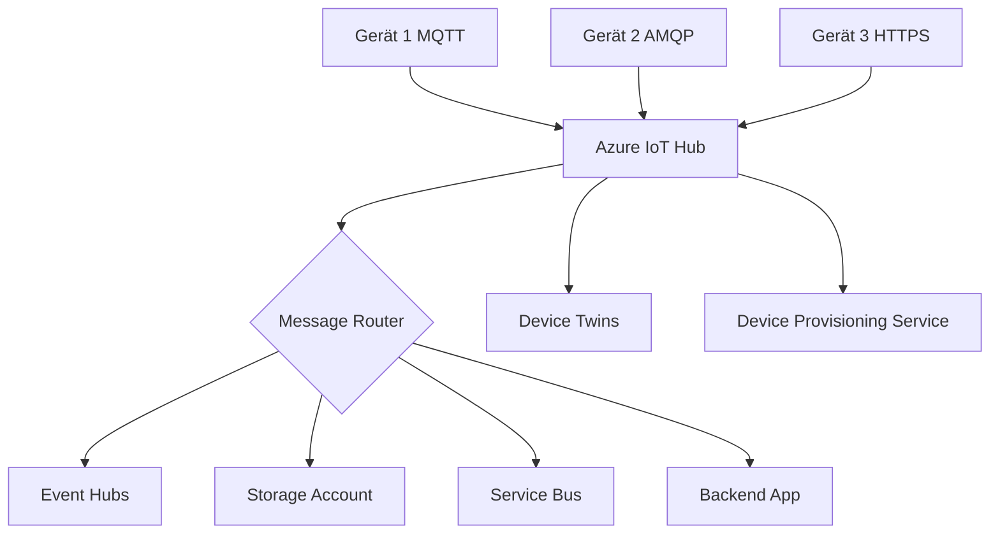
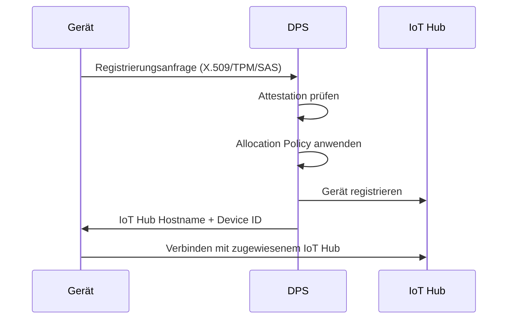
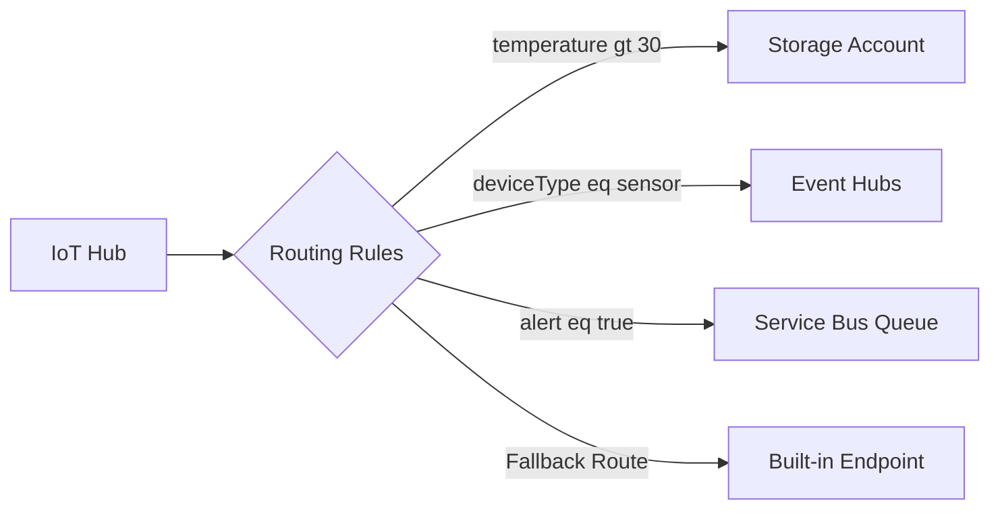

---
tags:
  - azure
  - iot
  - messaging
  - paas
aliases:
  - IoT Hub
  - Azure IoT Hub
---

# Azure IoT Hub

> [!ABSTRACT] TL;DR
> Azure IoT Hub ist ein vollständig verwalteter PaaS-Dienst für bidirektionale Kommunikation zwischen Millionen von IoT-Geräten und der Cloud. Er unterstützt MQTT, AMQP und HTTP und bietet Device Twins, Direktmethoden, DPS und flexibles Message Routing.

---

## Was ist Azure IoT Hub?

Azure IoT Hub ist ein **managed Cloud-Service** von Microsoft für die sichere, zuverlässige und skalierbare Kommunikation zwischen IoT-Geräten und einer Backend-Anwendung. Er fungiert als zentraler Nachrichtenbroker und Geräteverwaltungspunkt.

**Kernfähigkeiten:**

| Fähigkeit | Beschreibung |
|-----------|-------------|
| Bidirektionale Kommunikation | D2C (Telemetrie) und C2D (Befehle, Konfiguration) |
| Geräteverwaltung | Device Twins, Direktmethoden, Jobs |
| Skalierbarkeit | Millionen von Geräten gleichzeitig |
| Protokollunterstützung | MQTT 3.1.1, AMQP 1.0, HTTPS |
| Sicherheit | X.509, SAS Tokens, TPM |
| Routing | Nachrichten an verschiedene Azure-Endpunkte weiterleiten |



> [!NOTE] IoT Hub vs Event Hubs
> IoT Hub enthält einen Event Hub-kompatiblen Endpunkt. Für reine Telemetrie-Ingestion ohne Geräteverwaltung kann auch direkt Event Hubs genutzt werden — aber ohne C2D, Device Twins oder Direktmethoden.

---

---

## Via Azure Portal (UI)

> [!TIP] Schnellzugriff
> [portal.azure.com](https://portal.azure.com) → **IoT Hub** → **+ Erstellen**

### Schritt-für-Schritt

1. **IoT Hub erstellen** – portal.azure.com → "+ Ressource erstellen" → "IoT Hub"
2. **Grundkonfiguration** – Subscription, Resource Group, Region, Hub-Name, Tarif (Free / Basic / Standard)
3. **Zu Ressource wechseln** – "Erstellen" → nach Bereitstellung: Übersicht mit Statistiken
4. **Gerät hinzufügen** – "Geräte" (linke Sidebar) → "+ Gerät hinzufügen" → Geräte-ID und Authentifizierungstyp (SAS / X.509)
5. **Verbindungszeichenfolge kopieren** – Gerät anklicken → Verbindungszeichenfolge für das Gerät kopieren
6. **Device Twin** – Gerät öffnen → "Device Twin" → JSON-Dokument mit gewünschten und gemeldeten Eigenschaften bearbeiten
7. **Nachrichtenrouting** – "Nachrichtenrouting" → "+ Hinzufügen" → Endpunkt und Routen konfigurieren

---

## D2C — Device-to-Cloud Messaging

**D2C-Nachrichten** (Telemetrie) sind die häufigste Kommunikationsform: Geräte senden Sensordaten, Statusmeldungen oder Ereignisse an den IoT Hub.

**Eigenschaften:**
- Maximale Nachrichtengröße: **256 KB**
- Protokolle: MQTT, AMQP, HTTP
- Retention im Event Hub-kompatiblen Endpunkt: **1–7 Tage** (konfigurierbar)
- Throughput: abhängig vom Tier (bis zu 300 Mio. Nachrichten/Tag mit S3)

**Drei D2C-Nachrichtentypen:**

| Typ | Verwendung | Eigenschaften |
|-----|-----------|--------------|
| Telemetry Messages | Häufige Sensordaten | Fire-and-forget, hoher Durchsatz |
| Device Twin Reported Properties | Gerätestatus melden | Persistent, JSON, synchronisiert |
| File Uploads | Große Dateien (Bilder, Logs) | Bis 256 GB via Azure Blob Storage |

**Event Hub-kompatibler Endpunkt:**

Der eingebaute Endpunkt `messages/events` ist Event Hub-kompatibel — bestehende Event Hub SDKs und Consumer Groups funktionieren direkt.

```python
# Python SDK — Telemetrie senden
import asyncio
from azure.iot.device.aio import IoTHubDeviceClient
import json
from datetime import datetime

CONNECTION_STRING = "HostName=myhub.azure-devices.net;DeviceId=sensor01;SharedAccessKey=..."

async def send_telemetry():
    client = IoTHubDeviceClient.create_from_connection_string(CONNECTION_STRING)
    await client.connect()

    payload = {
        "deviceId": "sensor01",
        "temperature": 22.5,
        "humidity": 65.3,
        "timestamp": datetime.utcnow().isoformat()
    }

    message = json.dumps(payload)
    await client.send_message(message)
    print(f"Telemetrie gesendet: {message}")

    await client.disconnect()

asyncio.run(send_telemetry())
```

---

## C2D — Cloud-to-Device Messaging

Drei Methoden für die Kommunikation von der Cloud zum Gerät:

### Direktmethoden (Direct Methods)

Synchrone Anfrage-Antwort-Kommunikation. Das Backend ruft eine Methode auf dem Gerät auf und erhält sofort eine Antwort.

- **Timeout:** 5–300 Sekunden konfigurierbar
- **Payload:** bis 128 KB (Request + Response)
- **Ideal für:** Neustarts, Firmware-Updates auslösen, Konfigurationsänderungen

```python
# Direktmethode empfangen (auf dem Gerät)
async def method_handler(method_request):
    if method_request.name == "reboot":
        print("Neustart wird durchgeführt...")
        response_payload = {"status": "reboot initiated"}
        method_response = MethodResponse.create_from_method_request(
            method_request, 200, response_payload
        )
    await client.send_method_response(method_response)

client.on_method_request_received = method_handler
```

### Device Twin Desired Properties

**Asynchrone** Konfigurationsübermittlung an das Gerät. Wird als gewünschter Zustand gespeichert und beim nächsten Verbindungsaufbau übermittelt.

- Ideal für: Schwellenwerte, Intervalle, Konfigurationsparameter
- Funktioniert auch bei **offline** Geräten (wird bei Reconnect zugestellt)

### C2D Messages

Einfache Nachrichten vom Backend an ein Gerät.

- Maximale Payload: **64 KB**
- Retention im Queue: **48 Stunden** (konfigurierbar, max. 48h)
- Maximale Zustellversuche: 10
- Acknowledgement: none, positive, full

> [!TIP] Wann welche C2D-Methode?
> - **Direktmethoden**: Sofortige Reaktion erforderlich (Gerät muss online sein)
> - **Desired Properties**: Gerät kann offline sein, Konfiguration persistent
> - **C2D Messages**: Einmalige Nachrichten, keine Persistenz nötig

---

## Device Twins

Device Twins sind **JSON-Dokumente** in der Cloud, die den Zustand eines Geräts repräsentieren. Jedes registrierte Gerät hat automatisch einen Device Twin.

```json
{
  "deviceId": "sensor01",
  "etag": "AAAAAAAAAAI=",
  "version": 5,
  "tags": {
    "location": {
      "plant": "Werk-Berlin",
      "floor": 3
    },
    "deviceType": "temperature-sensor"
  },
  "properties": {
    "desired": {
      "telemetryInterval": 30,
      "alertThreshold": 25.0,
      "$metadata": { ... },
      "$version": 3
    },
    "reported": {
      "telemetryInterval": 30,
      "firmwareVersion": "2.4.1",
      "batteryLevel": 87,
      "$metadata": { ... },
      "$version": 5
    }
  }
}
```

**Device Twin Felder:**

| Feld | Beschreibung | Wer schreibt? |
|------|-------------|--------------|
| `tags` | Metadaten (nicht auf Gerät sichtbar) | Backend |
| `desired` properties | Gewünschter Gerätezustand | Backend |
| `reported` properties | Gemeldeter Ist-Zustand | Gerät |
| `etag` | Optimistic Concurrency Control | Automatisch |
| `version` | Versionsnummer (inkrementell) | Automatisch |

> [!NOTE] Module Twins
> IoT Edge-Geräte haben zusätzlich **Module Twins** — einen Twin pro Modul (Container) auf dem Edge-Gerät.

---

## Device Provisioning Service (DPS)

DPS ermöglicht **Zero-Touch-Provisioning** — Geräte registrieren sich automatisch beim richtigen IoT Hub, ohne manuelle Konfiguration.



**Attestation-Methoden:**

| Methode | Sicherheitsstufe | Verwendung |
|---------|-----------------|-----------|
| X.509-Zertifikate | Hoch | Produktionsgeräte, PKI-Infrastruktur |
| TPM (Trusted Platform Module) | Sehr hoch | Hardware-gesicherter Chip |
| Symmetric Key | Mittel | Entwicklung, Test, Legacy-Geräte |

**Enrollment-Typen:**
- **Enrollment Group**: Alle Geräte mit demselben Stammzertifikat (X.509) oder SAS-Schlüssel
- **Individual Enrollment**: Ein spezifisches Gerät (TPM oder X.509 Leaf Certificate)

**Allocation Policies:**
- Gleichmäßige Verteilung (Hashed)
- Niedrigste Latenz (geografisch nächster IoT Hub)
- Statische Konfiguration (immer derselbe IoT Hub)
- Custom (Azure Function)

---

## IoT Hub Tiers und Preise

| Tier | Nachrichten/Tag/Unit | Preis/Unit/Monat | Features |
|------|---------------------|-----------------|---------|
| **Free** | 8.000 | Kostenlos | Alle Standard-Features, max. 1 Hub, 500 Geräte |
| **B1** (Basic) | 400.000 | ~$10 | Nur D2C, kein C2D/Twins |
| **B2** (Basic) | 6 Mio. | ~$50 | Nur D2C, kein C2D/Twins |
| **B3** (Basic) | 300 Mio. | ~$500 | Nur D2C, kein C2D/Twins |
| **S1** (Standard) | 400.000 | ~$25 | Alle Features |
| **S2** (Standard) | 6 Mio. | ~$250 | Alle Features |
| **S3** (Standard) | 300 Mio. | ~$2.500 | Alle Features |

> [!WARNING] Basic Tier Einschränkungen
> Das **Basic Tier** unterstützt **kein** C2D-Messaging, keine Device Twins, keine Direktmethoden und kein Geräteverwaltung. Für vollständige IoT-Lösungen ist mindestens **Standard Tier** erforderlich.

**Nachrichtenabrechnung:**
- Nachrichten werden in **4 KB-Blöcken** abgerechnet (Standard/Basic)
- Eine 6 KB Nachricht = 2 abrechenbare Nachrichteneinheiten
- Free Tier: 0,5 KB-Blöcke

---

## Message Routing

IoT Hub kann eingehende D2C-Nachrichten basierend auf **Routing Queries** an verschiedene Endpunkte weiterleiten.



**Unterstützte Endpunkte:**

| Endpunkt | Verwendung |
|----------|-----------|
| Built-in Event Hub | Standard-Konsumenten (Stream Analytics, Functions) |
| Azure Blob Storage | Langzeitspeicherung, Cold Path Analytics |
| Azure Event Hubs | Weitere Verarbeitungs-Pipelines |
| Azure Service Bus Queue | Zuverlässige Einzel-Consumer |
| Azure Service Bus Topic | Publish-Subscribe-Muster |
| Azure Cosmos DB | Direkte Datenbankschreibvorgänge (2023+) |

**Routing Query Syntax:**

```sql
-- Nur Nachrichten mit Temperatur über 30
$body.temperature > 30

-- Nur von bestimmtem Gerätetyp (aus Twin Tag)
$twin.tags.deviceType = 'temperature-sensor'

-- Kombination
$body.temperature > 30 AND $twin.tags.location.plant = 'Werk-Berlin'
```

### Message Enrichments

Nachrichten können vor dem Routing mit **zusätzlichen Metadaten** angereichert werden:

```json
{
  "key": "deviceLocation",
  "value": "$twin.tags.location",
  "endpointNames": ["storageEndpoint", "eventHubEndpoint"]
}
```

> [!TIP] Fallback Route
> Aktiviere die **Fallback Route** — sie leitet alle Nachrichten weiter, die keiner anderen Routing-Regel entsprechen. Ohne Fallback Route gehen nicht-geroutete Nachrichten verloren.

---

## IoT Hub Jobs

Jobs ermöglichen **Bulk-Operationen** auf mehrere Geräte gleichzeitig:

| Job-Typ | Beschreibung |
|---------|-------------|
| Device Twin Update Job | Desired Properties für viele Geräte gleichzeitig setzen |
| Direct Method Job | Direktmethode auf tausende Geräte parallel aufrufen |
| Import/Export Job | Massenimport oder -export von Gerätedaten |

```python
# Job: Direktmethode auf alle Geräte eines bestimmten Typs
from azure.iot.hub import IoTHubRegistryManager

registry = IoTHubRegistryManager.from_connection_string(HUB_CONNECTION_STRING)

# Twin Query für Job-Target
query = "SELECT * FROM devices WHERE tags.deviceType = 'temperature-sensor'"

job_response = registry.create_job(
    job_id="firmware-update-job-001",
    job_request={
        "jobId": "firmware-update-job-001",
        "type": "scheduleDirectMethod",
        "queryCondition": query,
        "cloudToDeviceMethod": {
            "methodName": "startFirmwareUpdate",
            "payload": {"version": "2.5.0"},
            "responseTimeoutInSeconds": 30
        },
        "startTime": "2025-01-15T10:00:00Z",
        "maxExecutionTimeInSeconds": 3600
    }
)
```

---

## Azure IoT Explorer

**Azure IoT Explorer** ist ein kostenloses Desktop-Tool (Windows/macOS/Linux) zur Verwaltung und Überwachung von IoT Hub-Geräten.

**Funktionen:**
- Geräte auflisten, erstellen, löschen
- Device Twin anzeigen und bearbeiten
- D2C-Telemetrie in Echtzeit empfangen
- Direktmethoden aufrufen
- C2D-Nachrichten senden
- Plug-and-Play (PnP) Modell-Browser

> [!NOTE] Download
> Azure IoT Explorer ist auf GitHub verfügbar: `github.com/Azure/azure-iot-explorer`

---

## SDKs

| Sprache | Paketname | Status |
|---------|----------|--------|
| Python | `azure-iot-device` | GA |
| .NET (C#) | `Microsoft.Azure.Devices.Client` | GA |
| Java | `com.microsoft.azure.sdk.iot:iot-device-client` | GA |
| Node.js | `azure-iot-device` | GA |
| C | Azure IoT C SDK | GA |
| iOS (Swift) | Azure IoT SDK for Swift | Preview |

```bash
# Python SDK installieren
pip install azure-iot-device azure-iot-hub

# Node.js SDK installieren
npm install azure-iot-device azure-iot-device-mqtt
```

---

## Sicherheit

**Geräte-Authentifizierung:**

| Methode | Beschreibung | Empfehlung |
|---------|-------------|-----------|
| X.509-Zertifikate | PKI-basiert, Zertifikat pro Gerät oder CA-Chain | Produktion |
| SAS-Token | Shared Access Signature, zeitbegrenzt | Entwicklung/Test |
| TPM | Hardware Security Module, Attestation via DPS | Hochsicherheit |

**Transport-Sicherheit:**
- Alle Verbindungen via **TLS 1.2** (Minimum)
- TLS 1.3 unterstützt (empfohlen)
- Zertifikat-Pinning möglich

**Netzwerk-Sicherheit:**

```powershell
# IP-Filterregeln konfigurieren
az iot hub update --name myhub \
  --set "properties.ipFilterRules=[{filterName:'Allow-Office',action:'Accept',ipMask:'203.0.113.0/24'}]"

# Private Endpoint erstellen
az network private-endpoint create \
  --name iot-private-ep \
  --resource-group myRG \
  --vnet-name myVNet \
  --subnet mySubnet \
  --private-connection-resource-id /subscriptions/.../providers/Microsoft.Devices/IotHubs/myhub \
  --group-id iotHub \
  --connection-name iot-private-connection
```

---

## IoT Hub vs. IoT Central

| Kriterium | IoT Hub (PaaS) | IoT Central (SaaS) |
|-----------|---------------|-------------------|
| **Infrastruktur-Management** | Selbst verwaltet | Vollständig von Microsoft verwaltet |
| **Flexibilität** | Sehr hoch | Mittel (vordefiniertes Framework) |
| **Zielgruppe** | Entwickler, Architekten | Lösungsersteller, OT-Teams |
| **Dashboard** | Nicht enthalten (eigene Lösung) | Eingebaut |
| **Regeln und Aktionen** | Eigene Implementierung | Eingebaut (Schwellenwert → E-Mail/Webhook) |
| **Datenexport** | Message Routing | Kontinuierlicher Datenexport (CDE) |
| **Customization** | Vollständig | Begrenzt auf UI-Ebene |
| **Time-to-Market** | Länger | Schneller |
| **Kosten** | Per Nachrichten-Unit | Per Gerät/Monat |

> [!TIP] Wann IoT Hub, wann IoT Central?
> - **IoT Hub**: Maßgeschneiderte Lösungen, bestehende Backend-Architektur, maximale Kontrolle, komplexe Routing-Logik
> - **IoT Central**: Schnelle Proof-of-Concepts, standardisierte Geräte-Management-Szenarien, kein eigenes Backend gewünscht

---

## Kosten-Überblick

**IoT Hub Kosten (2024/2025):**
- Tier-Kosten: S1 ~$25/Einheit/Monat bis S3 ~$2.500/Einheit/Monat
- Mehrere Einheiten für mehr Durchsatz skalierbar
- **Nachrichten-Metering:** jede 4 KB = 1 Nachrichteneinheit
- Redundante Hub-Einheiten für hohe Verfügbarkeit empfohlen

**DPS Kosten:**
- ~$0.123 pro 1.000 Registrierungsoperationen
- Re-Provisioning und Updates ebenfalls abrechenbar

**Zusätzliche Kosten:**
- Message Enrichments: keine Extrakosten
- File Uploads: Azure Blob Storage-Kosten
- Private Endpoints: ~$10/Monat pro Endpoint

```powershell
# IoT Hub erstellen (Azure CLI)
az iot hub create \
  --name myhub \
  --resource-group myRG \
  --sku S1 \
  --unit 1 \
  --location westeurope

# Gerät registrieren
az iot hub device-identity create \
  --hub-name myhub \
  --device-id sensor01

# Connection String abrufen
az iot hub device-identity connection-string show \
  --hub-name myhub \
  --device-id sensor01
```

---

## Verwandte Notizen
- [[Azure IoT Central]]
- [[Azure IoT Edge]]
- [[Azure Digital Twins]]
- [[Azure Event Hubs]]
