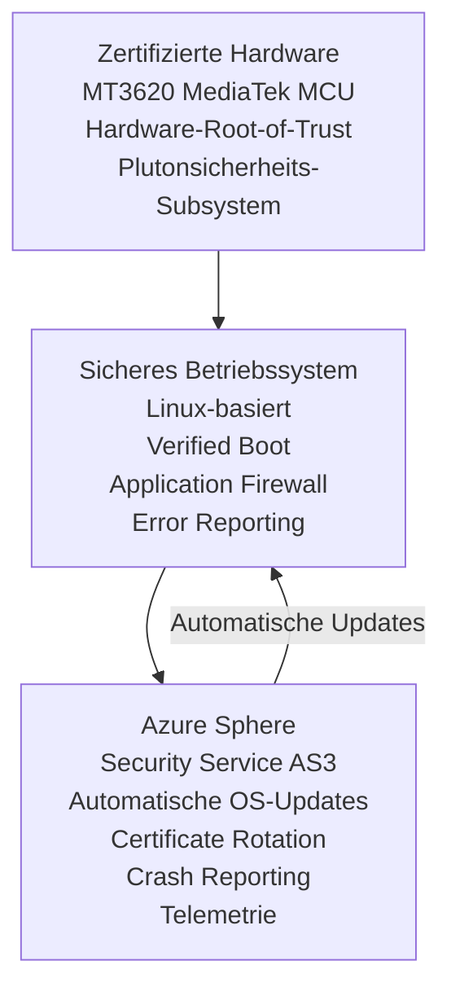
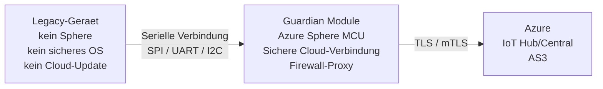
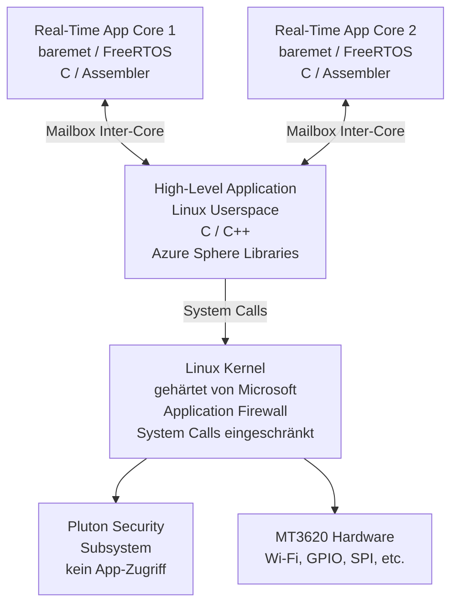
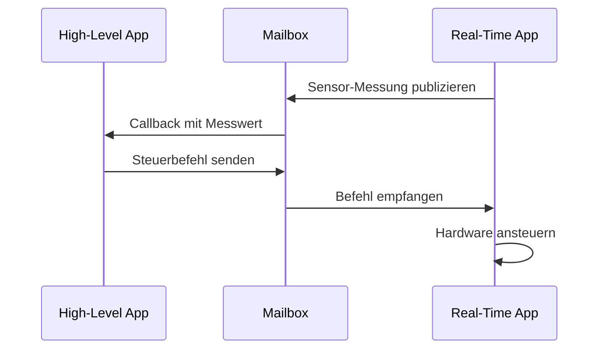
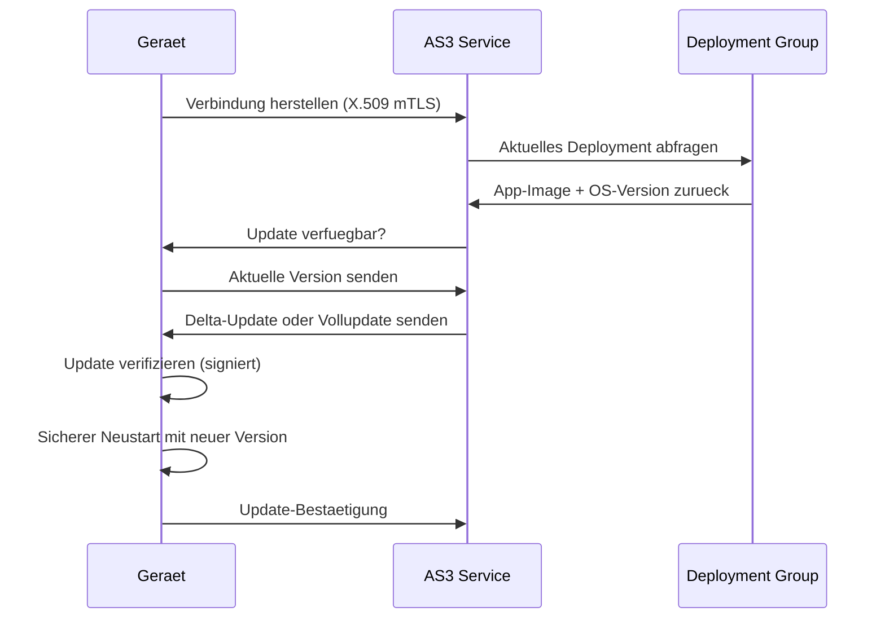
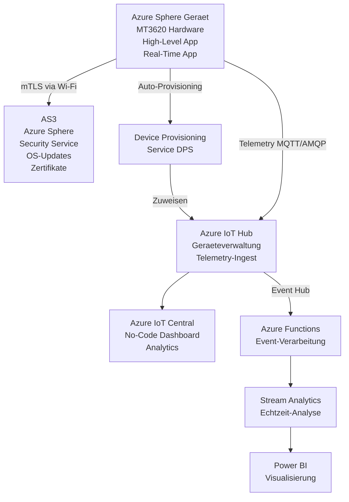

# Azure Sphere

> [!ABSTRACT]
> Azure Sphere ist eine ganzheitliche IoT-Sicherheitsplattform von Microsoft für vernetzte Geräte. Sie kombiniert speziell zertifizierte Hardware (MT3620 MediaTek-Chip), ein gehärtetes Linux-basiertes Betriebssystem und den Azure Sphere Security Service (AS3) zu einer End-to-End-Sicherheitslösung mit 10-jähriger Update-Garantie.

---

## Was ist Azure Sphere?

Azure Sphere adressiert das fundamentale Problem der IoT-Sicherheit: Die meisten Microcontroller-basierten Geräte werden einmal deployed und nie wieder mit Sicherheitsupdates versorgt. Azure Sphere löst dies durch drei untrennbar miteinander verbundene Säulen.

### Die drei Säulen von Azure Sphere



### Sicherheits-Anforderungen nach Microsoft

Microsoft beschreibt 7 Eigenschaften für hochgradig gesicherte Geräte, die alle von Azure Sphere erfüllt werden:

| Eigenschaft | Beschreibung | Azure Sphere Umsetzung |
|---|---|---|
| Hardware Root of Trust | Unveränderliche Vertrauensbasis | Pluton-Sicherheits-Subsystem im MT3620 |
| Defense in Depth | Mehrschichtige Sicherheit | OS-Isolation, App-Firewall, Netzwerk-Firewall |
| Small Trusted Computing Base | Minimale angreifbare Flaeche | Gehärtetes Micro-OS |
| Dynamic Compartments | Isolation zwischen Komponenten | Getrennte Kerne (App, Real-Time, Security) |
| Certificate-based Authentication | Kein Passwort im Gerät | X.509-Zertifikate, automatisch rotiert |
| Renewable Security | Updatebarkeit | AS3 liefert 10 Jahre lang automatisch Updates |
| Failure Reporting | Transparenz über Fehler | Crash Reports an AS3 |

---

## Microcontroller-Ökosystem

### MT3620 Chip-Architektur

Der MediaTek MT3620 ist der erste Azure-Sphere-zertifizierte Chip und enthält:
- **Application Core**: ARM Cortex-A7 (500 MHz) — High-Level Applications
- **Real-Time Cores**: 2x ARM Cortex-M4F (200 MHz) — Real-Time Applications
- **Pluton Security Subsystem**: ARM Cortex-M4 (dediziert für Sicherheit, nicht programmierbar)
- **Connectivity**: 802.11a/b/g/n Wi-Fi (2,4 und 5 GHz), optional Bluetooth 5.0
- **Peripherie**: UART, SPI, I2C, GPIO, ADC, PWM, I2S

> [!IMPORTANT]
> Der **Pluton Security Subsystem** ist vollständig von Microsoft kontrolliert und kann nicht durch Anwendungscode angesprochen werden. Er verwaltet kryptografische Schlüssel, Boot-Verification und die Kommunikation mit AS3. Dies ist eine bewusste Design-Entscheidung für maximale Sicherheit.

### Partner-Hardware (Entwicklungs-Kits)

| Hersteller | Board | Formfaktor | Besonderheit |
|---|---|---|---|
| Seeed Studio | MT3620 Development Board | Full-size Dev Board | Grove-Konnektoren, einsteigerfreundlich |
| Avnet | Azure Sphere MT3620 Starter Kit | Kompaktes Dev Board | Click-Module kompatibel, viele Sensoren |
| AI-Link | WF-M620 | Modul | OEM-Modul fuer Produktintegration |
| Seeed Studio | MT3620 Mini Dev Board | Mini | Platzsparend fuer Prototypen |

### Guardian Module

Das Guardian Module ist eine spezielle Azure Sphere-Konfiguration, um **bestehende Legacy-Geräte** ohne Hardware-Redesign mit Sphere-Sicherheit nachzurüsten.



#### Guardian Module Anwendungsfälle

| Szenario | Legacy-Geraet | Problem ohne Sphere | Sphere-Loesung |
|---|---|---|---|
| Industriemaschinen | SPS / SCADA-Systeme | Keine sichere Cloud-Verbindung | GM als sicherer Gateway-Proxy |
| Medizingeraete | Aeltere Diagnosegeraete | Kein Sicherheits-Update moeglich | GM schützt die Verbindung |
| Energieversorgung | Smart Meter (alt) | Veraltetes Protokoll, unsicher | GM uebersetzt + sichert Kommunikation |
| Gebaeudeautomation | BACnet/Modbus-Systeme | Proprietaere unsichere Protokolle | GM als sicherer Protokoll-Uebersetzer |
| Haushaltsgeraete | Waschmaschinen, Herde | Kein Netzwerk-Stack | GM fuegt sichere Konnektivitaet hinzu |

> [!TIP]
> Guardian Module eignen sich besonders fuer den industriellen Einsatz, wo ein Hardware-Redesign bestehender Maschinen wirtschaftlich nicht vertretbar ist. Die Sphere-Sicherheit wird hinzugefügt, ohne die bestehende Gerätesoftware zu verändern.

---

## Azure Sphere OS

### OS-Architektur

Das Azure Sphere OS ist ein von Microsoft stark gehärtetes Linux-basiertes Betriebssystem. Es ist kein Standard-Linux und bietet absichtlich **keine Shell-Zugriffsmöglichkeit**.



### Sicherheitsmechanismen des OS

| Mechanismus | Beschreibung |
|---|---|
| Verified Boot | Jede Boot-Stufe wird kryptografisch verifiziert |
| Application Firewall | Jede App deklariert Netzwerk-Endpoints explizit (Allowlist) |
| Process Isolation | Apps laufen in separaten Linux-Prozessen mit Namespaces |
| Keine Shell / SSH | Kein interaktiver Zugriff auf das OS nach Deployment |
| Read-only Filesystem | System-Partition ist nicht beschreibbar |
| Signed Updates | OS-Updates werden kryptografisch signiert und verifiziert |

### Capability-basiertes Sicherheitsmodell

Anwendungen müssen alle benötigten Ressourcen und Netzwerkverbindungen explizit in der `app_manifest.json` deklarieren:

```json
{
  "SchemaVersion": 1,
  "Name": "MyIoTApp",
  "ComponentId": "a3ca0929-5f46-42b0-91ba-d5de1222da86",
  "EntryPoint": "/bin/app",
  "CmdArgs": [],
  "Capabilities": {
    "AllowedConnections": [
      "global.azure-devices-provisioning.net",
      "myiothub.azure-devices.net"
    ],
    "DeviceAuthentication": "your-tenant-id-here",
    "Gpio": [8, 9, 10],
    "Uart": ["ISU0"],
    "I2cMaster": ["ISU2"],
    "SpiMaster": ["ISU1"],
    "WifiConfig": true,
    "NetworkConfig": true
  },
  "ApplicationType": "Default"
}
```

> [!WARNING]
> Verbindungen zu Hosts, die **nicht** in `AllowedConnections` aufgelistet sind, werden vom OS-Firewall blockiert — auch wenn der Code versucht, diese Verbindung herzustellen. Dies ist eine fundamentale Sicherheitseigenschaft und kann nicht umgangen werden.

---

## AS3 – Azure Sphere Security Service

### Funktionsumfang von AS3

AS3 ist ein Cloud-Service, der vollständig von Microsoft betrieben wird und Teil jedes Azure-Abonnements ist.

| Funktion | Beschreibung |
|---|---|
| Automatische OS-Updates | Sphere-Geraete empfangen OS-Patches automatisch ueber AS3 |
| Certificate Rotation | X.509-Geraetezertifikate werden automatisch und transparent erneuert |
| Crash Reporting | Anwendungsabstuerze werden anonymisiert an AS3 gemeldet |
| Telemetrie | Gerätezustandsdaten werden von AS3 erfasst |
| Deployment Groups | Kontrolliertes Rollout von App-Updates an Geraetegruppen |
| Device Authentication | Geraete authentifizieren sich gegenueber AS3 beim ersten Start |

### Deployment Groups

Deployment Groups erlauben kontrollierte Software-Rollouts:

```bash
# Deployment Group erstellen
azsphere device-group create \
  --name production-group \
  --product myProduct \
  --description "Produktions-Geraete"

# Deployment fuer Group erstellen
azsphere deployment create \
  --product myProduct \
  --device-group production-group \
  --deployed-files myapp.imagepackage

# Geraet einer Group zuweisen
azsphere device update \
  --device <geraete-id> \
  --device-group production-group
```

> [!NOTE]
> AS3 ist in Azure-Abonnements **kostenlos enthalten** — es fällt keine separate Gebühr für AS3 an. Die Kosten entstehen durch nachgelagerte Azure-Dienste (IoT Hub, IoT Central etc.), falls diese genutzt werden.

---

## Anwendungsentwicklung

### High-Level App vs. Real-Time App

| Merkmal | High-Level App | Real-Time App |
|---|---|---|
| **Prozessor** | ARM Cortex-A7 (Application Core) | ARM Cortex-M4F (Real-Time Core) |
| **Betriebssystem** | Linux Userspace (durch Sphere OS) | Bare Metal oder FreeRTOS |
| **Programmiersprache** | C, C++ | C, C++ (Assembler moeglich) |
| **Netzwerkzugang** | Ja (HTTPS, MQTT, WebSocket, etc.) | Nein (kein direkter Netzwerkzugriff) |
| **Cloud-Verbindung** | Direkt (IoT Hub, IoT Central, REST) | Nur ueber High-Level App via Mailbox |
| **Echtzeit-Anforderungen** | Gering (Linux-Scheduling) | Hoch (deterministisch, Interrupts) |
| **Hardware-Zugriff** | Ueber Sphere-APIs (Abstraktion) | Direkt auf Peripherie (Register) |
| **Typische Aufgaben** | Cloud-Kommunikation, UI, Logik | Sensor-Polling, PWM, schnelle Regelung |
| **Debugging** | JTAG / Visual Studio Attached | OpenOCD / JTAG |

### Inter-Core Communication

High-Level Apps und Real-Time Apps kommunizieren über einen Mailbox-Mechanismus:



---

## C Code — High-Level App Beispiel

### Vollstaendige High-Level App mit IoT Hub Verbindung

```c
#include <stdlib.h>
#include <stdio.h>
#include <string.h>
#include <time.h>
#include <applibs/log.h>
#include <applibs/gpio.h>
#include <applibs/networking.h>
#include "iothub_device_client_ll.h"
#include "iothub_message.h"
#include "azure_sphere_provisioning.h"

// GPIO-Pin fuer Status-LED (Seeed Development Board)
static const int statusLedGpio = 9;
static int ledFd = -1;
static IOTHUB_DEVICE_CLIENT_LL_HANDLE iothubClientHandle = NULL;

// Callback: Eingehende Cloud-to-Device Nachricht
static IOTHUBMESSAGE_DISPOSITION_RESULT MessageReceivedCallback(
    IOTHUB_MESSAGE_HANDLE message,
    void* userContextCallback)
{
    const unsigned char* buffer;
    size_t size;

    if (IoTHubMessage_GetByteArray(message, &buffer, &size) == IOTHUB_MESSAGE_OK) {
        Log_Debug("[IoT] Nachricht empfangen: %.*s\n", (int)size, buffer);

        // LED steuern basierend auf Nachricht
        if (strncmp((char*)buffer, "LED_ON", size) == 0) {
            GPIO_SetValue(ledFd, GPIO_Value_Low);  // Active Low
            Log_Debug("[GPIO] LED eingeschaltet\n");
        } else if (strncmp((char*)buffer, "LED_OFF", size) == 0) {
            GPIO_SetValue(ledFd, GPIO_Value_High);
            Log_Debug("[GPIO] LED ausgeschaltet\n");
        }
    }
    return IOTHUBMESSAGE_ACCEPTED;
}

// Callback: Nachrichtenversand bestaetigt
static void SendConfirmationCallback(
    IOTHUB_CLIENT_CONFIRMATION_RESULT result,
    void* userContextCallback)
{
    if (result == IOTHUB_CLIENT_CONFIRMATION_OK) {
        Log_Debug("[IoT] Nachricht erfolgreich gesendet\n");
    } else {
        Log_Debug("[IoT] Fehler beim Senden: %d\n", result);
    }
}

// Verbindung zu IoT Hub herstellen (ueber Device Provisioning Service)
static bool ConnectToIoTHub(void)
{
    AZURE_SPHERE_PROV_RETURN_VALUE provResult =
        IoTHubDeviceClient_LL_CreateWithAzureSphereDeviceAuthProvisioning(
            "global.azure-devices-provisioning.net",
            10000,
            &iothubClientHandle);

    if (provResult.result != AZURE_SPHERE_PROV_RESULT_OK) {
        Log_Debug("[IoT] Verbindung fehlgeschlagen: %d\n", provResult.result);
        return false;
    }

    // Message-Callback registrieren
    IoTHubDeviceClient_LL_SetMessageCallback(
        iothubClientHandle,
        MessageReceivedCallback,
        NULL);

    Log_Debug("[IoT] Verbindung zu IoT Hub hergestellt\n");
    return true;
}

// Temperaturwert simulieren und als Telemetry senden
static void SendTelemetry(float temperature, float humidity)
{
    char messageBuffer[128];
    snprintf(messageBuffer, sizeof(messageBuffer),
        "{\"temperature\": %.2f, \"humidity\": %.2f}",
        temperature, humidity);

    IOTHUB_MESSAGE_HANDLE messageHandle =
        IoTHubMessage_CreateFromString(messageBuffer);

    if (messageHandle == NULL) {
        Log_Debug("[IoT] Fehler beim Erstellen der Nachricht\n");
        return;
    }

    // Eigenschaften setzen
    IoTHubMessage_SetProperty(messageHandle, "contentType", "application/json");
    IoTHubMessage_SetProperty(messageHandle, "deviceType", "AzureSphere");

    IoTHubDeviceClient_LL_SendEventAsync(
        iothubClientHandle,
        messageHandle,
        SendConfirmationCallback,
        NULL);

    IoTHubMessage_Destroy(messageHandle);
    Log_Debug("[IoT] Telemetrie gesendet: Temp=%.2f, Hum=%.2f\n",
        temperature, humidity);
}

int main(void)
{
    Log_Debug("[App] Azure Sphere IoT Hub App gestartet\n");

    // GPIO initialisieren
    ledFd = GPIO_OpenAsOutput(statusLedGpio, GPIO_OutputMode_PushPull, GPIO_Value_High);
    if (ledFd < 0) {
        Log_Debug("[GPIO] Fehler beim Oeffnen von GPIO %d\n", statusLedGpio);
        return -1;
    }

    // Warten bis Netzwerk verfuegbar
    bool networkReady = false;
    while (!networkReady) {
        Networking_IsNetworkingReady(&networkReady);
        if (!networkReady) {
            Log_Debug("[Net] Warte auf Netzwerkverbindung...\n");
            struct timespec sleepTime = {.tv_sec = 1, .tv_nsec = 0};
            nanosleep(&sleepTime, NULL);
        }
    }
    Log_Debug("[Net] Netzwerk bereit\n");

    // IoT Hub Verbindung herstellen
    if (!ConnectToIoTHub()) {
        return -1;
    }

    // Hauptschleife: Telemetrie alle 30 Sekunden senden
    float simulatedTemp = 20.0f;
    float simulatedHum = 50.0f;
    int counter = 0;

    while (true) {
        IoTHubDeviceClient_LL_DoWork(iothubClientHandle);

        if (counter % 30 == 0) {
            // Sensor-Werte simulieren (in echter App: echter Sensor)
            simulatedTemp += (float)(rand() % 3 - 1) * 0.5f;
            simulatedHum += (float)(rand() % 3 - 1) * 1.0f;
            SendTelemetry(simulatedTemp, simulatedHum);
        }

        counter++;
        struct timespec sleepTime = {.tv_sec = 1, .tv_nsec = 0};
        nanosleep(&sleepTime, NULL);
    }

    // Aufraeumen
    IoTHubDeviceClient_LL_Destroy(iothubClientHandle);
    close(ledFd);
    return 0;
}
```

> [!NOTE]
> Azure Sphere nutzt den **Device Provisioning Service (DPS)** automatisch über die Sphere-Plattform. Die Geräteauthentifizierung erfolgt über X.509-Zertifikate, die vom Pluton-Subsystem verwaltet werden — kein manuelles Zertifikatsmanagement im Code notwendig.

---

## Entwicklungsumgebung und SDK

### Voraussetzungen

```bash
# Azure Sphere SDK installieren (Windows)
# Download von: https://aka.ms/AzureSphereSDKDownload

# Azure Sphere CLI nach Installation verfuegbar
azsphere --version

# Alternativ: Visual Studio Code mit Azure Sphere Extension
# Extension ID: ms-vscode.azure-sphere
```

### CMakeLists.txt fuer High-Level App

```cmake
cmake_minimum_required(VERSION 3.10)
project(MyIoTApp C)

# Azure Sphere SDK konfigurieren
find_package(AzureSphereSDK REQUIRED)

# Executable definieren
add_executable(${PROJECT_NAME} main.c)

# Target-Konfiguration fuer Sphere
target_link_libraries(${PROJECT_NAME}
    applibs
    pthread
    gcc_s
    c
    iothub_client_core_common
    iothub_client_ll_telemetry_sample
    azureiotcommon
    azure_prov_client
    hsm_custom
)

# App-Manifest setzen
azsphere_target_add_image_package(${PROJECT_NAME}
    RESOURCE_FILES "app_manifest.json"
)
```

### CLI-Workflow: Entwicklung bis Deployment

```bash
# Gerät mit PC verbinden und Recovery Mode aktivieren
azsphere device recover

# Geraeteinformationen abrufen
azsphere device show-attached

# App auf Geraet laden (Sideload fuer Development)
azsphere device sideload deploy --image-package build/MyIoTApp.imagepackage

# App-Logs in Echtzeit anzeigen
azsphere device app show-status
azsphere device app show-log

# Production-Image erstellen und signieren
azsphere image add --image build/MyIoTApp.imagepackage

# Deployment in Produktionsgruppe erstellen
azsphere deployment create \
  --product myProduct \
  --device-group production-group \
  --deployed-files build/MyIoTApp.imagepackage
```

> [!TIP]
> Während der Entwicklung kann das Gerät im **Development Mode** betrieben werden, der Sideloading erlaubt. Im Production Mode (nach Deployment) ist nur noch signierter Code von AS3 ausführbar. Der Wechsel zwischen den Modi erfolgt über `azsphere device enable-development` und `azsphere device enable-cloud-test`.

---

## Over-the-Air Updates

### Update-Mechanismus



### Update-Konfiguration in app_manifest.json

```json
{
  "SchemaVersion": 1,
  "Name": "MyIoTApp",
  "ComponentId": "a3ca0929-5f46-42b0-91ba-d5de1222da86",
  "EntryPoint": "/bin/app",
  "CmdArgs": [],
  "Capabilities": {
    "AllowedConnections": [
      "global.azure-devices-provisioning.net",
      "myiothub.azure-devices.net"
    ],
    "DeviceAuthentication": "your-tenant-id-here"
  },
  "ApplicationType": "Default"
}
```

---

## Anwendungsfälle und Branchen

### Industrie-IoT (IIoT)

Sphere schützt Industriemaschinen, die über Jahrzehnte betrieben werden, vor Cyberangriffen:
- CNC-Maschinen mit Netzwerkkonnektivität
- Robotersteuerungen in Fertigungslinien
- Pumpen und Kompressoren in der Prozessindustrie

### Kritische Infrastruktur

| Sektor | Geraet | Sicherheitsrisiko | Sphere-Schutz |
|---|---|---|---|
| Energieversorgung | Smart Meter, RTU | Manipulation, Spionage | Sichere Cloud-Verbindung, kein Shell-Zugriff |
| Wasserversorgung | Pumpensteuerungen | Sabotage durch Angreifer | Application Firewall, Verified Boot |
| Telekommunikation | Edge-Router, Repeater | Man-in-the-Middle | mTLS, Certificate Rotation |
| Gesundheitswesen | Medizingeraete, Monitore | Datenschutzverletzung | OS-Isolation, Audit Logs |

### Connected Assets

Sphere eignet sich fuer Assets, die unbeaufsichtigt im Feld betrieben werden:
- Windkraftanlagen-Steuerungen
- Solarwechselrichter
- Fernüberwachung von Pipelines

> [!DANGER]
> Sphere-Geräte im **Production Mode** können **nicht mehr gesideloaded** werden — nur noch Updates über AS3 sind möglich. Dies ist eine bewusste Sicherheitsentscheidung. Stelle sicher, dass dein Deployment-Workflow vor dem Übergang zu Production vollständig getestet ist.

---

## Integration mit Azure-Diensten

### Vollstaendige Architektur



### Microsoft Defender for IoT Integration

Azure Sphere kann mit Microsoft Defender for IoT integriert werden:
- Anomalie-Erkennung basierend auf Geräteverhalten
- Sicherheitswarnungen direkt im Azure Security Center
- Integration mit SIEM-Systemen (Azure Sentinel / Microsoft Sentinel)

```bash
# Defender for IoT Sensor auf Sphere-Geraete anwenden
# (erfolgt ueber Deployment Groups in AS3)
azsphere device-group update \
  --device-group production-group \
  --allow-crash-dumps-upload Enabled
```

---

## Kosten

| Komponente | Kosten | Hinweis |
|---|---|---|
| MT3620 Development Kit (Seeed) | ca. 50–80 USD | Einmalige Hardware-Kosten |
| MT3620 Development Kit (Avnet) | ca. 50–90 USD | Einmalige Hardware-Kosten |
| Production Module (OEM) | ca. 10–15 USD/Stueck | Abhaengig von Stueckzahl |
| AS3 Security Service | Kostenlos | In Azure-Abonnement enthalten |
| IoT Hub (Standard S1) | ~10 USD/Monat | Pro 400.000 Nachrichten/Tag |
| IoT Central | ~0,70 USD/Geraet/Monat | Ab 2 Geraeten |
| Lifetime-Updates | Kostenlos (10 Jahre) | Ueber AS3 |

> [!IMPORTANT]
> Microsoft garantiert **10 Jahre lang kostenlose automatische Sicherheitsupdates** fuer alle Azure Sphere-Geraete über AS3. Diese Garantie gilt ab dem Zeitpunkt, wenn ein Chip-Typ in das Azure Sphere Catalog aufgenommen wird. Dies ist ein einzigartiges Merkmal im IoT-Markt.

---

## Sicherheits-Best-Practices

> [!TIP]
> **Minimale Capabilities**: Deklariere in `app_manifest.json` nur die Ressourcen, die deine App tatsächlich benötigt. Jede unnötige Capability erhöht die Angriffsfläche.

> [!TIP]
> **Deployment Groups nutzen**: Nutze mehrere Deployment Groups (z. B. `dev`, `staging`, `production`) um App-Updates stufenweise auszurollen und Fehler frühzeitig zu erkennen.

> [!WARNING]
> **Keine Secrets im Code**: Da Sphere-Geräte X.509-Zertifikate für die Authentifizierung nutzen, sind hartkodierte Passwörter oder Connection Strings unnötig und unsicher. Nutze immer `DeviceAuthentication` über AS3.

> [!WARNING]
> **Inter-Core Validierung**: Validiere alle Daten, die von einer Real-Time App über den Mailbox-Mechanismus empfangen werden. Ein Fehler in der Real-Time App kann fehlerhafte Daten liefern.

---

## CLI-Schnellreferenz

```bash
# Geraet-Management
azsphere device show-attached                          # Verbundenes Geraet anzeigen
azsphere device show-deployment-status                # Deployment-Status pruefen
azsphere device enable-development                    # Development Mode aktivieren
azsphere device recover                               # Geraet in Recovery Mode setzen

# App-Management
azsphere device sideload deploy --image-package <pfad>  # App laden (nur Dev Mode)
azsphere device app show-status                        # App-Status anzeigen
azsphere device app stop --component-id <id>           # App stoppen
azsphere device app start --component-id <id>          # App starten

# Produkt- und Deployment-Management
azsphere product create --name <name>                  # Produkt erstellen
azsphere device-group create --name <name> --product <produkt>  # Gruppe erstellen
azsphere deployment create --product <p> --device-group <g> --deployed-files 

# Geraet Gruppe zuweisen
azsphere device update --device-group <group> --product <product>

# Zertifikat-Management
azsphere ca-certificate download --destination ca-cert.cer
azsphere tenant download-ca-certificate --destination tenant-ca.p7b
```

---

## Verwandte Notizen

- [[Azure IoT Hub]]
- [[Azure IoT Edge]]
- [[Azure IoT Central]]
