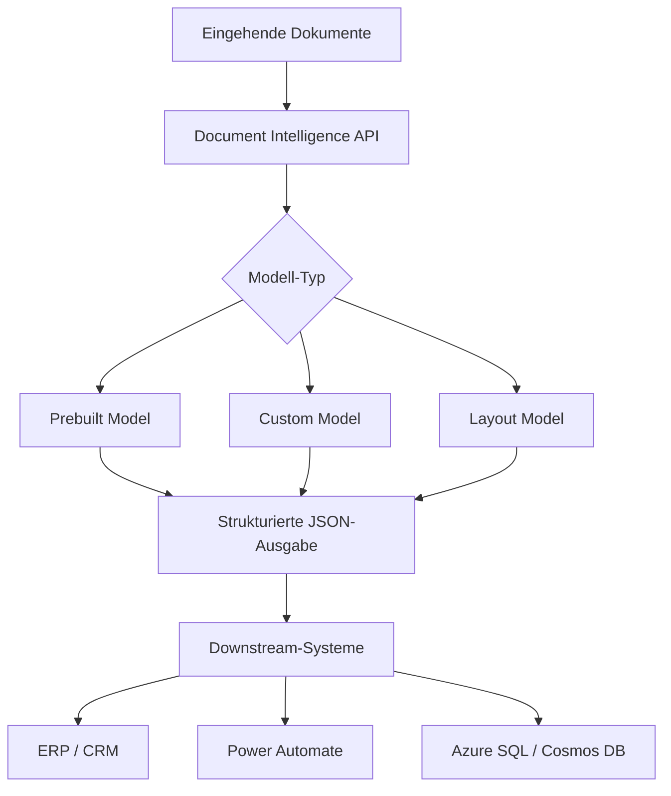
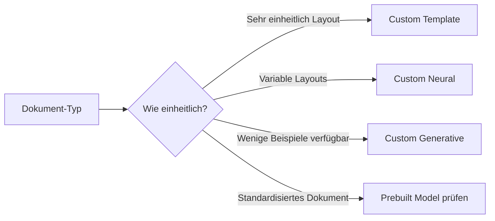
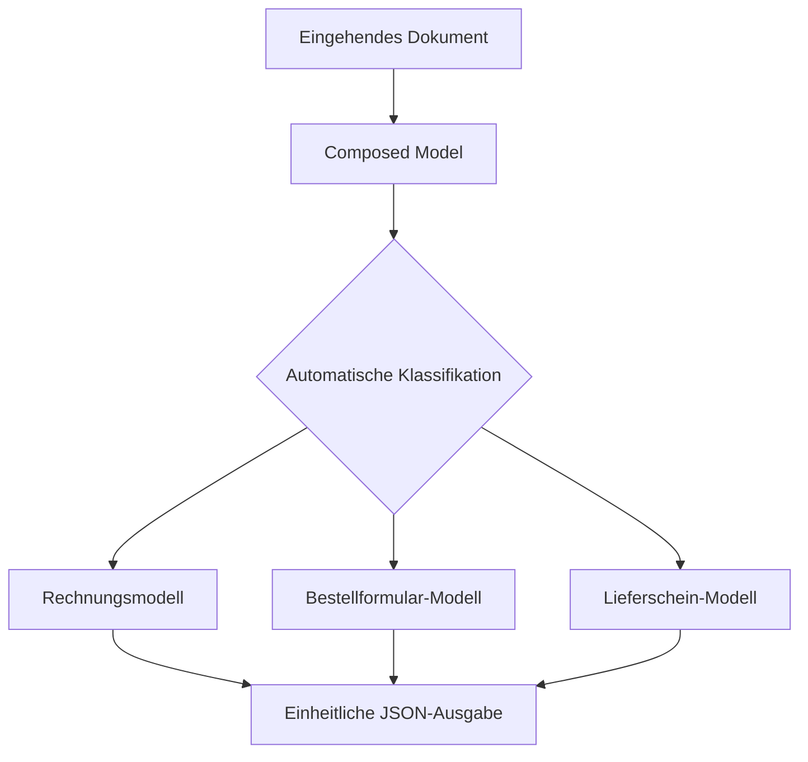
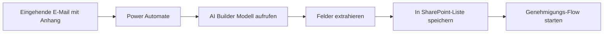

---
tags:
  - azure
  - ki
  - document-intelligence
  - ocr
aliases:
  - Form Recognizer
  - Azure Form Recognizer
  - Document Intelligence
---

# Azure AI Document Intelligence

> [!ABSTRACT] TL;DR
> Azure AI Document Intelligence (ehem. Form Recognizer) extrahiert strukturierte Daten aus Dokumenten per KI — Rechnungen, Ausweise, Verträge und mehr. Prebuilt Models sofort einsatzbereit, Custom Models für eigene Formulare trainierbar.

---

## Was ist Azure AI Document Intelligence?

**Azure AI Document Intelligence** ist ein cloudbasierter KI-Dienst zum automatischen Extrahieren von Text, Schlüssel-Wert-Paaren, Tabellen und strukturierten Daten aus Dokumenten (PDFs, Scans, Bilder).

### Anwendungsfälle

| Branche | Anwendungsfall |
|---------|---------------|
| **Finanzen** | Rechnungsverarbeitung, Kreditantragsformulare |
| **Versicherung** | Schadensmeldungen, Policen extrahieren |
| **Gesundheit** | Krankenversicherungskarten, Rezepte |
| **Steuern** | W-2, Steuerdokumente automatisch verarbeiten |
| **Logistik** | Lieferscheine, Frachtbriefe |
| **Behörden** | Ausweise, Pässe verarbeiten |



---

---

## Via Azure Portal (UI)

> [!TIP] Schnellzugriff
> [portal.azure.com](https://portal.azure.com) → **Dokumentintelligenz** → **+ Erstellen** → **Studio öffnen**

### Schritt-für-Schritt

1. **Ressource erstellen** – portal.azure.com → "+ Ressource erstellen" → "Dokumentintelligenz" suchen → + Erstellen
2. **Grundkonfiguration** – Subscription, Resource Group, Region, Name, Tarif (Free F0 / Standard S0)
3. **Studio öffnen** – Nach Bereitstellung: "Document Intelligence Studio öffnen" (documentintelligence.ai.azure.com)
4. **Prebuilt Model testen** – Studio → Prebuilt Models → Dokument hochladen → Modell wählen (Invoice, Receipt, ID Document, etc.) → Analysieren
5. **Custom Model erstellen** – Studio → Custom Models → "+ Projekt erstellen" → Training-Dokumente hochladen → Felder labeln → Trainieren
6. **Composed Model** – Studio → Composed Model: Mehrere Custom Models kombinieren
7. **API-Key kopieren** – portal.azure.com → Ressource → "Schlüssel und Endpunkt"

---

## Prebuilt Models

Microsoft bietet vortrainierte Modelle für häufige Dokumenttypen:

### Finanz-Dokumente

| Modell | Extrahierte Felder |
|--------|------------------|
| **Invoice** | Lieferant, Rechnungsnummer, Datum, Positionen, Steuern, Betrag |
| **Receipt** | Händlername, Datum, Artikel, Gesamtbetrag, Steuern |
| **Credit Card** | Karteninhaber, Kartennummer (letzte 4), Ablaufdatum |

### Identitätsdokumente

| Modell | Extrahierte Felder |
|--------|------------------|
| **ID Document** | Name, Geburtsdatum, Ablaufdatum, ID-Nummer, Nationalität |
| **Passport** | Alle MRZ-Felder, Visuminformationen |
| **Driver License** | Führerscheinklasse, Austellungsdaten |

### Business-Dokumente

| Modell | Extrahierte Felder |
|--------|------------------|
| **Business Card** | Name, Firma, Telefon, E-Mail, Adresse |
| **Contract** | Parteien, Datum, Vertragslaufzeit, Klauseln |
| **Check** | Betrag, Datum, Empfänger, Kontonummer |
| **W-2** | Arbeitgeber-EIN, Löhne, Steuereinbehalte |
| **Health Insurance Card** | Mitgliedsnummer, Gruppenname, Ablaufdatum |

> [!NOTE] Modellverfügbarkeit
> Die Verfügbarkeit von Prebuilt Models variiert je nach Region. Neue Modelle werden laufend hinzugefügt — aktuell sind über 20 Prebuilt Models verfügbar.

---

## Custom Models

Für proprietäre Formulare und Dokumente können eigene Modelle trainiert werden:

### Custom Template Model

- **Geeignet für:** Einheitliche, strukturierte Formulare (z.B. immer gleiche Steuerformulare)
- **Trainingsbeispiele:** Mindestens 5 Dokumente (empfohlen: 10–20)
- **Methode:** Regel-basiertes Layout-Erkennen mit KI-Unterstützung
- **Stärke:** Sehr präzise bei konsistenten Layouts

### Custom Neural Model

- **Geeignet für:** Diverse Dokumentvarianten (z.B. Rechnungen verschiedener Lieferanten)
- **Trainingsbeispiele:** Mindestens 10 Dokumente (empfohlen: 50–100)
- **Methode:** Deep-Learning-basiert, robust gegenüber Layoutvariationen
- **Stärke:** Generalisiert über verschiedene Formatlayouts

### Custom Generative Model (2024 GA)

- **Geeignet für:** Wenige Trainingsbeispiele (1–3 Dokumente)
- **Methode:** Nutzt GPT-Vision für Zero-/Few-Shot-Extraktion
- **Stärke:** Kein aufwändiges Labeling erforderlich
- **Einschränkung:** Weniger deterministisch als Template/Neural



---

## Composed Models

**Composed Models** kombinieren mehrere Custom Models zu einem einzigen Endpunkt:



- Bis zu **100 Custom Models** können zu einem Composed Model zusammengefasst werden
- Automatische Dokumentklassifikation und Routing
- Ein einziger API-Endpunkt für alle Dokumenttypen

---

## Document Analysis API (Layout)

Das **Layout-Modell** extrahiert alle Dokumentelemente ohne domänenspezifische Felder:

| Extrahiertes Element | Beschreibung |
|---------------------|-------------|
| **Text** | Alle Wörter mit Bounding Boxes und Confidence |
| **Paragraphs** | Logische Textabsätze |
| **Tables** | Tabellenstruktur mit Zellen und Spans |
| **Figures** | Bilder und Grafiken mit Positionen |
| **Formulas** | Mathematische Formeln |
| **Barcodes** | QR-Codes, Barcodes, Data Matrix |
| **Selection Marks** | Checkboxes, Radio Buttons |
| **Sections** | Dokumentstruktur und Hierarchie |

```python
from azure.ai.documentintelligence import DocumentIntelligenceClient
from azure.core.credentials import AzureKeyCredential

client = DocumentIntelligenceClient(
    endpoint="https://<resource>.cognitiveservices.azure.com/",
    credential=AzureKeyCredential("<api-key>")
)

with open("dokument.pdf", "rb") as f:
    poller = client.begin_analyze_document(
        model_id="prebuilt-layout",
        analyze_request=f,
        content_type="application/pdf"
    )

result = poller.result()

for page in result.pages:
    for line in page.lines:
        print(line.content)

for table in result.tables:
    for cell in table.cells:
        print(f"Zeile {cell.row_index}, Spalte {cell.column_index}: {cell.content}")
```

---

## Prebuilt Invoice — Beispiel

```python
poller = client.begin_analyze_document(
    model_id="prebuilt-invoice",
    analyze_request={"urlSource": "https://example.com/rechnung.pdf"}
)

result = poller.result()

for invoice in result.documents:
    fields = invoice.fields
    vendor = fields.get("VendorName")
    total = fields.get("InvoiceTotal")
    date = fields.get("InvoiceDate")
    
    print(f"Lieferant: {vendor.value_string if vendor else 'N/A'}")
    print(f"Betrag: {total.value_currency if total else 'N/A'}")
    print(f"Datum: {date.value_date if date else 'N/A'}")
    print(f"Confidence: {total.confidence:.2f}")
```

---

## Add-on Capabilities

Ab API-Version 2024-02-29-preview verfügbar:

| Add-on | Beschreibung | Kosten |
|--------|-------------|--------|
| **OCR High Resolution** | Verbesserte Erkennung kleiner Texte und Handschriften | Extra |
| **Barcodes** | QR-Codes, Data Matrix, Code 128 extrahieren | Extra |
| **Formulas** | LaTeX-Mathematikformeln erkennen | Extra |
| **Font/Style** | Schriftstil (fett, kursiv, Schriftgröße) extrahieren | Extra |
| **Languages** | Mehrsprachige Dokumente segmentieren | Extra |

```python
poller = client.begin_analyze_document(
    model_id="prebuilt-layout",
    analyze_request=f,
    features=["barcodes", "formulas", "highResolution"]
)
```

---

## Confidence Scores und Bounding Boxes

Jedes extrahierte Element enthält:

```json
{
  "content": "Microsoft Azure",
  "confidence": 0.98,
  "boundingRegions": [
    {
      "pageNumber": 1,
      "polygon": [100, 200, 300, 200, 300, 220, 100, 220]
    }
  ]
}
```

| Confidence | Empfehlung |
|-----------|-----------|
| > 0.90 | Automatisch akzeptieren |
| 0.70 – 0.90 | Manuelles Review empfohlen |
| < 0.70 | Manuelle Prüfung erforderlich |

---

## Azure AI Document Intelligence Studio

Das **Document Intelligence Studio** ermöglicht die browserbasierte Nutzung:

- **Testen:** Dokumente hochladen und Modelle direkt testen
- **Labeling:** Benutzerdefinierte Modelle visuell beschriften
- **Training:** Custom Models ohne Code trainieren
- **Deployment:** Trainierte Modelle direkt deployen

URL: `https://documentintelligence.ai.azure.com/`

---

## REST API

```bash
curl -X POST \
  "https://<resource>.cognitiveservices.azure.com/documentintelligence/documentModels/prebuilt-invoice:analyze?api-version=2024-02-29-preview" \
  -H "Ocp-Apim-Subscription-Key: <api-key>" \
  -H "Content-Type: application/json" \
  -d '{"urlSource": "https://example.com/invoice.pdf"}'
```

Das Ergebnis ist asynchron — die Operation-ID aus dem `Operation-Location` Header wird für das Abrufen des Ergebnisses genutzt.

---

## Integration mit Azure-Diensten

| Dienst | Integrationsmuster |
|--------|------------------|
| **Power Automate** | Connector: AI Builder — Document Processing |
| **Logic Apps** | Custom Connector oder HTTP-Trigger |
| **Azure Functions** | Event-gesteuerte Verarbeitung (Blob-Upload-Trigger) |
| **Azure Synapse** | Batch-Verarbeitung großer Dokumentmengen |
| **Azure AI Search** | Extrahierte Felder indizieren und durchsuchbar machen |

### Power Automate Workflow



---

## Kosten

| Kategorie | Preis (ca.) |
|-----------|------------|
| **Layout** | $1,50 / 1.000 Seiten |
| **Prebuilt (Invoice, Receipt)** | $10,00 / 1.000 Seiten |
| **Custom (Training)** | $10,00 pro Training |
| **Custom (Prediction)** | $40,00 / 1.000 Seiten |
| **Add-ons** | $0,50 – $2,00 / 1.000 Seiten extra |

> [!TIP] Kostenoptimierung
> Layout-Modell für einfache OCR-Extraktion nutzen (günstiger). Prebuilt oder Custom Models nur wenn strukturierte Feld-Extraktion benötigt wird.

---

## Verwandte Notizen
- [[Azure AI Services]]
- [[Azure AI Search]]
- [[Azure AI Foundry]]
- [[Azure KI Zusammenfassung]]
