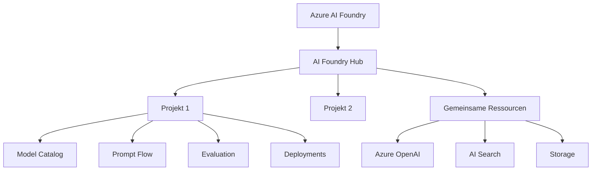
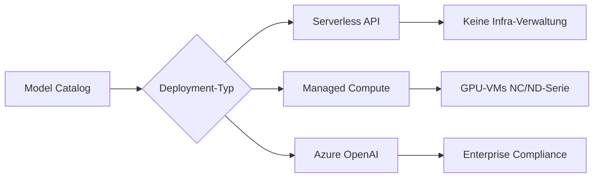
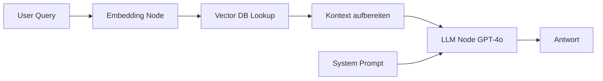
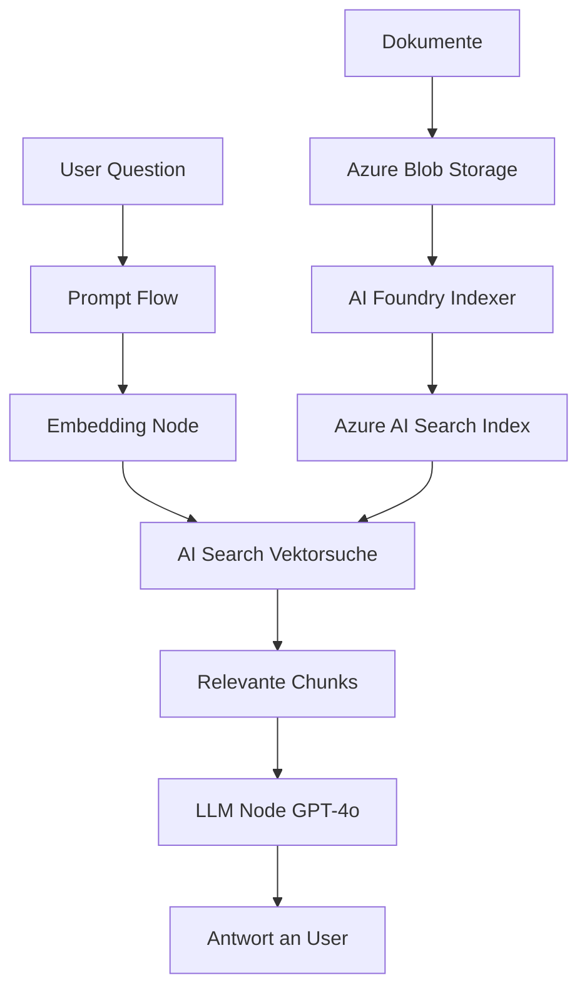

---
tags:
  - azure
  - ki
  - machine-learning
  - ai-foundry
aliases:
  - AI Foundry
  - Azure AI Studio
---

# Azure AI Foundry

> [!ABSTRACT] TL;DR
> Azure AI Foundry (ehem. Azure AI Studio) ist Microsofts unified AI-Entwicklungsplattform für Enterprise-KI: Model Catalog mit 1.900+ Modellen, Prompt Flow für LLM-Pipelines, Evaluation, Fine-Tuning und Deployment — alles in einer Plattform.

---

## Was ist Azure AI Foundry?

**Azure AI Foundry** wurde Ende 2024 als Nachfolger von **Azure AI Studio** offiziell gelauncht und vereint alle Azure KI-Entwicklungstools in einer Plattform. Es handelt sich um Microsofts zentrale Anlaufstelle für das Entwickeln, Testen, Evaluieren und Deployen von KI-Anwendungen — von einfachen API-Aufrufen bis hin zu komplexen Multi-Agent-Systemen.

### Kernfähigkeiten

| Bereich | Beschreibung |
|---------|-------------|
| **Model Catalog** | 1.900+ Modelle von OpenAI, Meta, Mistral, Cohere, uvm. |
| **Prompt Flow** | Visuelle LLM-Pipeline-Entwicklung |
| **Evaluation** | Automatische Qualitätsmessung von KI-Ausgaben |
| **Fine-Tuning** | Modelle auf eigene Daten anpassen |
| **Deployment** | Managed Endpoints und Serverless APIs |
| **Responsible AI** | Fairness, Safety und Explainability Dashboards |



---

## AI Foundry Hub und Projects

### Hub

Der **AI Foundry Hub** ist die übergeordnete Ressource, die gemeinsame Infrastruktur bereitstellt:

- Verbundene Azure-Ressourcen (OpenAI, Search, Storage, Key Vault)
- Netzwerkisolierung und Sicherheitsrichtlinien
- Shared Compute für alle Projekte
- Zentrales Monitoring und Logging

### Projects

**Projects** sind Arbeitsbereiche innerhalb eines Hubs für einzelne Teams oder Anwendungen:

- Eigene Deployments, Prompt Flows und Evaluierungen
- Isolation von Daten und Artefakten
- Team-Collaboration mit RBAC

> [!NOTE] Hub vs. Workspace
> In Azure Machine Learning entspricht der Hub dem Workspace. AI Foundry und AML teilen sich die gleiche Infrastruktur — ein AML Workspace ist gleichzeitig ein AI Foundry Hub.

---

---

## Via Azure AI Foundry (UI)

> [!TIP] Schnellzugriff
> [ai.azure.com](https://ai.azure.com) → **+ Neues Projekt** → Hub konfigurieren

### Schritt-für-Schritt

1. **ai.azure.com aufrufen** – Im Browser öffnen und mit Microsoft-Konto anmelden
2. **Neues Projekt erstellen** – "+ Neues Projekt" → Projektname und Hub auswählen (oder neu erstellen)
3. **Hub konfigurieren** – Azure-Subscription, Resource Group, Region und verbundene Ressourcen (Storage, Key Vault, Azure OpenAI, AI Search) festlegen
4. **Modell bereitstellen** – Linke Sidebar → "Modellkatalog" → Modell wählen → "Bereitstellen"
5. **Prompt Flow erstellen** – Linke Sidebar → "Prompt Flow" → + Erstellen → Flow-Typ wählen
6. **Evaluierungen** – "Auswertung" → + Neue Auswertung → Datensatz und Metriken konfigurieren
7. **Deployments überwachen** – "Bereitstellungen" → Endpunkt- und Modell-Status im Blick behalten

---

## Model Catalog

Der **Model Catalog** bietet Zugang zu über 1.900 Modellen verschiedener Anbieter:

### Modellkategorien

| Anbieter | Beispiel-Modelle | Deployment-Typ |
|---------|-----------------|----------------|
| **OpenAI** | GPT-4o, GPT-4 Turbo, o1 | Azure OpenAI Service |
| **Meta** | Llama 3.1, Llama 3.2 | Managed Compute / Serverless |
| **Mistral AI** | Mistral Large, Mistral Small | Serverless API |
| **Cohere** | Command R+, Embed v3 | Serverless API |
| **Microsoft** | Phi-3, Phi-4 | Managed Compute / Serverless |
| **Hugging Face** | Diverse Community-Modelle | Managed Compute |

### Deployment-Typen im Model Catalog

| Typ | Beschreibung | Kosten |
|-----|-------------|--------|
| **Serverless API** | Pay-per-Token, kein Compute nötig | Token-basiert |
| **Managed Compute** | Dedizierte GPU-VMs, Full Control | VM-Stunden |
| **Azure OpenAI** | Über Azure OpenAI Service | Token-basiert + PTU |



---

## Prompt Flow

**Prompt Flow** ist das visuelle LLM-Pipeline-Entwicklungstool in Azure AI Foundry. Es ermöglicht die Orchestrierung komplexer KI-Workflows als gerichtete azyklische Graphen (DAG).

### Node-Typen

| Node-Typ | Beschreibung | Beispiel |
|----------|-------------|---------|
| **LLM** | Aufruf eines Sprachmodells | GPT-4o für Antwortgenerierung |
| **Python** | Beliebiger Python-Code | Datenvorverarbeitung, APIs |
| **Prompt** | Jinja2-Prompt-Template | System-Prompt Konstruktion |
| **LLM Tool** | Vorgefertigte LLM-Aufgaben | Zusammenfassung, Klassifikation |
| **Vector DB Lookup** | Vektorsuche in AI Search | RAG-Retrieval |
| **Embedding** | Vektor-Erstellung | Text → Embedding |

### Typischer RAG Prompt Flow



### Prompt Flow YAML-Beispiel

```yaml
inputs:
  question:
    type: string
outputs:
  answer:
    type: string
    reference: ${generate_answer.output}
nodes:
  - name: embed_query
    type: python
    source:
      type: code
      path: embed.py
    inputs:
      query: ${inputs.question}
  - name: vector_search
    type: python
    source:
      type: code
      path: search.py
    inputs:
      embedding: ${embed_query.output}
  - name: generate_answer
    type: llm
    source:
      type: code
      path: answer.jinja2
    inputs:
      context: ${vector_search.output}
      question: ${inputs.question}
    connection: azure_openai_connection
    api: chat
    model: gpt-4o
```

---

## Evaluation

Azure AI Foundry bietet automatisierte Evaluation von LLM-Ausgaben mit folgenden Metriken:

### Metriken-Übersicht

| Metrik | Beschreibung | Wertebereich |
|--------|-------------|-------------|
| **Groundedness** | Antwort basiert auf gegebenem Kontext | 1–5 |
| **Coherence** | Logischer Aufbau und Zusammenhang | 1–5 |
| **Relevance** | Antwort ist relevant für die Frage | 1–5 |
| **Fluency** | Sprachliche Qualität und Fluss | 1–5 |
| **Similarity** | Semantische Ähnlichkeit zur Referenzantwort | 0–1 |
| **F1-Score** | Token-Überlappung mit Referenz | 0–1 |

> [!TIP] Evaluation für RAG
> Bei RAG-Systemen ist **Groundedness** die wichtigste Metrik: Werden die Fakten aus dem Retrieval-Kontext korrekt übernommen oder halluziniert das Modell?

```python
from azure.ai.evaluation import GroundednessEvaluator
from azure.ai.ml import MLClient

evaluator = GroundednessEvaluator(
    model_config={
        "azure_deployment": "gpt-4o",
        "azure_endpoint": "https://<resource>.openai.azure.com/"
    }
)

result = evaluator(
    response="Azure RBAC ermöglicht feingranulare Zugriffssteuerung.",
    context="Azure Role-Based Access Control (RBAC) ist ein System..."
)
print(result)  # {"groundedness": 4.0}
```

---

## Azure AI Foundry SDK (Python)

```bash
pip install azure-ai-projects azure-ai-inference
```

```python
from azure.ai.projects import AIProjectClient
from azure.identity import DefaultAzureCredential

client = AIProjectClient.from_connection_string(
    conn_str="<connection-string>",
    credential=DefaultAzureCredential()
)

# Verbindung zu Azure OpenAI über AI Foundry
openai_client = client.inference.get_azure_openai_client()
response = openai_client.chat.completions.create(
    model="gpt-4o",
    messages=[{"role": "user", "content": "Hallo!"}]
)
```

---

## Fine-Tuning

Azure AI Foundry unterstützt Fine-Tuning für folgende Modelle:

| Modell | Methode | Trainingsdaten |
|--------|---------|---------------|
| **GPT-3.5 Turbo** | Supervised Fine-Tuning | JSONL (mind. 10 Beispiele) |
| **GPT-4o mini** | Supervised Fine-Tuning | JSONL |
| **Phi-3 / Phi-4** | LoRA, QLoRA | JSONL, HuggingFace-Format |
| **Llama 3** | LoRA, QLoRA | Managed Compute erforderlich |

### Fine-Tuning Trainingsformat (JSONL)

```json
{"messages": [{"role": "system", "content": "Du bist IT-Experte."}, {"role": "user", "content": "Was ist RBAC?"}, {"role": "assistant", "content": "RBAC steht für Role-Based Access Control..."}]}
{"messages": [{"role": "system", "content": "Du bist IT-Experte."}, {"role": "user", "content": "Erkläre Azure Policy."}, {"role": "assistant", "content": "Azure Policy ermöglicht..."}]}
```

---

## Deployment

### Managed Compute Endpoint

- Dedizierter Kubernetes-basierter Endpunkt
- Skalierbar (min/max Instanzen)
- Eigene VNET-Integration möglich
- Für komplexe Modelle und hohen Durchsatz

### Serverless API

- Kein Compute-Management nötig
- Pay-per-Token-Abrechnung
- Ideal für Partner-Modelle (Llama, Mistral, Cohere)
- Schnelles Deployment ohne Infrastruktur-Setup

---

## RAG-Architektur mit Azure AI Foundry



### Komponenten einer RAG-Lösung

| Komponente | Azure-Dienst |
|-----------|-------------|
| Dokumentspeicher | Azure Blob Storage |
| Chunking und Embedding | AI Foundry Indexer / Skillset |
| Vektordatenbank | Azure AI Search |
| Orchestrierung | Prompt Flow |
| Generierung | Azure OpenAI GPT-4o |
| Monitoring | Azure Monitor + AI Foundry Tracing |

---

## Responsible AI Dashboard

Das **Responsible AI Dashboard** in Azure AI Foundry bietet:

| Tool | Zweck |
|------|-------|
| **Error Analysis** | Systematische Fehlerquellen identifizieren |
| **Model Overview** | Performance nach Datengruppen aufgeteilt |
| **Data Explorer** | Trainings- und Testdaten visualisieren |
| **Fairness** | Disparate Impact über demografische Gruppen |
| **Interpretability** | Feature-Importance und lokale Erklärungen |
| **Causal Analysis** | Kausale Zusammenhänge in Daten |

---

## Integration mit Azure Machine Learning

Azure AI Foundry und Azure Machine Learning teilen dieselbe Backend-Infrastruktur:

| Funktion | AI Foundry | Azure ML |
|---------|-----------|---------|
| **Fokus** | Generative AI, LLMs | Klassisches ML, Custom Training |
| **Prompt Flow** | Ja (primär) | Ja (über Integration) |
| **AutoML** | Nein | Ja |
| **Designer** | Nein | Ja |
| **Model Catalog** | 1.900+ Modelle | Standard ML Modelle |
| **MLOps** | Begrenzt | Vollständig |
| **Underlying** | AML Workspace | AML Workspace |

> [!NOTE] Konvergenz
> Seit 2024 konvergieren AI Foundry und AML zunehmend. Ein AML Workspace ist auch im AI Foundry Portal sichtbar. Microsoft empfiehlt AI Foundry für neue GenAI-Projekte.

---

## Verwandte Notizen
- [[Azure OpenAI Service]]
- [[Azure AI Search]]
- [[Azure Machine Learning]]
- [[Azure KI Zusammenfassung]]
