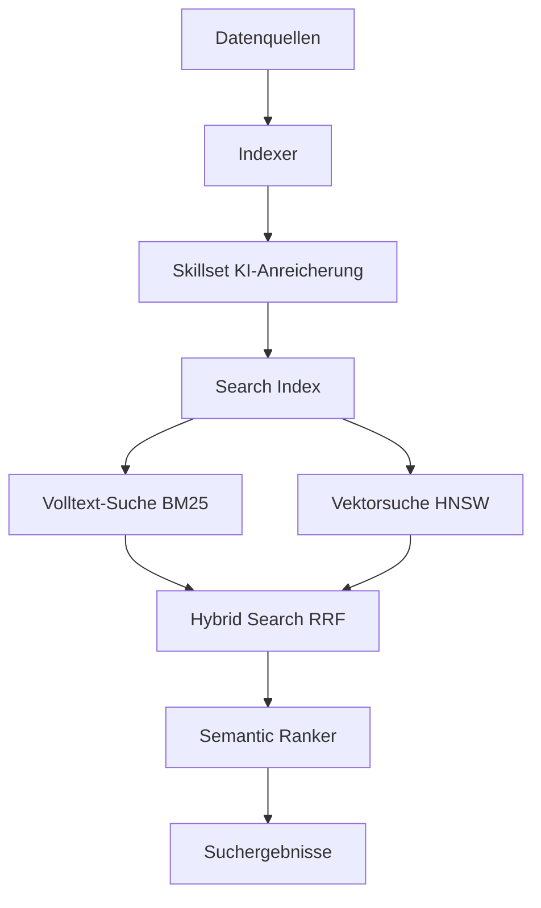
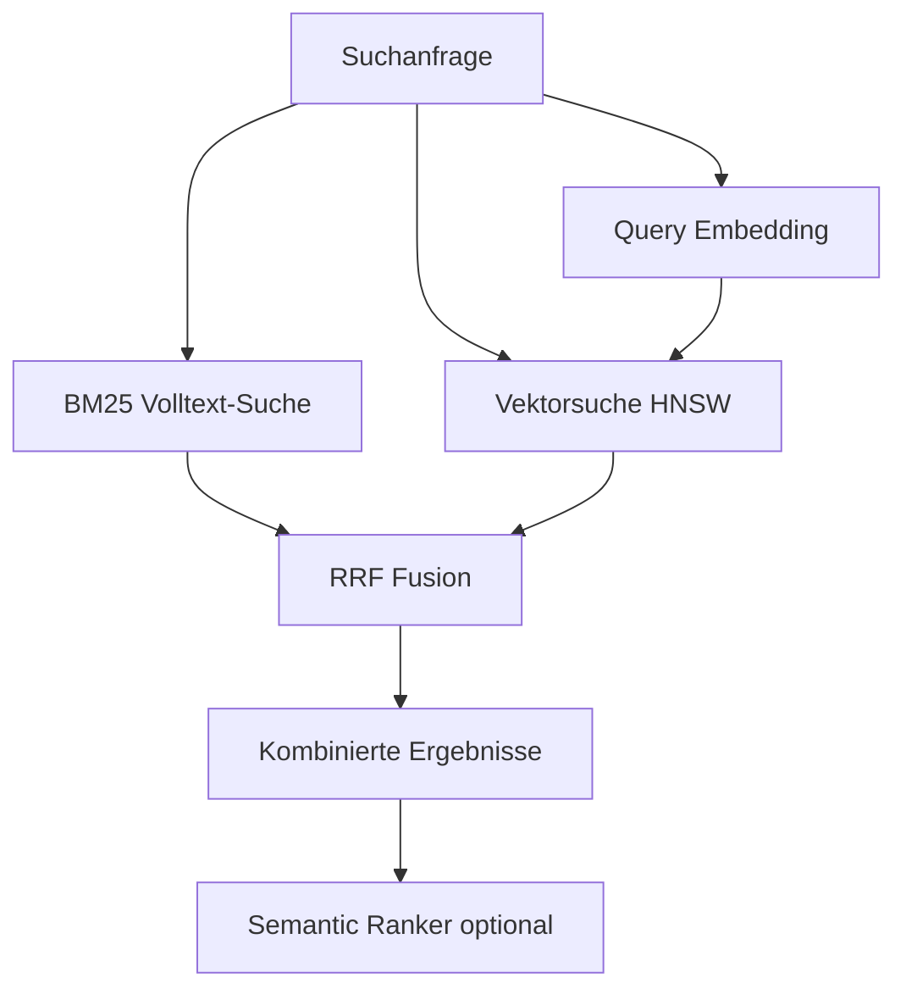
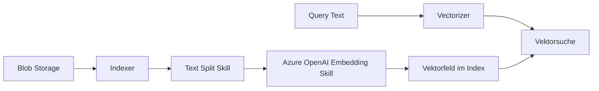
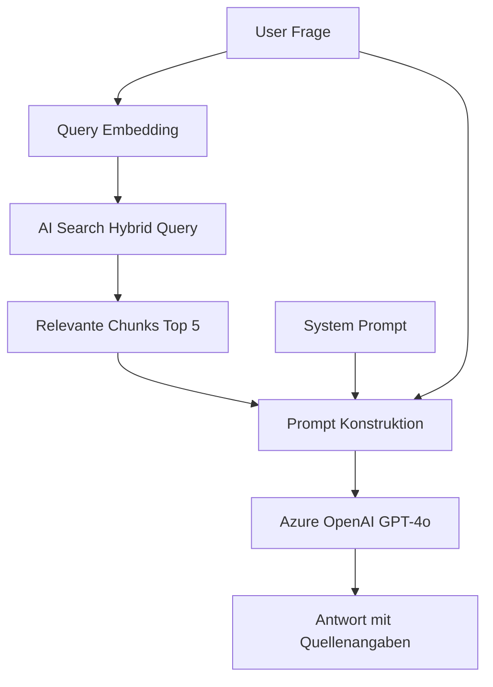

---
tags:
  - azure
  - ki
  - search
  - rag
  - vektor-suche
aliases:
  - Azure Cognitive Search
  - AI Search
  - Azure Search
---

# Azure AI Search

> [!ABSTRACT] TL;DR
> Azure AI Search (ehem. Cognitive Search) ist Microsofts Enterprise-Suchdienst mit Volltext-Suche (BM25), Vektorsuche (HNSW), Hybrid Search und Semantic Ranking. Kernkomponente für RAG-Architekturen mit Azure OpenAI.

---

## Was ist Azure AI Search?

**Azure AI Search** ist ein vollständig verwalteter Suchdienst in Azure, der für Unternehmensanwendungen und KI-gestützte Suche entwickelt wurde. Er kombiniert klassische Volltext-Suche mit modernen Vektorsuche-Fähigkeiten und KI-Anreicherung.

### Kernfunktionen 2024/2025

| Funktion | Beschreibung |
|---------|-------------|
| **Volltext-Suche** | Lucene-basiert, BM25 Ranking |
| **Vektorsuche** | HNSW für semantische Ähnlichkeitssuche |
| **Hybrid Search** | BM25 + Vektor kombiniert (RRF) |
| **Semantic Ranking** | L2 Re-ranking via Language Models |
| **Integrated Vectorization** | Automatisches Chunking und Embedding |
| **Skillsets** | KI-Anreicherungspipeline beim Indexieren |
| **Knowledge Store** | Angereicherte Daten in Storage persistieren |



---

---

## Via Azure Portal (UI)

> [!TIP] Schnellzugriff
> [portal.azure.com](https://portal.azure.com) → **KI-Suche** → **+ Erstellen**

### Schritt-für-Schritt

1. **Ressource erstellen** – portal.azure.com → "+ Ressource erstellen" → "KI-Suche" (Azure AI Search)
2. **Grundkonfiguration** – Subscription, Resource Group, Name, Region, Tarif (Free / Basic / Standard)
3. **Zu Ressource wechseln** – "Erstellen" → nach Bereitstellung: "Zu Ressource wechseln"
4. **Index erstellen** – "Indizes" → "+ Index hinzufügen" → Felder definieren (searchable, filterable, sortable, facetable)
5. **Datenquelle hinzufügen** – "Datenquellen" → + Hinzufügen (Azure Blob, SQL, Cosmos DB, Table Storage)
6. **Indexer erstellen** – "Indexer" → + Hinzufügen → Zeitplan für regelmäßige Aktualisierungen
7. **Skillset konfigurieren** – "Skillsets" → + Hinzufügen → KI-Anreicherungen (OCR, Entitätserkennung, Schlüsselwörter)
8. **Suchexplorer** – "Such-Explorer" → Suchanfragen direkt testen

---

## Volltext-Suche (Lucene-basiert)

### Analyser, Tokenizer und Filter

| Komponente | Beschreibung | Beispiel |
|-----------|-------------|---------|
| **Analyzer** | Verarbeitet Text für Indexierung und Suche | `de.microsoft` für Deutsch |
| **Tokenizer** | Teilt Text in Tokens | Standard, Whitespace, Keyword |
| **Token Filter** | Transformiert Tokens | Lowercase, Stopwörter, Stemming |
| **Char Filter** | Zeichenersetzung vor Tokenisierung | HTML-Entfernung, Pattern Replace |

```json
{
  "analyzers": [
    {
      "name": "german_custom",
      "@odata.type": "#Microsoft.Azure.Search.CustomAnalyzer",
      "tokenizer": "standard_v2",
      "tokenFilters": ["lowercase", "german_stop", "german_normalization"]
    }
  ]
}
```

### Suchabfragen

```bash
# Einfache Suche
GET https://<search>.search.windows.net/indexes/dokumente/docs?search=azure+rbac&api-version=2024-05-01-preview

# Strukturierte Lucene-Abfrage
GET /docs?search=titel:"Azure RBAC" AND kategorie:security

# Fuzzy-Suche (Tippfehler-tolerant)
GET /docs?search=azure~1
```

---

## Vektorsuche

### HNSW-Algorithmus

**Hierarchical Navigable Small World (HNSW)** ist der Standard-Algorithmus für Approximate Nearest Neighbor (ANN) Suche in Azure AI Search:

- **Schnell:** Sublineare Suchzeit O(log n)
- **Skalierbar:** Millionen von Vektoren möglich
- **Konfigurierbar:** m, efConstruction, efSearch Parameter

| Parameter | Beschreibung | Standard |
|-----------|-------------|---------|
| **m** | Verbindungen pro Knoten (Qualität vs. Speicher) | 4 |
| **efConstruction** | Indexierungsqualität (höher = besser, langsamer) | 400 |
| **efSearch** | Suchqualität (höher = besser, langsamer) | 500 |
| **metric** | Ähnlichkeitsmaß (cosine, dotProduct, euclidean) | cosine |

### Index mit Vektorfeld erstellen

```json
{
  "name": "dokumente-index",
  "fields": [
    {"name": "id", "type": "Edm.String", "key": true},
    {"name": "content", "type": "Edm.String", "searchable": true},
    {
      "name": "contentVector",
      "type": "Collection(Edm.Single)",
      "dimensions": 1536,
      "vectorSearchProfile": "hnsw-profile"
    }
  ],
  "vectorSearch": {
    "profiles": [
      {"name": "hnsw-profile", "algorithm": "hnsw-config"}
    ],
    "algorithms": [
      {
        "name": "hnsw-config",
        "kind": "hnsw",
        "hnswParameters": {"m": 4, "efConstruction": 400, "metric": "cosine"}
      }
    ]
  }
}
```

### Vektorsuche ausführen

```python
from azure.search.documents import SearchClient
from azure.core.credentials import AzureKeyCredential
from openai import AzureOpenAI

search_client = SearchClient(
    endpoint="https://<search>.search.windows.net",
    index_name="dokumente-index",
    credential=AzureKeyCredential("<api-key>")
)

openai_client = AzureOpenAI(...)

# Query vektorisieren
query = "Was ist Azure RBAC?"
embedding = openai_client.embeddings.create(
    model="text-embedding-3-small",
    input=query
).data[0].embedding

# Vektorsuche
results = search_client.search(
    search_text=None,
    vector_queries=[{
        "kind": "vector",
        "vector": embedding,
        "k_nearest_neighbors": 5,
        "fields": "contentVector"
    }]
)

for result in results:
    print(f"Score: {result['@search.score']:.4f} | {result['content'][:100]}")
```

---

## Hybrid Search

**Hybrid Search** kombiniert BM25 (Volltext) und Vektorsuche in einer Abfrage. Die Ergebnisse werden mittels **Reciprocal Rank Fusion (RRF)** zusammengeführt:



```python
results = search_client.search(
    search_text="Azure RBAC Rollen",  # BM25
    vector_queries=[{
        "kind": "vector",
        "vector": embedding,
        "k_nearest_neighbors": 50,
        "fields": "contentVector"
    }],
    select=["id", "content", "title"],
    top=10
)
```

> [!TIP] Hybrid Search ist Standard
> Hybrid Search mit RRF übertrifft in den meisten Benchmarks reine Volltext- oder reine Vektorsuche. Für RAG-Anwendungen ist Hybrid Search die empfohlene Standardkonfiguration.

---

## Semantic Ranking

**Semantic Ranking** ist ein L2-Re-Ranking-Schritt, der die Top-N Ergebnisse aus Hybrid Search nochmals mit einem Language Model neu bewertet:

| Schritt | Beschreibung |
|---------|-------------|
| **L1 Retrieval** | Hybrid Search liefert Top-50 Kandidaten |
| **L2 Re-Ranking** | Semantic Ranker bewertet Relevanz zum Query |
| **Caption/Answer** | Extraktion relevanter Textpassagen |

```python
from azure.search.documents.models import QueryType

results = search_client.search(
    search_text="Azure RBAC Rollen",
    vector_queries=[...],
    query_type=QueryType.SEMANTIC,
    semantic_configuration_name="my-semantic-config",
    query_caption="extractive",
    query_answer="extractive",
    top=5
)

for result in results:
    print(f"Semantic Score: {result['@search.reranker_score']:.4f}")
    if result.get('@search.captions'):
        print(f"Caption: {result['@search.captions'][0].text}")
```

> [!NOTE] Semantic Ranker Lizenzierung
> Semantic Ranking ist ab dem **Standard S1**-Tier verfügbar. Es entstehen zusätzliche Kosten pro 1.000 semantische Suchanfragen.

---

## Index-Aufbau mit Indexern

### Unterstützte Datenquellen

| Datenquelle | Connector |
|------------|---------|
| **Azure Blob Storage** | Dokumente, PDFs, Office-Dateien |
| **Azure SQL Database** | Tabellen und Views |
| **Azure Cosmos DB** | NoSQL-Dokumente |
| **Azure Table Storage** | Key-Value Daten |
| **SharePoint Online** | Dokumente und Seiten |
| **OneLake / Fabric** | Analytics-Daten |
| **MySQL / PostgreSQL** | Via Preview-Connector |

```json
{
  "name": "blob-indexer",
  "dataSourceName": "my-blob-datasource",
  "skillsetName": "my-skillset",
  "targetIndexName": "dokumente-index",
  "schedule": {"interval": "PT1H"},
  "fieldMappings": [
    {"sourceFieldName": "metadata_storage_name", "targetFieldName": "fileName"}
  ]
}
```

---

## Skillsets (KI-Anreicherungspipeline)

**Skillsets** verarbeiten Dokumente beim Indexieren mit KI:

| Skill | Beschreibung |
|-------|-------------|
| **OCR** | Text aus Bildern extrahieren |
| **Image Analysis** | Bildinhalt beschreiben |
| **Key Phrase Extraction** | Wichtige Phrasen extrahieren |
| **Entity Recognition** | Personen, Orte, Organisationen |
| **Language Detection** | Sprache erkennen |
| **Text Translation** | In Indexierungssprache übersetzen |
| **Text Split** | Dokumente in Chunks aufteilen |
| **Azure OpenAI Embedding** | Vektoren für Chunks erzeugen |
| **Custom Skill** | Azure Function als eigener Skill |

```json
{
  "skills": [
    {
      "@odata.type": "#Microsoft.Skills.Text.SplitSkill",
      "textSplitMode": "pages",
      "maximumPageLength": 2000,
      "pageOverlapLength": 200
    },
    {
      "@odata.type": "#Microsoft.Skills.Text.AzureOpenAIEmbeddingSkill",
      "resourceUri": "https://<openai>.openai.azure.com/",
      "deploymentId": "text-embedding-3-small",
      "modelName": "text-embedding-3-small"
    }
  ]
}
```

---

## Integrated Vectorization (2024)

**Integrated Vectorization** automatisiert den gesamten Embedding-Prozess:



- Kein manuelles Embedding-Management mehr nötig
- Query-Zeit-Vektorisierung automatisch
- Konsistenz zwischen Indexierung und Suche garantiert

---

## Knowledge Store

Angereicherte Daten können in Azure Storage persistiert werden:

```json
{
  "knowledgeStore": {
    "storageConnectionString": "<connection-string>",
    "projections": [
      {
        "tables": [
          {"tableName": "Dokumente", "source": "/document"},
          {"tableName": "Schluesselwoerter", "source": "/document/keyphrases/*"}
        ]
      },
      {
        "objects": [
          {"storageContainer": "enriched-docs", "source": "/document"}
        ]
      }
    ]
  }
}
```

---

## RAG mit Azure AI Search und Azure OpenAI



```python
def rag_query(user_question: str) -> str:
    # Schritt 1: Query vektorisieren
    query_vector = get_embedding(user_question)
    
    # Schritt 2: Hybrid Search
    results = search_client.search(
        search_text=user_question,
        vector_queries=[{"kind": "vector", "vector": query_vector,
                         "k_nearest_neighbors": 5, "fields": "contentVector"}],
        query_type="semantic",
        semantic_configuration_name="default",
        top=5
    )
    
    # Schritt 3: Kontext aufbereiten
    context = "\n\n".join([r["content"] for r in results])
    
    # Schritt 4: LLM-Generierung
    response = openai_client.chat.completions.create(
        model="gpt-4o",
        messages=[
            {"role": "system", "content": f"Beantworte Fragen nur basierend auf: {context}"},
            {"role": "user", "content": user_question}
        ]
    )
    return response.choices[0].message.content
```

---

## SKUs und Kosten

| SKU | Partitionen | Replicas | Storage | Semantic Ranker |
|-----|------------|---------|---------|----------------|
| **Free** | 1 | 1 | 50 MB | Nein |
| **Basic** | 1 | bis 3 | 2 GB | Ja |
| **Standard S1** | bis 12 | bis 12 | 25 GB/P | Ja |
| **Standard S2** | bis 12 | bis 12 | 100 GB/P | Ja |
| **Standard S3** | bis 12 | bis 12 | 200 GB/P | Ja |
| **Storage L1** | bis 12 | bis 12 | 1 TB/P | Ja |
| **Storage L2** | bis 12 | bis 12 | 2 TB/P | Ja |

**Faustformel:** S1 für die meisten Produktionsanwendungen. L1/L2 für sehr große Dokumentmengen.

> [!NOTE] Semantic Ranker Kosten
> ~$0,005 pro 1.000 semantische Anfragen zusätzlich zum SKU-Preis.

---

## Verwandte Notizen
- [[Azure OpenAI Service]]
- [[Azure AI Foundry]]
- [[Azure AI Document Intelligence]]
- [[Azure KI Zusammenfassung]]
