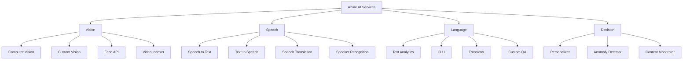
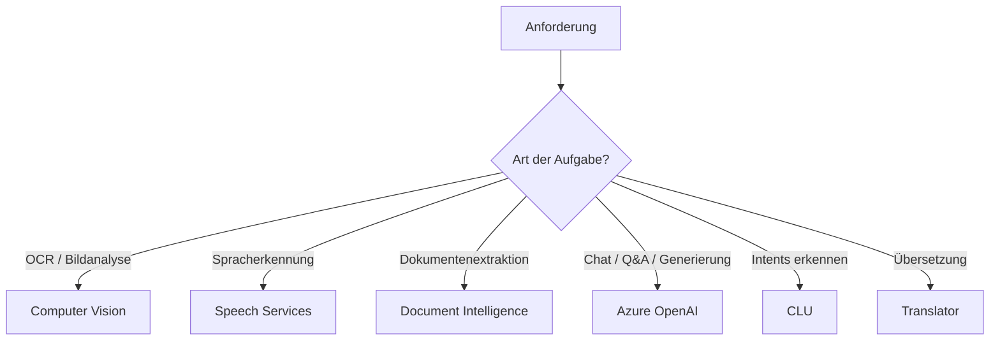

---
tags:
  - azure
  - ki
  - cognitive-services
  - ai-services
aliases:
  - Azure Cognitive Services
  - Azure AI Services
---

# Azure AI Services

> [!ABSTRACT] TL;DR
> Azure AI Services (ehem. Cognitive Services) sind vorgefertigte KI-APIs für Vision, Speech, Language und Decision — ohne eigenes ML-Training nutzbar. Ergänzen Azure OpenAI für spezifische Aufgaben wie OCR, Sprachübersetzung oder Anomalieerkennung.

---

## Was sind Azure AI Services?

**Azure AI Services** (bis 2023: **Azure Cognitive Services**) sind ein Portfolio von REST-APIs und SDKs, die vortrainierte KI-Modelle für häufige Aufgaben bereitstellen. Entwickler können diese ohne ML-Kenntnisse in Anwendungen integrieren.

### Merkmale

- **Kein Training erforderlich:** Modelle sind vorgefertigt und sofort einsetzbar
- **REST-APIs:** Plattformunabhängige Integration
- **SDKs:** .NET, Python, Java, JavaScript, Go
- **Skalierbar:** Azure-verwaltete Infrastruktur
- **On-Premises:** Viele Services als Docker-Container verfügbar



---

## Service-Kategorien: Vision

### Computer Vision

**Azure AI Vision** analysiert Bilder und extrahiert Informationen:

| Feature | Beschreibung |
|---------|-------------|
| **Image Analysis** | Beschreibung, Tags, Objekte, Gesichter erkennen |
| **OCR (Read API)** | Text aus Bildern und PDFs extrahieren |
| **Spatial Analysis** | Personen-Bewegungen in Videos analysieren |
| **Background Removal** | Hintergrund aus Bildern entfernen |
| **Product Recognition** | Produkte in Bildern identifizieren |

```python
from azure.ai.vision.imageanalysis import ImageAnalysisClient
from azure.core.credentials import AzureKeyCredential

client = ImageAnalysisClient(
    endpoint="https://<resource>.cognitiveservices.azure.com/",
    credential=AzureKeyCredential("<api-key>")
)

result = client.analyze_from_url(
    image_url="https://example.com/bild.jpg",
    visual_features=["CAPTION", "TAGS", "READ"]
)
print(result.caption.text)
```

### Custom Vision

Trainiert eigene Bildklassifikations- und Objekterkennungsmodelle:

- **Klassifikation:** Multi-Class oder Multi-Label
- **Objekterkennung:** Bounding Boxes um Objekte
- Wenige Trainingsbilder dank Transfer Learning
- Export als ONNX, CoreML, TensorFlow für Edge-Deployment

### Face API

> [!WARNING] Eingeschränkter Zugang
> Die erweiterten Face-API-Features (Identifikation, Verifikation) erfordern seit 2023 eine explizite Beantragung bei Microsoft (Responsible AI-Einschränkung).

| Feature | Beschreibung |
|---------|-------------|
| **Face Detection** | Gesichter + Attribute (Alter, Emotion) erkennen |
| **Face Verification** | Zwei Gesichter vergleichen |
| **Face Identification** | Person in einer Gruppe identifizieren |
| **Liveness Detection** | Lebenderkennung gegen Spoofing |

### Video Indexer

**Azure Video Indexer** analysiert Videos automatisch:

- Transkription und Übersetzung
- Gesichts- und Prominentenerkennung
- Szenenerkennung und Keyframe-Extraktion
- Brand und Logo-Erkennung
- Topic und Sentiment-Analyse
- Barrierefreiheits-Untertitel

---

## Service-Kategorien: Speech

### Speech-to-Text (STT)

```python
import azure.cognitiveservices.speech as speechsdk

speech_config = speechsdk.SpeechConfig(
    subscription="<api-key>",
    region="westeurope"
)
speech_config.speech_recognition_language = "de-DE"

audio_config = speechsdk.AudioConfig(use_default_microphone=True)
recognizer = speechsdk.SpeechRecognizer(speech_config, audio_config)

result = recognizer.recognize_once_async().get()
print(result.text)
```

| Feature | Beschreibung |
|---------|-------------|
| **Echtzeit-Transkription** | Kontinuierliche Sprach-zu-Text Umwandlung |
| **Batch-Transkription** | Große Audio-Dateien asynchron verarbeiten |
| **Custom Speech** | Eigene Akzente / Fachbegriffe trainieren |
| **Diarization** | Sprecher unterscheiden |
| **Profanity Filter** | Anstößige Inhalte filtern |

### Text-to-Speech (TTS)

- **Neural Voices:** Natürlich klingende Stimmen (430+ Stimmen, 140+ Sprachen)
- **Custom Neural Voice:** Eigene Stimme trainieren
- **SSML-Steuerung:** Betonung, Pausen, Emotionen per SSML-Tags
- **Avatare:** Sprechende Video-Avatare

### Speech Translation

- Echtzeit-Übersetzung von gesprochener Sprache
- Mehrere Zielsprachen gleichzeitig
- Kontinuierliche Konversations-Übersetzung

### Speaker Recognition

- **Speaker Verification:** Stimme einer bekannten Person bestätigen
- **Speaker Identification:** Sprecher aus einer Gruppe identifizieren

---

## Service-Kategorien: Language

### Text Analytics (Azure AI Language)

| Feature | Beschreibung |
|---------|-------------|
| **Sentiment Analysis** | Positiv/Negativ/Neutral, Opinion Mining |
| **Key Phrase Extraction** | Wichtigste Phrasen extrahieren |
| **Named Entity Recognition (NER)** | Personen, Orte, Organisationen erkennen |
| **PII Detection** | Personenbezogene Daten erkennen und maskieren |
| **Language Detection** | Sprache erkennen (120+ Sprachen) |
| **Summarization** | Dokumente oder Konversationen zusammenfassen |

```python
from azure.ai.textanalytics import TextAnalyticsClient
from azure.core.credentials import AzureKeyCredential

client = TextAnalyticsClient(
    endpoint="https://<resource>.cognitiveservices.azure.com/",
    credential=AzureKeyCredential("<api-key>")
)

documents = ["Azure ist eine tolle Cloud-Plattform von Microsoft."]
result = client.analyze_sentiment(documents)
print(result[0].sentiment)  # positive
```

### CLU — Conversational Language Understanding

**CLU** (Nachfolger von LUIS) versteht natürlichsprachige Intents und extrahiert Entities:

| Konzept | Beschreibung |
|---------|-------------|
| **Intent** | Absicht des Nutzers (z.B. "Ticket buchen") |
| **Entity** | Extrahierte Informationen (z.B. Datum, Ort) |
| **Utterances** | Trainingsbeispiele für Intents |

> [!NOTE] LUIS → CLU Migration
> LUIS wurde zum 1. Oktober 2025 eingestellt. Migrationstools für CLU stehen zur Verfügung.

### Translator

- **Textübersetzung:** 130+ Sprachen
- **Dokument-Übersetzung:** Word, PDF, HTML-Dateien asynchron übersetzen
- **Custom Translator:** Eigene Übersetzungsmodelle trainieren
- **Transliteration:** Schriftsystem-Konvertierung

### Custom Question Answering (ehem. QnA Maker)

- Wissensdatenbank aus FAQs, Dokumenten, URLs erstellen
- Mehrere Antworten mit Confidence Scores
- Multiturn-Gespräche mit Follow-up-Fragen
- Integration mit Azure Bot Service

---

## Service-Kategorien: Decision

### Personalizer

**Azure AI Personalizer** ist ein Reinforcement-Learning-Service für personalisierte Empfehlungen:

- **Rank API:** Beste Aktion für Kontext bestimmen
- **Reward API:** Feedback-Signal für Lernprozess
- Echtzeit-Personalisierung ohne ML-Expertise

### Anomaly Detector

- **Univariat:** Zeitreihendaten auf Anomalien prüfen
- **Multivariat:** Korrelierte Anomalien über mehrere Metriken
- Einsatz: IoT-Überwachung, Betrugserkennun, Finanzanalyse

### Content Moderator (veraltet → Azure AI Content Safety)

> [!WARNING] Deprecated
> Azure Content Moderator wird am 27. Februar 2027 eingestellt. Nachfolger ist **Azure AI Content Safety**.

**Azure AI Content Safety:**
- Text und Bild-Moderation
- Kategorien: Hate, Violence, Sexual, Self-harm
- Schwellenwerte konfigurierbar
- Promptbooks für Jailbreak-Schutz

---

## Multi-Service-Endpoint

Ein einzelner Endpoint für mehrere AI Services:

```bash
# Erstellen einer Multi-Service-Ressource
az cognitiveservices account create \
  --name "my-ai-services" \
  --resource-group "rg-prod" \
  --kind "CognitiveServices" \
  --sku "S0" \
  --location "westeurope"
```

**Vorteile:**
- Ein einziger API-Key und Endpoint für alle Services
- Vereinfachtes Billing
- Weniger Azure-Ressourcen zu verwalten

**Nachteile:**
- Weniger granulare Zugriffssteuerung
- Geteilte Quotas

---

## Preismodell

| Pricing-Tier | Beschreibung |
|-------------|-------------|
| **Free (F0)** | Begrenzte monatliche Anfragen kostenlos |
| **Standard (S0)** | Pay-per-Use nach API-Calls oder Einheiten |
| **Commitment Tier** | Monatliche Vorauszahlung für günstigere Preise |

Beispiel-Preise (pro 1.000 Transaktionen):
- Computer Vision: $1,00 – $1,50
- Speech-to-Text: $1,00/Stunde Audio
- Translator: $10,00/1M Zeichen
- Text Analytics: $1,00 – $2,00

---

## Azure AI Services im Container

Viele Services stehen als **Docker-Container** für On-Premises-Deployment zur Verfügung:

```bash
docker pull mcr.microsoft.com/azure-cognitive-services/textanalytics/sentiment:latest

docker run --rm -it -p 5000:5000 \
  -e ApiKey="<key>" \
  -e Billing="https://<resource>.cognitiveservices.azure.com/" \
  mcr.microsoft.com/azure-cognitive-services/textanalytics/sentiment:latest
```

**Verfügbare Container-Services:**
- Text Analytics (Sentiment, NER, Key Phrase)
- Computer Vision (Read/OCR)
- Speech (STT, TTS)
- Translator
- Face

> [!IMPORTANT] Billing im Container
> Auch Container-Deployments senden Metrik-Daten zur Abrechnung an Azure. Vollständig offline sind sie nicht — nur die Verarbeitung findet lokal statt.

---

## Azure AI Services vs. Azure OpenAI

| Kriterium | Azure AI Services | Azure OpenAI |
|-----------|-----------------|-------------|
| **Aufgabe** | Spezifisch (OCR, STT, NER) | Allgemein (Chat, Completions) |
| **Training** | Nicht erforderlich | Nicht erforderlich |
| **Customization** | Begrenzt (Custom Vision, CLU) | Fine-Tuning möglich |
| **Kosten** | Per API-Call | Per Token |
| **Latenz** | Niedrig (dediziert) | Variabel |
| **Einsatz** | Strukturierte Aufgaben | Freie Textgenerierung |

**Wann welches?**



---

## Authentifizierung

### API Key

```python
from azure.core.credentials import AzureKeyCredential
credential = AzureKeyCredential("<api-key>")
```

### Managed Identity (empfohlen für Produktion)

```python
from azure.identity import DefaultAzureCredential
credential = DefaultAzureCredential()
# Funktioniert mit System-Assigned und User-Assigned Managed Identity
```

> [!TIP] Managed Identity bevorzugen
> Für produktive Deployments immer Managed Identity statt API Keys verwenden — kein Secret-Management, automatische Rotation, RBAC-Steuerung.

### RBAC-Rollen

| Rolle | Berechtigung |
|-------|-------------|
| **Cognitive Services User** | API-Aufrufe ausführen |
| **Cognitive Services Contributor** | Ressource verwalten |
| **Cognitive Services Data Reader** | Daten lesen (begrenzt) |

---

## Verwandte Notizen
- [[Azure OpenAI Service]]
- [[Azure AI Document Intelligence]]
- [[Azure AI Foundry]]
- [[Azure KI Zusammenfassung]]
