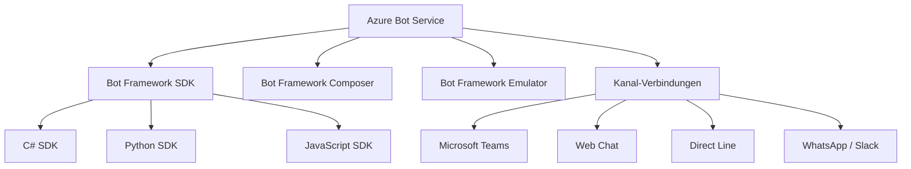
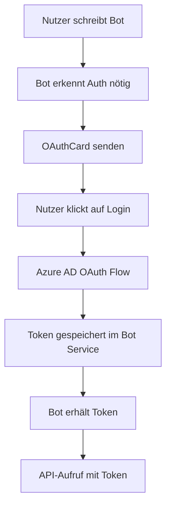
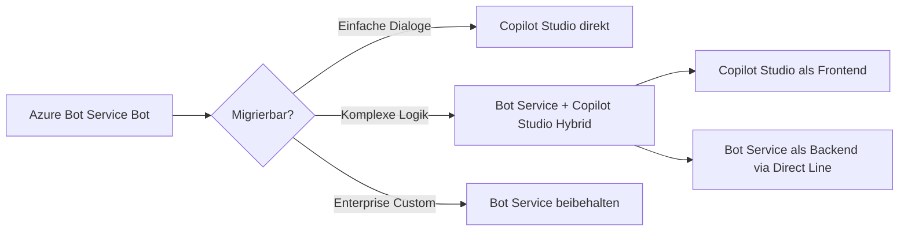

---
tags:
  - azure
  - bot-service
  - chatbot
  - ki
aliases:
  - Bot Framework
  - Azure Bot
---

# Azure Bot Service

> [!ABSTRACT] TL;DR
> Azure Bot Service ist Microsofts Plattform für Enterprise-Chatbots — mit Bot Framework SDK (C#/Python/JS), Composer für Low-Code-Dialoge, Multi-Channel-Deployment (Teams, Web, WhatsApp) und Integration mit CLU/Custom Question Answering.

---

## Was ist Azure Bot Service?

**Azure Bot Service** ist ein verwalteter Dienst zum Erstellen, Testen, Deployen und Verwalten von Chatbots auf Azure. Er bildet die technische Grundlage für konversationsbasierte KI-Anwendungen, bevor Copilot Studio (Power Virtual Agents) die Low-Code-Alternative wurde.

### Kernkomponenten



---

## Bot Framework SDK

Das **Bot Framework SDK** ist das Entwickler-Framework für programmatische Bot-Entwicklung:

### Aktivitäts-Typen

| Aktivität | Beschreibung |
|-----------|-------------|
| **Message** | Text- oder Rich-Media-Nachricht |
| **ConversationUpdate** | Nutzer tritt bei/verlässt Unterhaltung |
| **Event** | Benutzerdefiniertes Event |
| **Invoke** | Synchrone Aktivität (z.B. Adaptive Card Submit) |
| **Typing** | Schreibindikator anzeigen |

### Einfacher Bot (Python)

```python
from botbuilder.core import ActivityHandler, TurnContext
from botbuilder.schema import Activity

class EchoBot(ActivityHandler):
    async def on_message_activity(self, turn_context: TurnContext):
        user_message = turn_context.activity.text
        response = f"Du hast gesagt: {user_message}"
        await turn_context.send_activity(response)
    
    async def on_members_added_activity(self, members_added, turn_context):
        for member in members_added:
            if member.id != turn_context.activity.recipient.id:
                await turn_context.send_activity("Willkommen! Wie kann ich helfen?")
```

### Bot mit Dialogen (Waterfall Dialog)

```python
from botbuilder.dialogs import DialogSet, WaterfallDialog, WaterfallStepContext
from botbuilder.dialogs.prompts import TextPrompt, ConfirmPrompt

class OrderDialog(WaterfallDialog):
    DIALOGS = [
        WaterfallStepContext.prompt("name", TextPrompt()),
        WaterfallStepContext.prompt("confirm", ConfirmPrompt())
    ]
    
    async def step_ask_name(self, step: WaterfallStepContext):
        return await step.prompt("name", "Wie heißt du?")
    
    async def step_confirm(self, step: WaterfallStepContext):
        step.values["name"] = step.result
        return await step.prompt("confirm", 
            f"Bist du {step.result}? (Ja/Nein)")
    
    async def step_final(self, step: WaterfallStepContext):
        if step.result:
            await step.context.send_activity(
                f"Hallo {step.values['name']}! Schön dich kennenzulernen."
            )
        return await step.end_dialog()
```

---

## Bot Framework Composer

**Bot Framework Composer** ist ein visueller, Low-Code-Editor für Dialoge:

### Konzepte im Composer

| Konzept | Beschreibung |
|---------|-------------|
| **Trigger** | Löst einen Dialog aus (Intent, Event, Aktivität) |
| **Action** | Aktion im Dialog (Sende Antwort, Bedingung, Schleife) |
| **Dialog** | Eigenständiger Gesprächsfluss |
| **State** | Gespeicherte Konversationsdaten (User, Conversation, Dialog) |
| **LG (Language Generation)** | Vorlagen für Bot-Antworten |
| **LU (Language Understanding)** | Intents und Entities definieren |

### Beispiel: Trigger mit CLU-Intent

```
# In Composer: Trigger konfigurieren
Trigger: Intent erkannt = "BucheFahrt"
  Conditions: @abfahrtsort != null AND @zielort != null

Actions:
  1. Sende: "Ich buche eine Fahrt von {$abfahrtsort} nach {$zielort}."
  2. HTTP Request: POST https://api.taxi.com/book
  3. Sende: "Ihr Taxi kommt in {$wartezeit} Minuten."
```

---

## Deployment

### Hosting-Optionen

| Option | Geeignet für | Skalierung |
|--------|-------------|-----------|
| **Azure App Service** | Standard-Bots, produktiv | Auto-Scale |
| **Azure Functions** | Einfache, event-gesteuerte Bots | Serverless |
| **Container (ACI/AKS)** | Komplexe Bots, Microservices | K8s-Scaling |

### App Service Deployment (CLI)

```bash
# Bot-Ressource erstellen
az bot create \
  --resource-group rg-bots \
  --name mycompany-bot \
  --kind webapp \
  --location westeurope \
  --sku S1

# App Service Deployment
az webapp deployment source config-zip \
  --resource-group rg-bots \
  --name mycompany-bot-app \
  --src bot.zip
```

### Bot Framework Konfiguration (appsettings.json)

```json
{
  "MicrosoftAppId": "<bot-app-id>",
  "MicrosoftAppPassword": "<bot-secret>",
  "MicrosoftAppType": "MultiTenant",
  "LuisAppId": "<clu-project>",
  "LuisAPIKey": "<api-key>",
  "LuisAPIHostName": "<resource>.cognitiveservices.azure.com"
}
```

---

## Kanäle

Azure Bot Service verbindet Bots mit verschiedenen Messaging-Plattformen:

| Kanal | Beschreibung | Auth |
|-------|-------------|------|
| **Microsoft Teams** | Native Teams-Integration, reichhaltige Karten | Bot Framework App Registration |
| **Web Chat** | Einbettbarer Chat-Widget für Websites | Direct Line Secret |
| **Direct Line** | REST-API für eigene Clients | Direct Line Secret |
| **Direct Line Speech** | Sprachkanal für Voice-Bots | Cognitive Services |
| **Slack** | Slack-App-Integration | OAuth |
| **WhatsApp (via Twilio)** | WhatsApp Business API | Twilio API Key |
| **Facebook Messenger** | Facebook Page-Integration | Facebook App Token |
| **Telegram** | Telegram Bot API | Bot Token |
| **Email** | E-Mail-basierter Bot | SMTP/Exchange |

> [!TIP] Teams-Kanal
> Der **Microsoft Teams-Kanal** ist für Enterprise-Szenarien der wichtigste. Er unterstützt Adaptive Cards, Meeting-Bots, Message Extensions und Tab-Integration.

---

## CLU/LUIS Integration

### CLU (Conversational Language Understanding)

```python
from azure.ai.language.conversations import ConversationAnalysisClient
from azure.core.credentials import AzureKeyCredential

clu_client = ConversationAnalysisClient(
    endpoint="https://<resource>.cognitiveservices.azure.com/",
    credential=AzureKeyCredential("<api-key>")
)

result = clu_client.analyze_conversation(
    task={
        "kind": "Conversation",
        "analysisInput": {
            "conversationItem": {
                "text": "Buche einen Flug nach Berlin morgen",
                "participantId": "user1",
                "id": "1"
            }
        },
        "parameters": {
            "projectName": "travel-bot",
            "deploymentName": "production"
        }
    }
)

intent = result["result"]["prediction"]["topIntent"]
entities = result["result"]["prediction"]["entities"]
```

---

## Custom Question Answering Integration

```python
from azure.ai.language.questionanswering import QuestionAnsweringClient

qa_client = QuestionAnsweringClient(
    endpoint="https://<resource>.cognitiveservices.azure.com/",
    credential=AzureKeyCredential("<api-key>")
)

output = qa_client.get_answers(
    question="Was sind die Öffnungszeiten?",
    project_name="it-helpdesk-kb",
    deployment_name="production"
)

for answer in output.answers:
    print(f"Antwort: {answer.answer}")
    print(f"Confidence: {answer.confidence:.2f}")
```

---

## Bot Framework Emulator

Der **Bot Framework Emulator** ermöglicht lokales Testen von Bots:

- Direktverbindung zum lokalen Bot (localhost)
- Konversationsprotokoll anzeigen
- State-Variablen inspizieren
- Channel Inspector für Karten-Vorschau
- Ngrok-Integration für Webhook-Tests

```bash
# Bot lokal starten
python app.py

# Emulator verbinden mit:
# http://localhost:3978/api/messages
```

---

## Authentication in Bots (OAuth 2.0)



```python
from botbuilder.dialogs.prompts import OAuthPrompt, OAuthPromptSettings

oauth_settings = OAuthPromptSettings(
    connection_name="AzureADv2",  # OAuth-Verbindung in Bot Service
    text="Bitte melde dich an:",
    title="Anmelden",
    timeout=300
)

oauth_prompt = OAuthPrompt("OAuthPrompt", oauth_settings)

async def login_step(step: WaterfallStepContext):
    return await step.begin_dialog("OAuthPrompt")

async def process_step(step: WaterfallStepContext):
    token_response = step.result
    if token_response:
        # Graph API mit Token aufrufen
        token = token_response.token
```

---

## Adaptive Cards

**Adaptive Cards** sind JSON-definierte, plattformübergreifende UI-Elemente:

```json
{
  "type": "AdaptiveCard",
  "version": "1.5",
  "body": [
    {
      "type": "TextBlock",
      "text": "IT-Support Ticket erstellen",
      "size": "Large",
      "weight": "Bolder"
    },
    {
      "type": "Input.Text",
      "id": "problem",
      "placeholder": "Beschreibe dein Problem..."
    },
    {
      "type": "Input.ChoiceSet",
      "id": "priority",
      "choices": [
        {"title": "Hoch", "value": "high"},
        {"title": "Mittel", "value": "medium"},
        {"title": "Niedrig", "value": "low"}
      ]
    }
  ],
  "actions": [
    {"type": "Action.Submit", "title": "Ticket einreichen"}
  ]
}
```

---

## Proaktive Nachrichten

Bots können Nachrichten **ohne User-Interaktion** senden:

```python
async def send_proactive_message(app, conversation_reference):
    async def callback(turn_context: TurnContext):
        await turn_context.send_activity(
            "Ihr gemeldetes Problem wurde gelöst!"
        )
    
    await app.continue_conversation(
        conversation_reference,
        callback,
        app_id="<bot-app-id>"
    )
```

---

## Azure Bot Service vs. Copilot Studio

| Kriterium | Azure Bot Service | Copilot Studio |
|-----------|-----------------|----------------|
| **Zielgruppe** | Entwickler | Business-User, Maker |
| **Code** | Pro-Code (SDK) | Low-Code / No-Code |
| **Komplexität** | Hoch, flexibel | Begrenzt, aber schnell |
| **Teams-Integration** | Manuell konfigurieren | Out-of-the-box |
| **GenAI-Integration** | Custom (Azure OpenAI) | Integriert (Copilot) |
| **Lizenz** | Azure Pay-as-you-go | Power Platform / M365 |
| **Deployment** | Azure Hosting | Managed (Microsoft) |
| **Eignung** | Komplexe Enterprise-Bots | Standard-Helpdesk, FAQ |

> [!IMPORTANT] Empfehlung 2024/2025
> Neue Bot-Projekte sollten mit **Copilot Studio** beginnen. Azure Bot Service nur für komplexe Anforderungen (Custom Code, spezielle Authentifizierung, On-Prem-Integration).

---

## Migration zu Copilot Studio



---

## Kosten

| Kanal | Preis |
|-------|-------|
| **Standard-Kanäle** | Kostenlos (Teams, Direct Line, etc.) |
| **Premium-Kanäle** | $0,50 per 1.000 Nachrichten |
| **Bot Service Hosting** | Azure App Service Preise |
| **Direct Line Speech** | Speech-Service-Preise extra |

> [!NOTE] Kostenfalle
> Die eigentlichen Bot-Kosten entstehen durch das Hosting (App Service) und die integrierten KI-Dienste (CLU, Azure OpenAI), nicht durch den Bot Service selbst.

---

## Verwandte Notizen
- [[Azure AI Services]]
- [[Copilot Studio]]
- [[Azure KI Zusammenfassung]]
- [[Microsoft Security Copilot]]
