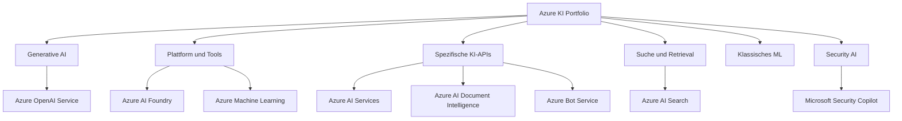
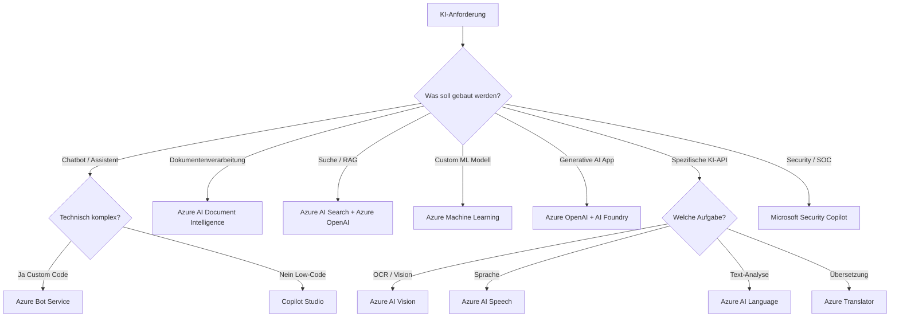
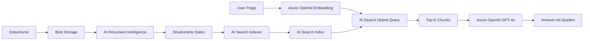
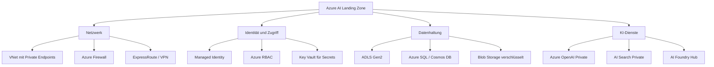

---
tags:
  - azure
  - ki
  - machine-learning
  - übersicht
aliases:
  - Azure KI Übersicht
  - Azure AI Übersicht
  - AI-102 Lernpfad
---

# Azure KI Zusammenfassung

> [!ABSTRACT] TL;DR
> Übersicht aller Azure KI-Dienste: Von Azure OpenAI für Generative AI über AI Foundry als Entwicklungsplattform, AI Services für spezifische Aufgaben, bis zu AI Search für RAG und Azure ML für klassisches Machine Learning. Entscheidungshilfe und Responsible AI-Prinzipien.

---

## Übersicht aller Azure KI-Dienste

### Dienst-Übersicht auf einen Blick

| Dienst | Frühere Bezeichnung | Primäre Aufgabe | Zielgruppe |
|--------|-------------------|----------------|------------|
| **Azure OpenAI Service** | Azure OpenAI | GPT-4o, DALL-E, Embeddings | Entwickler |
| **Azure AI Foundry** | Azure AI Studio | Unified AI Entwicklung | KI-Entwickler |
| **Azure AI Services** | Cognitive Services | Vorgefertigte KI-APIs | Alle Entwickler |
| **Azure AI Document Intelligence** | Form Recognizer | Dokument-Extraktion | Entwickler, RPA |
| **Azure AI Search** | Cognitive Search | Enterprise-Suche, RAG | Entwickler |
| **Azure Machine Learning** | AML | Custom ML, MLOps | Data Scientists |
| **Azure Bot Service** | Bot Framework | Chatbot-Entwicklung | Entwickler |
| **Microsoft Security Copilot** | Copilot for Security | SOC-Unterstützung | Security-Teams |

---

## Entscheidungsbaum: Welcher Azure KI-Dienst wann?

---

## Vergleich: Azure OpenAI vs. AI Foundry vs. AI Services vs. Azure ML

| Kriterium | Azure OpenAI | AI Foundry | AI Services | Azure ML |
|-----------|-------------|-----------|------------|---------|
| **Training erforderlich** | Nein | Nein (Fine-Tuning optional) | Nein | Ja (Kernaufgabe) |
| **Anpassung** | Fine-Tuning | Fine-Tuning, RAG | Custom Vision/CLU | Vollständig |
| **Modell-Typ** | GPT-4o, DALL-E, etc. | Alle Modelle im Catalog | Spezifische Aufgaben | Eigene Modelle |
| **Kontext-Länge** | 128K Token | Modellabhängig | N/A | N/A |
| **Preis** | Token-basiert | Token / VM-Stunden | Per API-Call | VM-Stunden |
| **No-Code-Option** | Nein | Prompt Flow | Ja (Studio) | Designer |
| **MLOps** | Nein | Begrenzt | Nein | Vollständig |
| **Datenschutz** | Enterprise | Enterprise | Enterprise | Enterprise |

---

---

## Via Azure Portal / KI-Portale (UI)

> [!TIP] Schnellzugriff
> [portal.azure.com](https://portal.azure.com) → **+ Erstellen** → **KI + Machine Learning**

| Dienst | Portal-URL | Schnellzugriff |
|--------|-----------|----------------|
| Azure OpenAI | ai.azure.com | Deployments → + Modell bereitstellen |
| AI Foundry | ai.azure.com | + Neues Projekt → Hub konfigurieren |
| AI Services | portal.azure.com | KI + Machine Learning → + Erstellen |
| Document Intelligence | documentintelligence.ai.azure.com | Studio → Dokument analysieren |
| AI Search | portal.azure.com | KI-Suche → + Erstellen |
| Azure ML | ml.azure.com | Designer / AutoML / Endpunkte |
| Bot Service | portal.azure.com | Azure Bot → + Erstellen |
| Security Copilot | securitycopilot.microsoft.com | Erste Schritte → SCU zuweisen |

### Schritt-für-Schritt

1. **Ressource erstellen** – portal.azure.com → "+ Ressource erstellen" → "KI + Machine Learning"
2. **Dienst auswählen** – Gewünschten KI-Dienst auswählen und Grundkonfiguration vornehmen (Subscription, RG, Region, Tarif)
3. **Studio wechseln** – Nach Bereitstellung in den jeweiligen Studio-Link wechseln (s. Tabelle oben)
4. **Keys & Endpunkte** – Immer unter "Schlüssel und Endpunkt" in der Ressourcen-Übersicht abrufbar

---

## Anwendungsfälle und Dienst-Zuordnung

### Szenario-Matrix

| Anwendungsfall | Primärer Dienst | Ergänzende Dienste |
|---------------|----------------|-------------------|
| **Unternehmens-Chatbot (FAQ)** | Copilot Studio | Custom Question Answering |
| **Komplexer Enterprise-Bot** | Azure Bot Service + Azure OpenAI | CLU, AI Search |
| **Rechnungsverarbeitung** | Azure AI Document Intelligence | Logic Apps, Power Automate |
| **Dokumentensuche / RAG** | Azure AI Search | Azure OpenAI, AI Foundry |
| **Transkription und Übersetzung** | Azure AI Speech + Translator | Blob Storage |
| **Bildanalyse / OCR** | Azure AI Vision | Document Intelligence |
| **Custom ML-Modell (Churn)** | Azure Machine Learning | Datastore, MLflow |
| **Generative AI App** | Azure OpenAI + AI Foundry | AI Search, Cosmos DB |
| **LLM Fine-Tuning** | Azure AI Foundry | Azure OpenAI, AML |
| **Threat Hunting / SOC** | Microsoft Security Copilot | Defender XDR, Sentinel |
| **Videoanalyse** | Azure Video Indexer | Blob Storage, Media Services |
| **Anomalie-Erkennung** | Azure AI Anomaly Detector | Azure Monitor, Event Hub |

### Detail: RAG-Architektur

### Detail: ML-Produktions-Pipeline

```mermaid
graph LR
    A[Rohdaten] --> B[Azure Data Factory]
    B --> C[ADLS Gen2]
    C --> D[AML Datastore]
    D --> E[AML AutoML Training]
    E --> F[Modell-Registrierung]
    F --> G[CI/CD GitHub Actions]
    G --> H[AML Managed Endpoint]
    H --> I[Produktions-API]
    I --> J[Azure Monitor]
```

---

## Responsible AI Prinzipien

Microsoft verpflichtet sich zu **sechs Prinzipien** für verantwortungsvolle KI:

| Prinzip | Definition | Umsetzung in Azure |
|---------|-----------|-------------------|
| **Fairness** | KI darf keine unfairen Unterschiede zwischen Personengruppen machen | AML Responsible AI Dashboard, Fairlearn |
| **Reliability & Safety** | KI muss zuverlässig und sicher funktionieren | Content Filter, Error Analysis |
| **Privacy & Security** | Daten und Privatsphäre schützen | Private Endpoints, Managed Identity |
| **Inclusiveness** | KI soll alle Menschen einbeziehen und niemanden ausschließen | Barrierefreiheits-Features, Mehrsprachigkeit |
| **Transparency** | KI-Systeme müssen verständlich und erklärbar sein | Interpretability-Tools, Model Cards |
| **Accountability** | Menschen müssen für KI-Systeme verantwortlich sein | Audit Logs, RBAC, Governance |

### Responsible AI Tools pro Dienst

| Dienst | Responsible AI Feature |
|--------|----------------------|
| **Azure OpenAI** | Content Filter (Hate, Violence, Sexual, Self-harm) |
| **AI Foundry** | Responsible AI Dashboard, Safety Evaluation |
| **Azure ML** | Fairlearn, SHAP, Error Analysis, Counterfactuals |
| **Azure AI Services** | Eingeschränkter Zugang für Face API, Custom Content Filter |
| **Security Copilot** | Prompts verlassen keine Compliance-Grenze |

---

## Azure AI Landing Zone

Eine **Azure AI Landing Zone** stellt die Infrastruktur für Enterprise-KI-Deployments bereit:

### Kernelemente einer AI Landing Zone

| Element | Empfehlung |
|---------|-----------|
| **Networking** | Private Endpoints für alle KI-Dienste |
| **Identity** | Managed Identity statt API Keys |
| **Key Management** | Azure Key Vault für Secrets und CMK |
| **Data Governance** | Microsoft Purview für Data Catalog |
| **Monitoring** | Azure Monitor + Application Insights |
| **Cost Management** | Azure Cost Management, Budgets, Alerts |

---

## Kosten-Überblick

### Token-basierte Dienste

| Dienst | Kostenmodell | Beispielpreis |
|--------|-------------|-------------|
| **Azure OpenAI GPT-4o** | Token (Input/Output) | $2,50 / $10,00 per 1M Token |
| **Azure OpenAI Embeddings** | Token | $0,02 per 1M Token |
| **AI Foundry Serverless (Llama)** | Token | Modellabhängig |

### Compute-basierte Dienste

| Dienst | Kostenmodell | Beispielpreis |
|--------|-------------|-------------|
| **Azure ML Compute** | VM-Stunden | $0,29/h (DS3_v2) |
| **AI Search Standard S1** | Stunden | ~$0,25/h |
| **Bot Service App Service** | App Service Plan | $0,10 – $0,30/h |
| **Security Copilot** | SCU/Stunde | $4/SCU/h |

### API-Call-basierte Dienste

| Dienst | Kostenmodell | Beispielpreis |
|--------|-------------|-------------|
| **Document Intelligence** | Pro Seite | $1,50 – $40 / 1.000 Seiten |
| **Computer Vision** | Pro API-Call | $1,00 / 1.000 Calls |
| **Speech-to-Text** | Pro Audio-Stunde | $1,00/h |
| **Translator** | Pro Zeichen | $10,00 / 1M Zeichen |

> [!TIP] Kostenkontrolle
> Azure Cost Management Alerts einrichten. Für Azure OpenAI Token-Budget über API-Level-Rate-Limits kontrollieren. AI Search und AML Compute im Idle-Zustand stoppen/herunterskalieren.

---

## Lernpfad: Azure AI Engineer Associate (AI-102)

Die Zertifizierung **AI-102: Designing and Implementing a Microsoft Azure AI Solution** deckt ab:

### Prüfungsthemen und Gewichtung

| Domäne | Anteil | Schlüsselthemen |
|--------|--------|----------------|
| **Plan and manage an Azure AI solution** | 15–20 % | Ressource-Auswahl, Security, Monitoring |
| **Implement decision support solutions** | 10–15 % | Personalizer, Anomaly Detector, Content Safety |
| **Implement computer vision solutions** | 15–20 % | Computer Vision, Custom Vision, Face, Video |
| **Implement natural language processing** | 30–35 % | Language, CLU, QnA, Speech, Translator |
| **Implement knowledge mining and RAG** | 10–15 % | AI Search, Skillsets, Indexer |
| **Implement generative AI solutions** | 15–20 % | Azure OpenAI, AI Foundry, Prompt Engineering |

### Empfohlene Lernressourcen

| Ressource | Typ | Beschreibung |
|---------|-----|-------------|
| **Microsoft Learn AI-102** | Kostenlos | Offizieller Lernpfad |
| **AI-102 Study Guide** | Dokument | Prüfungsthemen-Übersicht |
| **Azure AI Documentation** | Docs | Vollständige Produktdoku |
| **GitHub: Azure AI Samples** | Code | Praxis-Beispiele |
| **Exam Sandbox** | Übung | Demo-Prüfungsumgebung |

### Voraussetzungen

- Azure-Grundkenntnisse (AZ-900 empfohlen)
- Programmierkenntnisse (Python oder C# empfohlen)
- Verständnis von ML-Grundkonzepten

---

## Quick Reference: Azure KI Dienste

### Namens-Historik

| Neuer Name | Alter Name |
|-----------|-----------|
| Azure AI Services | Azure Cognitive Services |
| Azure AI Foundry | Azure AI Studio |
| Azure AI Search | Azure Cognitive Search |
| Azure AI Document Intelligence | Azure Form Recognizer |
| Azure AI Vision | Azure Computer Vision |
| Azure AI Language | Azure Text Analytics + LUIS |
| Azure AI Speech | Azure Cognitive Services Speech |
| Conversational Language Understanding | LUIS (Language Understanding) |
| Custom Question Answering | QnA Maker |

> [!NOTE] Umbenennung beachten
> Microsoft benennt Azure KI-Dienste regelmäßig um. Bei der Prüfung AI-102 und in der Dokumentation können beide Namen vorkommen.

---

## Verwandte Notizen
- [[Azure OpenAI Service]]
- [[Azure AI Foundry]]
- [[Azure AI Services]]
- [[Azure AI Document Intelligence]]
- [[Azure AI Search]]
- [[Azure Machine Learning]]
- [[Azure Bot Service]]
- [[Microsoft Security Copilot]]
