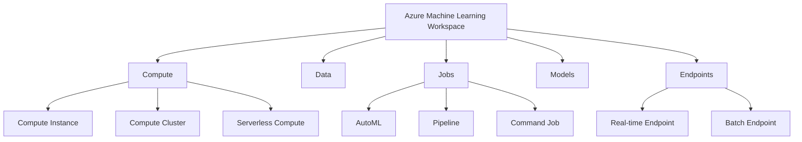
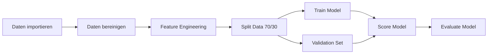
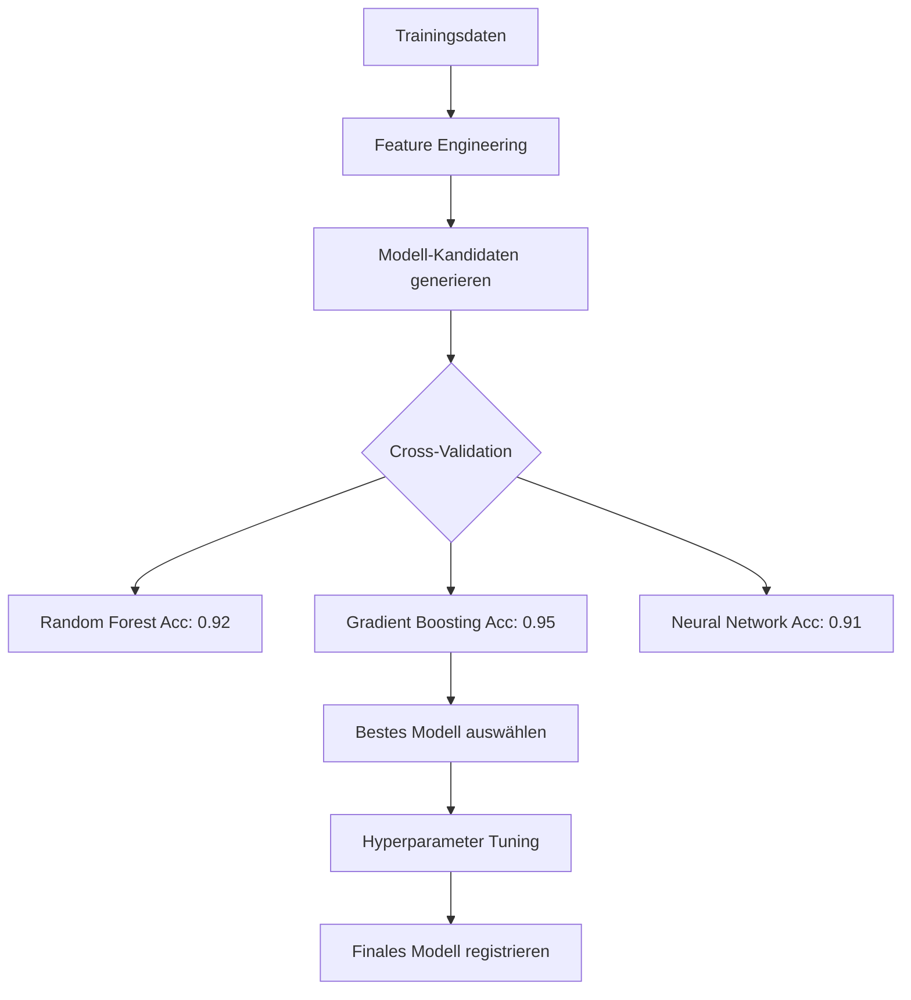

---
tags:
  - azure
  - machine-learning
  - mlops
  - automl
aliases:
  - AML
  - Azure ML
---

# Azure Machine Learning

> [!ABSTRACT] TL;DR
> Azure Machine Learning (AML) ist Microsofts vollständige MLOps-Plattform für klassisches ML und Deep Learning: AutoML, Designer, Pipelines, Modell-Registrierung, Deployment und Responsible AI Dashboard — von Experiment bis Produktion.

---

## Was ist Azure Machine Learning?

**Azure Machine Learning (AML)** ist eine cloudbasierte Plattform für den gesamten Machine-Learning-Lebenszyklus — von der Datenaufbereitung über das Training bis hin zum Deployment und Monitoring von ML-Modellen in der Produktion.

### Wann AML statt Azure AI Foundry?

| Kriterium | Azure ML | Azure AI Foundry |
|-----------|---------|-----------------|
| **Fokus** | Klassisches ML, Custom DL | Generative AI, LLMs |
| **AutoML** | Ja | Nein |
| **Designer** | Ja (No-Code) | Nein |
| **MLOps** | Vollständig | Begrenzt |
| **Custom Training Jobs** | Ja (PyTorch, TF, Scikit) | Eingeschränkt |
| **Prompt Flow** | Via Integration | Primär |
| **Modell-Registrierung** | Umfassend | Ja |
| **Zielgruppe** | Data Scientists | AI-Entwickler |



---

---

## Via Azure Machine Learning Studio (UI)

> [!TIP] Schnellzugriff
> [ml.azure.com](https://ml.azure.com) → **Arbeitsbereich** → **Designer** / **Automatisiertes ML**

### Schritt-für-Schritt

1. **Workspace erstellen** – portal.azure.com → "+ Erstellen" → "Machine Learning" → Subscription, RG, Region, Name
2. **Studio öffnen** – "Studio starten" → ml.azure.com öffnet den Arbeitsbereich
3. **Compute einrichten** – Linke Sidebar → "Compute" → Compute-Instanz (für Entwicklung) oder Compute-Cluster (für Training) erstellen
4. **Designer (No-Code)** – "Designer" → + Neue Pipeline → Module per Drag & Drop verbinden
5. **AutoML** – "Automatisiertes ML" → + Neuer AutoML-Auftrag → Datensatz und Task-Typ (Classification/Regression/etc.) wählen → Starten
6. **Modelle verwalten** – "Modelle" → Modell registrieren oder bereitgestellte Modelle überwachen
7. **Endpunkte** – "Endpunkte" → Online- oder Batch-Endpunkte für Inferenz verwalten

---

## Workspace-Komponenten

### Kernressourcen

| Komponente | Beschreibung |
|-----------|-------------|
| **Workspace** | Zentrale Ressource — enthält alle AML-Artefakte |
| **Compute** | Rechenressourcen für Training und Inferenz |
| **Datastores** | Verbindungen zu Datenspeichern (Blob, ADLS, SQL) |
| **Data Assets** | Versionierte Datasets und Dateiverweise |
| **Environments** | Docker-Images mit definierten Abhängigkeiten |
| **Jobs** | Trainings- und Pipeline-Ausführungen |
| **Models** | Registrierte und versionierte Modelle |
| **Endpoints** | Deployment-Endpunkte für Inferenz |

---

## Compute-Typen

### Compute Instance

**Für:** Entwicklung, Notebooks, interaktive Arbeit

- Verwaltete VM (DS-Serie, GPU-fähig)
- Vorinstalliert: Jupyter, VS Code, Azure ML SDK
- Start/Stop für Kosteneinsparung
- Kein Sharing zwischen Nutzern

```bash
# Compute Instance erstellen (CLI v2)
az ml compute create \
  --name "dev-instance" \
  --type ComputeInstance \
  --size Standard_DS3_v2 \
  --resource-group rg-ml \
  --workspace-name ws-ml
```

### Compute Cluster

**Für:** Skalierbare Trainings-Jobs, AutoML, parallele Ausführung

- Auto-Scaling von 0 bis N Nodes
- Kosten nur bei aktiven Jobs
- GPU-Cluster für Deep Learning (NC, ND, NV-Serie)
- Multi-Node-Training mit MPI, PyTorch DDP

```yaml
# compute-cluster.yml
name: training-cluster
type: amlcompute
size: Standard_NC6s_v3  # GPU VM
min_instances: 0
max_instances: 4
idle_time_before_scale_down: 120
```

### Serverless Compute

**Für:** Einzel-Jobs ohne Cluster-Management

- On-Demand Compute, kein Cluster vorkonfigurieren
- Ideal für seltene oder infrequente Jobs
- Unterstützt CPU und GPU

### Inference Cluster (AKS)

**Für:** Produktions-Deployment von ML-Modellen

- Azure Kubernetes Service (AKS) als Basis
- Skalierbar, hochverfügbar
- SSL-Terminierung, Custom Domains

### Attached Compute

**Für:** Eigene VMs oder Cluster integrieren

- Azure Arc-fähige Server
- HDInsight, Databricks-Cluster
- On-Premises Kubernetes via Arc

---

## Designer (No-Code ML)

Der **AML Designer** ermöglicht ML-Pipeline-Entwicklung ohne Code:



**Verfügbare Komponenten:**
- Datentransformation (Normalization, Feature Hashing, PCA)
- Klassifikation (Logistic Regression, Random Forest, Boosted Trees)
- Regression (Linear Regression, Neural Network)
- Clustering (K-Means)
- Anomalie-Erkennung
- Text Analytics (TF-IDF, Word2Vec)

---

## Automated ML (AutoML)

**AutoML** findet automatisch das beste Modell und Hyperparameter für einen Datensatz:

### Unterstützte Aufgaben

| Task | Beschreibung |
|------|-------------|
| **Klassifikation** | Kategorien vorhersagen (binär, multi-class) |
| **Regression** | Numerische Werte vorhersagen |
| **Time Series Forecasting** | Zeitreihendaten prognostizieren |
| **NLP** | Text-Klassifikation, Named Entity Recognition |
| **Computer Vision** | Bildklassifikation, Objekterkennung |

```python
from azure.ai.ml import MLClient
from azure.ai.ml.automl import classification

automl_job = classification(
    training_data=train_data,
    target_column_name="label",
    primary_metric="accuracy",
    n_cross_validations=5,
    experiment_name="automl-classification",
    compute="training-cluster"
)
automl_job.set_limits(
    timeout_minutes=60,
    trial_timeout_minutes=10,
    max_trials=20,
    max_concurrent_trials=4
)

returned_job = ml_client.jobs.create_or_update(automl_job)
ml_client.jobs.stream(returned_job.name)
```

### AutoML-Prozess



---

## MLOps — ML-Lebenszyklus

### Modell-Registrierung

```python
from azure.ai.ml.entities import Model
from azure.ai.ml.constants import AssetTypes

model = Model(
    path="./outputs/model.pkl",
    type=AssetTypes.CUSTOM_MODEL,
    name="churn-model",
    version="3",
    description="Kunden-Churn Vorhersagemodell",
    tags={"framework": "sklearn", "accuracy": "0.94"}
)
registered_model = ml_client.models.create_or_update(model)
```

### Versionierung und Lineage

| Artefakt | Versioniert | Lineage-Tracking |
|---------|-------------|-----------------|
| Data Assets | Ja | Training-Job verknüpft |
| Environments | Ja | Job verknüpft |
| Models | Ja | Training-Job verknüpft |
| Endpoints | Ja (Deployments) | Modell verknüpft |

### CI/CD für ML (MLOps mit GitHub Actions)

```yaml
# .github/workflows/train-and-deploy.yml
name: ML Train and Deploy
on:
  push:
    branches: [main]
jobs:
  train:
    runs-on: ubuntu-latest
    steps:
      - uses: actions/checkout@v3
      - name: Azure Login
        uses: azure/login@v1
      - name: Run Training Job
        run: |
          az ml job create -f train-job.yml --workspace-name ws-ml
      - name: Deploy to Endpoint
        run: |
          az ml online-deployment create -f deployment.yml
```

---

## Pipelines

**AML Pipelines** sind wiederverwendbare, parallelisierbare ML-Workflows:

```python
from azure.ai.ml import dsl, Input, Output

@dsl.pipeline(
    name="training-pipeline",
    description="Datenaufbereitung und Modelltraining"
)
def training_pipeline(raw_data: Input):
    prep_step = prep_component(raw_data=raw_data)
    train_step = train_component(
        training_data=prep_step.outputs.processed_data
    )
    return {"model": train_step.outputs.model}

pipeline = training_pipeline(
    raw_data=Input(path="azureml:my-dataset@latest")
)
ml_client.jobs.create_or_update(pipeline, experiment_name="pipeline-run")
```

---

## Deployment

### Real-time Endpoint (Online Endpoint)

**Für:** Niedrige Latenz, synchrone Anfragen

```yaml
# online-endpoint.yml
name: churn-endpoint
auth_mode: key
deployments:
  - name: blue
    model: azureml:churn-model@3
    instance_type: Standard_DS3_v2
    instance_count: 2
    environment: azureml:AzureML-sklearn-1.5@latest
    code_configuration:
      code: ./score/
      scoring_script: score.py
```

### Batch Endpoint

**Für:** Große Datensätze, asynchrone Verarbeitung

```bash
az ml batch-endpoint invoke \
  --name churn-batch-endpoint \
  --input azureml:unlabeled-customers@latest \
  --output-path azureml://datastores/predictions/paths/run1/
```

---

## Responsible AI Dashboard

Das **Responsible AI Dashboard** analysiert Modelle auf Fairness und Erklärbarkeit:

| Tool | Zweck |
|------|-------|
| **Error Analysis** | Wo macht das Modell Fehler? Welche Untergruppen? |
| **Model Overview** | Performance-Metriken pro Subgruppe |
| **Data Explorer** | Features, Labels und Verteilungen visualisieren |
| **Fairness** | Disparate Impact, Equal Opportunity, Demographic Parity |
| **Feature Importance** | Global (SHAP) und lokale Erklärungen |
| **Causal Analysis** | Was-wäre-wenn-Analysen für Datenpunkte |
| **Counterfactuals** | Minimale Änderungen für andere Vorhersage |

```python
from raiwidgets import ResponsibleAIDashboard
from responsibleai import RAIInsights

rai_insights = RAIInsights(
    model=model,
    train=train_df,
    test=test_df,
    target_column="label",
    task_type="classification"
)
rai_insights.explainer.add()
rai_insights.error_analysis.add()
rai_insights.fairlearn.add(
    sensitive_features=test_df[["gender", "age_group"]]
)
rai_insights.compute()

ResponsibleAIDashboard(rai_insights)
```

---

## Kosten

| Ressource | Kosten |
|----------|--------|
| **Compute Instance DS3_v2** | ~$0,29/Stunde |
| **Compute Cluster NC6s_v3 GPU** | ~$0,90/Stunde |
| **Serverless Compute** | Variabel nach Nutzung |
| **Storage (Datastore)** | Azure Blob-Preise |
| **Managed Endpoints DS3_v2** | ~$0,29/Stunde/Instanz |

> [!TIP] Kosten senken
> Compute Instances bei Nichtbenutzung stoppen (Auto-Stop-Plan nutzen). Compute Cluster auf min_instances=0 setzen — zahlt nur während Jobs.

---

## Verwandte Notizen
- [[Azure AI Foundry]]
- [[Azure OpenAI Service]]
- [[Azure AI Services]]
- [[Azure KI Zusammenfassung]]
