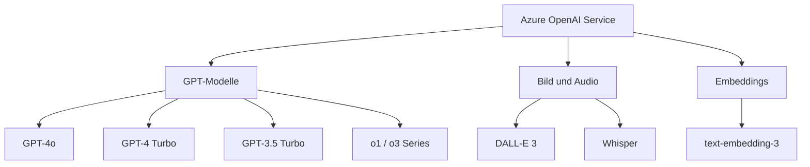
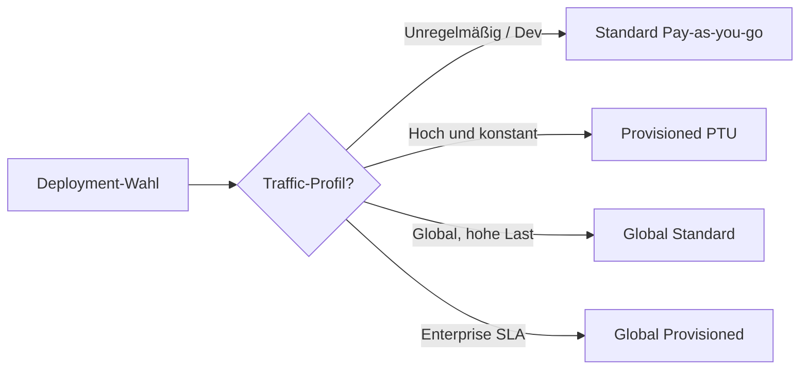
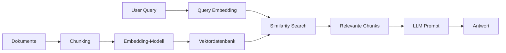
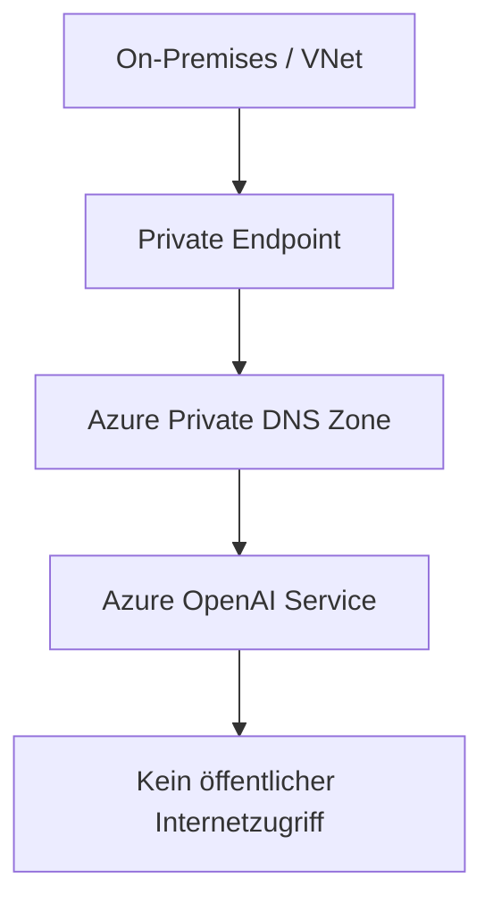

---
tags:
  - azure
  - ki
  - machine-learning
  - openai
aliases:
  - Azure OpenAI
  - AOAI
---

# Azure OpenAI Service

> [!ABSTRACT] TL;DR
> Azure OpenAI Service stellt OpenAI-Modelle (GPT-4o, GPT-4, GPT-3.5, DALL-E, Whisper, Embeddings) über die Azure-Infrastruktur bereit — mit Enterprise-Sicherheit, Private Endpoints, Compliance und Content-Filter. Abrechnung erfolgt token-basiert.

---

## Was ist Azure OpenAI Service?

**Azure OpenAI Service** ist ein von Microsoft gehosteter Dienst, der OpenAI-Sprachmodelle über die Azure-Plattform bereitstellt. Im Unterschied zur direkten OpenAI-API bietet Azure:

- **Datenschutz:** Prompts und Completions werden nicht zum Training von OpenAI-Modellen verwendet
- **Compliance:** ISO 27001, SOC 2, DSGVO-Compliance, private Netzwerkisolierung
- **SLA:** 99,9 % Verfügbarkeits-SLA mit Enterprise-Support
- **Integration:** Native Azure-Services (Key Vault, Managed Identity, VNet, Private Endpoints)
- **Responsible AI:** Integrierte Content-Filter via Azure AI Content Safety



---

## Verfügbare Modelle

### GPT-Modelle

| Modell | Kontext | Besonderheit |
|--------|---------|--------------|
| **GPT-4o** | 128K Token | Multimodal (Text + Bild), schnell, günstig |
| **GPT-4o mini** | 128K Token | Kostengünstige GPT-4o-Variante |
| **GPT-4 Turbo** | 128K Token | Starkes Reasoning, JSON-Mode |
| **GPT-3.5 Turbo** | 16K Token | Günstig, schnell, Chat-Optimiert |
| **o1 / o1-mini** | 128K Token | Chain-of-Thought Reasoning, komplex |
| **o3-mini** | 128K Token | Neuestes Reasoning-Modell (2025) |

### Weitere Modelle

| Modell | Typ | Verwendung |
|--------|-----|------------|
| **DALL-E 3** | Bildgenerierung | Text-zu-Bild (1024×1024 bis 1792×1024) |
| **Whisper** | Speech-to-Text | Audio-Transkription, 99 Sprachen |
| **text-embedding-3-small** | Embeddings | 1536 Dimensionen, günstig |
| **text-embedding-3-large** | Embeddings | 3072 Dimensionen, präziser |
| **text-embedding-ada-002** | Embeddings | Älteres Standardmodell |

---

---

## Via Azure AI Foundry / Azure Portal (UI)

> [!TIP] Schnellzugriff
> [ai.azure.com](https://ai.azure.com) → **Deployments** → **+ Modell bereitstellen**

### Schritt-für-Schritt

1. **Ressource erstellen** – portal.azure.com → "Azure OpenAI" → + Erstellen → Subscription, RG, Region, Tier wählen
2. **AI Foundry öffnen** – Nach Bereitstellung: "Zu Azure AI Foundry wechseln" (ai.azure.com)
3. **Modell bereitstellen** – AI Foundry → Deployments → + Modell bereitstellen → Modell aus Katalog wählen (gpt-4o, gpt-4, gpt-35-turbo etc.)
4. **Deployment konfigurieren** – Deployment-Name, Deployment-Typ (Standard/Provisioned), Token-Limit festlegen
5. **Chat Playground** – Playground → Chat Playground → System Message setzen → Modell testen
6. **DALL-E Playground** – Playground → Images → Prompt eingeben → Bild generieren
7. **API-Key kopieren** – AI Foundry → Projekt-Einstellungen → Verbindungen → API-Key und Endpunkt kopieren

---

## Deployment-Typen

### Übersicht

| Typ | Beschreibung | Latenz | Compliance |
|-----|-------------|--------|------------|
| **Standard** | Pay-as-you-go, regional | Variabel | Regional |
| **Global Standard** | Pay-as-you-go, global | Niedriger | Daten regional gespeichert |
| **Provisioned (PTU)** | Reservierte Kapazität | Vorhersehbar | Regional oder Global |
| **Global Provisioned** | PTU global (seit Sep 2024) | Optimal | Verarbeitung global |

### Provisioned Throughput Units (PTUs)

**PTUs** ermöglichen reservierte, dedizierte Rechenkapazität für Azure OpenAI:

- Keine Quota-Limits durch andere Kunden
- **Vorhersehbare Latenz** für produktive Workloads
- Abrechnung stundenweise (auch Jahres-Reservierungen möglich)
- Portierbar zwischen kompatiblen Modellen



---

## Quotas und Limits

### Token-basierte Limits

| Limit-Typ | Beschreibung |
|-----------|-------------|
| **TPM** | Tokens per Minute — maximaler Tokendurchsatz |
| **RPM** | Requests per Minute — maximale Anfragen |

> [!NOTE] Quota-Management
> Quotas sind pro Deployment konfigurierbar. Über das Azure Portal oder CLI können TPM/RPM-Limits angepasst werden. Standard-Deployments starten häufig mit 30.000 TPM für GPT-4o.

### Typische Standard-Quotas (GPT-4o, East US)

| Deployment-Typ | Standard TPM | Erweiterbar |
|----------------|-------------|-------------|
| Standard | 30.000 | Ja (Request) |
| Global Standard | 450.000 | Ja |
| PTU | Konfiguriert | Kaufen |

---

## Azure OpenAI vs. OpenAI Direct

| Kriterium | Azure OpenAI | OpenAI Direct |
|-----------|-------------|---------------|
| **Datenschutz** | Daten bleiben in Azure-Tenant | OpenAI-Datenschutzrichtlinien |
| **Training** | Keine Datennutzung für Training | Opt-out möglich |
| **Private Endpoints** | Ja | Nein |
| **Managed Identity** | Ja | Nein |
| **Compliance** | ISO 27001, SOC 2, DSGVO | Begrenzt |
| **SLA** | 99,9 % | Kein formales SLA |
| **RBAC** | Azure RBAC | API-Keys only |
| **Modellverfügbarkeit** | Teilmenge der OpenAI-Modelle | Alle Modelle |

> [!IMPORTANT] Enterprise-Wahl
> Für Unternehmensanwendungen mit Datenschutz-Anforderungen (DSGVO, HIPAA, ISO) ist Azure OpenAI die richtige Wahl. Für schnellen Zugang zu neuesten Modellen ist OpenAI Direct flexibler.

---

## Prompting-Grundlagen

### Rollen und Nachrichten

```json
{
  "messages": [
    {
      "role": "system",
      "content": "Du bist ein hilfreicher Assistent für IT-Dokumentation."
    },
    {
      "role": "user",
      "content": "Erkläre Azure RBAC in 3 Sätzen."
    },
    {
      "role": "assistant",
      "content": "Azure RBAC..."
    },
    {
      "role": "user",
      "content": "Welche Built-in Rollen gibt es?"
    }
  ]
}
```

### Wichtige Parameter

| Parameter | Wertebereich | Beschreibung |
|-----------|-------------|-------------|
| **temperature** | 0.0 – 2.0 | 0 = deterministisch, 1+ = kreativ |
| **top_p** | 0.0 – 1.0 | Nucleus Sampling — Wahrscheinlichkeits-Schwelle |
| **max_tokens** | 1 – Modellmax | Maximale Ausgabelänge |
| **frequency_penalty** | -2.0 – 2.0 | Bestraft Wiederholung häufiger Tokens |
| **presence_penalty** | -2.0 – 2.0 | Bestraft Wiederholung bereits verwendeter Tokens |

> [!TIP] Temperature vs. Top-p
> Empfehlung: Entweder `temperature` oder `top_p` anpassen — nicht beide gleichzeitig. Für faktische Aufgaben: `temperature=0`. Für kreative Texte: `temperature=0.7–1.0`.

---

## Chat Completions API

```python
from openai import AzureOpenAI

client = AzureOpenAI(
    azure_endpoint="https://<resource>.openai.azure.com/",
    api_key="<api-key>",
    api_version="2024-10-21"
)

response = client.chat.completions.create(
    model="gpt-4o",  # Deployment-Name
    messages=[
        {"role": "system", "content": "Du bist ein IT-Assistent."},
        {"role": "user", "content": "Was ist Azure OpenAI?"}
    ],
    temperature=0.7,
    max_tokens=500
)

print(response.choices[0].message.content)
```

---

## Assistants API

Die **Assistants API** ermöglicht zustandsbehaftete Konversationen mit persistenten Threads, Datei-Uploads und integrierten Tools.

### Kernkonzepte

| Konzept | Beschreibung |
|---------|-------------|
| **Assistant** | Konfiguriertes Modell mit System-Prompt und Tools |
| **Thread** | Konversations-Container (persistent, tokenbasiert verwaltet) |
| **Message** | Einzelne Nachricht in einem Thread |
| **Run** | Ausführung eines Assistants auf einem Thread |
| **File** | Hochgeladene Datei für Retrieval oder Code Interpreter |

### Tools

- **Code Interpreter:** Führt Python-Code in Sandbox aus (Datenanalyse, Berechnungen, Plots)
- **File Search:** Durchsucht hochgeladene Dokumente (Vector Store)
- **Function Calling:** Ruft externe APIs/Funktionen auf

```python
assistant = client.beta.assistants.create(
    name="Analyse-Assistent",
    instructions="Analysiere Daten und erstelle Visualisierungen.",
    model="gpt-4o",
    tools=[{"type": "code_interpreter"}]
)

thread = client.beta.threads.create()
message = client.beta.threads.messages.create(
    thread_id=thread.id,
    role="user",
    content="Analysiere diese CSV-Daten..."
)
```

---

## Embeddings für RAG

**Embeddings** wandeln Text in numerische Vektoren um, die semantische Ähnlichkeit messbar machen. Grundlage für **Retrieval Augmented Generation (RAG)**.



```python
response = client.embeddings.create(
    model="text-embedding-3-small",
    input="Was ist Azure RBAC?"
)
vector = response.data[0].embedding  # Liste mit 1536 Floats
```

---

## DALL-E 3 Bildgenerierung

```python
result = client.images.generate(
    model="dall-e-3",
    prompt="Ein futuristisches Azure Rechenzentrum, digitale Kunst",
    n=1,
    size="1024x1024",
    quality="hd",    # standard oder hd
    style="vivid"    # vivid oder natural
)
image_url = result.data[0].url
```

| Parameter | Optionen |
|-----------|---------|
| **size** | 1024×1024, 1792×1024, 1024×1792 |
| **quality** | standard, hd |
| **style** | vivid (dramatisch), natural (realistisch) |

---

## Whisper Transkription

```python
with open("audio.mp3", "rb") as audio_file:
    transcript = client.audio.transcriptions.create(
        model="whisper",
        file=audio_file,
        language="de",
        response_format="text"
    )
print(transcript)
```

Whisper unterstützt: MP3, MP4, MPEG, MPGA, M4A, WAV, WEBM (max. 25 MB)

---

## Content Filter (Azure AI Content Safety)

Azure OpenAI filtert standardmäßig schädliche Inhalte in vier Kategorien:

| Kategorie | Beschreibung |
|-----------|-------------|
| **Hate** | Diskriminierung, Hassrede |
| **Violence** | Gewaltdarstellungen |
| **Sexual** | Sexuell explizite Inhalte |
| **Self-harm** | Suizid- und Selbstverletzungsthemen |

Jede Kategorie hat Schwellenwerte: **Safe / Low / Medium / High**

> [!WARNING] Custom Content Filter
> Für spezifische Anwendungsfälle (z.B. medizinische oder juristische Inhalte) kann ein Custom Content Filter beantragt werden, der bestimmte Kategorien lockert.

---

## Private Endpoints für Azure OpenAI



Konfiguration:
1. Private Endpoint in eigenem VNet erstellen
2. DNS: `privatelink.openai.azure.com` konfigurieren
3. Public Network Access auf "Disabled" setzen
4. Firewall: VNet-Regeln oder IP-Whitelist

---

## Responsible AI

Microsoft verpflichtet sich zu sechs Responsible-AI-Prinzipien:

| Prinzip | Bedeutung für Azure OpenAI |
|---------|---------------------------|
| **Fairness** | Vorurteile in Modellausgaben minimieren |
| **Reliability** | Robuste, konsistente Modellverhalten |
| **Privacy** | Datenschutz und Vertraulichkeit |
| **Inclusiveness** | Zugänglichkeit für alle Nutzergruppen |
| **Transparency** | Dokumentation von Modellverhalten und -grenzen |
| **Accountability** | Verantwortlichkeit bei Modelldeployments |

---

## Kosten (Token-basiert)

| Modell | Input (pro 1M Token) | Output (pro 1M Token) |
|--------|---------------------|----------------------|
| GPT-4o | $2,50 | $10,00 |
| GPT-4o mini | $0,15 | $0,60 |
| GPT-4 Turbo | $10,00 | $30,00 |
| GPT-3.5 Turbo | $0,50 | $1,50 |
| text-embedding-3-small | $0,02 | — |
| DALL-E 3 Standard | $0,04/Bild (1024²) | — |
| Whisper | $0,006/Minute | — |

> [!NOTE] PTU-Kosten
> PTU-Deployments werden stündlich abgerechnet. 1 PTU für GPT-4o kostet ca. $2/Stunde. Die Wirtschaftlichkeit lohnt sich ab kontinuierlichem, hohem Durchsatz.

---

## Verwandte Notizen
- [[Azure AI Foundry]]
- [[Azure AI Search]]
- [[Azure Machine Learning]]
- [[Azure KI Zusammenfassung]]
