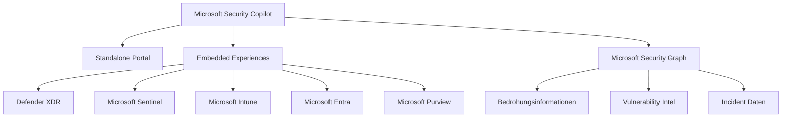
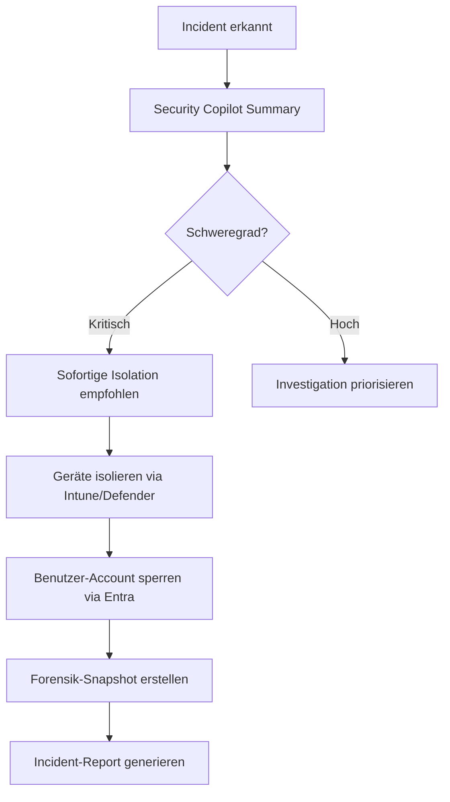
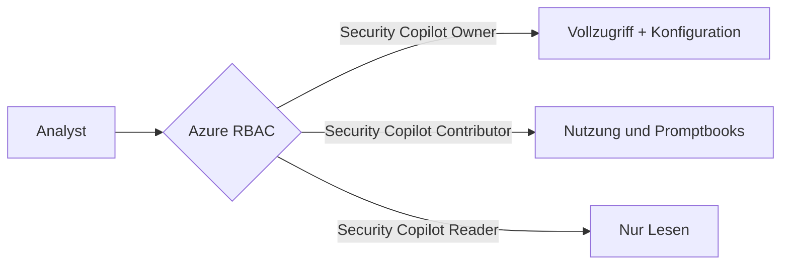

---
tags:
  - azure
  - security
  - ki
  - copilot
  - soc
aliases:
  - Security Copilot
  - Copilot for Security
  - Microsoft Copilot for Security
---

# Microsoft Security Copilot

> [!ABSTRACT] TL;DR
> Microsoft Security Copilot ist ein KI-gestützter Security-Assistent (GPT-4 Basis), der SOC-Teams bei Incident Response, Threat Hunting und Reporting unterstützt. Integriert in Defender XDR, Sentinel, Intune, Entra und Purview. Abrechnung per Security Compute Units (SCUs).

---

## Was ist Microsoft Security Copilot?

**Microsoft Security Copilot** (ehem. Copilot for Security) ist Microsofts KI-gestützter Sicherheitsassistent, der auf GPT-4 und Microsofts Security-spezifischen Modellen basiert. Er unterstützt Security-Analysten bei der schnelleren Bearbeitung von Sicherheitsvorfällen, der Analyse von Bedrohungen und der Automatisierung repetitiver SOC-Aufgaben.

### Kernprinzipien

| Prinzip | Beschreibung |
|---------|-------------|
| **Natürliche Sprache** | Sicherheitsanalysen in Alltagssprache statt KQL |
| **Kontext-bewusst** | Kombiniert Daten aus allen Microsoft-Security-Produkten |
| **Lernend** | Verbessert sich durch Feedback des SOC-Teams |
| **Sicher** | Prompts verlassen keine Compliance-Grenze |



---

---

## Via Security Copilot Portal (UI)

> [!TIP] Schnellzugriff
> [securitycopilot.microsoft.com](https://securitycopilot.microsoft.com) → **Erste Schritte** → SCU zuweisen

### Schritt-für-Schritt

1. **Portal aufrufen** – securitycopilot.microsoft.com (Global Admin oder Security Admin benötigt)
2. **Erste Einrichtung** – "Erste Schritte" → Kapazität konfigurieren
3. **SCU zuweisen** – Kapazität → Azure-Subscription auswählen → SCU-Anzahl festlegen (Mindest: 1 SCU/Stunde)
4. **Datenspeicherung** – Region für Datenspeicherung wählen (EU Data Boundary verfügbar)
5. **Promptbook starten** – Startseite → "+ Neue Sitzung" → Prompt eingeben oder Promptbook wählen
6. **Plugins aktivieren** – Einstellungen → Plugins → Microsoft-eigene und Drittanbieter-Plugins aktivieren
7. **Embedded Experience** – Microsoft Defender XDR (security.microsoft.com) → Incident → "Security Copilot zusammenfassen"

---

## Security Copilot Portal (Standalone)

Das **Standalone Portal** unter `securitycopilot.microsoft.com` bietet:

- **Prompt-Bar:** Freie Eingabe von Security-Anfragen
- **Promptbooks:** Vorgefertigte Prompt-Sequenzen für wiederkehrende Workflows
- **Sessions:** Gespeicherte Konversationen pro Untersuchung
- **Skills:** Aufruf spezifischer Security-Datenquellen
- **Plugins:** Erweiterungen (Microsoft-intern + Third-Party)
- **My Reports:** Automatisch generierte Berichte

### Standalone vs. Embedded

| Merkmal | Standalone Portal | Embedded |
|---------|------------------|---------|
| **Zugang** | Direkte URL | Innerhalb Produkt-UIs |
| **Kontext** | Manuell per Prompt | Automatisch aus aktuellem Incident |
| **Workflow** | Freies Arbeiten | Geführt im Produkt-Flow |
| **Promptbooks** | Ja | Begrenzt |
| **Zielgruppe** | Senior-Analysten, Threat Hunters | Tier-1/2 Analysten |

---

## Embedded Experiences

### Microsoft Defender XDR

Security Copilot ist direkt in Defender XDR integriert:

| Feature | Beschreibung |
|---------|-------------|
| **Incident Summary** | Automatische Zusammenfassung des Vorfalls |
| **Guided Response** | Schrittweise Handlungsempfehlungen |
| **Alert Story** | Erklärung der Angriffskette |
| **KQL-Generierung** | Hunting-Queries aus natürlicher Sprache |
| **Script Analysis** | Malicious Scripts automatisch analysieren |
| **Device Summary** | Gerätezustand und -risiko zusammenfassen |

### Microsoft Sentinel

| Feature | Beschreibung |
|---------|-------------|
| **Incident Investigation** | Incidents analysieren und triagieren |
| **NL2KQL** | KQL-Abfragen aus natürlicher Sprache generieren |
| **Playbook-Erstellung** | SOAR-Playbooks per Beschreibung generieren |
| **Workbook-Analyse** | Sentinel-Workbooks interpretieren |

### Microsoft Intune

| Feature | Beschreibung |
|---------|-------------|
| **Device Summary** | Geräte-Compliance und -risiko |
| **Policy Analysis** | Konfigurationsrichtlinien erklären |
| **Error Code Lookup** | Fehler-Codes und Lösungen |

### Microsoft Entra

| Feature | Beschreibung |
|---------|-------------|
| **User Risk Summary** | Risikobenutzer analysieren |
| **Sign-in Analysis** | Verdächtige Anmeldungen untersuchen |
| **Identity Investigation** | Identitäts-Anomalien erklären |

### Microsoft Purview

| Feature | Beschreibung |
|---------|-------------|
| **Data Risk Summary** | DLP-Vorfälle zusammenfassen |
| **Compliance Query** | Compliance-Status in natürlicher Sprache |

---

## Skills

**Skills** sind vorgefertigte Fähigkeiten, die auf bestimmte Datenquellen zugreifen:

### Microsoft-eigene Skills

| Produkt | Beispiel-Skills |
|---------|----------------|
| **Defender XDR** | GetIncidentDetails, GetAlertsByIncidentId |
| **Sentinel** | RunKQLQuery, GetThreatIntelligence |
| **Entra** | GetUserRiskDetails, GetSignInLogs |
| **Intune** | GetDeviceInfo, GetCompliancePolicy |
| **Defender TI** | GetReputationByIP, GetThreatActor |
| **CVE/NVD** | GetCVEDetails, GetVulnerabilityInfo |

### Third-Party Plugins

- **ServiceNow:** Incident-Tickets erstellen
- **Splunk:** SIEM-Abfragen
- **VirusTotal:** Datei-/URL-Reputation
- **CrowdStrike:** EDR-Daten
- **Custom:** Azure Logic Apps oder Functions als Skill

---

## Promptbooks

**Promptbooks** sind wiederverwendbare Prompt-Sequenzen für strukturierte SOC-Workflows:

### Beispiel: Incident-Triage Promptbook

```
1. Fasse den Incident #{IncidentId} zusammen.
2. Liste alle betroffenen Benutzer und Geräte auf.
3. Erkläre die Angriffstaktiken (MITRE ATT&CK).
4. Welche Lateral-Movement-Aktivitäten wurden erkannt?
5. Erstelle eine priorisierte Handlungsliste für den Analysten.
```

### Verfügbare Standard-Promptbooks

| Promptbook | Beschreibung |
|-----------|-------------|
| **Incident Investigation** | Vollständige Incident-Analyse |
| **Threat Actor Profile** | Bedrohungsakteur recherchieren |
| **Vulnerability Impact Assessment** | CVE-Auswirkung bewerten |
| **Phishing Analysis** | Phishing-E-Mail untersuchen |
| **Suspicious Script Analysis** | PowerShell/Bash-Scripts analysieren |

---

## Natural Language zu KQL

Security Copilot kann KQL-Abfragen aus natürlicher Sprache generieren:

**Eingabe (natürliche Sprache):**
```
Zeige mir alle fehlgeschlagenen Anmeldeversuche der letzten 7 Tage 
von externen IP-Adressen für Administratoren.
```

**Ausgabe (KQL):**
```kql
SigninLogs
| where TimeGenerated >= ago(7d)
| where ResultType != "0"  // 0 = Erfolg
| where NetworkLocationDetails !has "trustedNamedLocation"
| where UserType == "Member"
| join kind=inner (
    IdentityInfo
    | where AssignedRoles has "Global Administrator" 
      or AssignedRoles has "Security Administrator"
    | project AccountUPN, AssignedRoles
) on $left.UserPrincipalName == $right.AccountUPN
| summarize Attempts=count(), IPs=dcount(IPAddress) by UserPrincipalName, AssignedRoles
| order by Attempts desc
```

---

## Incident Summary und Guided Response

### Incident Summary

Automatisch generierte Zusammenfassung enthält:
- **Was:** Art des Angriffs (Ransomware, Phishing, etc.)
- **Wer:** Betroffene Benutzer, Geräte, Dienste
- **Wann:** Zeitlicher Ablauf der Angriffskette
- **Wie:** Verwendete Taktiken und Techniken (MITRE)
- **Auswirkung:** Betroffene Assets und Datenlage

### Guided Response

Schrittweise Handlungsempfehlungen:



---

## Script Analysis

Security Copilot analysiert verdächtige Scripts automatisch:

**Beispiel-Prompt:**
```
Analysiere dieses PowerShell-Script und erkläre, 
was es tut und ob es schädlich ist:

[Base64-kodiertes PowerShell-Script]
```

**Security Copilot-Analyse:**
- Dekodiert verschleierte Inhalte (Base64, XOR)
- Identifiziert MITRE ATT&CK-Techniken
- Bewertet Schweregrad und Schadenspotenzial
- Listet Indikatoren auf (C2-Domains, IP-Adressen)

---

## Vulnerability Summary und Tenant Summarization

### Vulnerability Summary

- CVE-Details in verständlicher Sprache
- Betroffene Systeme im eigenen Tenant identifizieren
- Priorisierung nach Ausnutzbarkeit (EPSS-Score) und Exposition
- Patch-Empfehlungen und Workarounds

### Tenant Summarization

Ein Überblick über den gesamten Security-Status:

```
Erstelle eine Zusammenfassung des aktuellen Sicherheitszustands 
meines Tenants für das wöchentliche Reporting.
```

Ausgabe enthält:
- Offene kritische Incidents
- Top-Risiko-Identitäten und -Geräte
- Ungelöste Compliance-Verstöße
- Aktuelle Bedrohungslage (Threat Intelligence)

---

## MSSP-Szenarien (Multi-Tenant)

Security Copilot unterstützt Managed Security Service Provider (MSSPs):

| Feature | Beschreibung |
|---------|-------------|
| **Multi-Tenant Management** | Mehrere Kunden-Tenants verwalten |
| **Tenant-Switching** | Schnell zwischen Tenants wechseln |
| **Delegated Access** | GDAP (Granular Delegated Admin Privileges) |
| **Isolated Sessions** | Keine Daten-Vermischung zwischen Tenants |

---

## Lizenzierung (Security Compute Units — SCUs)

### SCU-Modell

**Security Compute Units (SCUs)** sind die Abrechnungseinheit für Security Copilot:

| Aspekt | Details |
|--------|---------|
| **Preis** | ~$4 pro SCU/Stunde (standalone) |
| **Minimum** | 1 SCU/Stunde |
| **Jahreskosten (24/7, 1 SCU)** | ~$35.040 |
| **Overage** | ~$6 pro SCU/Stunde |
| **Skalierung** | Beliebig anpassbar |

### Microsoft 365 E5 — Inklusive SCUs (ab Nov 2025)

> [!IMPORTANT] Neue Inklusion ab November 2025
> Ab November 2025 erhalten alle **Microsoft 365 E5**-Kunden Security Copilot ohne Aufpreis:
> - **400 SCUs pro 1.000 Nutzer/Monat** (bis max. 10.000 SCUs)
> - Automatische Bereitstellung, kein separates Azure-Setup nötig
> - Gilt für alle Embedded Experiences (Defender, Sentinel, Intune, Entra, Purview)

| Lizenz | SCU-Zuteilung | Setup |
|--------|-------------|-------|
| **M365 E5** | 400 SCUs / 1.000 User / Monat | Automatisch |
| **Standalone** | Selbst konfiguriert | Azure Portal |
| **MSSP** | Pro Kunden-Tenant | Azure Lighthouse |

---

## Datenschutz und Compliance

> [!NOTE] Datenschutz-Garantien
> - Prompts und Antworten werden **nicht** für Training von Microsoft- oder OpenAI-Modellen genutzt
> - Daten verlassen **nicht** die Compliance-Grenze des Tenants
> - Verarbeitung erfolgt in der zugewiesenen Azure-Region
> - SOC 2 Type II, ISO 27001 zertifiziert

### Zugriffskontrolle



---

## Aktuelle GA-Features 2024/2025

| Feature | Status | Beschreibung |
|---------|--------|-------------|
| **Standalone Portal** | GA | Vollständig verfügbar |
| **Defender XDR Embedded** | GA | Incident Summary, Guided Response |
| **Sentinel Embedded** | GA | Incident Investigation, NL2KQL |
| **Intune Embedded** | GA | Device Summary, Error Lookup |
| **Entra Embedded** | GA | User Risk, Sign-in Analysis |
| **Purview Embedded** | GA | DLP-Incident Summary |
| **M365 E5 Inklusion** | GA (Nov 2025) | Automatische SCU-Zuteilung |
| **Security Agents** | Preview | Autonome Sicherheitsagenten |
| **Custom Plugins** | GA | Logic Apps / Functions |

---

## Verwandte Notizen
- [[Microsoft Defender XDR]]
- [[Microsoft Sentinel]]
- [[Azure KI Zusammenfassung]]
- [[Microsoft Copilot for M365]]
