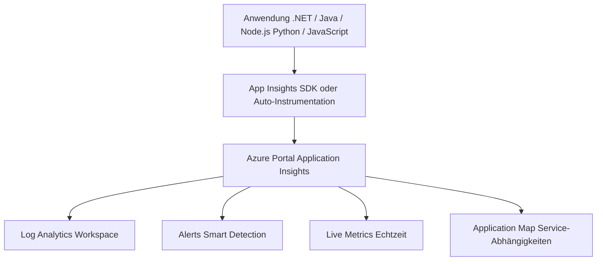
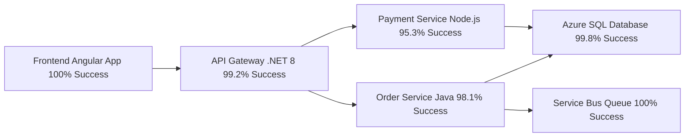
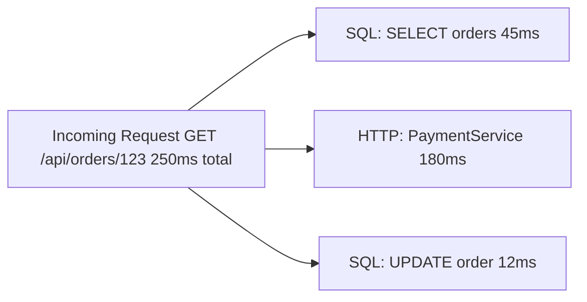

---
tags:
  - azure
  - monitoring
  - apm
  - application-insights
  - observability
aliases:
  - App Insights
  - Application Insights
  - APM Azure
---

# Application Insights

> [!ABSTRACT]
> Application Insights ist Azures APM-Lösung (Application Performance Monitoring) und Teil von Azure Monitor. Es überwacht Laufzeitverhalten, Performance und Fehler von Webanwendungen, APIs und Microservices — mit SDK-Integration oder codeless Auto-Instrumentation.

---

## Was ist Application Insights?

Application Insights bietet:
- **Echtzeit-Telemetrie** (Requests, Dependencies, Exceptions)
- **Distributed Tracing** (End-to-End Request-Verfolgung über Microservices)
- **Smart Detection** (automatische Anomalie-Erkennung)
- **Availability Tests** (externe Überwachung der Erreichbarkeit)
- **User Behavior Analytics** (wie nutzen User die App?)



---

## Workspace-based vs. Classic

> [!IMPORTANT]
> **Classic Application Insights** ist seit **Februar 2024 abgekündigt**. Alle Ressourcen müssen auf **Workspace-based** migriert werden.

| Eigenschaft | Classic | Workspace-based |
|---|---|---|
| Datenspeicher | Eigene isolierte Datenbank | Log Analytics Workspace |
| KQL-Abfragen | Nur in App Insights Portal | Auch direkt im LAW |
| Cross-Resource Queries | Eingeschränkt | Vollständig (workspace-Kontext) |
| RBAC | App Insights-spezifisch | LAW RBAC |
| Kosten-Transparenz | Separat | Im LAW-Verbrauch integriert |
| Retention-Konfiguration | Separat | Über LAW-Tabellen |

```powershell
# Migration Classic → Workspace-based
$law = Get-AzOperationalInsightsWorkspace -ResourceGroupName "rg-monitoring" -Name "law-central"

Update-AzApplicationInsights `
  -ResourceGroupName "rg-myapp" `
  -Name "appi-myapp-prod" `
  -WorkspaceResourceId $law.ResourceId
```

---

## SDK vs. Auto-Instrumentation

### SDK-basierte Instrumentation

Manuelle Integration in den Anwendungscode. Ermöglicht:
- Custom Events und Custom Metrics
- Custom Telemetry-Prozessoren
- Vollständige Kontrolle über Sampling

```bash
# .NET SDK installieren
dotnet add package Microsoft.ApplicationInsights.AspNetCore

# Java SDK (Maven)
# pom.xml: applicationinsights-spring-boot-starter

# Node.js SDK
npm install applicationinsights
```

### Auto-Instrumentation (Codeless)

Kein Codeänderung nötig — Instrumentation wird automatisch eingefügt.

| Plattform | Auto-Instrumentation |
|---|---|
| Azure App Service (.NET) | ✅ Portal-Einstellung |
| Azure App Service (Java) | ✅ Portal-Einstellung |
| Azure App Service (Node.js) | ✅ Portal-Einstellung |
| Azure Functions | ✅ Automatisch |
| AKS / Kubernetes | ✅ Auto-Instrumentation Operator |
| Azure Spring Apps | ✅ Integriert |
| On-Premises | SDK erforderlich |

```powershell
# Auto-Instrumentation für App Service aktivieren
az webapp config appsettings set \
  --resource-group rg-myapp \
  --name app-myapp-prod \
  --settings APPLICATIONINSIGHTS_CONNECTION_STRING="InstrumentationKey=xxx;IngestionEndpoint=https://..."
```

---

## Unterstützte Sprachen

| Sprache / Framework | SDK | Auto-Instrumentation |
|---|---|---|
| **.NET / .NET Core** | ✅ Vollständig | ✅ App Service, AKS |
| **Java** | ✅ Vollständig | ✅ Java Agent (javaagent) |
| **Node.js** | ✅ Vollständig | ✅ App Service |
| **Python** | ✅ OpenTelemetry-basiert | Eingeschränkt |
| **JavaScript** (Browser) | ✅ Web SDK | N/A |
| **Go** | OpenTelemetry | Eingeschränkt |

> [!NOTE]
> Ab 2024 empfiehlt Microsoft die **OpenTelemetry-basierten Azure Monitor Exporter** für neue Projekte statt der klassischen SDKs.

---

## Telemetrie-Typen

### Requests
HTTP-Eingehende Anfragen an die Anwendung.

```csharp
// .NET: Custom Request Tracking
var client = new TelemetryClient();
var operation = client.StartOperation<RequestTelemetry>("ProcessOrder");
try
{
    // Verarbeitung
    operation.Telemetry.ResponseCode = "200";
    operation.Telemetry.Success = true;
}
catch (Exception ex)
{
    operation.Telemetry.Success = false;
    client.TrackException(ex);
    throw;
}
finally
{
    client.StopOperation(operation);
}
```

### Dependencies
Ausgehende Aufrufe (HTTP, SQL, Service Bus, Blob Storage, etc.)

```kusto
// Langsame Dependency-Aufrufe analysieren
AppDependencies
| where TimeGenerated > ago(1h)
| where DurationMs > 1000
| summarize AvgDuration = avg(DurationMs), Count = count(), FailureRate = countif(Success == false) * 100.0 / count()
    by DependencyType, Target, Name
| sort by AvgDuration desc
```

### Exceptions

```kusto
// Top-Exceptions der letzten 24 Stunden
AppExceptions
| where TimeGenerated > ago(24h)
| summarize Count = count() by ExceptionType, OuterMessage
| sort by Count desc
| take 20
```

### Traces (Logs)

```csharp
// .NET: Trace-Logging
_logger.LogInformation("Bestellung {OrderId} wird verarbeitet", orderId);
_logger.LogWarning("Zahlungsanbieter antwortet langsam: {DurationMs}ms", duration);
_logger.LogError(ex, "Fehler bei Bestellung {OrderId}", orderId);
```

### Custom Events und Metrics

```javascript
// JavaScript Web SDK: Custom Event
appInsights.trackEvent({
    name: 'CheckoutCompleted',
    properties: {
        productCategory: 'Electronics',
        paymentMethod: 'CreditCard'
    },
    measurements: {
        totalValue: 299.99,
        itemCount: 3
    }
});

// Custom Metric
appInsights.trackMetric({
    name: 'CartSize',
    average: 4.2
});
```

---

## Live Metrics

Live Metrics bietet **Echtzeit-Einblick** in laufende Telemetrie — mit < 1 Sekunde Latenz.

| Metrik | Beschreibung |
|---|---|
| Incoming Requests/s | Aktuelle Request-Rate |
| Incoming Request Duration | Aktuelle durchschnittliche Antwortzeit |
| Outgoing Requests/s | Dependency-Aufrufrate |
| Overall Health | Aggregierter Gesundheits-Indikator |
| Server CPU | CPU-Auslastung |
| Server Memory | RAM-Auslastung |
| Exceptions/s | Aktuelle Fehlerrate |

> [!TIP]
> Live Metrics ist ideal während **Deployments** oder **Incidents** — sofortiges Feedback ob ein Rollout Probleme verursacht.

---

## Application Map

Die Application Map visualisiert **Service-Abhängigkeiten** und ihren Gesundheitsstatus.



Jeder Knoten zeigt:
- Request-Rate
- Fehlerrate (in Prozent)
- Durchschnittliche Latenz
- Clickthrough zu den Abhängigkeits-Details

---

## Transaction Search und End-to-End Traces

Distributed Tracing über `operation_Id`:

```kusto
// End-to-End Trace für eine Operation
let operationId = "a1b2c3d4e5f6";
union AppRequests, AppDependencies, AppExceptions, AppTraces
| where OperationId == operationId
| project TimeGenerated, ItemType, Name, DurationMs, Success, Message
| sort by TimeGenerated asc
```



---

## Smart Detection

Smart Detection erkennt automatisch Anomalien ohne manuelle Alert-Konfiguration.

| Erkennungsregel | Beschreibung |
|---|---|
| **Failure Anomalies** | Ungewöhnliche Fehlerrate im Vergleich zu Baseline |
| **Performance Anomalies** | Langsame Pages oder Requests |
| **Memory Leak Detection** | Stetig steigender Speicherverbrauch |
| **Security Detection** | Verdächtige Aktivitätsmuster |
| **Trace Severity** | Unerwartete Log-Level-Änderungen |

> [!NOTE]
> Smart Detection benötigt ca. **7 Tage** Daten, um eine Baseline aufzubauen. Danach erfolgen Benachrichtigungen per E-Mail oder Action Group.

---

## Availability Tests

### URL-Ping Test (Standard)

Einfachster Test: HTTP-GET auf eine URL von einem Azure-Teststandort.

```powershell
# Availability Test per Azure CLI erstellen
az monitor app-insights web-test create \
  --resource-group rg-myapp \
  --app-insights-name appi-myapp-prod \
  --name "Homepage Health Check" \
  --location westeurope \
  --url "https://myapp.azurewebsites.net/health" \
  --frequency 300 \
  --timeout 30 \
  --enabled true \
  --locations '["emea-nl-ams-azr", "emea-gb-db3-azr", "us-va-ash-azr"]'
```

### Standard Test (empfohlen)

Unterstützt benutzerdefinierte HTTP-Header, Authentifizierungs-Token und SSL-Zertifikat-Prüfung.

### Multi-Step Web Test

Aufgezeichnete Transaktionsfolge (z.B. Login → Warenkorb → Checkout).

> [!WARNING]
> Multi-Step Web Tests (Webtest-Recorder) werden Ende 2024 abgekündigt. Ersatz: **TrackAvailability() API** für Custom Availability Tests.

```csharp
// Custom Availability Test per Code
public async Task RunAvailabilityTest()
{
    var client = new TelemetryClient();
    var availability = new AvailabilityTelemetry
    {
        Name = "OrderFlow End-to-End",
        RunLocation = "Custom",
        Success = false
    };
    var stopwatch = Stopwatch.StartNew();
    try
    {
        // Test-Logik hier
        await _httpClient.PostAsync("/api/orders", testOrder);
        availability.Success = true;
    }
    catch (Exception ex)
    {
        availability.Message = ex.Message;
        client.TrackException(ex);
    }
    finally
    {
        stopwatch.Stop();
        availability.Duration = stopwatch.Elapsed;
        client.TrackAvailability(availability);
    }
}
```

---

## User Behavior Analytics

| Feature | Beschreibung |
|---|---|
| **Users** | Eindeutige Benutzer über Zeit |
| **Sessions** | Sitzungsdauer, Abbruchrate |
| **Funnels** | Conversion-Rate durch mehrstufige Flows |
| **Retention** | Wiederkehrende Benutzer (Day 1, Day 7, Day 30) |
| **User Flows** | Visualisierung, welche Pfade User nehmen |
| **Impact** | Einfluss von Ladezeit auf Conversion |

```kusto
// Täglich aktive Benutzer (DAU)
AppPageViews
| where TimeGenerated > ago(30d)
| summarize DAU = dcount(UserId) by bin(TimeGenerated, 1d)
| render timechart

// Top-Seiten nach Seitenaufrufen
AppPageViews
| where TimeGenerated > ago(7d)
| summarize Views = count() by Name
| sort by Views desc
| take 20
```

---

## Sampling

Sampling reduziert Telemetrie-Volumen und damit Kosten.

| Sampling-Typ | Funktionsweise | Empfehlung |
|---|---|---|
| **Adaptive Sampling** | Passt automatisch Rate an Volumen an | Standard, .NET SDK |
| **Fixed Rate** | Fester Prozentsatz (z.B. 10 %) | Wenn statistische Konsistenz wichtig |
| **Ingestion Sampling** | Filtert nach Eingang im Backend | Letzter Ausweg (verliert Frontend-Kontext) |

```json
// applicationinsights.json: Adaptive Sampling konfigurieren
{
  "sampling": {
    "isEnabled": true,
    "maxTelemetryItemsPerSecond": 20,
    "evaluationInterval": "00:00:15",
    "initialSamplingPercentage": 100,
    "samplingPercentageDecreaseTimeout": "00:02:00",
    "samplingPercentageIncreaseTimeout": "00:15:00",
    "minSamplingPercentage": 5
  }
}
```

> [!IMPORTANT]
> Beim Sampling werden immer **vollständige Traces zusammengehalten** — entweder wird die gesamte Operation gesampelt oder gar nicht. Das erhält die Konsistenz der End-to-End Traces.

---

## Kosten

| Komponente | Kosten |
|---|---|
| Daten-Ingest | ~2,30 $/GB (über LAW) |
| Erste 5 GB/Monat | Kostenlos (pro LAW) |
| Availability Tests (Standard) | Kostenlos bis 1 Million Tests |
| Multi-Step Web Tests | ~0,10 $ pro 1.000 Tests |
| Smart Detection | Kostenlos |
| Live Metrics | Kostenlos |

> [!TIP]
> Mit **Adaptive Sampling** und sinnvollen Sampling-Grenzen können App-Insights-Kosten auf 10–20 % des ungesampelten Volumens reduziert werden.

---

---

## Via Azure Portal (UI)

> [!TIP]
> Portal: **[portal.azure.com](https://portal.azure.com)**

**Application Insights erstellen:**
1. [portal.azure.com](https://portal.azure.com) → **+ Ressource erstellen** → **Application Insights**
2. Ressourcengruppe, Name, Region und **Log Analytics Workspace** (workspace-based) auswählen → **Erstellen**

**Instrumentierungsschlüssel/Connection String abrufen:**
- Ressource öffnen → **Übersicht** → **Connection String** kopieren → In Anwendungskonfiguration eintragen

**Anwendungszuordnung anzeigen:**
- Application Insights → **Anwendungszuordnung** → Topologie der Abhängigkeiten (Dienste, Datenbanken) visualisieren

**Live Metrics anzeigen:**
- Application Insights → **Livemetriken** → Echtzeit-Anfragen, Fehler und Leistung beobachten

**Availability-Test erstellen:**
- Application Insights → **Verfügbarkeit** → **+ Standard-Test hinzufügen** → URL, Frequenz und Schwellenwerte konfigurieren

**Fehler und Ausnahmen analysieren:**
- Application Insights → **Fehler** → Fehlerrate und Ausnahmen nach Operation oder Abhängigkeit aufschlüsseln

**Performance-Analyse:**
- Application Insights → **Leistung** → Langsame Anfragen und Abhängigkeiten identifizieren

---

## Bicep: Application Insights

```bicep
resource law 'Microsoft.OperationalInsights/workspaces@2022-10-01' existing = {
  name: 'law-central'
  scope: resourceGroup('rg-monitoring')
}

resource appInsights 'Microsoft.Insights/components@2020-02-02' = {
  name: 'appi-myapp-prod'
  location: 'westeurope'
  kind: 'web'
  properties: {
    Application_Type: 'web'
    WorkspaceResourceId: law.id
    IngestionMode: 'LogAnalytics'
    publicNetworkAccessForIngestion: 'Enabled'
    publicNetworkAccessForQuery: 'Enabled'
    RetentionInDays: 90
    SamplingPercentage: 100  // Adaptive Sampling im SDK konfigurieren
  }
}

// Connection String als Output für App-Konfiguration
output connectionString string = appInsights.properties.ConnectionString
output instrumentationKey string = appInsights.properties.InstrumentationKey
```

---

## Verwandte Notizen

- [[Azure Monitor Grundlagen]]
- [[Log Analytics Workspace]]
- [[Azure Alerts]]
- [[Azure API Management]]
