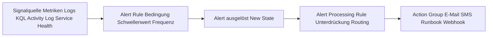
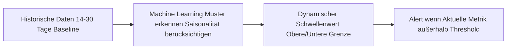
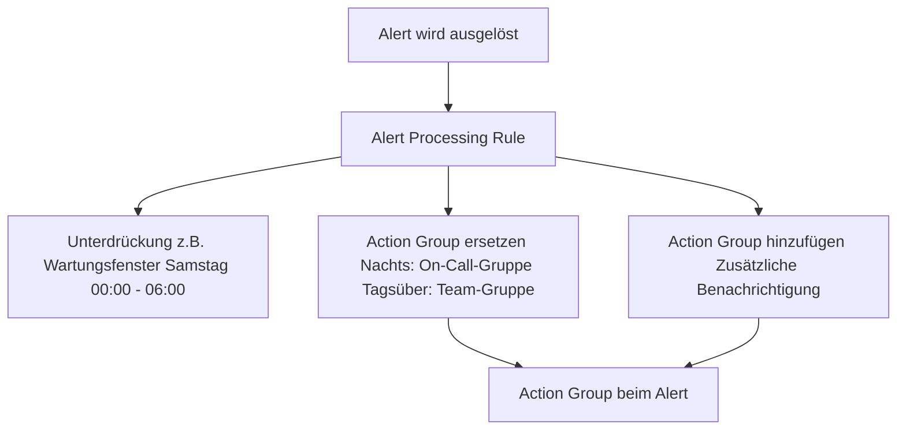
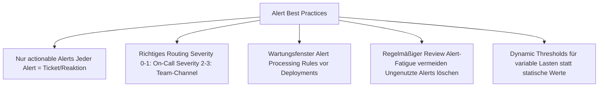

---
tags:
  - azure
  - monitoring
  - alerts
  - alerting
  - azure-monitor
aliases:
  - Azure Alerts
  - Monitor Alerts
  - Alert Rules
---

# Azure Alerts

> [!ABSTRACT]
> Azure Alerts benachrichtigen proaktiv bei Problemen in Azure-Infrastruktur und Anwendungen. Sie basieren auf Metriken, Logs, Activity Log-Ereignissen oder Service Health und lösen über Action Groups Benachrichtigungen und automatisierte Aktionen aus.

---

## Was sind Azure Alerts?

Azure Alerts überwachen kontinuierlich Signale aus Azure Monitor und lösen Aktionen aus, wenn vordefinierte Bedingungen erfüllt sind.



---

## Alert-Typen

### Übersicht

| Typ | Signal | Anwendungsfall |
|---|---|---|
| **Metric Alert** | Metriken | CPU > 90 %, Requests/s < 100 |
| **Log Search Alert** | KQL-Abfrage auf LAW | Fehlermuster, Anomalien im Log |
| **Activity Log Alert** | Azure-Operationen | VM gelöscht, Policy-Änderung |
| **Service Health Alert** | Azure-Dienststatus | Azure-Ausfälle, Maintenance |
| **Smart Detection Alert** | App Insights ML | Failure-Anomalien |
| **Prometheus Alert** | Prometheus-Metriken | AKS-Cluster-Metriken |

---

## Metric Alerts

### Statische Schwellenwerte

```powershell
# CPU-Alert auf eine VM — statischer Schwellenwert
New-AzMetricAlertRuleV2 `
  -Name "vm-cpu-high" `
  -ResourceGroupName "rg-prod" `
  -WindowSize "00:05:00" `
  -Frequency "00:01:00" `
  -TargetResourceId "/subscriptions/{subId}/resourceGroups/rg-prod/providers/Microsoft.Compute/virtualMachines/vm-prod-01" `
  -Condition (
    New-AzMetricAlertRuleV2Criteria `
      -MetricName "Percentage CPU" `
      -MetricNamespace "Microsoft.Compute/virtualMachines" `
      -Operator "GreaterThan" `
      -Threshold 90 `
      -TimeAggregation "Average"
  ) `
  -ActionGroupId "/subscriptions/{subId}/resourceGroups/rg-monitoring/providers/microsoft.insights/actionGroups/ag-ops-team" `
  -Severity 2 `
  -Description "VM CPU über 90% für 5 Minuten"
```

### Dynamic Thresholds (Machine Learning)

Dynamic Thresholds lernen aus historischen Daten und setzen automatisch sinnvolle Schwellenwerte — ohne manuelle Kalibrierung.



| Eigenschaft | Statisch | Dynamisch |
|---|---|---|
| Konfiguration | Manuell, Zahl eingeben | Automatisch lernend |
| Saisonalität | Muss manuell berücksichtigt werden | Automatisch erkannt |
| Empfindlichkeit | Fix | Low / Medium / High wählbar |
| Cold-Start | Sofort | Benötigt 14 Tage Daten |
| Geeignet für | Bekannte feste Grenzwerte | Variable Lasten (Web-Traffic) |

```powershell
# Dynamic Threshold Alert
$condition = New-AzMetricAlertRuleV2Criteria `
  -MetricName "Requests" `
  -MetricNamespace "Microsoft.Web/sites" `
  -Operator "LessThan" `
  -DynamicThreshold `
  -DynamicThresholdSensitivity "Medium" `
  -DynamicThresholdFailingPeriod 4 `
  -DynamicThresholdTotalPeriod 4 `
  -TimeAggregation "Total"
```

---

## Log Search Alerts

KQL-basierte Alerts auf Log Analytics Workspace-Daten.

### Konfigurationsparameter

| Parameter | Beschreibung |
|---|---|
| **KQL Query** | Die Abfrage, die ausgeführt wird |
| **Frequency** | Wie oft wird abgefragt? (1 min – 1 Tag) |
| **Time Window** | Welcher Zeitraum wird analysiert? |
| **Threshold** | Anzahl Ergebnisse, die Alert auslösen |
| **Aggregation** | Wie werden Ergebnisse gemessen? |

### Beispiele

```kusto
// Alert: Mehr als 10 Failed Logins in 15 Minuten
SecurityEvent
| where TimeGenerated > ago(15m)
| where EventID == 4625
| summarize FailedLogins = count()
| where FailedLogins > 10
```

```kusto
// Alert: HTTP 5xx Fehlerrate > 5%
AppRequests
| where TimeGenerated > ago(5m)
| summarize
    Total = count(),
    Errors = countif(ResultCode startswith "5")
| extend ErrorRate = Errors * 100.0 / Total
| where ErrorRate > 5
```

```kusto
// Alert: VM ohne Heartbeat seit 15 Minuten
Heartbeat
| where TimeGenerated > ago(15m)
| summarize LastHeartbeat = max(TimeGenerated) by Computer
| where LastHeartbeat < ago(15m)
```

> [!WARNING]
> Log Search Alerts haben eine **Mindest-Frequency** abhängig vom Time Window. Sehr kurze Intervalle (< 5 Minuten) sind teurer und verursachen mehr Workspace-Last.

### Bicep: Log Search Alert

```bicep
resource logAlert 'Microsoft.Insights/scheduledQueryRules@2022-06-15' = {
  name: 'alert-failed-logins'
  location: 'westeurope'
  properties: {
    displayName: 'Zu viele fehlgeschlagene Logins'
    description: 'Mehr als 10 fehlgeschlagene Logins in 15 Minuten'
    severity: 2
    enabled: true
    evaluationFrequency: 'PT5M'
    windowSize: 'PT15M'
    scopes: [
      '/subscriptions/{subId}/resourceGroups/rg-monitoring/providers/Microsoft.OperationalInsights/workspaces/law-central'
    ]
    criteria: {
      allOf: [
        {
          query: '''SecurityEvent
| where EventID == 4625
| summarize FailedLogins = count()
| where FailedLogins > 10'''
          timeAggregation: 'Count'
          operator: 'GreaterThan'
          threshold: 0
          failingPeriods: {
            numberOfEvaluationPeriods: 1
            minFailingPeriodsToAlert: 1
          }
        }
      ]
    }
    actions: {
      actionGroups: [
        '/subscriptions/{subId}/resourceGroups/rg-monitoring/providers/microsoft.insights/actionGroups/ag-security-team'
      ]
    }
  }
}
```

---

## Activity Log Alerts

Überwachen Azure-Ressourcenmanagement-Ereignisse:

| Ereignis | Alert-Empfehlung |
|---|---|
| VM gelöscht | ✅ Immer alertieren |
| Key Vault gelöscht | ✅ Immer alertieren |
| NSG-Regel geändert | ✅ Security-relevant |
| RBAC-Rolle zugewiesen | ✅ Privilege-Escalation |
| Policy geändert | ✅ Compliance |
| Subscription-Level-Änderungen | ✅ Kritisch |

```powershell
# Activity Log Alert: VM-Löschung in einer Resource Group
$condition = New-AzActivityLogAlertCondition `
  -Field "category" -Equal "Administrative" |
  Add-AzActivityLogAlertCondition `
  -Field "operationName" -Equal "Microsoft.Compute/virtualMachines/delete" |
  Add-AzActivityLogAlertCondition `
  -Field "status" -Equal "Succeeded"

Set-AzActivityLogAlert `
  -Location "Global" `
  -Name "alert-vm-deleted" `
  -ResourceGroupName "rg-monitoring" `
  -Scope "/subscriptions/{subId}/resourceGroups/rg-prod" `
  -Action (New-AzActionGroup -ActionGroupId "/subscriptions/{subId}/resourceGroups/rg-monitoring/providers/microsoft.insights/actionGroups/ag-ops-team") `
  -Condition $condition `
  -Description "VM in rg-prod wurde gelöscht"
```

---

## Service Health Alerts

Service Health Alerts benachrichtigen bei:

| Typ | Beschreibung |
|---|---|
| **Service Issues** | Aktuelle Azure-Ausfälle (Incidents) |
| **Planned Maintenance** | Angekündigte Wartungsfenster |
| **Health Advisories** | Empfehlungen, Abkündigungen |
| **Security Advisories** | Sicherheitsrelevante Azure-Informationen |

```powershell
# Service Health Alert für alle Azure-Dienste in West Europe
New-AzActivityLogAlert `
  -Name "alert-service-health-westeurope" `
  -ResourceGroupName "rg-monitoring" `
  -Location "Global" `
  -Scope "/subscriptions/{subId}" `
  -Condition @(
    New-AzActivityLogAlertCondition -Field "category" -Equal "ServiceHealth",
    New-AzActivityLogAlertCondition -Field "properties.impactedServices[*].ImpactedRegions[*].RegionName" -Equal "West Europe"
  ) `
  -ActionGroupId "/subscriptions/{subId}/resourceGroups/rg-monitoring/providers/microsoft.insights/actionGroups/ag-ops-team"
```

---

## Action Groups

Action Groups definieren **wer und was** bei einem Alert passiert.

### Aktionstypen

| Typ | Beschreibung | Anwendungsfall |
|---|---|---|
| **E-Mail** | E-Mail an Empfänger | Standard-Benachrichtigung |
| **SMS** | Textnachricht | On-Call-Rotation |
| **Push** | Azure-App-Benachrichtigung | Mobile On-Call |
| **Voice** | Telefonanruf | Kritische Alerts |
| **ITSM** | ServiceNow, Jira, etc. | Ticket-Erstellung |
| **Runbook** | Azure Automation Runbook | Automatische Remediation |
| **Azure Function** | Serverless-Code | Custom Logik |
| **Logic App** | Workflow-Automatisierung | Komplexe Workflows |
| **Webhook** | HTTP-POST an beliebige URL | PagerDuty, Slack, Teams |
| **Event Hub** | Streaming von Alerts | SIEM-Integration |

```bicep
resource actionGroup 'microsoft.insights/actionGroups@2023-01-01' = {
  name: 'ag-ops-team'
  location: 'Global'
  properties: {
    groupShortName: 'OpsTeam'
    enabled: true
    emailReceivers: [
      {
        name: 'Ops-Team-Email'
        emailAddress: 'ops-team@contoso.com'
        useCommonAlertSchema: true
      }
    ]
    smsReceivers: [
      {
        name: 'On-Call-SMS'
        countryCode: '49'
        phoneNumber: '1234567890'
      }
    ]
    webhookReceivers: [
      {
        name: 'Teams-Webhook'
        serviceUri: 'https://outlook.office.com/webhook/...'
        useCommonAlertSchema: true
      }
    ]
    automationRunbookReceivers: [
      {
        name: 'Auto-Remediation'
        automationAccountId: '/subscriptions/{subId}/resourceGroups/rg-automation/providers/Microsoft.Automation/automationAccounts/aa-prod'
        runbookName: 'Restart-UnhealthyVM'
        isGlobalRunbook: false
        useCommonAlertSchema: true
      }
    ]
  }
}
```

---

## Alert Processing Rules

Alert Processing Rules (früher: Suppression Rules) steuern, **welche Action Groups** bei einem Alert benachrichtigt werden — und wann Alerts unterdrückt werden.

### Anwendungsfälle



```powershell
# Alert Processing Rule: Wartungsfenster (Alerts unterdrücken)
New-AzAlertProcessingRule `
  -Name "apr-maintenance-saturday" `
  -ResourceGroupName "rg-monitoring" `
  -Scope "/subscriptions/{subId}/resourceGroups/rg-prod" `
  -FilterAlertRuleName @("vm-cpu-high", "vm-heartbeat") `
  -ActionType "RemoveAllActionGroups" `
  -ScheduleRecurrenceType "Weekly" `
  -ScheduleRecurrenceDayOfWeek "Saturday" `
  -ScheduleStartTime "00:00:00" `
  -ScheduleEndTime "06:00:00" `
  -Description "Wartungsfenster Samstagnacht"
```

---

## Alert-Status und Lifecycle

| Status | Beschreibung |
|---|---|
| **New** | Alert wurde ausgelöst, noch nicht bearbeitet |
| **Acknowledged** | Jemand hat den Alert gesehen und übernommen |
| **Closed** | Alert ist behoben oder manuell geschlossen |

### Stateful vs. Stateless

| Eigenschaft | Stateful | Stateless |
|---|---|---|
| Alert-Erstellung | Einmal pro Bedingung | Bei jeder Evaluation |
| Automatisches Schließen | ✅ Wenn Bedingung nicht mehr gilt | ❌ Bleibt offen |
| Anwendung | Metric Alerts, Log Alerts (Standard) | Ältere Log Alerts |
| Alert-Menge | Gering (eine Instanz) | Hoch (viele Instanzen) |

> [!TIP]
> Immer **Stateful Alerts** bevorzugen. Sie erzeugen weniger Noise und schließen sich automatisch, wenn das Problem behoben ist.

---

## Alert-Kosten

| Alert-Typ | Kosten |
|---|---|
| Metric Alerts (erste 1.000 Regeln) | Kostenlos |
| Metric Alerts (> 1.000 Regeln) | 0,10 $/Regel/Monat |
| Log Search Alerts | 1,50 $/Regel/Monat |
| Activity Log Alerts | Kostenlos |
| Service Health Alerts | Kostenlos |
| Smart Detection Alerts | Kostenlos |
| Action Group (E-Mail) | Erste 1.000/Monat kostenlos |
| Action Group (SMS/Voice) | 0,15 $/Nachricht |
| Action Group (Push-Notification) | Kostenlos |

---

## Best Practices



> [!IMPORTANT]
> **Alert Fatigue** ist das größte Problem bei schlecht konfiguriertem Alerting. Wenn zu viele Alerts kommen, werden sie ignoriert. Besser: Weniger, aber bedeutungsvolle Alerts.

---

---

## Via Azure Portal (UI)

> [!TIP]
> Portal: **[portal.azure.com](https://portal.azure.com)**

**Alert-Regel erstellen:**
1. [portal.azure.com](https://portal.azure.com) → **Monitor** → **Warnungen** → **+ Erstellen** → **Warnungsregel**
2. **Bereich** (Ressource) auswählen → **Bedingung** konfigurieren
3. Signaltyp wählen: **Metrik**, **Protokollsuche**, **Aktivitätsprotokoll** oder **Service Health**
4. Schwellenwert definieren → **Weiter: Aktionen**

**Aktionsgruppe erstellen:**
- **Aktionen** → **Aktionsgruppe erstellen**
- Benachrichtigungen: E-Mail, SMS, Push, Voice
- Aktionen: Azure Function, Logic App, Webhook, ITSM, Automation Runbook → **Speichern**

**Alert-Verarbeitungsregel erstellen:**
- Monitor → **Warnungen** → **Warnungsverarbeitungsregeln** → **+ Erstellen**
- Unterdrückung oder Aktionsgruppenüberschreibung für Wartungsfenster

**Aktive Warnungen anzeigen:**
- Monitor → **Warnungen** → Übersicht nach Schweregrad (Sev 0–4) → Warnung anklicken → Details und Verlauf

**Alert per E-Mail testen:**
- Warnungsregel → **Testwarnung senden** → Aktionsgruppe direkt auslösen

---

## Verwandte Notizen

- [[Azure Monitor Grundlagen]]
- [[Log Analytics Workspace]]
- [[Application Insights]]
- [[Azure Automation]]
- [[Azure Logic Apps]]
