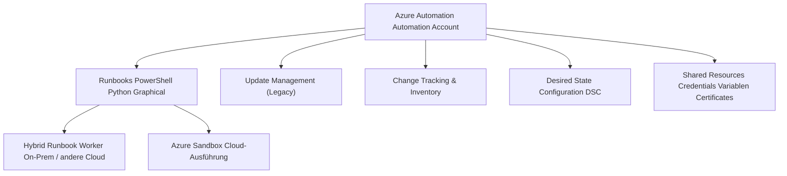
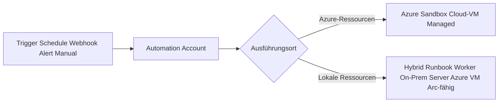
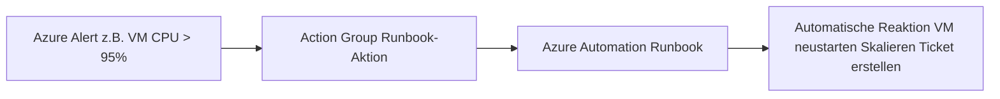

---
tags:
  - azure
  - automation
  - runbooks
  - powershell
  - dsc
  - update-management
aliases:
  - Azure Automation
  - Automation Account
  - Runbook Azure
---

# Azure Automation

> [!ABSTRACT]
> Azure Automation ermöglicht die Automatisierung von Betriebs- und Verwaltungsaufgaben in Azure und On-Premises. Runbooks (PowerShell, Python), Hybrid Runbook Worker, Update Management, Change Tracking und Desired State Configuration (DSC) bilden die Kernbausteine.

---

## Was ist Azure Automation?

Azure Automation ist ein Dienst zur **Prozessautomatisierung** und **Konfigurationsverwaltung**:

| Funktion | Beschreibung |
|---|---|
| **Runbooks** | Automatisierte Skripte (PowerShell, Python, Graphical) |
| **Hybrid Runbook Worker** | Ausführung auf On-Prem oder anderen Cloud-VMs |
| **Update Management** | Patch-Verwaltung (wird durch Azure Update Manager abgelöst) |
| **Change Tracking & Inventory** | Überwachung von Datei-/Registry-/Softwareänderungen |
| **Desired State Configuration** | Deklarative Konfiguration für Windows/Linux |
| **Shared Resources** | Credentials, Variablen, Zertifikate, Verbindungen |



---

## Runbooks

### Runbook-Typen

| Typ | Sprache | Anwendungsfall |
|---|---|---|
| **PowerShell** | PowerShell 5.1 / 7.2 | Azure-Verwaltung, Skripting |
| **PowerShell Workflow** | PowerShell Workflow | Parallele Aktionen, Checkpoints (veraltet) |
| **Python** | Python 2 / 3 | Plattformübergreifend, Data Science |
| **Graphical** | Visuell (PowerShell-Basis) | Einstieg, einfache Workflows |
| **Graphical PowerShell Workflow** | Visuell (Workflow) | Veraltet |

> [!TIP]
> Für neue Runbooks: **PowerShell 7.2** oder **Python 3**. PowerShell Workflow und Graphical Runbooks gelten als veraltet.

### PowerShell Runbook: Beispiel

```powershell
# Runbook: Gestoppte VMs in einer Resource Group starten
param(
    [Parameter(Mandatory = $true)]
    [string]$ResourceGroupName,

    [Parameter(Mandatory = $false)]
    [string]$Environment = "prod"
)

# Managed Identity-Authentifizierung (kein RunAs Account mehr!)
try {
    Connect-AzAccount -Identity
    Write-Output "Erfolgreich per Managed Identity authentifiziert"
}
catch {
    Write-Error "Authentifizierung fehlgeschlagen: $_"
    throw
}

# Gestoppte VMs finden und starten
$deallocatedVMs = Get-AzVM -ResourceGroupName $ResourceGroupName -Status |
    Where-Object { $_.PowerState -eq "VM deallocated" }

if ($deallocatedVMs.Count -eq 0) {
    Write-Output "Keine gestoppten VMs in '$ResourceGroupName' gefunden."
    return
}

foreach ($vm in $deallocatedVMs) {
    Write-Output "Starte VM: $($vm.Name)"
    Start-AzVM -ResourceGroupName $ResourceGroupName -Name $vm.Name -NoWait
}

Write-Output "Alle $($deallocatedVMs.Count) VMs wurden gestartet."
```

### Python Runbook: Beispiel

```python
import automationassets
from azure.identity import ManagedIdentityCredential
from azure.mgmt.compute import ComputeManagementClient
import sys

# Managed Identity Authentifizierung
credential = ManagedIdentityCredential()

# Parameter aus dem Runbook
subscription_id = automationassets.get_automation_variable("SubscriptionId")

compute_client = ComputeManagementClient(credential, subscription_id)

# Alle VMs in der Subscription auflisten
print("Liste aller VMs:")
for vm in compute_client.virtual_machines.list_all():
    print(f"  - {vm.name} ({vm.location})")

print("Runbook erfolgreich abgeschlossen.")
```

---

## Runbook-Ausführung

### Azure Sandbox

- Ausführung in einer **verwalteten Azure-Umgebung**
- Kein Zugriff auf on-premises Ressourcen
- Max. 3 Stunden Laufzeit
- Kein persistenter Speicher zwischen Ausführungen

### Hybrid Runbook Worker

- Ausführung auf **eigenen Maschinen** (Windows oder Linux)
- On-Premises, andere Clouds, Azure VMs möglich
- Kein Zeitlimit
- Zugriff auf lokale Ressourcen und Netzwerke
- Ideal für: Datenbank-Backups, On-Prem-Verwaltung, lokale Dateien



---

## Hybrid Runbook Worker einrichten

```powershell
# Hybrid Runbook Worker Group erstellen
New-AzAutomationHybridRunbookWorkerGroup `
  -AutomationAccountName "aa-prod" `
  -ResourceGroupName "rg-automation" `
  -Name "hrw-onprem-group"

# Worker-Agent auf Server installieren (Windows)
# Via Azure Arc Extension (empfohlen)
az connectedmachine extension create `
  --resource-group rg-arc `
  --machine-name server-onprem-01 `
  --name HybridWorkerExtension `
  --publisher Microsoft.Azure.Automation.HybridWorker `
  --type HybridWorkerForWindows `
  --settings '{
    "AutomationAccountURL": "https://<account>.jrds.we.azure-automation.net/automationAccounts/<guid>"
  }'
```

> [!NOTE]
> Der **Extension-basierte Hybrid Runbook Worker** (ab 2022) ist die empfohlene Methode. Er nutzt Managed Identity und erfordert kein Log Analytics Gateway mehr.

---

## Automation Shared Resources

Shared Resources ermöglichen das sichere Teilen von Secrets und Konfiguration zwischen Runbooks.

### Credentials

```powershell
# Credential in Automation Account speichern
$securePW = ConvertTo-SecureString "MyPassword" -AsPlainText -Force
$cred = New-Object System.Management.Automation.PSCredential("svc-account@contoso.com", $securePW)

New-AzAutomationCredential `
  -AutomationAccountName "aa-prod" `
  -ResourceGroupName "rg-automation" `
  -Name "svc-sql-backup" `
  -Value $cred

# In Runbook verwenden
$sqlCred = Get-AutomationPSCredential -Name "svc-sql-backup"
```

### Variablen

```powershell
# Variable speichern
New-AzAutomationVariable `
  -AutomationAccountName "aa-prod" `
  -ResourceGroupName "rg-automation" `
  -Name "SubscriptionId" `
  -Value "xxxxxxxx-xxxx-xxxx-xxxx-xxxxxxxxxxxx" `
  -Encrypted $false

# In Runbook lesen
$subId = Get-AutomationVariable -Name "SubscriptionId"
```

### Zertifikate

```powershell
# Zertifikat in Automation Account importieren
$cert = Get-PfxCertificate -FilePath "C:\certs\service-cert.pfx"
New-AzAutomationCertificate `
  -AutomationAccountName "aa-prod" `
  -ResourceGroupName "rg-automation" `
  -Name "service-auth-cert" `
  -Path "C:\certs\service-cert.pfx" `
  -Password (ConvertTo-SecureString "CertPassword" -AsPlainText -Force)
```

---

## Managed Identity für Automation

> [!IMPORTANT]
> Das alte **RunAs-Konto** (Service Principal) ist seit **September 2023 abgekündigt**. Alle Runbooks müssen auf **Managed Identity** umgestellt werden.

```powershell
# System-assigned Managed Identity aktivieren
Set-AzAutomationAccount `
  -ResourceGroupName "rg-automation" `
  -Name "aa-prod" `
  -AssignSystemIdentity

# Berechtigungen vergeben (Contributor auf Resource Group)
$automationAccount = Get-AzAutomationAccount -ResourceGroupName "rg-automation" -Name "aa-prod"
$principalId = $automationAccount.Identity.PrincipalId

New-AzRoleAssignment `
  -ObjectId $principalId `
  -RoleDefinitionName "Contributor" `
  -Scope "/subscriptions/{subId}/resourceGroups/rg-prod"
```

---

## Webhooks für Runbooks

Webhooks ermöglichen den Start von Runbooks per HTTP-POST:

```powershell
# Webhook erstellen (Gültig bis 1 Jahr)
$expiryTime = (Get-Date).AddYears(1)
$webhook = New-AzAutomationWebhook `
  -AutomationAccountName "aa-prod" `
  -ResourceGroupName "rg-automation" `
  -Name "webhook-restart-vm" `
  -RunbookName "Restart-UnhealthyVM" `
  -IsEnabled $true `
  -ExpiryTime $expiryTime `
  -Force

# URL des Webhooks (nur einmal sichtbar!)
Write-Output "Webhook URL: $($webhook.WebhookURI)"
```

> [!DANGER]
> Die Webhook-URL enthält das **Authentifizierungs-Token** und ist nur bei der Erstellung sichtbar. Sie muss sofort sicher gespeichert werden (z.B. in Key Vault). Sie kann **nicht** erneut abgerufen werden.

---

## Integration mit Azure Monitor Alerts

Runbooks können direkt als Reaktion auf Alerts ausgeführt werden:



```powershell
# Action Group mit Runbook-Aktion
$runbookReceiver = New-AzActionGroupReceiver `
  -Name "RunbookRemediaton" `
  -AutomationRunbookReceiver `
  -AutomationAccountResourceId "/subscriptions/{subId}/resourceGroups/rg-automation/providers/Microsoft.Automation/automationAccounts/aa-prod" `
  -RunbookName "Restart-UnhealthyVM" `
  -IsGlobalRunbook $false `
  -UseCommonAlertSchema $true

Set-AzActionGroup `
  -ResourceGroupName "rg-monitoring" `
  -Name "ag-ops-team" `
  -ShortName "OpsTeam" `
  -Receiver $runbookReceiver
```

---

## Desired State Configuration (DSC)

DSC ermöglicht **deklarative Konfiguration** — der gewünschte Zustand wird beschrieben, Azure sorgt dafür, dass VMs in diesem Zustand bleiben.

```powershell
# DSC-Konfiguration: IIS auf Windows Server installieren
Configuration WebServerConfig {
    param (
        [string[]]$ComputerName = "localhost"
    )

    Import-DscResource -ModuleName PSDesiredStateConfiguration

    Node $ComputerName {
        WindowsFeature IIS {
            Ensure = "Present"
            Name   = "Web-Server"
        }

        WindowsFeature IISManagement {
            Ensure    = "Present"
            Name      = "Web-Mgmt-Tools"
            DependsOn = "[WindowsFeature]IIS"
        }

        File WebsiteContent {
            Ensure          = "Present"
            Type            = "Directory"
            DestinationPath = "C:\inetpub\wwwroot"
            DependsOn       = "[WindowsFeature]IIS"
        }
    }
}

# Konfiguration kompilieren und in Automation Account hochladen
WebServerConfig -OutputPath "C:\DSC\WebServerConfig"

Import-AzAutomationDscConfiguration `
  -AutomationAccountName "aa-prod" `
  -ResourceGroupName "rg-automation" `
  -SourcePath "C:\DSC\WebServerConfig\WebServerConfig.ps1" `
  -Published $true `
  -Force
```

---

## Change Tracking und Inventory

Change Tracking überwacht:

| Kategorie | Was wird überwacht? |
|---|---|
| **Windows-Software** | Installierte Programme (Add/Remove Programs) |
| **Linux-Software** | dpkg / rpm Pakete |
| **Windows-Dienste** | Service-Status-Änderungen |
| **Linux-Daemons** | Daemon-Status-Änderungen |
| **Registry** | Beliebige Registry-Schlüssel (Windows) |
| **Dateien** | Beliebige Dateipfade (Hash-basiert) |

```kusto
// Change Tracking: Alle Softwareänderungen der letzten 7 Tage
ConfigurationChange
| where TimeGenerated > ago(7d)
| where ConfigChangeType == "Software"
| project TimeGenerated, Computer, SoftwareName, ChangeCategory, SoftwareType
| sort by TimeGenerated desc
```

```kusto
// Welche Server haben einen bestimmten Dienst?
ConfigurationData
| where ConfigDataType == "WindowsServices"
| where SvcName == "wuauserv"  // Windows Update Service
| project Computer, SvcName, SvcState, SvcStartupType
| sort by Computer asc
```

---

## Update Management (Legacy)

> [!WARNING]
> Update Management in Azure Automation wird durch **Azure Update Manager** abgelöst. Neue Implementierungen sollten Azure Update Manager nutzen. Details: [[Azure Update Manager]]

Update Management ermöglicht:
- **Patch-Status** aller VMs einsehen
- **Deployment Schedules** für koordiniertes Patching
- **Pre/Post-Scripts** per Runbook (z.B. VM vor Patch-Run aus Load Balancer nehmen)

```powershell
# Update-Deployment-Schedule erstellen (Legacy)
New-AzAutomationSoftwareUpdateConfiguration `
  -AutomationAccountName "aa-prod" `
  -ResourceGroupName "rg-automation" `
  -Schedule (New-AzAutomationSchedule -Name "monthly-patch" ...) `
  -Windows `
  -Duration (New-TimeSpan -Hours 2) `
  -IncludedUpdateClassification Critical, Security, UpdateRollup `
  -ExcludedKbNumber @("KB4561623") `
  -AzureVirtualMachine @("/subscriptions/{subId}/resourceGroups/rg-prod/providers/Microsoft.Compute/virtualMachines/vm-prod-01")
```

---

## Start/Stop VMs-Lösung

Die "Start/Stop VMs v2"-Lösung aus dem Marketplace automatisiert das Hoch- und Runterfahren von VMs nach Zeitplan — typischerweise für Entwicklungs-/Testumgebungen.


---

## Kosten

| Komponente | Kosten |
|---|---|
| Runbook-Ausführungsminuten (erste 500 min/Monat) | Kostenlos |
| Runbook-Ausführungsminuten (> 500 min) | ~0,002 $/Minute |
| DSC-Knoten-Konfigurationen (erste 5 Nodes) | Kostenlos |
| DSC-Knoten (> 5 Nodes) | ~6 $/Node/Monat |
| Change Tracking (erste 5 Server, 500 MB) | Kostenlos |
| Change Tracking (> 5 Server) | ~6 $/Server/Monat |
| Update Management | Kostenlos (exkl. Log Analytics-Kosten) |

> [!TIP]
> Für reine Azure-Ressourcenverwaltung (ohne Hybrid Worker) ist Azure Automation **sehr kostengünstig**, da die meisten Workloads in den Freiminuten abgedeckt sind.

---

## Bicep: Automation Account

```bicep
resource automationAccount 'Microsoft.Automation/automationAccounts@2022-08-08' = {
  name: 'aa-prod'
  location: 'westeurope'
  identity: {
    type: 'SystemAssigned'  // Managed Identity
  }
  properties: {
    sku: {
      name: 'Basic'
    }
    publicNetworkAccess: true
    encryption: {
      keySource: 'Microsoft.Automation'
    }
  }
}

// Runbook erstellen und hochladen
resource runbook 'Microsoft.Automation/automationAccounts/runbooks@2022-08-08' = {
  parent: automationAccount
  name: 'Start-StoppedVMs'
  location: 'westeurope'
  properties: {
    runbookType: 'PowerShell72'
    logProgress: false
    logVerbose: false
    description: 'Startet alle gestoppten VMs in einer Resource Group'
    publishContentLink: {
      uri: 'https://raw.githubusercontent.com/contoso/runbooks/main/Start-StoppedVMs.ps1'
    }
  }
}

// Schedule erstellen
resource schedule 'Microsoft.Automation/automationAccounts/schedules@2022-08-08' = {
  parent: automationAccount
  name: 'daily-8am'
  properties: {
    description: 'Täglich um 08:00 Uhr'
    startTime: '2024-01-15T08:00:00+01:00'
    frequency: 'Day'
    interval: 1
    timeZone: 'Europe/Berlin'
  }
}

// RBAC: Managed Identity als Contributor auf rg-prod
resource roleAssignment 'Microsoft.Authorization/roleAssignments@2022-04-01' = {
  name: guid(automationAccount.id, 'Contributor', resourceGroup().id)
  scope: resourceGroup()
  properties: {
    roleDefinitionId: subscriptionResourceId('Microsoft.Authorization/roleDefinitions', 'b24988ac-6180-42a0-ab88-20f7382dd24c')
    principalId: automationAccount.identity.principalId
    principalType: 'ServicePrincipal'
  }
}
```

---

## Verwandte Notizen

- [[Azure Monitor Grundlagen]]
- [[Azure Alerts]]
- [[Azure Update Manager]]
- [[Log Analytics Workspace]]
