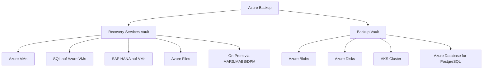
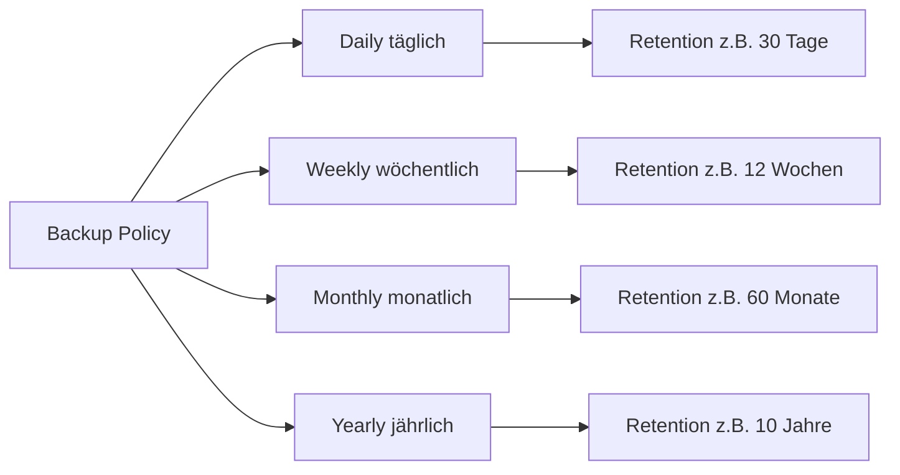
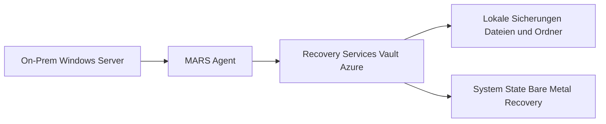
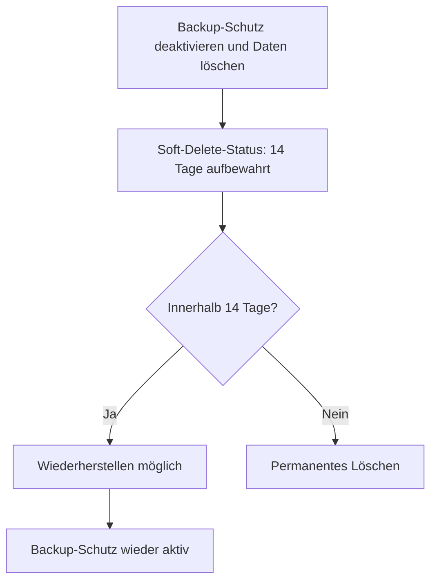

---
tags:
  - azure
  - backup
  - disaster-recovery
  - bcdr
  - recovery-services
aliases:
  - Azure Backup Service
  - RSV
  - Recovery Services Vault
---

# Azure Backup

> [!ABSTRACT]
> Azure Backup ist der cloudnative Sicherungsdienst von Microsoft Azure zur Datensicherung von Azure VMs, SQL-Datenbanken, SAP HANA, Azure Files, Blobs, Disks und On-Premises-Workloads. Er bietet zwei Vault-Typen (Recovery Services Vault und Backup Vault), flexible Retention-Policies, Soft Delete, Cross-Region Restore und ein zentrales Backup Center für die Verwaltung aller Sicherungen.

---

## Was ist Azure Backup?

Azure Backup ist ein **Platform-as-a-Service (PaaS)** Dienst für die Sicherung und Wiederherstellung von Daten. Er ersetzt klassische Backup-Infrastruktur und bietet:

- **Keine Infrastrukturkosten** – kein Backup-Server erforderlich
- **Automatische Skalierung** – unbegrenzte Speicherkapazität
- **Verschlüsselung** – Daten at-rest und in-transit
- **Geografische Redundanz** – LRS, ZRS oder GRS
- **Zentrales Management** – Backup Center für alle Workloads



---

## Backup-Komponenten

### Vault-Typen

| Komponente | Beschreibung |
|---|---|
| **Recovery Services Vault** | Für Azure VMs, SQL, SAP HANA, Files, On-Prem |
| **Backup Vault** | Für Blobs, Disks, AKS, PostgreSQL, Azure Database |
| **Backup Policy** | Definiert Zeitplan und Retention |
| **Backup Items** | Geschützte Instanzen im Vault |
| **Recovery Points** | Gespeicherte Snapshots/Sicherungen |

### Recovery Services Vault vs. Backup Vault

| Kriterium | Recovery Services Vault (RSV) | Backup Vault |
|---|---|---|
| **VMs (IaaS)** | ✅ | ❌ |
| **SQL auf VM** | ✅ | ❌ |
| **SAP HANA** | ✅ | ❌ |
| **Azure Files** | ✅ | ❌ |
| **MARS/MABS/DPM** | ✅ | ❌ |
| **Azure Blobs** | ❌ | ✅ |
| **Managed Disks** | ❌ | ✅ |
| **AKS** | ❌ | ✅ |
| **Azure Database for PostgreSQL** | ❌ | ✅ |
| **Immutable Vault** | ✅ | ✅ |
| **Soft Delete** | ✅ (14 Tage) | ✅ (14 Tage) |
| **Cross-Region Restore** | ✅ (GRS) | Workload-abhängig |

---

## Vault erstellen

### Recovery Services Vault (PowerShell)

```powershell
# Recovery Services Vault erstellen
New-AzRecoveryServicesVault `
    -Name "rsv-prod-westeurope" `
    -ResourceGroupName "rg-backup" `
    -Location "westeurope"

# Redundanz konfigurieren
$vault = Get-AzRecoveryServicesVault -Name "rsv-prod-westeurope"
Set-AzRecoveryServicesBackupProperty `
    -Vault $vault `
    -BackupStorageRedundancy "GeoRedundant"
```

### Backup Vault (Azure CLI)

```bash
# Backup Vault erstellen
az dataprotection backup-vault create \
    --resource-group rg-backup \
    --vault-name bv-prod-westeurope \
    --location westeurope \
    --type SystemAssigned \
    --storage-settings datastore-type="VaultStore" type="GloballyRedundant"
```

---

## Backup Policies

### Retention-Ebenen



### VM-Backup-Policy erstellen (PowerShell)

```powershell
$vault = Get-AzRecoveryServicesVault -Name "rsv-prod-westeurope"
Set-AzRecoveryServicesVaultContext -Vault $vault

# Policy-Objekt erstellen
$policy = Get-AzRecoveryServicesBackupProtectionPolicy -Name "DefaultPolicy"
$newPolicy = $policy | Set-AzRecoveryServicesBackupProtectionPolicy `
    -ScheduleRunTimes @([datetime]"2024-01-01 22:00:00") `
    -RetentionPolicy $policy.RetentionPolicy

# Neue Policy mit erweiterter Retention
$schedulePolicy = Get-AzRecoveryServicesBackupSchedulePolicyObject -WorkloadType "AzureVM"
$retentionPolicy = Get-AzRecoveryServicesBackupRetentionPolicyObject -WorkloadType "AzureVM"

# Daily: 30 Tage
$retentionPolicy.DailySchedule.DurationCountInDays = 30
# Weekly: 12 Wochen (jeden Sonntag)
$retentionPolicy.IsWeeklyScheduleEnabled = $true
$retentionPolicy.WeeklySchedule.DurationCountInWeeks = 12
# Monthly: 60 Monate
$retentionPolicy.IsMonthlyScheduleEnabled = $true
$retentionPolicy.MonthlySchedule.DurationCountInMonths = 60

New-AzRecoveryServicesBackupProtectionPolicy `
    -Name "policy-vm-extended" `
    -WorkloadType "AzureVM" `
    -BackupManagementType "AzureVM" `
    -RetentionPolicy $retentionPolicy `
    -SchedulePolicy $schedulePolicy
```

---

## Azure VMs sichern

### VM-Backup aktivieren

```powershell
# VM-Backup aktivieren
$vault = Get-AzRecoveryServicesVault -Name "rsv-prod-westeurope"
Set-AzRecoveryServicesVaultContext -Vault $vault

$policy = Get-AzRecoveryServicesBackupProtectionPolicy -Name "policy-vm-extended"
$vm = Get-AzVM -ResourceGroupName "rg-prod" -Name "vm-web01"

Enable-AzRecoveryServicesBackupProtection `
    -ResourceGroupName "rg-prod" `
    -Name "vm-web01" `
    -Policy $policy
```

```bash
# Azure CLI: VM-Backup aktivieren
az backup protection enable-for-vm \
    --resource-group rg-prod \
    --vault-name rsv-prod-westeurope \
    --vm vm-web01 \
    --policy-name policy-vm-extended
```

### On-Demand Backup

```powershell
# Sofortiges Backup auslösen
$backupItem = Get-AzRecoveryServicesBackupItem `
    -BackupManagementType "AzureVM" `
    -WorkloadType "AzureVM" `
    -Name "vm-web01"

Backup-AzRecoveryServicesBackupItem -Item $backupItem
```

### Konsistenz-Typen

| Typ | Beschreibung | Anwendungsfall |
|---|---|---|
| **App-Consistent** | VSS-Snapshot inkl. In-Flight-Daten | SQL Server, Exchange – empfohlen |
| **File-System Consistent** | Konsistenter FS-Snapshot via VSS | Alle anderen Windows-Workloads |
| **Crash-Consistent** | Speicherabbild zum Zeitpunkt T | Fallback bei VSS-Fehler |

> [!NOTE]
> Bei Linux VMs nutzt Azure Backup **pre/post-Skripte** für applikationskonsistente Sicherungen (z.B. für MySQL, Oracle).

---

## MARS Agent (On-Premises)

Der **Microsoft Azure Recovery Services (MARS) Agent** sichert **Dateien, Ordner und den Systemstatus** von Windows-Maschinen direkt in einen Recovery Services Vault.

### MARS Agent Eigenschaften

| Eigenschaft | Wert |
|---|---|
| Betriebssystem | Windows Server 2008 R2+ / Windows 7+ |
| Backup-Ziel | Recovery Services Vault |
| Backup-Typen | Dateien/Ordner, System State, Bare Metal Recovery |
| Netzwerk | Port 443 ausgehend |
| Verschlüsselung | AES-256 mit Passphrase |



### MARS Agent vs. MABS vs. DPM

| Kriterium | MARS Agent | MABS (Azure Backup Server) | DPM (Data Protection Manager) |
|---|---|---|---|
| **Infrastruktur** | Kein separater Server | Eigener Windows Server | SCCM/System Center |
| **Workloads** | Files, System State | VMs, SQL, SharePoint, Exchange | Vollständig |
| **Staging-Bereich** | Lokal (Disk) | Lokal (Disk/Tape) | Disk/Tape |
| **Lizenz** | Kostenlos | Kostenlos (+ Azure) | System Center Lizenz |
| **Granularität** | Dateiebene | Anwendungsebene | Anwendungsebene |

---

## Cross-Region Restore (CRR)

Cross-Region Restore ermöglicht die **Wiederherstellung in der Paired Region** bei einem regionalen Ausfall.

### Voraussetzungen

- Recovery Services Vault mit **Geo-Redundant Storage (GRS)** konfiguriert
- CRR muss explizit auf dem Vault aktiviert werden
- Unterstützte Workloads: Azure VMs, SQL auf VMs, SAP HANA

```powershell
# Cross-Region Restore aktivieren
$vault = Get-AzRecoveryServicesVault -Name "rsv-prod-westeurope"
Set-AzRecoveryServicesBackupProperty `
    -Vault $vault `
    -EnableCrossRegionRestore
```


> [!WARNING]
> CRR erhöht die Speicherkosten um den Faktor 2 (GRS-Replikation). Bei sehr großen Umgebungen sollte der Einsatz sorgfältig abgewogen werden.

---

## Soft Delete

Soft Delete schützt Backup-Daten **14 Tage nach dem Löschen** vor versehentlichem oder bösartigem Entfernen.

### Verhalten



```powershell
# Soft Delete auf Vault deaktivieren (nicht empfohlen!)
$vault = Get-AzRecoveryServicesVault -Name "rsv-prod-westeurope"
Set-AzRecoveryServicesVaultProperty `
    -VaultId $vault.ID `
    -SoftDeleteFeatureState "Disable"
```

> [!DANGER]
> Das Deaktivieren von Soft Delete ist ein Sicherheitsrisiko. In Ransomware-Szenarien ermöglicht es das sofortige Löschen von Backup-Daten. **Soft Delete sollte stets aktiviert bleiben.**

---

## Immutable Vault

Der **Immutable Vault** verhindert, dass Backup-Daten vorzeitig gelöscht oder Policies gelockert werden.

| Modus | Beschreibung |
|---|---|
| **Disabled** | Kein Immutability-Schutz |
| **Unlocked** | Immutability aktiv, kann noch deaktiviert werden |
| **Locked** | Immutability permanent – **nicht rückgängig machbar** |

```powershell
# Immutable Vault aktivieren (Unlocked)
$vault = Get-AzRecoveryServicesVault -Name "rsv-prod-westeurope"
Update-AzRecoveryServicesVault `
    -ResourceGroupName "rg-backup" `
    -Name "rsv-prod-westeurope" `
    -ImmutabilityState "Unlocked"
```

> [!IMPORTANT]
> Der **Locked**-Modus ist irreversibel. Vor der Aktivierung sicherstellen, dass alle Retention-Policies korrekt konfiguriert sind.

---

## Backup Center

Backup Center ist das **zentrale Management-Portal** für alle Azure Backup Workloads.

### Funktionen

| Funktion | Beschreibung |
|---|---|
| **Overview** | Gesamtübersicht aller geschützten Instanzen |
| **Backup Instances** | Liste aller Backup-Items über alle Vaults |
| **Backup Policies** | Policies-Übersicht und -Verwaltung |
| **Backup Jobs** | Status aller laufenden und vergangenen Jobs |
| **Alerts** | Aktive und vergangene Warnungen |
| **Backup Reports** | Azure Monitor Workbook für Compliance |
| **Security** | Soft Delete, MUA, Immutability-Status |

### Multi-User Authorization (MUA)

MUA erzwingt eine **zweite Genehmigung** für kritische Backup-Operationen:

- Backup-Schutz deaktivieren
- Soft Delete deaktivieren
- Backup-Policy-Änderungen

```powershell
# Resource Guard erstellen (in separater Subscription)
New-AzResourceGuard `
    -ResourceGroupName "rg-security" `
    -Name "rg-backup-protection" `
    -Location "westeurope"
```

---

## Monitoring und Alerts

### Azure Monitor Alerts konfigurieren

```powershell
# Alert für fehlgeschlagene Backup-Jobs
$actionGroup = Get-AzActionGroup -ResourceGroupName "rg-monitoring" -Name "ag-ops"

New-AzMetricAlertRuleV2 `
    -Name "alert-backup-failures" `
    -ResourceGroupName "rg-backup" `
    -TargetResourceId $vault.ID `
    -Condition (
        New-AzMetricAlertRuleV2Criteria `
            -MetricName "BackupHealthEvent" `
            -TimeAggregation "Count" `
            -Operator "GreaterThan" `
            -Threshold 0
    ) `
    -ActionGroup $actionGroup `
    -Severity 2 `
    -WindowSize "PT5M" `
    -Frequency "PT1M"
```

### Kusto-Abfragen für Backup Reports

```kusto
// Fehlgeschlagene Backup-Jobs der letzten 7 Tage
AzureDiagnostics
| where ResourceType == "RECOVERYSERVICESVAULTS"
| where Category == "AzureBackupReport"
| where OperationName == "Job"
| where ResultType == "Failed"
| where TimeGenerated >= ago(7d)
| project TimeGenerated, Resource, JobOperation, JobStatus, JobFailureCode
| order by TimeGenerated desc
```

```kusto
// Backup Storage-Verbrauch pro Vault
AzureDiagnostics
| where Category == "AzureBackupReport"
| where OperationName == "StorageAssociation"
| summarize StorageGB = sum(todouble(StorageConsumedInMBs_s)) / 1024
    by Resource, bin(TimeGenerated, 1d)
| order by TimeGenerated desc
```

---

## Kosten

| Workload | Preis-Modell |
|---|---|
| Azure VM Backup | Pro geschützte Instanz + Speicher |
| SQL auf Azure VM | Pro geschützte Instanz + Speicher |
| Azure Files | Pro geschützte Instanz + Speicher |
| Azure Blobs (Operational) | Pro geschützte Instanz/Monat |
| Azure Disks | Pro Disk/Monat |
| MARS Agent | Nur Speicherkosten |
| Cross-Region Restore | +GRS-Speicherkosten |

> [!TIP]
> Nutze den **Azure Pricing Calculator** und das **Backup Reports Workbook** um Kosten zu analysieren. Alte Recovery Points mit überlanger Retention treiben die Kosten signifikant.

---

## Best Practices

> [!TIP]
> **Empfohlene Konfiguration für Produktionsumgebungen:**
>
> 1. GRS für kritische Workloads, LRS für Dev/Test
> 2. Soft Delete und Immutable Vault aktivieren
> 3. MUA für kritische Vaults (Produktion)
> 4. Backup Center als zentrales Dashboard nutzen
> 5. Azure Monitor Alerts für Job-Fehler konfigurieren
> 6. Regelmäßige Restore-Tests durchführen (Chaos Engineering)

> [!WARNING]
> **Snapshots ≠ Backups:** VM-Snapshots im Storage Account sind keine vollwertigen Backups. Stets Azure Backup für compliance-konforme Sicherungen verwenden.

---

## Verwandte Notizen

- [[Azure Site Recovery]]
- [[Azure Update Manager]]
- [[Azure Monitor Grundlagen]]
- [[Azure Automation]]
