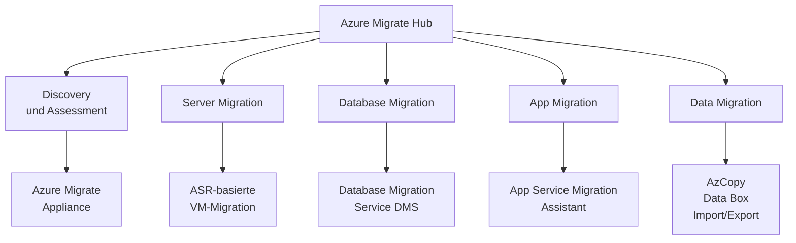
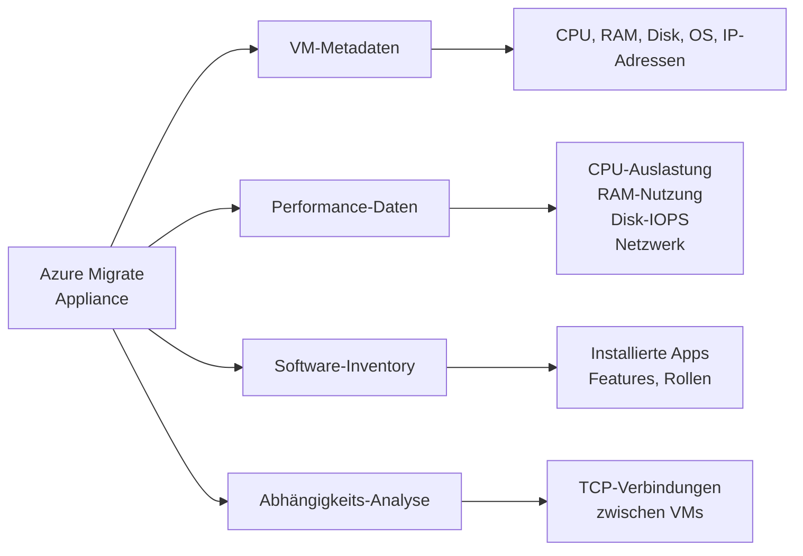
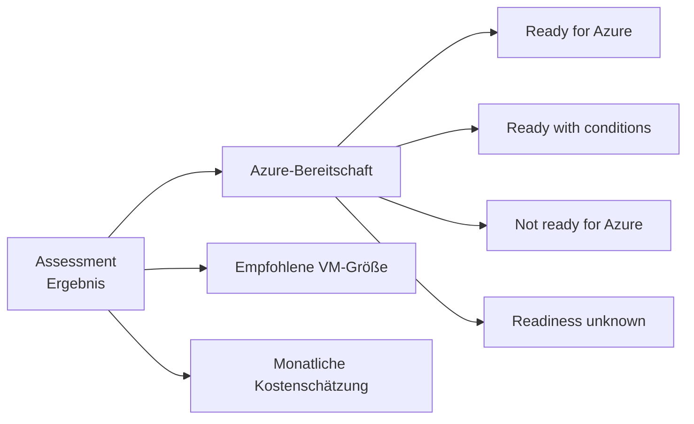
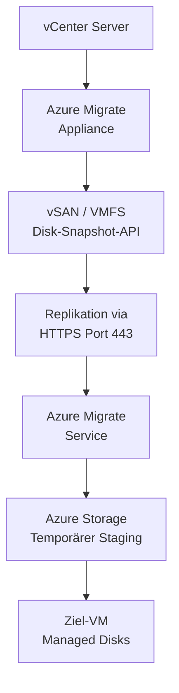
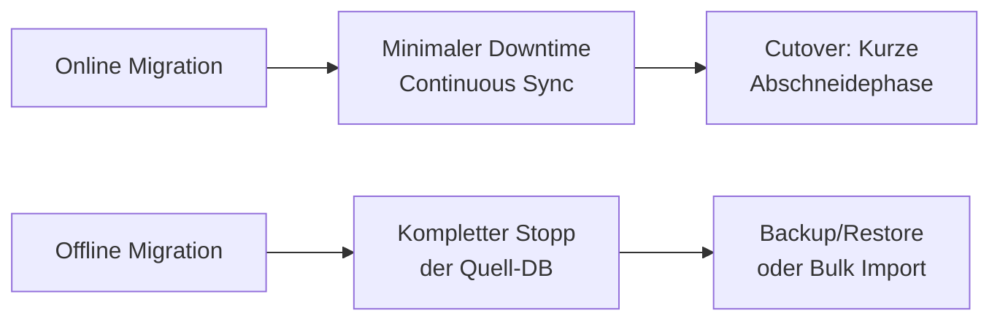
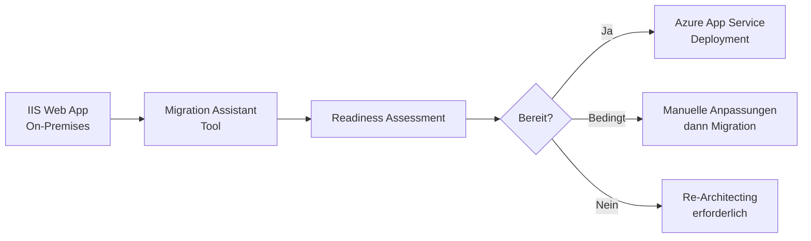
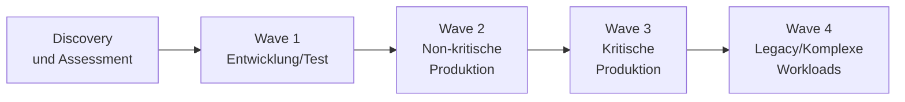
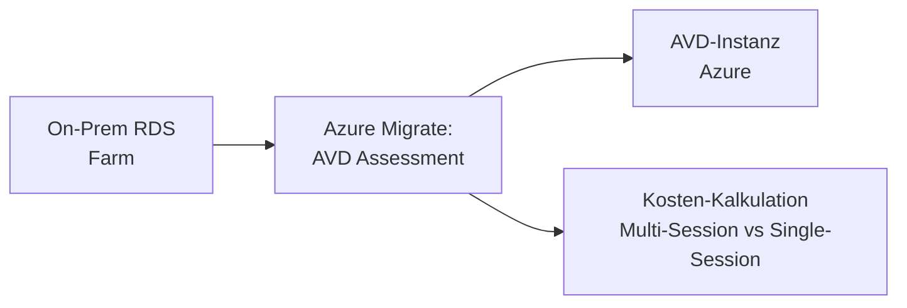

---
tags:
  - azure
  - migration
  - assessment
  - lift-and-shift
  - cloud-migration
aliases:
  - Azure Migrate Hub
  - Cloud Migration Azure
---

# Azure Migrate

> [!ABSTRACT]
> Azure Migrate ist der zentrale Hub für Cloud-Migrationen zu Azure. Er vereint Discovery, Assessment und Migration von Servern, Datenbanken, Web-Apps und Daten in einem Portal. Mit der Discovery Appliance werden On-Premises-Umgebungen analysiert, Kosten geschätzt und Migrationsempfehlungen gegeben – für VMware, Hyper-V, physische Server und andere Clouds.

---

## Was ist Azure Migrate?

Azure Migrate ist ein **kostenloses, portalbasiertes Service** für die geplante und durchgeführte Migration zu Azure. Es bietet:

- **Zentrales Portal** für alle Migrations-Tools (First-party und ISV-Tools)
- **Discovery und Assessment** für On-Premises-Workloads
- **Migration-Tools** für verschiedene Workload-Typen
- **Wave Planning** für strukturierte, phasenweise Migration



---

## Migrate Hub – Zentrales Portal

Der **Azure Migrate Hub** im Azure Portal bündelt alle Migrations-Tools:

### First-Party Tools

| Tool | Zweck |
|---|---|
| **Azure Migrate: Discovery and Assessment** | Server-Erkennung und Bewertung |
| **Azure Migrate: Server Migration** | VM-Migration (ASR-basiert) |
| **Azure Database Migration Service** | Datenbank-Migration |
| **Azure App Service Migration Assistant** | Web-App-Migration |

### ISV-Partner Tools (Beispiele)

| Tool | Hersteller | Zweck |
|---|---|---|
| Carbonite Migrate | OpenText | Server-Migration |
| CloudAmize | CloudAmize | Assessment |
| Zerto | Zerto | DR + Migration |
| Corent SurPaaS | Corent Technology | Re-Platforming |

---

## Discovery Appliance

Die **Azure Migrate Appliance** ist eine leichtgewichtige On-Premises-VM, die automatisch Metadaten und Performance-Daten sammelt.

### Unterstützte Hypervisoren

| Plattform | Appliance-Typ | Deployment |
|---|---|---|
| VMware vCenter | OVA-Template | vSphere |
| Hyper-V | VHD-Template | Hyper-V Manager |
| Physische Server | PowerShell-Installer | Windows Server |
| Andere Clouds (AWS, GCP) | Wie physische Server | Windows Server |

### Gesammelte Daten



### Appliance einrichten (VMware)

```powershell
# Nach OVA-Deployment: Appliance-Konfiguration via Browser
# URL: https://<ApplianceIP>:44368

# PowerShell: Appliance-Status prüfen (nach Konfiguration)
# (auf der Appliance ausführen)
Get-Service -Name "GuestConfigurationExtension" | 
    Select-Object Status, StartType
```

> [!NOTE]
> Die Appliance sendet Daten **ausschließlich über HTTPS (Port 443)** an Azure. Keine eingehenden Verbindungen erforderlich.

---

## Assessment: Server Assessment

### Assessment-Typen

| Typ | Ziel | Beschreibung |
|---|---|---|
| **Azure VM Assessment** | Azure VMs | Empfehlungen für VM-Größen, Kosten |
| **Azure VMware Solution** | AVS | Knoten-Schätzung für AVS |
| **Azure SQL Assessment** | Azure SQL DB/MI | SQL Server zu Azure SQL migrieren |
| **Azure App Service** | App Service | Web-Apps zu App Service |

### Assessment-Kriterien

| Kriterium | Beschreibung |
|---|---|
| **As on-premises** | Aktuelle VM-Größe 1:1 übernehmen |
| **Performance-based** | Basierend auf gesammelten Performance-Daten (empfohlen) |

### Assessment-Ergebnis interpretieren



### Assessment per PowerShell auslösen

```powershell
# Assessment-Projekt erstellen
New-AzMigrateProject `
    -ResourceGroupName "rg-migrate" `
    -ProjectName "migrate-project-prod" `
    -Location "westeurope"
```

```bash
# Azure CLI: Assessment-Ergebnisse abrufen
az migrate assessment list \
    --resource-group rg-migrate \
    --project-name migrate-project-prod \
    --group-name group-web-servers
```

---

## Migration-Methoden

### Agentless vs. Agent-based (VMware)

| Kriterium | Agentless | Agent-based |
|---|---|---|
| **Agent auf VM** | Nicht erforderlich | Mobility Service Agent |
| **vCenter Berechtigungen** | Höher (Snapshot-API) | Standard |
| **Gleichzeitige Migrationen** | Bis 500 VMs / Appliance | Unbegrenzt |
| **Concurrent Replications** | 300 gleichzeitig | Mehr |
| **Disk-Typen** | Managed Disks | Managed Disks |
| **VM-Zustand** | VMs können laufen | VMs können laufen |
| **Empfehlung** | Standard | Große Umgebungen |

### Agentlose VMware-Migration



### Migration starten (PowerShell)

```powershell
# Agentlose VMware-Migration: Replikation starten
$machine = Get-AzMigrateMachine `
    -ProjectName "migrate-project-prod" `
    -ResourceGroupName "rg-migrate" `
    -MachineName "vm-web01"

New-AzMigrateReplicationJob `
    -ProjectName "migrate-project-prod" `
    -ResourceGroupName "rg-migrate" `
    -MachineId $machine.Id `
    -TargetResourceGroupId "/subscriptions/{subId}/resourceGroups/rg-prod" `
    -TargetVirtualNetworkId "/subscriptions/{subId}/resourceGroups/rg-prod/providers/Microsoft.Network/virtualNetworks/vnet-prod" `
    -TargetSubnetName "subnet-web" `
    -TargetVmName "vm-web01-azure" `
    -TargetVmSize "Standard_D4s_v3"
```

---

## Server Migration Tool (ASR-basiert)

Das Server Migration Tool nutzt intern **Azure Site Recovery** für die Replikation. Der Unterschied zu ASR:

| Aspekt | Azure Migrate: Server Migration | Azure Site Recovery |
|---|---|---|
| **Zweck** | Einmalige Migration | Dauerhaftes DR |
| **Zielzustand** | VM läuft in Azure | VM repliziert, gestoppt |
| **Kosten nach Migration** | Nur VM-Kosten | ASR-Lizenz + Storage |
| **Portal** | Azure Migrate Hub | Recovery Services Vault |

---

## Database Migration Service (DMS)

Der **Azure Database Migration Service** migriert Datenbanken mit minimalem Downtime (Online Migration).

### Unterstützte Migrationen

| Quelle | Ziel | Modus |
|---|---|---|
| SQL Server (On-Prem) | Azure SQL Database | Online + Offline |
| SQL Server (On-Prem) | Azure SQL Managed Instance | Online + Offline |
| SQL Server (On-Prem) | SQL Server auf Azure VM | Offline |
| MySQL (On-Prem) | Azure Database for MySQL | Online + Offline |
| PostgreSQL (On-Prem) | Azure Database for PostgreSQL | Online + Offline |
| MongoDB | Azure Cosmos DB (Mongo API) | Offline |
| Oracle | Azure Database for PostgreSQL | Offline |

### Online vs. Offline Migration



### DMS-Migration starten

```bash
# DMS-Instanz erstellen
az dms create \
    --resource-group rg-migrate \
    --name dms-prod-migration \
    --location westeurope \
    --sku-name Premium_4vCores \
    --subnet "/subscriptions/{subId}/resourceGroups/rg-network/providers/Microsoft.Network/virtualNetworks/vnet-migrate/subnets/subnet-dms"

# Migrationsprojekt erstellen
az dms project create \
    --resource-group rg-migrate \
    --service-name dms-prod-migration \
    --name project-sql-to-azure \
    --source-platform SQL \
    --target-platform SQLMI \
    --location westeurope
```

---

## App Service Migration Assistant

Der **App Service Migration Assistant** analysiert bestehende IIS Web-Apps und migriert sie zu **Azure App Service**.

### Funktionen

- **Readiness Check:** Kompatibilitätsprüfung der Web-App mit App Service
- **Automatische Migration:** Kopiert Web-App-Inhalte und Konfiguration
- **Hybrid Connections:** Für Datenbankverbindungen zu On-Prem-DBs



---

## Data Migration

### Methoden-Übersicht

| Methode | Datenmenge | Netzwerk | Dauer | Anwendungsfall |
|---|---|---|---|---|
| **AzCopy** | GB – TB | Online | Stunden – Tage | Storage-Migration, Dateien |
| **Azure Data Box Disk** | bis 35 TB | Offline (Post) | ~1 Woche | Begrenzte Bandbreite |
| **Azure Data Box** | bis 80 TB | Offline (Post) | ~1-2 Wochen | Große Datenmengen |
| **Data Box Heavy** | bis 800 TB | Offline (Post) | ~2-3 Wochen | Sehr große Datenmengen |
| **Import/Export Service** | TB | Offline (eigene Disks) | ~1-2 Wochen | Flexibel |

### AzCopy Beispiel

```bash
# AzCopy: Dateien in Azure Blob Storage kopieren
azcopy copy \
    "C:\data\*" \
    "https://storageaccount.blob.core.windows.net/container?sas-token" \
    --recursive=true \
    --log-level=INFO \
    --output-type=text

# AzCopy: Performance optimieren
azcopy copy \
    "C:\data\*" \
    "https://storageaccount.blob.core.windows.net/container?sas-token" \
    --recursive=true \
    --block-size-mb=256 \
    --concurrency-value=64
```

---

## Wave Planning

Wave Planning strukturiert die Migration in **Phasen (Waves)**:



| Wave | Inhalt | Risiko | Zeitraum |
|---|---|---|---|
| **Wave 1** | Dev/Test-Umgebungen | Niedrig | Monat 1-2 |
| **Wave 2** | Non-kritische Produktions-VMs | Mittel | Monat 2-4 |
| **Wave 3** | Kritische Applikationen | Hoch | Monat 4-6 |
| **Wave 4** | Legacy, Datenbanken, SAP | Sehr hoch | Monat 6-12 |

---

## Migrationsstrategien: 6 Rs

| Strategie | Beschreibung | Aufwand | Azure-Optimierung |
|---|---|---|---|
| **Rehost (Lift & Shift)** | VM 1:1 nach Azure verschieben | Niedrig | Gering |
| **Replatform** | Kleinere Anpassungen (z.B. zu PaaS DB) | Mittel | Mittel |
| **Refactor** | App-Code anpassen für Cloud-native | Hoch | Hoch |
| **Rearchitect** | Komplette Neuentwicklung (Microservices) | Sehr hoch | Maximal |
| **Replace** | SaaS-Lösung statt eigener App | Niedrig | Hoch |
| **Retire** | App stilllegen, nicht migrieren | Keine | Keine |

> [!TIP]
> **80% der Workloads** eignen sich für **Rehost (Lift & Shift)** als ersten Schritt. Nach der Migration kann schrittweise optimiert werden.

---

## Azure Migrate für AVD-Migrationen

Azure Migrate enthält spezielle Tools für **Azure Virtual Desktop (AVD)**-Migrationen:



---

## Kosten

| Komponente | Kosten |
|---|---|
| **Azure Migrate Hub** | Kostenlos |
| **Discovery Appliance** | Kostenlos |
| **Server Assessment** | Kostenlos |
| **Server Migration** | Kostenlos (nur Replikations-Traffic) |
| **Database Migration Service (DMS)** | Pro vCore/Stunde (Standard/Premium SKU) |
| **Data Box** | Pro Gerät/Leihzeitraum |
| **Ziel-Infrastruktur (VMs, Storage)** | Reguläre Azure-Kosten |

> [!NOTE]
> Während der Replikation entstehen **Storage-Kosten** für den Staging-Bereich. Nach dem Cutover fallen nur noch die regulären VM-Kosten an.

---

## Best Practices

> [!TIP]
> **Empfohlener Migrationsprozess:**
>
> 1. Discovery Appliance deployen, mindestens **30 Tage** Performance-Daten sammeln
> 2. Performance-basiertes Assessment durchführen (nicht "As on-premises")
> 3. Abhängigkeitsanalyse für Applikationsgruppen
> 4. Wave Plan erstellen: Dev/Test zuerst
> 5. Test-Migration vor produktivem Cutover
> 6. Cutover in einem Wartungsfenster

> [!WARNING]
> **Nicht migrieren ohne Assessment!** Ohne Performance-Daten werden VMs häufig überdimensioniert (over-provisioning), was zu unnötigen Kosten führt.

---

## Verwandte Notizen

- [[Azure Site Recovery]]
- [[Azure Backup]]
- [[Azure Resource Graph]]
- [[Subscriptions und Management Groups]]
