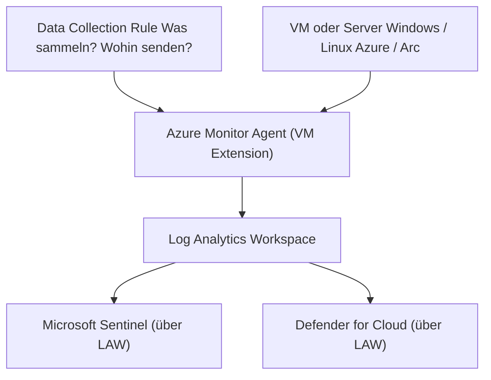
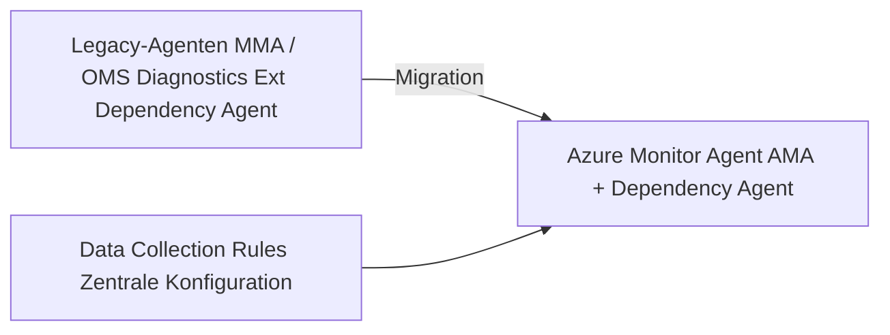
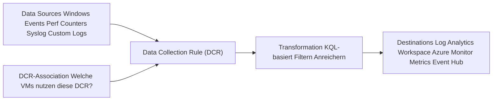
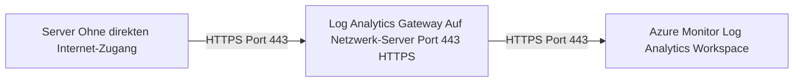
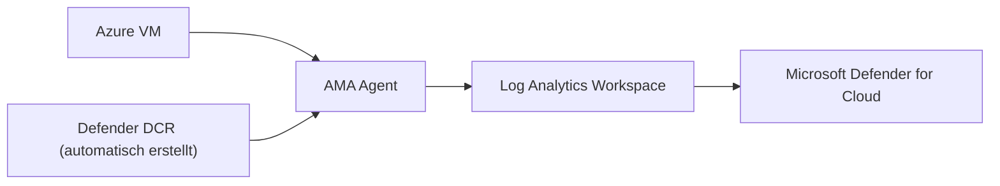
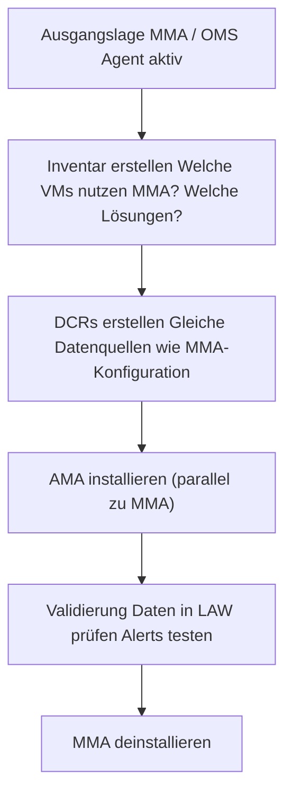

---
tags:
  - azure
  - monitoring
  - agent
  - ama
  - data-collection
aliases:
  - AMA
  - Azure Monitor Agent
  - MMA Ablösung
---

# Azure Monitor Agent

> [!ABSTRACT]
> Der Azure Monitor Agent (AMA) ist der moderne, einheitliche Agent für die Datensammlung in Azure Monitor. Er ersetzt MMA, OMS Agent und Diagnostics Extension und nutzt Data Collection Rules (DCR) für eine flexible, zentralisierte Konfiguration.

---

## Was ist der Azure Monitor Agent?

Der AMA ist ein **VM-Extension**, der auf Windows- und Linux-VMs (Azure, Arc) installiert wird und:
- Logs und Performance-Daten an Log Analytics Workspace sendet
- Vollständig über **Data Collection Rules (DCR)** konfiguriert wird
- Managed Identity für sichere Authentifizierung nutzt
- Arc-fähig ist (On-Premises, andere Clouds)



---

## Ablösung von Legacy-Agenten

> [!IMPORTANT]
> MMA und OMS Agent werden **Ende August 2024** abgekündigt. Alle Umgebungen müssen auf AMA migriert werden.

| Legacy-Agent | Aufgabe | Status | Ersatz durch AMA |
|---|---|---|---|
| **MMA** (Microsoft Monitoring Agent) | Log Analytics, Security | ⛔ Deprecated 2024 | ✅ AMA |
| **OMS Agent** (Linux) | Log Analytics auf Linux | ⛔ Deprecated 2024 | ✅ AMA |
| **Diagnostics Extension** (WAD/LAD) | Metriken & Logs an Storage | ⛔ Deprecated | ✅ AMA + DCR |
| **Dependency Agent** | Service Map, VM Insights | ✅ Weiter nötig (separat) | AMA + Dependency Agent |



> [!NOTE]
> Der **Dependency Agent** ist weiterhin separat erforderlich, wenn VM Insights mit Service Map (Prozess- und Netzwerkabhängigkeiten) genutzt werden soll.

---

## Data Collection Rules (DCR)

DCRs sind das **Herzstück** des AMA. Sie definieren vollständig, was gesammelt und wohin gesendet wird.

### Aufbau einer DCR



### Unterstützte Datenquellen

| Datenquelle | Windows | Linux | Beschreibung |
|---|---|---|---|
| Windows Event Logs | ✅ | ❌ | Sicherheit, System, Anwendung |
| Performance Counters | ✅ | ✅ | CPU, RAM, Disk, Network |
| Syslog | ❌ | ✅ | Facility/Severity-basiert |
| IIS Logs | ✅ | ❌ | W3C-Format |
| Custom Text Logs | ✅ | ✅ | Beliebige Log-Dateien |
| SQL-Assessment Data | ✅ | ❌ | SQL Server Insights |
| Prometheus Metrics | ❌ | ✅ | Kubernetes / AKS |

---

## DCR erstellen — Beispiele

### Windows Security Events + Performance

```json
{
  "kind": "Windows",
  "location": "westeurope",
  "properties": {
    "dataSources": {
      "windowsEventLogs": [
        {
          "name": "securityEvents",
          "streams": ["Microsoft-SecurityEvent"],
          "xPathQueries": [
            "Security!*[System[(EventID=4624 or EventID=4625 or EventID=4648 or EventID=4720)]]"
          ]
        }
      ],
      "performanceCounters": [
        {
          "name": "perfBasic",
          "samplingFrequencyInSeconds": 60,
          "streams": ["Microsoft-Perf"],
          "counterSpecifiers": [
            "\\Processor Information(_Total)\\% Processor Time",
            "\\Memory\\Available Bytes",
            "\\LogicalDisk(_Total)\\% Free Space",
            "\\Network Interface(*)\\Bytes Total/sec"
          ]
        }
      ]
    },
    "destinations": {
      "logAnalytics": [
        {
          "workspaceResourceId": "/subscriptions/{subId}/resourceGroups/rg-monitoring/providers/Microsoft.OperationalInsights/workspaces/law-central",
          "name": "centralLAW"
        }
      ]
    },
    "dataFlows": [
      {
        "streams": ["Microsoft-SecurityEvent", "Microsoft-Perf"],
        "destinations": ["centralLAW"]
      }
    ]
  }
}
```

### Linux Syslog

```json
{
  "kind": "Linux",
  "properties": {
    "dataSources": {
      "syslog": [
        {
          "name": "syslogBasic",
          "streams": ["Microsoft-Syslog"],
          "facilityNames": ["auth", "authpriv", "daemon", "kern", "syslog"],
          "logLevels": ["Warning", "Error", "Critical", "Alert", "Emergency"]
        }
      ]
    },
    "destinations": {
      "logAnalytics": [
        {
          "workspaceResourceId": "/subscriptions/{subId}/resourceGroups/rg-monitoring/providers/Microsoft.OperationalInsights/workspaces/law-central",
          "name": "centralLAW"
        }
      ]
    },
    "dataFlows": [
      {
        "streams": ["Microsoft-Syslog"],
        "destinations": ["centralLAW"]
      }
    ]
  }
}
```

---

## Unterstützte Plattformen

| Plattform | Unterstützung |
|---|---|
| Azure VMs (Windows Server 2012+) | ✅ |
| Azure VMs (Windows 10/11) | ✅ |
| Azure VMs (Linux: Ubuntu, RHEL, SLES, Debian) | ✅ |
| Azure VMSS (Virtual Machine Scale Sets) | ✅ |
| Azure Arc-enabled Servers (On-Prem) | ✅ |
| Azure Arc-enabled Servers (AWS, GCP) | ✅ |
| Windows Server Core | ✅ |
| Azure Virtual Desktop | ✅ |
| Kubernetes (AKS) | Containerized Agent |

> [!WARNING]
> AMA benötigt **Managed Identity** (System-assigned oder User-assigned). VMs ohne Managed Identity können AMA nicht nutzen.

---

## Installationsmethoden

### 1. Azure Policy (empfohlen für Scale)

```powershell
# Built-in Policy: AMA auf alle Linux-VMs in einer Subscription deployen
New-AzPolicyAssignment `
  -Name "Deploy-AMA-Linux" `
  -PolicyDefinitionId "/providers/Microsoft.Authorization/policyDefinitions/a4034bc6-ae50-406d-bf76-50f4ee5a7811" `
  -Scope "/subscriptions/{subId}" `
  -IdentityType "SystemAssigned" `
  -Location "westeurope" `
  -PolicyParameterObject @{
    userAssignedIdentityResourceId = @{ value = "" }
    dcrResourceId = @{ value = "/subscriptions/{subId}/resourceGroups/rg-monitoring/providers/Microsoft.Insights/dataCollectionRules/dcr-windows-security" }
  }
```

### 2. Direkte VM Extension

```powershell
# AMA auf einzelne Windows-VM installieren
Set-AzVMExtension `
  -ResourceGroupName "rg-prod" `
  -VMName "vm-prod-01" `
  -Name "AzureMonitorWindowsAgent" `
  -Publisher "Microsoft.Azure.Monitor" `
  -ExtensionType "AzureMonitorWindowsAgent" `
  -TypeHandlerVersion "1.0" `
  -Location "westeurope"
```

```bash
# AMA auf Linux-VM installieren (Azure CLI)
az vm extension set \
  --resource-group rg-prod \
  --vm-name vm-linux-01 \
  --name AzureMonitorLinuxAgent \
  --publisher Microsoft.Azure.Monitor \
  --version 1.0 \
  --enable-auto-upgrade true
```

### 3. Azure Arc Extension

```bash
# AMA auf Arc-enabled Server installieren
az connectedmachine extension create \
  --resource-group rg-arc \
  --machine-name server-onprem-01 \
  --name AzureMonitorWindowsAgent \
  --publisher Microsoft.Azure.Monitor \
  --type AzureMonitorWindowsAgent \
  --location westeurope
```

---

## DCR-Zuordnung (Association)

Eine DCR muss mit den Ressourcen **assoziiert** werden, von denen sie Daten sammeln soll.

```powershell
# DCR mit einer VM assoziieren
New-AzDataCollectionRuleAssociation `
  -TargetResourceId "/subscriptions/{subId}/resourceGroups/rg-prod/providers/Microsoft.Compute/virtualMachines/vm-prod-01" `
  -AssociationName "dcr-assoc-vm-prod-01" `
  -RuleId "/subscriptions/{subId}/resourceGroups/rg-monitoring/providers/Microsoft.Insights/dataCollectionRules/dcr-windows-security"
```

> [!TIP]
> Mit Azure Policy kann die DCR-Zuordnung **automatisch** auf alle neuen VMs angewendet werden — ideal für skalierbare Umgebungen.

---

## Netzwerkanforderungen

### Direkte Verbindung

AMA benötigt HTTPS-Zugang (Port 443) zu:

| Endpunkt | Zweck |
|---|---|
| `global.handler.control.monitor.azure.com` | DCR-Konfiguration |
| `<workspace-id>.ods.opinsights.azure.com` | Log-Ingest |
| `<workspace-id>.oms.opinsights.azure.com` | Agent-Management |
| `management.azure.com` | ARM (für Arc) |
| `login.microsoftonline.com` | AAD-Token (Managed Identity) |

### Log Analytics Gateway (Proxy)

Für Server ohne Internetzugang kann ein **Log Analytics Gateway** als Proxy dienen:



> [!NOTE]
> Der Log Analytics Gateway ist ein einfacher HTTP-Proxy. Er muss selbst Internetzugang haben und kann für viele Agenten gleichzeitig fungieren.

---

## AMA für Defender for Cloud und Sentinel

### Microsoft Defender for Cloud



- Defender for Cloud erstellt **automatisch DCRs**, wenn die Datensammlung aktiviert ist
- Sammelt: SecurityEvents (Windows), Syslog (Linux), Defender Sensor-Daten

### Microsoft Sentinel

Sentinel nutzt AMA über spezifische **Datenconnectoren**:
- Windows Security Events via AMA
- Linux Syslog via AMA
- DNS Events via AMA
- IIS Logs via AMA

> [!IMPORTANT]
> Für Sentinel muss der AMA **und** die entsprechende DCR über den Sentinel-Datenconnector konfiguriert werden. Manuelle DCRs werden von Sentinel nicht automatisch erkannt.

---

## Migration von MMA zu AMA



### Migration-Checkliste

```powershell
# Alle VMs mit MMA-Extension ermitteln
Get-AzVM -Status | ForEach-Object {
    $vm = $_
    $extensions = Get-AzVMExtension -ResourceGroupName $vm.ResourceGroupName -VMName $vm.Name -ErrorAction SilentlyContinue
    $mma = $extensions | Where-Object { $_.ExtensionType -in "MicrosoftMonitoringAgent", "OmsAgentForLinux" }
    if ($mma) {
        [PSCustomObject]@{
            VMName = $vm.Name
            RG = $vm.ResourceGroupName
            OS = $vm.StorageProfile.OsDisk.OsType
            MMAVersion = $mma.TypeHandlerVersion
        }
    }
} | Export-Csv -Path "mma-inventory.csv" -NoTypeInformation
```

---

## Troubleshooting

### AMA-Status prüfen

```powershell
# Extension-Status auf Windows-VM
Get-AzVMExtension `
  -ResourceGroupName "rg-prod" `
  -VMName "vm-prod-01" `
  -Name "AzureMonitorWindowsAgent" | Select-Object ProvisioningState, Statuses
```

### Logs auf der VM

```powershell
# Windows: AMA Event Logs
Get-WinEvent -LogName "Microsoft-AzureMonitor-Agent/Operational" -MaxEvents 50 |
  Where-Object { $_.LevelDisplayName -in "Error", "Warning" } |
  Select-Object TimeCreated, Id, Message
```

```bash
# Linux: AMA Service-Logs
journalctl -u azuremonitoragent --since "1 hour ago" | grep -E "ERROR|WARNING"

# AMA Status
systemctl status azuremonitoragent
```

### Häufige Probleme

| Problem | Ursache | Lösung |
|---|---|---|
| Keine Daten in LAW | Managed Identity fehlt | System-assigned Identity aktivieren |
| DCR wird nicht angewendet | Fehlende DCR-Association | Association erstellen/prüfen |
| Hohe CPU-Last durch AMA | Zu viele Performance Counters | Sampling-Intervall erhöhen |
| Verbindungsfehler | Firewall blockiert Endpunkte | NSG/Firewall-Regeln prüfen |
| Extension in "Failed"-Zustand | Veraltete Extension-Version | Extension neu deployen |

### KQL: AMA-Diagnose

```kusto
// AMA Heartbeat — welche VMs senden Daten?
Heartbeat
| where TimeGenerated > ago(1h)
| summarize LastHeartbeat = max(TimeGenerated) by Computer, Category, Version
| extend MinutesSince = datetime_diff('minute', now(), LastHeartbeat)
| where MinutesSince > 15
| order by MinutesSince desc
```

---

## Bicep: AMA + DCR + Association

```bicep
// Managed Identity für VM
resource vm 'Microsoft.Compute/virtualMachines@2023-03-01' existing = {
  name: 'vm-prod-01'
  scope: resourceGroup('rg-prod')
}

// AMA Extension
resource amaExtension 'Microsoft.Compute/virtualMachines/extensions@2023-03-01' = {
  parent: vm
  name: 'AzureMonitorWindowsAgent'
  location: 'westeurope'
  properties: {
    publisher: 'Microsoft.Azure.Monitor'
    type: 'AzureMonitorWindowsAgent'
    typeHandlerVersion: '1.0'
    autoUpgradeMinorVersion: true
    enableAutomaticUpgrade: true
  }
}

// Data Collection Rule
resource dcr 'Microsoft.Insights/dataCollectionRules@2022-06-01' = {
  name: 'dcr-windows-prod'
  location: 'westeurope'
  properties: {
    dataSources: {
      windowsEventLogs: [
        {
          name: 'securityEvents'
          streams: ['Microsoft-SecurityEvent']
          xPathQueries: [
            'Security!*[System[(EventID=4624 or EventID=4625)]]'
          ]
        }
      ]
      performanceCounters: [
        {
          name: 'perfCounters'
          samplingFrequencyInSeconds: 60
          streams: ['Microsoft-Perf']
          counterSpecifiers: [
            '\\Processor Information(_Total)\\% Processor Time'
            '\\Memory\\Available Bytes'
          ]
        }
      ]
    }
    destinations: {
      logAnalytics: [
        {
          workspaceResourceId: '/subscriptions/{subId}/resourceGroups/rg-monitoring/providers/Microsoft.OperationalInsights/workspaces/law-central'
          name: 'centralLAW'
        }
      ]
    }
    dataFlows: [
      {
        streams: ['Microsoft-SecurityEvent', 'Microsoft-Perf']
        destinations: ['centralLAW']
      }
    ]
  }
}

// DCR Association
resource dcrAssociation 'Microsoft.Insights/dataCollectionRuleAssociations@2022-06-01' = {
  name: 'dcr-assoc-vm-prod-01'
  scope: vm
  properties: {
    dataCollectionRuleId: dcr.id
    description: 'Windows Security und Performance DCR'
  }
  dependsOn: [amaExtension]
}
```

---

## Verwandte Notizen

- [[Azure Monitor Grundlagen]]
- [[Log Analytics Workspace]]
- [[Azure Automation]]
- [[Microsoft Defender for Cloud]]
