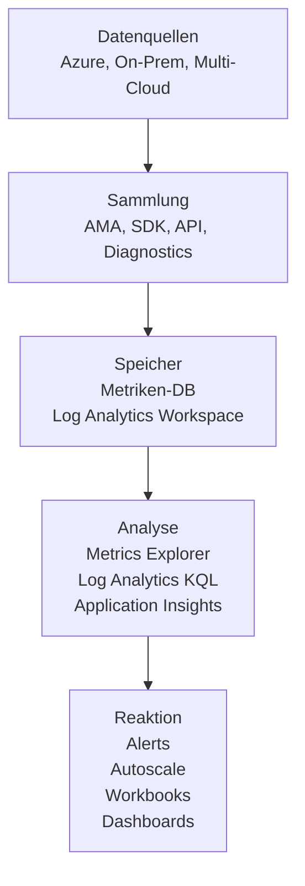
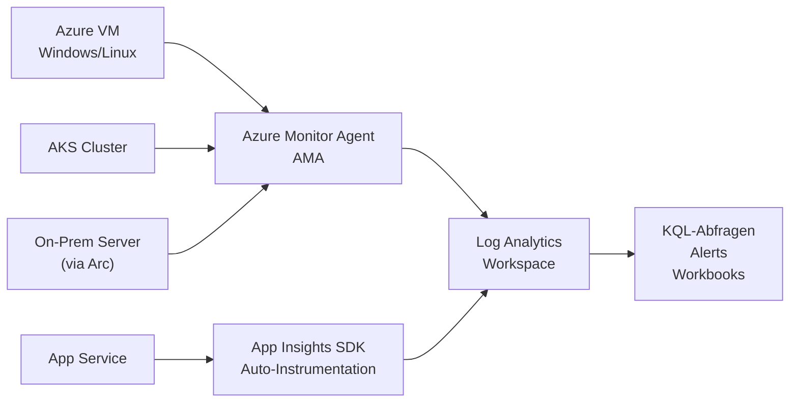
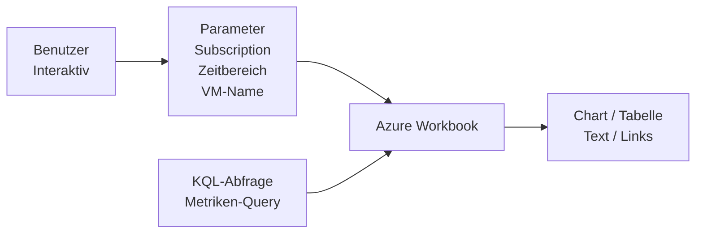
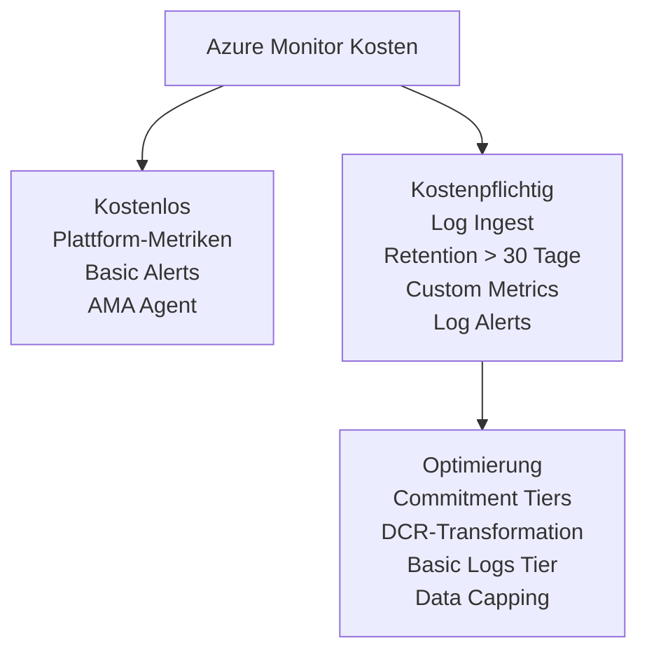
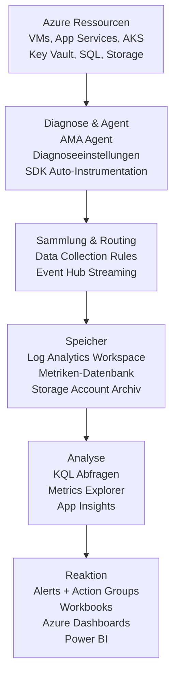

---
tags:
  - azure
  - monitoring
  - observability
  - azure-monitor
aliases:
  - Azure Monitor
  - Monitor Grundlagen
---

# Azure Monitor Grundlagen

> [!ABSTRACT]
> Azure Monitor ist die zentrale Observability-Plattform in Azure. Sie sammelt Metriken, Logs, Traces und Änderungsdaten aus allen Azure-Ressourcen, On-Premises-Systemen und anderen Clouds — und ermöglicht Analyse, Alerting, Dashboards und automatisierte Reaktionen.

---

## Was ist Azure Monitor?

Azure Monitor ist kein einzelnes Tool, sondern eine **Plattform** aus mehreren integrierten Diensten. Sie beantwortet die drei grundlegenden Observability-Fragen:

| Frage | Signal | Werkzeug |
|---|---|---|
| Was passiert gerade? | Metriken | Metrics Explorer |
| Was ist passiert? | Logs | Log Analytics |
| Wo liegt das Problem? | Traces | Application Insights |
| Was hat sich geändert? | Änderungen | Change Analysis |



> [!NOTE]
> Azure Monitor ist in Azure bereits eingebaut — viele Metriken werden **ohne Konfiguration** automatisch gesammelt (Plattform-Metriken).

---

## Datenquellen

Azure Monitor empfängt Daten aus vier Kategorien:

### Metriken
- Numerische Zeitreihendaten (CPU %, Requests/s, Bytes/s)
- Leichtgewichtig, schnell, kurze Latenz (< 1 Minute)
- 93 Tage Standardaufbewahrung
- Kostenlos für Plattform-Metriken

### Logs
- Strukturierte oder semi-strukturierte Ereignisdaten
- Gespeichert in Log Analytics Workspace
- Abfragen mit KQL (Kusto Query Language)
- Kosten: Pay-as-you-go nach Ingest-Volumen

### Traces (Distributed Tracing)
- Verfolgt Anfragen über Microservice-Grenzen hinweg
- Integriert in Application Insights
- Korrelation via `operation_Id`

### Änderungen (Change Analysis)
- Erkennt Konfigurationsänderungen an Azure-Ressourcen
- Nützlich bei "Was hat sich geändert, bevor das Problem auftrat?"
- Nutzt Azure Resource Graph

---

## Metriken vs. Logs

| Eigenschaft | Metriken | Logs |
|---|---|---|
| Datenformat | Numerisch (Float) | Strukturierter Text / JSON |
| Latenz | < 1 Minute | 2–5 Minuten |
| Abfragesprache | Metrics Explorer / REST | KQL |
| Aufbewahrung | 93 Tage (fix) | Konfigurierbar (30 Tage bis 7 Jahre) |
| Kosten | Plattform-Metriken kostenlos | Pay-as-you-go |
| Geeignet für | Alerting, Autoscaling, Dashboards | Diagnose, Audit, komplexe Analysen |
| Granularität | 1 Minute | Beliebig (Event-basiert) |

> [!TIP]
> **Faustregel:** Metriken für schnelle Alerts und Echtzeit-Dashboards. Logs für tiefe Diagnose, Compliance und Korrelation über mehrere Ressourcen.

---

## Azure Monitor Metriken

### Plattform-Metriken
Werden automatisch von Azure-Ressourcen gesammelt — kein Agent nötig.

Beispiele:
- `microsoft.compute/virtualmachines` → CPU Percentage, Disk Read Bytes, Network In
- `microsoft.sql/servers/databases` → DTU consumption, Storage percent
- `microsoft.web/sites` → Requests, Response Time, Http5xx

### Custom Metrics
Eigene Metriken können per API, SDK oder OpenTelemetry an Azure Monitor gesendet werden.

```bash
# Custom Metric via REST API senden
POST https://eastus.monitoring.azure.com/subscriptions/{subId}/resourceGroups/{rg}/providers/Microsoft.Compute/virtualMachines/{vmName}/metrics

# Header: Authorization: Bearer {token}
# Body:
{
  "time": "2024-01-15T10:00:00Z",
  "data": {
    "baseData": {
      "metric": "MyCustomMetric",
      "namespace": "MyApp",
      "series": [{ "dimValues": [], "min": 42, "max": 42, "sum": 42, "count": 1 }]
    }
  }
}
```

### Prometheus-Metriken
- Azure Monitor Managed Service for Prometheus
- Speziell für Kubernetes / AKS
- PromQL-kompatibel
- Integration mit Azure Managed Grafana

---

## Azure Monitor Logs und Log Analytics Workspace

Alle Log-Daten landen im **Log Analytics Workspace (LAW)**.



> [!IMPORTANT]
> Ein Log Analytics Workspace ist kein simples Log-Archiv — er ist die **Abfrage-Engine** für alle Log-basierten Alerts, Workbooks und Dashboards.

---

## Data Collection Rules (DCR)

DCRs sind die **moderne Art**, Daten in Azure Monitor zu konfigurieren. Sie definieren:

1. **Was** gesammelt wird (Windows Events, Perf Counters, Syslog)
2. **Von wo** (welche VMs/Server)
3. **Wohin** (Log Analytics Workspace, Storage Account, Event Hub)
4. **Transformationen** (Filtern, Anreichern beim Ingest)

```json
{
  "kind": "Windows",
  "dataSources": {
    "windowsEventLogs": [
      {
        "name": "eventLogsDataSource",
        "scheduledTransferPeriod": "PT1M",
        "streams": ["Microsoft-Event"],
        "xPathQueries": [
          "Application!*[System[(Level=1 or Level=2 or Level=3)]]",
          "System!*[System[(Level=1 or Level=2)]]"
        ]
      }
    ],
    "performanceCounters": [
      {
        "name": "perfCounterDataSource",
        "samplingFrequencyInSeconds": 60,
        "streams": ["Microsoft-Perf"],
        "counterSpecifiers": [
          "\\Processor Information(_Total)\\% Processor Time",
          "\\Memory\\Available Bytes"
        ]
      }
    ]
  },
  "destinations": {
    "logAnalytics": [
      {
        "workspaceResourceId": "/subscriptions/.../workspaces/mylaw",
        "name": "centralWorkspace"
      }
    ]
  },
  "dataFlows": [
    {
      "streams": ["Microsoft-Event", "Microsoft-Perf"],
      "destinations": ["centralWorkspace"]
    }
  ]
}
```

> [!NOTE]
> DCRs ersetzen die alte Konfiguration direkt im Log Analytics Workspace. Sie sind **portabel** und können per Policy auf viele Ressourcen angewendet werden.

---

## Diagnoseeinstellungen

Diagnoseeinstellungen konfigurieren, wohin **Resource Logs** und Metriken einer Azure-Ressource gesendet werden.

| Ziel | Anwendungsfall |
|---|---|
| Log Analytics Workspace | KQL-Abfragen, Alerts, Workbooks |
| Storage Account | Langzeit-Archivierung, Compliance |
| Event Hub | Streaming zu SIEM (Sentinel, Splunk) |
| Partner Solution | Direkt an Drittanbieter |

```powershell
# Diagnoseeinstellung per PowerShell erstellen
$law = Get-AzOperationalInsightsWorkspace -ResourceGroupName "rg-monitoring" -Name "law-central"

Set-AzDiagnosticSetting `
  -ResourceId "/subscriptions/{subId}/resourceGroups/rg-prod/providers/Microsoft.KeyVault/vaults/kv-prod" `
  -WorkspaceId $law.ResourceId `
  -Enabled $true `
  -Category @("AuditEvent") `
  -Name "kv-to-law"
```

> [!WARNING]
> Diagnoseeinstellungen müssen **pro Ressource** konfiguriert werden. Azure Policy hilft, dies automatisiert und konsistent durchzusetzen.

---

## Azure Monitor Agent (AMA)

Der AMA ist der **einheitliche, moderne Agent** und ersetzt:

| Legacy-Agent | Funktion | Abgelöst durch |
|---|---|---|
| MMA / OMS Agent | Log Analytics | AMA |
| Diagnostics Extension | Plattform-Diagnose | AMA |
| Dependency Agent | Service Map / VM Insights | AMA (integriert) |

> [!IMPORTANT]
> Microsoft hat angekündigt, MMA und OMS Agent **Ende 2024** abzukündigen. Migration zu AMA ist zwingend.

Der AMA wird über **Data Collection Rules** gesteuert — keine direkte Workspace-Konfiguration mehr.

Details: [[Azure Monitor Agent]]

---

## Insights

Azure Monitor bietet vorkonfigurierte Monitoring-Lösungen ("Insights"):

### VM Insights
- Monitoring für Azure VMs und Arc-Server
- Vorkonfigurierte Performance- und Abhängigkeits-Karten
- Benötigt AMA + Dependency Agent

### Container Insights
- Monitoring für AKS und Arc-enabled Kubernetes
- Pod-Health, Node-Performance, Container-Logs
- Integration mit Prometheus

### Application Insights
- APM (Application Performance Monitoring)
- Requests, Dependencies, Exceptions, Traces
- Live Metrics, Smart Detection
- Details: [[Application Insights]]

### Network Insights
- Topology-Ansicht des virtuellen Netzwerks
- Connection Monitor, NSG Flow Logs
- Bandwidth-Analyse

---

## Workbooks

Workbooks sind **interaktive, parametergesteuerte Dashboards** in Azure Monitor.

Unterschied zu statischen Dashboards:

| Feature | Workbooks | Azure Dashboards |
|---|---|---|
| Parameter (Zeitbereich, Subscription) | ✅ | ❌ |
| Interaktivität / Drill-Down | ✅ | Eingeschränkt |
| KQL-Abfragen einbetten | ✅ | Eingeschränkt |
| Mehrere Datenquellen kombinieren | ✅ | Eingeschränkt |
| Teilen / Vorlagen | ✅ (Gallery) | ✅ |
| Exportierbar als Report | ❌ | ❌ |



---

## Azure Dashboards vs. Workbooks vs. Power BI

| Kriterium | Azure Dashboards | Workbooks | Power BI |
|---|---|---|---|
| Zielgruppe | Operations-Teams | Techniker, Analysten | Business, Management |
| Echtzeit | ✅ | ✅ | Eingeschränkt |
| Interaktivität | Gering | Hoch | Sehr hoch |
| Datenquellen | Azure-Dienste | Azure Monitor | Viele (inkl. Azure) |
| Teilen | Per Link / RBAC | Per Link / RBAC | Power BI Service |
| Kosten | Kostenlos | Kostenlos | Power BI Pro Lizenz |
| Deployment as Code | ARM/Bicep | ARM/Bicep | .pbix Datei |

> [!TIP]
> Für operative Azure-Überwachung: **Workbooks**. Für Management-Reporting und Business-Metriken: **Power BI**.

---

## Kosten

| Komponente | Kosten |
|---|---|
| Plattform-Metriken | Kostenlos |
| Custom Metrics | 0,10 $/Metrik-Zeitreihe/Monat (erste 10 kostenlos) |
| Log Analytics Ingest | ~2,30 $/GB (Pay-as-you-go) |
| Log Analytics Retention > 30 Tage | 0,10 $/GB/Monat |
| Basic Logs | ~0,50 $/GB (nur einfache Abfragen) |
| Alerts | Erste 1.000 Metric Alerts kostenlos |
| Log Search Alerts | ~0,10 $/Regel/Monat |

> [!TIP]
> Mit **Commitment Tiers** (100 GB/Tag, 200 GB/Tag, ...) können bis zu 30 % gegenüber Pay-as-you-go gespart werden. Details: [[Log Analytics Workspace]]



> [!WARNING]
> Ohne **Daily Cap** auf dem Log Analytics Workspace können bei unerwarteten Log-Spitzen hohe Kosten entstehen. Daily Cap unbedingt konfigurieren!

---

## Architektur: Vollständiges Monitoring-Setup



---

## Schnellstart: Basis-Monitoring per Bicep

```bicep
// Log Analytics Workspace
resource law 'Microsoft.OperationalInsights/workspaces@2022-10-01' = {
  name: 'law-monitoring-prod'
  location: 'westeurope'
  properties: {
    sku: {
      name: 'PerGB2018'
    }
    retentionInDays: 90
    features: {
      dailyQuotaGb: 10  // Daily Cap: 10 GB
    }
  }
}

// Diagnoseeinstellung für Activity Log
resource activityDiag 'Microsoft.Insights/diagnosticSettings@2021-05-01-preview' = {
  name: 'activitylog-to-law'
  scope: subscription()
  properties: {
    workspaceId: law.id
    logs: [
      {
        category: 'Administrative'
        enabled: true
      }
      {
        category: 'Security'
        enabled: true
      }
      {
        category: 'Policy'
        enabled: true
      }
    ]
  }
}
```

---

## Verwandte Notizen

- [[Log Analytics Workspace]]
- [[Azure Monitor Agent]]
- [[Application Insights]]
- [[Azure Alerts]]
- [[Azure RBAC]]
