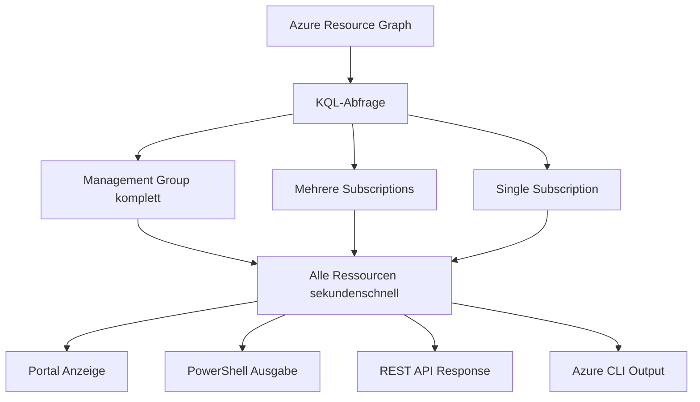

---
tags:
  - azure
  - resource-graph
  - kql
  - governance
  - inventory
aliases:
  - ARG
  - Resource Graph Explorer
  - Azure Resource Query
---

# Azure Resource Graph

> [!ABSTRACT]
> Azure Resource Graph (ARG) ist ein Dienst zur schnellen, KQL-basierten Abfrage aller Azure-Ressourcen über Subscriptions und Management Groups hinweg. Er ermöglicht Inventarisierung, Compliance-Überprüfung, Sicherheitsanalysen und Change-History-Abfragen in Sekunden – ohne dass jede Subscription einzeln abgefragt werden muss.

---

## Was ist Azure Resource Graph?

Azure Resource Graph bietet:

- **Skalierbare Ressourcenabfragen** über Hunderte von Subscriptions in Sekunden
- **KQL (Kusto Query Language)** als Abfragesprache
- **Echtzeit-Daten** aus dem Azure Resource Manager (ARM)
- **Change History** – Ressourcen-Änderungen der letzten 14 Tage
- **REST API, PowerShell, Azure CLI** Integration



---

## Resource Graph Explorer

Der **Resource Graph Explorer** ist das portalbasierte KQL-Query-Interface:

**Portal-Pfad:** Azure Portal → "Resource Graph Explorer"

### Funktionen

| Funktion | Beschreibung |
|---|---|
| **Query Editor** | KQL-Editor mit IntelliSense |
| **Scope-Auswahl** | Management Group, Subscription, Resource Group |
| **Ergebnisse** | Tabellen-, JSON- und Chart-Ansicht |
| **Abfragen speichern** | Private oder öffentliche gespeicherte Abfragen |
| **Pin to Dashboard** | Abfrageergebnisse als Dashboard-Widget |
| **Download** | CSV oder JSON Export |

---

## Verfügbare Tabellen

### Haupttabellen

| Tabelle | Inhalt |
|---|---|
| **resources** | Alle Azure-Ressourcen (VMs, Storage, etc.) |
| **resourcecontainers** | Subscriptions, Resource Groups, Management Groups |
| **policyresources** | Policy-Assignments, Definitionen, Compliance |
| **securityresources** | Microsoft Defender for Cloud – Findings |
| **advisorresources** | Azure Advisor – Empfehlungen |
| **healthresources** | Azure Service Health – Ressourcen-Gesundheit |
| **patchassessmentresources** | Azure Update Manager – Patch-Status |
| **patchinstallationresources** | Azure Update Manager – Patch-History |
| **guestconfigurationresources** | Azure Policy Guest Configuration |
| **maintenanceresources** | Maintenance Configurations und Assignments |
| **networkresources** | Netzwerkressourcen (NSGs, Routes, etc.) |
| **desktopvirtualizationresources** | Azure Virtual Desktop |
| **kubernetesconfigurationresources** | AKS und Arc Kubernetes |
| **iotsecurityresources** | IoT-Sicherheitsressourcen |

### Tabellen-Struktur (resources)

```kusto
resources
| getschema
| project ColumnName, ColumnType
| order by ColumnName asc
```

---

## Wichtige KQL-Abfragen

### Alle VMs einer Subscription

```kusto
resources
| where type == "microsoft.compute/virtualmachines"
| where subscriptionId == "{subId}"
| project 
    name,
    resourceGroup,
    location,
    vmSize = properties.hardwareProfile.vmSize,
    osType = properties.storageProfile.osDisk.osType,
    powerState = properties.extended.instanceView.powerState.displayStatus
| order by resourceGroup asc, name asc
```

### Alle VMs über mehrere Subscriptions

```kusto
resources
| where type == "microsoft.compute/virtualmachines"
| project 
    name,
    resourceGroup,
    subscriptionId,
    location,
    vmSize = properties.hardwareProfile.vmSize,
    osType = properties.storageProfile.osDisk.osType
| join kind=leftouter (
    resourcecontainers
    | where type == "microsoft.resources/subscriptions"
    | project subscriptionId, subscriptionName = name
) on subscriptionId
| project-away subscriptionId1
| order by subscriptionName asc, name asc
```

### Ungetaggte Ressourcen finden

```kusto
resources
| where isnull(tags) or tags == "{}"
| where type !in (
    "microsoft.resources/resourcegroups",
    "microsoft.authorization/roleassignments"
)
| project name, type, resourceGroup, subscriptionId, location
| order by type asc, name asc
```

### Ressourcen mit bestimmtem Tag

```kusto
resources
| where tags["Environment"] == "Production"
| summarize count() by type
| order by count_ desc
```

### Non-Compliant Policy-Assignments

```kusto
policyresources
| where type == "microsoft.policyinsights/policystates"
| where properties.complianceState == "NonCompliant"
| project 
    resourceId = properties.resourceId,
    policyName = properties.policyDefinitionName,
    policyEffect = properties.policyDefinitionAction,
    subscriptionId = properties.subscriptionId,
    resourceType = properties.resourceType
| order by policyName asc
```

### Öffentliche IP-Adressen finden

```kusto
resources
| where type == "microsoft.network/publicipaddresses"
| where isnotnull(properties.ipAddress)
| project 
    name,
    resourceGroup,
    ipAddress = properties.ipAddress,
    allocationMethod = properties.publicIPAllocationMethod,
    associatedTo = properties.ipConfiguration.id,
    subscriptionId
| order by ipAddress asc
```

### VMs ohne Backup-Schutz

```kusto
resources
| where type == "microsoft.compute/virtualmachines"
| project vmId = tolower(id), name, resourceGroup, subscriptionId
| join kind=leftouter (
    recoveryservicesresources
    | where type == "microsoft.recoveryservices/vaults/backupfabrics/protectioncontainers/protecteditems"
    | project protectedVmId = tolower(tostring(properties.sourceResourceId))
) on $left.vmId == $right.protectedVmId
| where isnull(protectedVmId)
| project name, resourceGroup, subscriptionId
```

### Veraltete VM-Größen identifizieren

```kusto
resources
| where type == "microsoft.compute/virtualmachines"
| where properties.hardwareProfile.vmSize startswith "Standard_A" 
    or properties.hardwareProfile.vmSize startswith "Standard_D1_"
    or properties.hardwareProfile.vmSize startswith "Standard_D2_"
| project 
    name,
    resourceGroup,
    vmSize = properties.hardwareProfile.vmSize,
    subscriptionId
| order by vmSize asc
```

### Storage Accounts ohne sichere Übertragung

```kusto
resources
| where type == "microsoft.storage/storageaccounts"
| where properties.supportsHttpsTrafficOnly == false
| project name, resourceGroup, subscriptionId, location
| order by resourceGroup asc
```

### NSGs mit Allow-All-Regeln

```kusto
resources
| where type == "microsoft.network/networksecuritygroups"
| mv-expand rules = properties.securityRules
| where rules.properties.access == "Allow"
    and rules.properties.direction == "Inbound"
    and rules.properties.destinationPortRange == "*"
    and rules.properties.sourceAddressPrefix == "*"
| project 
    nsgName = name,
    ruleName = rules.name,
    priority = rules.properties.priority,
    resourceGroup,
    subscriptionId
```

---

## Resource Graph über PowerShell

```powershell
# Modul installieren
Install-Module -Name Az.ResourceGraph -Force -AllowClobber

# Einfache Abfrage
$query = "resources | where type == 'microsoft.compute/virtualmachines' | project name, resourceGroup, location"
Search-AzGraph -Query $query

# Über mehrere Subscriptions
$subscriptions = @("{subId1}", "{subId2}", "{subId3}")
Search-AzGraph -Query $query -Subscription $subscriptions

# Mit Paging (für mehr als 1000 Ergebnisse)
$allResults = @()
$skipToken = $null

do {
    $result = Search-AzGraph `
        -Query "resources | where type == 'microsoft.compute/virtualmachines'" `
        -First 1000 `
        -SkipToken $skipToken
    
    $allResults += $result.Data
    $skipToken = $result.SkipToken
} while ($null -ne $skipToken)

Write-Host "Gesamt: $($allResults.Count) VMs gefunden"
```

---

## Resource Graph über Azure CLI

```bash
# Extension installieren (falls nicht vorhanden)
az extension add --name resource-graph

# Einfache Abfrage
az graph query \
    --graph-query "resources | where type == 'microsoft.compute/virtualmachines' | project name, resourceGroup, location" \
    --output table

# Über mehrere Subscriptions
az graph query \
    --graph-query "resources | summarize count() by type | order by count_ desc" \
    --subscriptions "{subId1}" "{subId2}" \
    --output table

# Mit Paging
az graph query \
    --graph-query "resources | where type == 'microsoft.compute/virtualmachines'" \
    --first 1000 \
    --output json | jq '.data | length'
```

---

## Resource Graph über REST API

```powershell
# REST API direkt aufrufen
$token = (Get-AzAccessToken).Token
$headers = @{
    "Authorization" = "Bearer $token"
    "Content-Type"  = "application/json"
}

$body = @{
    query = "resources | where type == 'microsoft.compute/virtualmachines' | project name, resourceGroup"
    subscriptions = @("{subId1}", "{subId2}")
} | ConvertTo-Json

$response = Invoke-RestMethod `
    -Uri "https://management.azure.com/providers/Microsoft.ResourceGraph/resources?api-version=2022-10-01" `
    -Method POST `
    -Headers $headers `
    -Body $body

$response.data
```

---

## Change History

Die **Change History** zeigt alle Ressourcen-Änderungen der letzten **14 Tage**.

### Change History abfragen

```kusto
// Alle Änderungen der letzten 24 Stunden
resourcechanges
| where timestamp > ago(24h)
| project 
    changeTime = timestamp,
    resourceId,
    changeType = properties.changeType,
    changedBy = properties.changedBy,
    changedProperties = properties.changes
| order by changeTime desc
```

```kusto
// Gelöschte Ressourcen der letzten 7 Tage
resourcechanges
| where timestamp > ago(7d)
| where properties.changeType == "Delete"
| project 
    changeTime = timestamp,
    resourceId,
    changedBy = properties.changedBy
| order by changeTime desc
```

```kusto
// Änderungen an einer spezifischen VM
resourcechanges
| where timestamp > ago(14d)
| where resourceId has "vm-web01"
| project 
    changeTime = timestamp,
    changeType = properties.changeType,
    changedProperties = properties.changes
| order by changeTime desc
```

### Change History im Portal

Im Azure Portal: Ressource öffnen → **"Activity Log"** → **"Change history"** Tab

---

## Compliance-Überprüfung (Policy)

### Policy Compliance State abfragen

```kusto
// Compliance-Übersicht nach Policy
policyresources
| where type == "microsoft.policyinsights/policystates"
| summarize 
    Compliant = countif(properties.complianceState == "Compliant"),
    NonCompliant = countif(properties.complianceState == "NonCompliant"),
    Total = count()
    by policyName = tostring(properties.policyDefinitionName)
| extend ComplianceRate = round(toreal(Compliant) / Total * 100, 1)
| order by ComplianceRate asc
```

```kusto
// Alle Non-Compliant Ressourcen mit Policy-Details
policyresources
| where type == "microsoft.policyinsights/policystates"
| where properties.complianceState == "NonCompliant"
| project 
    resourceName = tostring(split(properties.resourceId, "/")[-1]),
    resourceType = properties.resourceType,
    policyName = properties.policyDefinitionName,
    policyEffect = properties.policyDefinitionAction,
    subscriptionId = properties.subscriptionId,
    resourceGroup = properties.resourceGroup
| summarize NonCompliantResources = count() 
    by policyName, policyEffect
| order by NonCompliantResources desc
```

---

## Azure Advisor Empfehlungen

```kusto
// Alle High-Priority Advisor-Empfehlungen
advisorresources
| where type == "microsoft.advisor/recommendations"
| where properties.impact == "High"
| project 
    category = properties.category,
    impactedResource = properties.impactedValue,
    recommendation = properties.shortDescription.solution,
    savings = properties.extendedProperties.annualSavingsAmount,
    subscriptionId
| order by category asc, savings desc
```

```kusto
// Kosteneinsparungen nach Kategorie summieren
advisorresources
| where type == "microsoft.advisor/recommendations"
| where properties.category == "Cost"
| extend savings = todouble(properties.extendedProperties.annualSavingsAmount)
| summarize TotalSavingsPerYear = sum(savings) by subscriptionId
| order by TotalSavingsPerYear desc
```

---

## Security Center / Defender Findings

```kusto
// Offene Security Findings nach Severity
securityresources
| where type == "microsoft.security/assessments"
| where properties.status.code == "Unhealthy"
| project 
    assessmentName = properties.displayName,
    severity = properties.metadata.severity,
    resourceId = properties.resourceDetails.id,
    remediationSteps = properties.metadata.remediationDescription
| summarize count() by severity, assessmentName
| order by severity asc, count_ desc
```

---

## Limits und Paging

| Limit | Wert |
|---|---|
| **Max. Ergebnisse pro Abfrage** | 1.000 |
| **Paging via SkipToken** | Ja (unbegrenzte Gesamtergebnisse) |
| **Max. Abfragedauer** | 10 Sekunden |
| **Max. Subscriptions pro Abfrage** | Alle (Management Group scope) |
| **Change History Zeitraum** | 14 Tage |
| **Parallele Abfragen** | Throttling bei hoher Last |

### Paging mit PowerShell

```powershell
# Alle VMs über Paging abrufen (>1000)
$query = "resources | where type == 'microsoft.compute/virtualmachines'"
$results = @()
$response = Search-AzGraph -Query $query -First 1000

$results += $response
while ($response.SkipToken) {
    $response = Search-AzGraph -Query $query -First 1000 -SkipToken $response.SkipToken
    $results += $response
}

Write-Host "Gesamtzahl VMs: $($results.Count)"
```

---

## Best Practices für große Umgebungen

> [!TIP]
> **Empfehlungen für Abfrage-Performance:**
>
> 1. **`where`-Filter früh setzen** – reduziert zu scannende Datenmenge
> 2. **`project`** statt `*` – nur benötigte Felder abrufen
> 3. **`summarize`** für Aggregationen nutzen – weniger Daten übertragen
> 4. **Management Group als Scope** für tenant-weite Abfragen
> 5. **Paging** für Ergebnismengen > 1.000 Einträge implementieren

```kusto
// Gute Abfrage: Filter und Projektion früh
resources
| where type == "microsoft.compute/virtualmachines"  // Filter zuerst
| where location == "westeurope"                      // weiterer Filter
| project name, resourceGroup, subscriptionId         // nur benötigte Felder
| order by resourceGroup asc

// Schlechte Abfrage: Kein früher Filter
resources
| project *                                           // alle Felder laden
| order by id                                         // sortieren ohne Filter
```

> [!NOTE]
> Azure Resource Graph hat eine **Throttling-Grenze** von 15 Abfragen pro 5 Sekunden für Standard-Calls und 20 für privilegierte Calls. Bei Automatisierungen `Start-Sleep` einbauen.

---

## Abfragen speichern und teilen

```powershell
# Gespeicherte Abfrage erstellen
New-AzResourceGraphQuery `
    -Name "VMs ohne Tags" `
    -Description "Alle VMs ohne Tags in allen Subscriptions" `
    -Query "resources | where type == 'microsoft.compute/virtualmachines' | where isnull(tags) or tags == '{}' | project name, resourceGroup, subscriptionId" `
    -Location "global" `
    -ResourceGroupName "rg-governance"

# Alle gespeicherten Abfragen auflisten
Get-AzResourceGraphQuery -ResourceGroupName "rg-governance"
```

---

## Verwandte Notizen

- [[Azure Monitor Grundlagen]]
- [[Log Analytics Workspace]]
- [[Azure Policy]]
- [[Subscriptions und Management Groups]]
- [[Azure Migrate]]
