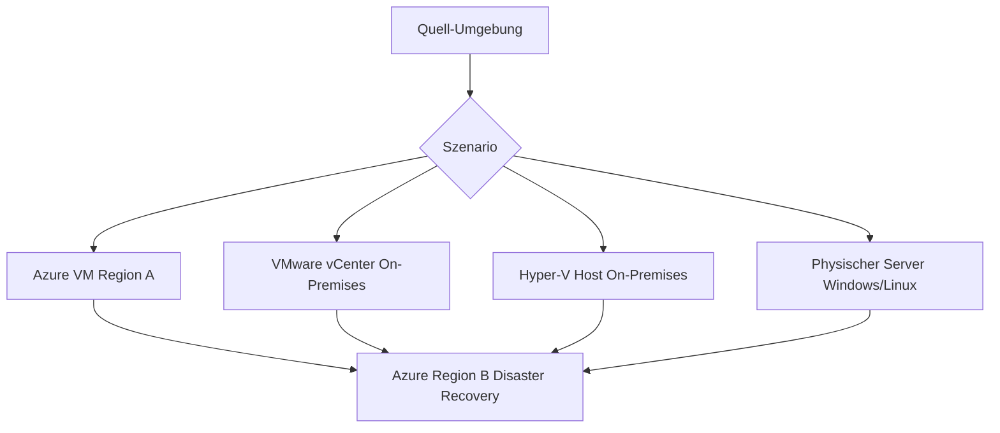
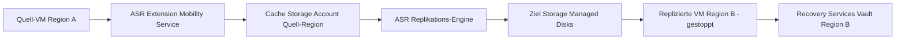
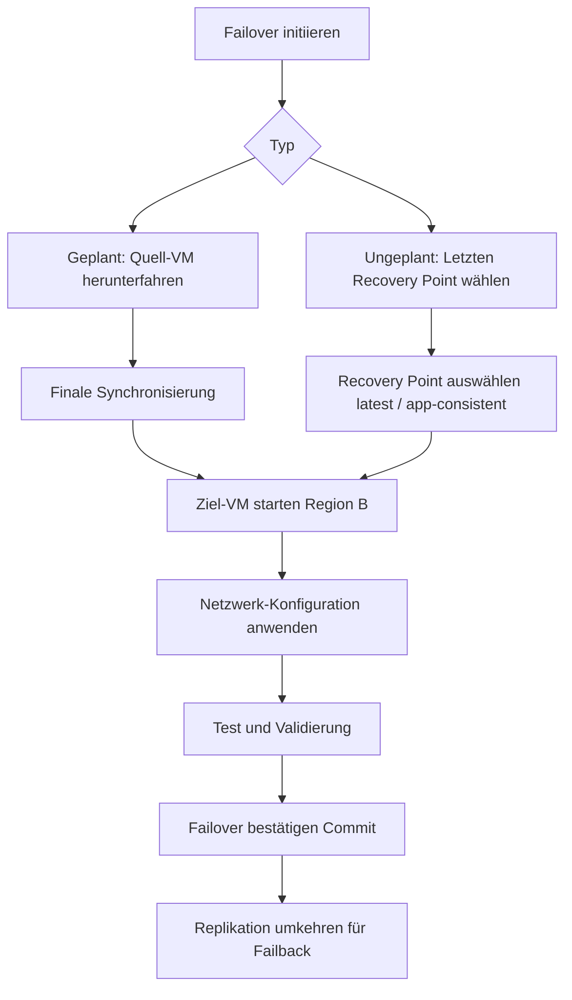
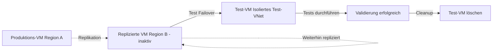
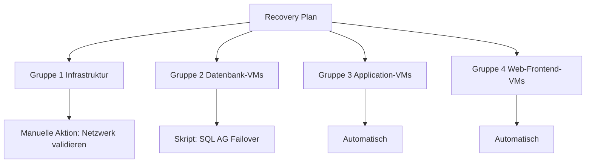
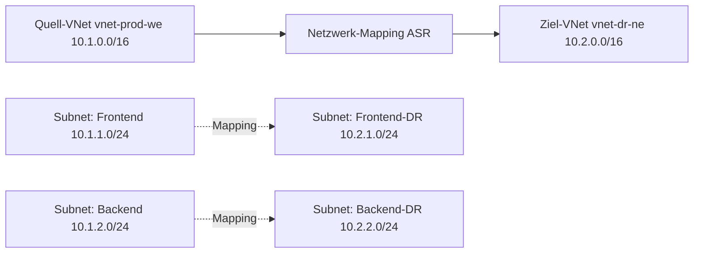

---
tags:
  - azure
  - disaster-recovery
  - bcdr
  - replication
  - failover
aliases:
  - ASR
  - Site Recovery
  - Disaster Recovery Azure
---

# Azure Site Recovery

> [!ABSTRACT]
> Azure Site Recovery (ASR) ist der cloudnative Disaster-Recovery-Dienst von Microsoft Azure. Er repliziert VMs und physische Server kontinuierlich in eine Azure-Zielregion (oder sekundäres Datacenter) und ermöglicht geplante sowie ungeplante Failover mit minimalem Datenverlust. ASR unterstützt Azure-zu-Azure-, VMware-zu-Azure-, Hyper-V-zu-Azure- und Physical-Server-zu-Azure-Szenarien.

---

## Was ist Azure Site Recovery?

Azure Site Recovery (ASR) bietet **kontinuierliche Replikation** und **orchestrierte Failover-Fähigkeiten** für:

- Azure VMs (Region-zu-Region)
- VMware-VMs (On-Premises → Azure)
- Hyper-V-VMs (On-Premises → Azure oder sekundäres Datacenter)
- Physische Windows/Linux-Server (On-Premises → Azure)

### Kernkonzepte

| Begriff | Beschreibung |
|---|---|
| **RPO (Recovery Point Objective)** | Maximaler tolerierbarer Datenverlust (Zeit) |
| **RTO (Recovery Time Objective)** | Maximale tolerierbare Ausfallzeit |
| **Failover** | Umschalten auf die Replikat-Umgebung |
| **Failback** | Rückkehr zur primären Umgebung |
| **Test Failover** | DR-Test ohne Produktionsunterbrechung |
| **Recovery Plan** | Orchestrierter, geskripteter Failover-Ablauf |

### ASR RPO/RTO Zielwerte

| Szenario | RPO | RTO |
|---|---|---|
| Azure VM zu Azure VM | ~1 Minute | ~30 Minuten (Recovery Plan) |
| VMware zu Azure | ~15 Minuten | ~1-2 Stunden |
| Hyper-V zu Azure | ~30 Minuten | ~2 Stunden |
| Physischer Server | ~1 Stunde | ~2 Stunden |

---

## Unterstützte Szenarien



---

## Replikations-Architektur: Azure VM zu Azure VM

### Komponenten



### Replikations-Ablauf

1. **Erste Replikation (Initial Replication):** Vollständige Kopie der Daten in die Zielregion
2. **Delta-Replikation:** Laufende Synchronisierung der Änderungen (~30-sekündige Intervalle)
3. **Recovery Points:** Crash-konsistente Punkte alle 5 Minuten, App-konsistente alle 4 Stunden

### ASR für Azure VM aktivieren (PowerShell)

```powershell
# Recovery Services Vault Context setzen
$vault = Get-AzRecoveryServicesVault -Name "rsv-dr-northeurope"
Set-AzRecoveryServicesAsrVaultContext -Vault $vault

# Replikations-Fabric (Quell-Region) abrufen
$primaryFabric = Get-AzRecoveryServicesAsrFabric -Name "asr-fabric-westeurope"
$recoveryFabric = Get-AzRecoveryServicesAsrFabric -Name "asr-fabric-northeurope"

# Protection Container abrufen
$primaryContainer = Get-AzRecoveryServicesAsrProtectionContainer `
    -Fabric $primaryFabric
$recoveryContainer = Get-AzRecoveryServicesAsrProtectionContainer `
    -Fabric $recoveryFabric

# Replizierbare Items aktivieren
$replicationPolicy = Get-AzRecoveryServicesAsrPolicy -Name "asr-policy-24h"

New-AzRecoveryServicesAsrProtectionContainerMapping `
    -Name "mapping-we-to-ne" `
    -Policy $replicationPolicy `
    -PrimaryProtectionContainer $primaryContainer `
    -RecoveryProtectionContainer $recoveryContainer
```

```bash
# Azure CLI: VM-Replikation aktivieren
az site-recovery protected-item create \
    --resource-group rg-dr \
    --vault-name rsv-dr-northeurope \
    --fabric-name asr-fabric-westeurope \
    --container-name asr-container-westeurope \
    --replicated-item-name vm-web01-replication \
    --provider-input '{
        "instanceType": "A2A",
        "fabricObjectId": "/subscriptions/{subId}/resourceGroups/rg-prod/providers/Microsoft.Compute/virtualMachines/vm-web01",
        "recoveryResourceGroupId": "/subscriptions/{subId}/resourceGroups/rg-dr",
        "recoveryContainerId": "/subscriptions/{subId}/resourceGroups/rg-dr/providers/Microsoft.RecoveryServices/vaults/rsv-dr-northeurope/replicationFabrics/asr-fabric-northeurope/replicationProtectionContainers/asr-container-northeurope"
    }'
```

---

## Failover

### Geplanter vs. Ungeplanter Failover

| Kriterium | Geplanter Failover | Ungeplanter Failover |
|---|---|---|
| **Auslöser** | Wartung, Migration | Regionaler Ausfall, Katastrophe |
| **Datenverlust** | Kein Verlust (Sync vor Failover) | Bis zum letzten Recovery Point |
| **Quell-VM Status** | Wird sauber heruntergefahren | Verbleibt ausgefallen |
| **Empfehlung** | Regelmäßige DR-Tests/Migration | Nur bei echtem Ausfall |

### Failover-Ablauf



### Failover ausführen (PowerShell)

```powershell
# Test Failover (ohne Produktion zu unterbrechen)
$protectedItem = Get-AzRecoveryServicesAsrReplicationProtectedItem `
    -ProtectionContainer $primaryContainer `
    -Name "vm-web01-replication"

# Test Failover mit letztem App-konsistenten Recovery Point
$recoveryPoint = (Get-AzRecoveryServicesAsrRecoveryPoint `
    -ReplicationProtectedItem $protectedItem | 
    Where-Object { $_.RecoveryPointType -eq "AppConsistent" } | 
    Sort-Object RecoveryPointTime -Descending | 
    Select-Object -First 1)

$job = Start-AzRecoveryServicesAsrTestFailoverJob `
    -ReplicationProtectedItem $protectedItem `
    -Direction "PrimaryToRecovery" `
    -RecoveryPoint $recoveryPoint `
    -AzureVMNetworkId "/subscriptions/{subId}/resourceGroups/rg-dr/providers/Microsoft.Network/virtualNetworks/vnet-dr-test"

# Job-Status überwachen
Get-AzRecoveryServicesAsrJob -Job $job
```

```powershell
# Test Failover bereinigen
Start-AzRecoveryServicesAsrTestFailoverCleanupJob `
    -ReplicationProtectedItem $protectedItem `
    -Comment "DR-Test erfolgreich durchgeführt am $(Get-Date -Format 'yyyy-MM-dd')"
```

---

## Test Failover (DR-Test)

> [!TIP]
> Test Failover ist die **empfohlene Methode** für regelmäßige DR-Tests. Er startet eine Kopie der VM in einem **isolierten Test-Netzwerk** ohne die Produktionsumgebung zu beeinflussen.

### Test Failover Best Practices

- Mindestens **einmal pro Quartal** durchführen
- Dediziertes **Test-VNet** ohne Verbindung zur Produktion
- Automatisierte Tests via **Recovery Plan + Scripts**
- Ergebnisse dokumentieren für Compliance (ISO 27001, DSGVO)



---

## Failback

Failback beschreibt die **Rückkehr von Region B nach Region A** nach einem Failover.

### Failback-Ablauf

1. **Re-protect:** Replikation von Region B → Region A aktivieren
2. **Synchonisierung:** Änderungen aus Region B nach Region A replizieren
3. **Geplanter Failover zurück:** Failover in Richtung Region A
4. **Re-protect erneut:** Replikation wieder auf Region B aktivieren

```powershell
# Re-protect nach Failover (Replikation umkehren)
Update-AzRecoveryServicesAsrProtectionDirection `
    -ReplicationProtectedItem $protectedItem `
    -Direction "RecoveryToPrimary"
```

---

## Recovery Plans

Recovery Plans orchestrieren den **Failover mehrerer VMs** in definierter Reihenfolge.

### Aufbau eines Recovery Plans



### Recovery Plan erstellen (PowerShell)

```powershell
# Recovery Plan für geordneten Failover erstellen
$vm1 = Get-AzRecoveryServicesAsrReplicationProtectedItem -Name "vm-sql01-replication" -ProtectionContainer $primaryContainer
$vm2 = Get-AzRecoveryServicesAsrReplicationProtectedItem -Name "vm-app01-replication" -ProtectionContainer $primaryContainer
$vm3 = Get-AzRecoveryServicesAsrReplicationProtectedItem -Name "vm-web01-replication" -ProtectionContainer $primaryContainer

New-AzRecoveryServicesAsrRecoveryPlan `
    -Name "rp-prod-dr" `
    -PrimaryFabric $primaryFabric `
    -RecoveryFabric $recoveryFabric `
    -ReplicationProtectedItem @($vm1, $vm2, $vm3)
```

### Skripte in Recovery Plans

Recovery Plans unterstützen:
- **Azure Automation Runbooks** (automatisch, keine manuelle Eingabe)
- **Manuelle Aktionen** (Pause für Genehmigung/Validierung)

---

## Netzwerk-Mapping

Netzwerk-Mapping definiert die Zuordnung von **Quell-VNets zu Ziel-VNets**.



```powershell
# Netzwerk-Mapping konfigurieren
New-AzRecoveryServicesAsrNetworkMapping `
    -Name "mapping-vnet-we-to-ne" `
    -PrimaryFabric $primaryFabric `
    -PrimaryAzureNetworkId "/subscriptions/{subId}/resourceGroups/rg-prod/providers/Microsoft.Network/virtualNetworks/vnet-prod-we" `
    -RecoveryFabric $recoveryFabric `
    -RecoveryAzureNetworkId "/subscriptions/{subId}/resourceGroups/rg-dr/providers/Microsoft.Network/virtualNetworks/vnet-dr-ne"
```

---

## ASR und Proximity Placement Groups

Bei Verwendung von **Proximity Placement Groups (PPG)** in der Quell-Region muss die Ziel-Region ebenfalls PPGs haben:

```powershell
# PPG für DR-Region erstellen und ASR zuordnen
$drPPG = New-AzProximityPlacementGroup `
    -ResourceGroupName "rg-dr" `
    -Name "ppg-dr-app-tier" `
    -Location "northeurope" `
    -ProximityPlacementGroupType "Standard"

# Bei der Replikation PPG als Ziel angeben
# (via ARM Template oder REST API konfigurieren)
```

---

## Kapazitätsreservierung für DR

Azure ermöglicht **Kapazitätsreservierungen** in der DR-Region für garantierte VM-Verfügbarkeit bei Failover:

```powershell
# Kapazitätsreservierungsgruppe erstellen
New-AzCapacityReservationGroup `
    -ResourceGroupName "rg-dr" `
    -Name "crg-dr-prod" `
    -Location "northeurope"

# Kapazität reservieren (z.B. 5x Standard_D4s_v3)
New-AzCapacityReservation `
    -ResourceGroupName "rg-dr" `
    -ReservationGroupName "crg-dr-prod" `
    -Name "cr-d4sv3-web-tier" `
    -Location "northeurope" `
    -SkuName "Standard_D4s_v3" `
    -CapacityToReserve 5
```

> [!NOTE]
> Kapazitätsreservierungen verursachen Kosten auch wenn die VMs nicht laufen. Kostenoptimierung: Nur für kritische VMs der Produktion reservieren.

---

## ASR Monitoring

### Replikations-Gesundheit überwachen

```powershell
# Replikations-Status aller geschützten Items
Get-AzRecoveryServicesAsrReplicationProtectedItem `
    -ProtectionContainer $primaryContainer |
    Select-Object FriendlyName, ProtectionStatus, ReplicationHealth, 
                  @{N="LastRPO";E={$_.ProviderSpecificDetails.LastRpoInSeconds}} |
    Format-Table -AutoSize
```

### Azure Monitor Alerts für ASR

```powershell
# Alert für Replikations-Fehler
$condition = New-AzMetricAlertRuleV2Criteria `
    -MetricName "ReplicationHealth" `
    -TimeAggregation "Average" `
    -Operator "LessThan" `
    -Threshold 100

New-AzMetricAlertRuleV2 `
    -Name "alert-asr-replication-health" `
    -ResourceGroupName "rg-dr" `
    -TargetResourceId $vault.ID `
    -Condition $condition `
    -ActionGroup $actionGroup `
    -Severity 1 `
    -WindowSize "PT15M" `
    -Frequency "PT5M"
```

---

## Kosten

| Kostenkomponente | Preis-Modell |
|---|---|
| **ASR-Lizenz** | Pro geschützter VM/Monat |
| **Ziel-Region Storage** | Pro GB/Monat (Managed Disks) |
| **Cache Storage Account** | Pro GB/Monat (Quell-Region) |
| **Ausgehende Daten** | Pro GB (initiale Replikation) |
| **Compute (Failover-VM)** | Nur bei aktivem Failover berechnet |
| **Kapazitätsreservierung** | Pro VM-Stunde (auch bei gestoppter VM) |

> [!TIP]
> Die **erste 31 Tage** sind für neu geschützte Instanzen kostenlos. Nutze diese Phase für initiale Tests.

---

## Best Practices

> [!TIP]
> **Empfohlene ASR-Implementierung:**
>
> 1. Recovery Plans für alle kritischen Anwendungsgruppen erstellen
> 2. Netzwerk-Mapping für alle VNets konfigurieren
> 3. Dedizierte Test-VNets für Test Failover anlegen
> 4. Quartalsweise Test Failover mit Dokumentation
> 5. RPO-Monitoring via Azure Monitor (Alert bei RPO > 15 Minuten)
> 6. Automation Runbooks für Pre/Post-Failover-Skripte

> [!WARNING]
> Nach einem **Failover-Commit** kann nicht mehr zum ursprünglichen Recovery Point zurückgekehrt werden. Immer zuerst **Test Failover** durchführen, bevor ein produktiver Failover bestätigt wird.

---

---

## Via Azure Portal (UI)

> [!TIP]
> Portal: **[portal.azure.com](https://portal.azure.com)**

**Recovery Services-Tresor erstellen:**
1. [portal.azure.com](https://portal.azure.com) → **+ Ressource erstellen** → **Recovery Services-Tresor**
2. Ressourcengruppe, Name und **Zielregion** (DR-Region) wählen → **Erstellen**

**Replikation für Azure-VM aktivieren:**
- Tresor → **Site Recovery** → **Schritt 1: Infrastruktur vorbereiten** → Azure-to-Azure wählen
- **+ Replizieren** → Quellregion, VMs auswählen, Zielressourcengruppe und VNet konfigurieren → **Replikation aktivieren**

**Replikationsstatus überwachen:**
- Tresor → **Replizierte Elemente** → VM auswählen → Replikationsstatus und RPO-Wert anzeigen

**Test-Failover durchführen:**
- Repliziertes Element → **Test-Failover** → Wiederherstellungspunkt und isoliertes VNet wählen → **OK**
- Nach Test: **Test-Failover bereinigen** → Ressourcen aus Test-Failover löschen

**Wiederherstellungsplan erstellen:**
- Tresor → **Wiederherstellungspläne** → **+ Plan hinzufügen** → VMs gruppieren und Reihenfolge festlegen

**Failover durchführen (Notfall):**
- Repliziertes Element → **Failover** → Wiederherstellungspunkt wählen → **Failover** bestätigen

---

## Verwandte Notizen

- [[Azure Backup]]
- [[Azure Migrate]]
- [[Azure Monitor Grundlagen]]
- [[Azure Automation]]
