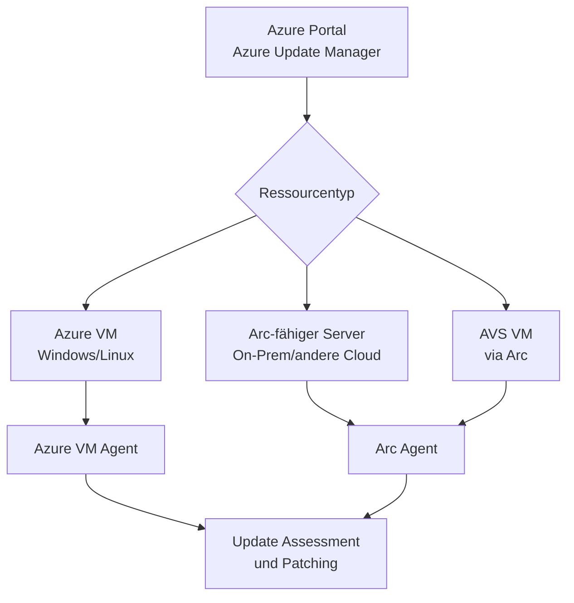
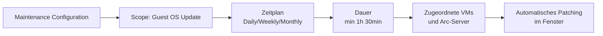
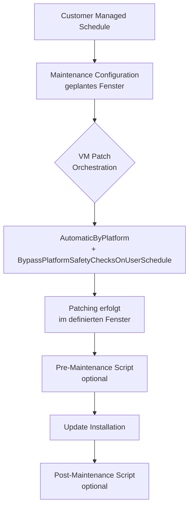
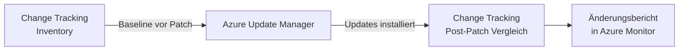

---
tags:
  - azure
  - update-management
  - patching
  - governance
  - arc
aliases:
  - AUM
  - Azure Update Management
---

# Azure Update Manager

> [!ABSTRACT]
> Azure Update Manager (AUM) ist der cloudnative Patch-Management-Dienst für Azure VMs und Arc-fähige Server. Er löst das ältere Automation Update Management ab und bietet zentralisiertes Assessment, geplante Wartungsfenster, On-Demand-Patching sowie Pre/Post-Skripte – ohne Abhängigkeit von Azure Automation oder Log Analytics Workspace.

---

## Was ist Azure Update Manager?

Azure Update Manager ist ein **nativer Azure-Dienst** zur Verwaltung von Betriebssystem-Updates für:

- Azure Virtual Machines (Windows & Linux)
- Azure Arc-fähige Server (On-Premises, andere Clouds)
- Azure VMware Solution (AVS) VMs via Arc

AUM kommuniziert direkt über den **Azure VM Agent** bzw. den **Arc Agent** – kein zusätzlicher Log Analytics Agent oder Automation Account ist erforderlich.



---

## Ablösung von Automation Update Management

| Feature | Automation Update Management (alt) | Azure Update Manager (neu) |
|---|---|---|
| Abhängigkeit | Log Analytics Agent + Automation Account | Nur VM Agent / Arc Agent |
| Plattform | Azure, Arc (eingeschränkt) | Azure, Arc (vollständig) |
| Pre/Post-Skripte | Nicht nativ unterstützt | Nativ unterstützt |
| Maintenance Configurations | Eingeschränkt | Vollständig integriert |
| Kosten | Teil von Automation | Separat berechnet |
| Unterstützte OS | Windows, Linux | Windows, Linux |
| End-of-Support | August 2024 | Aktiv |

> [!IMPORTANT]
> Das Automation Update Management wurde im **August 2024** eingestellt. Alle bestehenden Konfigurationen sollten zu Azure Update Manager migriert werden.

---

## Unterstützte Plattformen

### Windows

| Version | Azure VM | Arc-fähig |
|---|---|---|
| Windows Server 2008 R2 SP1 | ✅ | ✅ |
| Windows Server 2012/2012 R2 | ✅ | ✅ |
| Windows Server 2016 | ✅ | ✅ |
| Windows Server 2019 | ✅ | ✅ |
| Windows Server 2022 | ✅ | ✅ |
| Windows 10/11 (Multi-Session) | ✅ (AVD) | ❌ |

### Linux

| Distribution | Azure VM | Arc-fähig |
|---|---|---|
| Ubuntu 16.04 LTS+ | ✅ | ✅ |
| Red Hat Enterprise Linux 7.x+ | ✅ | ✅ |
| CentOS 7.x/8.x | ✅ | ✅ |
| SUSE Linux Enterprise 12 SP3+ | ✅ | ✅ |
| Debian 9+ | ✅ | ✅ |
| Oracle Linux 7.x+ | ✅ | ✅ |

> [!NOTE]
> Für Arc-fähige Server muss der **Azure Arc Connected Machine Agent** (Version 1.33 oder neuer) installiert sein.

---

## Patch Assessment

Die **Patch Assessment** prüft regelmäßig, welche Updates auf einer Maschine fehlen, ohne sie zu installieren.

### Assessment-Modi

- **Azure-managed (Automatic):** Automatische Überprüfung alle 24 Stunden (empfohlen)
- **Customer-managed:** Manuelle Auslösung über Portal, PowerShell oder API

### Assessment aktivieren (PowerShell)

```powershell
# Patch Assessment für eine Azure VM aktivieren
$vm = Get-AzVM -ResourceGroupName "rg-prod" -Name "vm-web01"

Update-AzVM -ResourceGroupName "rg-prod" -VM $vm `
    -AssessmentMode "AutomaticByPlatform"
```

### Assessment-Ergebnisse abrufen

```powershell
# Fehlende Updates für eine VM abrufen
Get-AzVMPatchStatus -ResourceGroupName "rg-prod" -VMName "vm-web01"
```

### Assessment über Azure CLI

```bash
# VM-Patch-Assessment-Status anzeigen
az vm assess-patches \
    --resource-group rg-prod \
    --name vm-web01
```

---

## Maintenance Configurations

Maintenance Configurations definieren **geplante Wartungsfenster** für automatische Updates.

### Konfigurationsebenen



### Maintenance Configuration erstellen

```powershell
# Neue Maintenance Configuration
New-AzMaintenanceConfiguration `
    -ResourceGroupName "rg-maintenance" `
    -Name "mc-prod-weekly" `
    -MaintenanceScope "InGuestPatch" `
    -Location "westeurope" `
    -StartDateTime "2024-01-01 22:00" `
    -Duration "02:00" `
    -RecurEvery "Week Saturday" `
    -TimeZone "W. Europe Standard Time" `
    -InstallPatchRebootSetting "IfRequired" `
    -WindowParameterClassificationToInclude @("Critical", "Security", "UpdateRollup") `
    -LinuxParameterClassificationToInclude @("Critical", "Security")
```

### VM einer Maintenance Configuration zuordnen

```powershell
# VM der Maintenance Configuration zuordnen
New-AzConfigurationAssignment `
    -ResourceGroupName "rg-prod" `
    -ResourceType "VirtualMachines" `
    -ResourceName "vm-web01" `
    -ProviderName "Microsoft.Compute" `
    -ConfigurationAssignmentName "assign-mc-prod-weekly" `
    -MaintenanceConfigurationId "/subscriptions/{subId}/resourceGroups/rg-maintenance/providers/Microsoft.Maintenance/maintenanceConfigurations/mc-prod-weekly" `
    -Location "westeurope"
```

### Wichtige Parameter

| Parameter | Beschreibung | Empfehlung |
|---|---|---|
| `MaintenanceScope` | `InGuestPatch` für OS-Updates | Pflicht für AUM |
| `Duration` | Dauer des Wartungsfensters | Mindestens `01:30` |
| `RecurEvery` | Wiederholungsintervall | `Week Sunday` für Prod |
| `InstallPatchRebootSetting` | Neustart-Verhalten | `IfRequired` |
| `RebootSetting` | `Always`, `Never`, `IfRequired` | `IfRequired` |

---

## On-Demand Patch

On-Demand Patching ermöglicht **sofortiges Installieren** von Updates außerhalb eines Wartungsfensters.

```powershell
# On-Demand Patch für eine VM starten
$params = @{
    ResourceGroupName = "rg-prod"
    VMName            = "vm-web01"
    MaximumDuration   = "PT2H"
    RebootSetting     = "IfRequired"
    WindowParameterClassificationToInclude = @("Critical", "Security")
    WindowParameterKbNumberToInclude       = @("KB5004945")
}

Invoke-AzVMInstallPatch @params
```

```bash
# Azure CLI: On-Demand Patch
az vm install-patches \
    --resource-group rg-prod \
    --name vm-web01 \
    --maximum-duration PT2H \
    --reboot-setting IfRequired \
    --windows-parameters '{"classificationsToInclude":["Critical","Security"]}'
```

> [!TIP]
> Bei kritischen Sicherheitslücken (z.B. Zero-Days) kann On-Demand Patch sofort auf betroffene VMs angewendet werden, ohne auf das nächste Wartungsfenster zu warten.

---

## Patch Orchestration Modi

### Übersicht der Modi

| Modus | Beschreibung | Empfehlung |
|---|---|---|
| **AutomaticByOS** | Windows Update verwaltet Updates automatisch | Nicht für Azure VMs empfohlen |
| **AutomaticByPlatform** | Azure verwaltet Updates (Customer Managed Schedule oder Azure-managed) | ✅ Empfohlen |
| **Manual** | Kein automatisches Patching | Nur für spezielle Anforderungen |
| **ImageDefault** | Verhält sich wie Image-Standard | Standard bei neuem VM |

### Customer Managed Schedules (CMS)



```powershell
# VM für Customer Managed Schedule konfigurieren
$vm = Get-AzVM -ResourceGroupName "rg-prod" -Name "vm-web01"
$vm.OSProfile.WindowsConfiguration.PatchSettings.PatchMode = "AutomaticByPlatform"
$vm.OSProfile.WindowsConfiguration.PatchSettings.AutomaticByPlatformSettings = @{
    RebootSetting = "IfRequired"
    BypassPlatformSafetyChecksOnUserSchedule = $true
}
Update-AzVM -ResourceGroupName "rg-prod" -VM $vm
```

---

## Pre/Post Maintenance Scripts

Pre/Post Maintenance Scripts ermöglichen automatische Aktionen **vor und nach** dem Patching-Prozess.

### Anwendungsfälle

| Zeitpunkt | Typische Aktionen |
|---|---|
| **Pre-Maintenance** | VM aus Load Balancer nehmen, Backup auslösen, Dienste stoppen |
| **Post-Maintenance** | VM in Load Balancer zurückführen, Dienste starten, Tests ausführen |

### Skript-Konfiguration

Pre/Post Scripts werden als **Azure Functions** oder **Automation Runbooks** definiert und der Maintenance Configuration zugeordnet.

```powershell
# Pre-Script zur Maintenance Configuration hinzufügen
$preScript = @{
    TaskScope = "Resource"
    MaintenanceRunId = "Pre"
    TaskHandler = @{
        source = "https://{functionApp}.azurewebsites.net/api/PrePatch"
        taskArguments = @{
            resourceGroup = "rg-prod"
            loadBalancer  = "lb-prod"
        }
    }
}
# Wird über ARM/Bicep oder REST API konfiguriert
```

```json
// Bicep-Beispiel: Pre/Post Skript in Maintenance Configuration
{
  "type": "Microsoft.Maintenance/maintenanceConfigurations",
  "apiVersion": "2023-04-01",
  "name": "mc-prod-weekly",
  "properties": {
    "maintenanceScope": "InGuestPatch",
    "extensionProperties": {
      "InGuestPatchMode": "User"
    },
    "installPatches": {
      "rebootSetting": "IfRequired",
      "windowsParameters": {
        "classificationsToInclude": ["Critical", "Security"]
      }
    }
  }
}
```

> [!NOTE]
> Pre/Post Scripts erfordern eine **Managed Identity** mit ausreichenden Berechtigungen für die Zielressourcen.

---

## Reporting und Compliance Dashboard

### Update Compliance Dashboard

Das AUM-Dashboard im Azure Portal zeigt:

- **Compliance-Status** aller verwalteten Maschinen
- **Fehlende Updates** nach Klassifikation (Critical, Security, etc.)
- **Patch-History** der letzten Durchläufe
- **Fehlgeschlagene Updates** mit Fehlerdetails

### Azure Monitor Workbook

```powershell
# Update Compliance über PowerShell abfragen
Get-AzUpdateManagerMachineUpdateStatus `
    -SubscriptionId "{subId}" `
    -Filter "properties/patchSummary/rebootPending eq true"
```

### Kusto-Abfragen für Update Manager (Azure Resource Graph)

```kusto
// Alle VMs mit ausstehenden Critical Updates
patchassessmentresources
| where type == "microsoft.compute/virtualmachines/patchassessmentresults"
| extend criticalCount = properties.availablePatchCountByClassification.critical
| where criticalCount > 0
| project name, resourceGroup, subscriptionId, criticalCount
| order by criticalCount desc
```

```kusto
// Patch Compliance nach Subscription
patchinstallationresources
| where type == "microsoft.compute/virtualmachines/patchinstallationresults"
| summarize 
    Succeeded = countif(properties.status == "Succeeded"),
    Failed = countif(properties.status == "Failed"),
    Total = count()
    by subscriptionId
| extend ComplianceRate = round(toreal(Succeeded) / Total * 100, 2)
| order by ComplianceRate asc
```

---

## Azure Policy Integration

### Vordefinierte Policies für AUM

| Policy | Beschreibung |
|---|---|
| `Configure periodic checking for missing system updates on azure virtual machines` | Aktiviert automatische Assessment |
| `Configure periodic checking for missing system updates on Azure Arc-enabled servers` | Assessment für Arc-Server |
| `Schedule recurring updates using Azure Update Manager` | Erzwingt Maintenance Configuration |
| `[Preview]: Set prerequisite for Scheduling recurring updates on Azure virtual machines` | Setzt Patch-Modus auf AutomaticByPlatform |

### Policy-Zuweisung per PowerShell

```powershell
# Policy-Initiative für AUM zuweisen
$definition = Get-AzPolicyDefinition | Where-Object {
    $_.Properties.DisplayName -like "*periodic checking for missing system updates*"
}

New-AzPolicyAssignment `
    -Name "aum-assessment-policy" `
    -DisplayName "AUM: Automatische Update-Prüfung" `
    -PolicyDefinition $definition `
    -Scope "/subscriptions/{subId}" `
    -IdentityType "SystemAssigned" `
    -Location "westeurope"
```

> [!TIP]
> Nutze die **Initiative "Configure machines to receive these Azure Update Manager settings"** für eine vollständige AUM-Konfiguration per Policy.

---

## Integration mit Change Tracking

Azure Update Manager lässt sich mit **Change Tracking and Inventory** kombinieren:

- **Vor** dem Patching: Baseline-Snapshot der installierten Software
- **Nach** dem Patching: Vergleich zur Erkennung unerwarteter Änderungen
- Gemeinsame Nutzung des **Azure Monitor Agent (AMA)**



---

## AUM vs. WSUS vs. SCCM SUP

| Kriterium | Azure Update Manager | WSUS | SCCM/MECM SUP |
|---|---|---|---|
| **Infrastruktur** | Cloudnativ, keine Server | On-Prem Server erforderlich | On-Prem SCCM erforderlich |
| **Reichweite** | Azure + Arc (hybrid) | On-Prem primär | On-Prem + Azure (hybrid) |
| **Granularität** | Update-Klassifikationen | KB-Nummern, Klassifikationen | Vollständig anpassbar |
| **Reporting** | Azure Portal, Workbooks | WSUS-Konsole | SCCM-Konsole, SSRS |
| **Pre/Post Scripts** | ✅ Nativ | ❌ | ✅ Task Sequences |
| **Drittanbieter-Updates** | ❌ (nur MS/Linux-Repos) | ✅ (mit SCUP) | ✅ |
| **Kosten** | Pro VM/Monat | Lizenz im Windows Server | SCCM-Lizenz (EMS/M365) |
| **Setup-Aufwand** | Minimal | Mittel | Hoch |
| **Linux-Unterstützung** | ✅ | ❌ | ✅ (eingeschränkt) |

---

## Kosten

| Ressourcentyp | Preis (Stand 2024) |
|---|---|
| Azure VM | ~$0,05 / VM / Monat |
| Arc-fähiger Server | ~$0,05 / Server / Monat |
| Azure VMs (erste 30 Tage) | Kostenlos |

> [!NOTE]
> Kosten entstehen nur für **aktiv verwaltete** Maschinen. VMs, die nur im Assessment-Modus sind, werden günstiger berechnet. Aktuelle Preise: [Azure Pricing Calculator](https://azure.microsoft.com/pricing/calculator/)

### Kostenschätzung für 100 VMs

```
100 Azure VMs × $0,05 = $5,00 / Monat
50 Arc Server × $0,05  = $2,50 / Monat
Gesamt:                  $7,50 / Monat
```

---

## Best Practices

> [!TIP]
> **Empfohlene Implementierungsstrategie:**
>
> 1. Assessment-Modus für alle VMs aktivieren (via Azure Policy)
> 2. Maintenance Configurations nach Umgebung strukturieren (Dev/Test/Prod)
> 3. Prod-Fenster: Sonntagnacht, nach Dev/Test-Patching am Samstag
> 4. Pre-Script: VM aus Load Balancer nehmen
> 5. Post-Script: Smoke-Tests ausführen, VM zurückführen
> 6. Monitoring via Azure Monitor Alerts auf fehlgeschlagene Patches

> [!WARNING]
> Bei **SQL Server VMs** und **SAP-Systemen** sollte das `RebootSetting` auf `Never` gesetzt und der Neustart manuell koordiniert werden.

---

## Verwandte Notizen

- [[Azure Automation]]
- [[Azure Monitor Grundlagen]]
- [[Azure Backup]]
- [[Azure Policy]]
