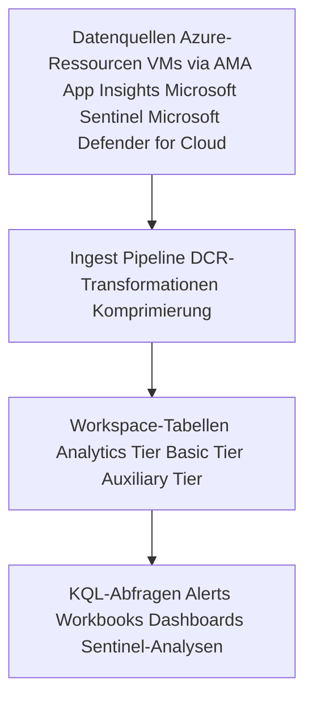
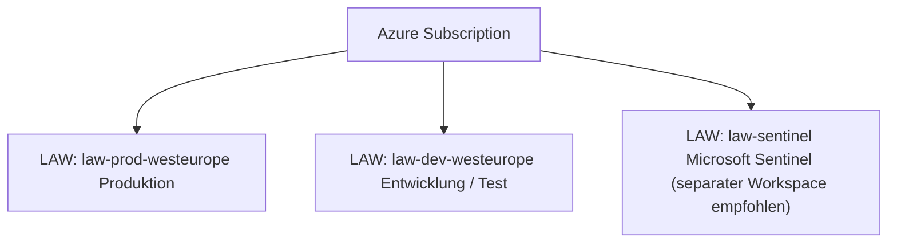
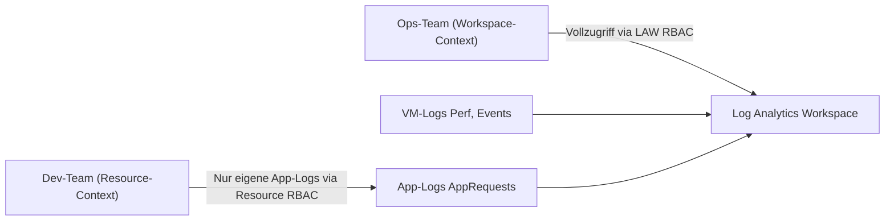

---
tags:
  - azure
  - monitoring
  - log-analytics
  - kql
  - logs
aliases:
  - LAW
  - Log Analytics
  - Log Analytics Workspace
---

# Log Analytics Workspace

> [!ABSTRACT]
> Der Log Analytics Workspace (LAW) ist die zentrale Log-Speicher- und Abfrage-Engine in Azure Monitor. Er nimmt Logs aus Azure-Ressourcen, VMs, Anwendungen und On-Premises-Systemen auf und ermöglicht mächtige Analysen mit der Kusto Query Language (KQL).

---

## Was ist ein Log Analytics Workspace?

Ein Log Analytics Workspace ist:
- Eine **Datenbank** für strukturierte Log- und Telemetriedaten
- Eine **Abfrage-Engine** auf Basis von Azure Data Explorer (Kusto)
- Eine **Plattform** für Alerts, Workbooks, Dashboards
- Der **Backend-Speicher** für Application Insights (workspace-based)



> [!NOTE]
> Jeder Log Analytics Workspace ist einer **Azure Region** zugeordnet. Daten verlassen diese Region nicht (außer bei explizitem Cross-Workspace Query).

---

## Workspace-Design

### Zentral vs. Dezentral

| Modell | Beschreibung | Vorteile | Nachteile |
|---|---|---|---|
| **Zentral** | Ein Workspace für alles | Einfache Verwaltung, Kostenoptimierung, Commitment Tiers | Datentrennung schwieriger, Latenz bei fernen Regionen |
| **Dezentral** | Workspace pro Team/App | Strikte Isolation, autonome Teams | Höhere Kosten, kein Cross-App-Korrelation |
| **Hybrid** | Zentral + Satellite-Workspaces | Balance aus Kontrolle und Kosten | Komplexer |

### Empfehlung

> [!TIP]
> Microsoft empfiehlt in den meisten Fällen **einen Workspace pro Region pro Umgebung** (Prod/Non-Prod). Compliance-Anforderungen können einen separaten Workspace erzwingen.



---

## Wichtige Tabellen

### Azure-Aktivität & Verwaltung

| Tabelle | Inhalt |
|---|---|
| `AzureActivity` | Azure Resource Manager-Operationen (wer hat was wann gemacht?) |
| `AzureDiagnostics` | Resource Logs vieler Azure-Dienste (Key Vault, NSG, SQL, ...) |
| `AzureMetrics` | Metriken (wenn per Diagnoseeinstellung an LAW gesendet) |
| `ResourceGraph` | Azure Resource Graph Änderungen |

### Sicherheit

| Tabelle | Inhalt |
|---|---|
| `SecurityEvent` | Windows Security Events (Defender for Cloud / AMA) |
| `CommonSecurityLog` | CEF-Logs (Firewalls, Netzwerkgeräte via Syslog-Connector) |
| `SecurityAlert` | Defender for Cloud und Sentinel Alerts |
| `SecurityIncident` | Microsoft Sentinel Incidents |
| `SigninLogs` | Entra ID Sign-in Events |
| `AuditLogs` | Entra ID Audit Events (Benutzer-, Gruppen-, App-Änderungen) |

### VMs und Server

| Tabelle | Inhalt |
|---|---|
| `Heartbeat` | AMA Agent Heartbeat (VM-Verfügbarkeit) |
| `Perf` | Performance Counters (CPU, RAM, Disk, Network) |
| `Event` | Windows Event Log |
| `Syslog` | Linux Syslog / rsyslog |
| `W3CIISLog` | IIS Web Server Logs |
| `WindowsFirewall` | Windows Firewall Logs |

### Anwendungen

| Tabelle | Inhalt |
|---|---|
| `AppRequests` | Application Insights HTTP-Anfragen |
| `AppExceptions` | Application Insights Ausnahmen |
| `AppDependencies` | Abhängigkeitsaufrufe (DB, HTTP, ...) |
| `AppTraces` | Application Insights Trace-Logs |
| `AppPageViews` | Browser Page Views |

---

## KQL-Grundlagen

KQL (Kusto Query Language) ist eine **pipeline-basierte** Abfragesprache.

### Basis-Operatoren

```kusto
// where — Filtern
SecurityEvent
| where TimeGenerated > ago(1h)
| where EventID == 4625  // Failed Login

// project — Spalten auswählen
SecurityEvent
| where TimeGenerated > ago(1h)
| project TimeGenerated, Computer, Account, EventID, Activity

// extend — Neue Spalten berechnen
Perf
| where CounterName == "% Processor Time"
| extend CPUPercent = round(CounterValue, 2)

// summarize — Aggregieren
SecurityEvent
| where EventID == 4625
| summarize FailedLogins = count() by Computer, bin(TimeGenerated, 1h)

// sort / order by
SecurityEvent
| where EventID == 4625
| summarize count() by Account
| sort by count_ desc

// top — Erste N Zeilen
Perf
| where CounterName == "% Processor Time"
| top 10 by CounterValue desc

// render — Visualisierung
Perf
| where CounterName == "% Processor Time"
| summarize avg(CounterValue) by Computer, bin(TimeGenerated, 15m)
| render timechart
```

### Zeitfunktionen

```kusto
// ago() — Relativer Zeitraum
| where TimeGenerated > ago(7d)   // letzte 7 Tage
| where TimeGenerated > ago(2h)   // letzte 2 Stunden

// bin() — Zeitgruppen
| summarize count() by bin(TimeGenerated, 1h)   // stündlich
| summarize count() by bin(TimeGenerated, 1d)   // täglich

// startofday / startofweek
| where TimeGenerated >= startofday(ago(7d))
```

### Joins

```kusto
// Inner Join: SecurityEvents mit Heartbeat korrelieren
SecurityEvent
| where EventID == 4625
| join kind=inner (
    Heartbeat
    | summarize LastSeen = max(TimeGenerated) by Computer
) on Computer
| project TimeGenerated, Computer, Account, LastSeen
```

---

## KQL Praxis-Abfragen

### Top-Fehler in den letzten 24 Stunden

```kusto
AppExceptions
| where TimeGenerated > ago(24h)
| summarize ErrorCount = count() by Type, outerMessage
| top 20 by ErrorCount desc
| render barchart
```

### VM-Verfügbarkeit (Heartbeat)

```kusto
Heartbeat
| where TimeGenerated > ago(1h)
| summarize LastHeartbeat = max(TimeGenerated) by Computer
| extend MinutesSinceHeartbeat = datetime_diff('minute', now(), LastHeartbeat)
| where MinutesSinceHeartbeat > 10
| project Computer, LastHeartbeat, MinutesSinceHeartbeat
| sort by MinutesSinceHeartbeat desc
```

### Login-Anomalien: Viele fehlgeschlagene Logins

```kusto
SecurityEvent
| where TimeGenerated > ago(1h)
| where EventID == 4625
| summarize FailedAttempts = count() by Account, Computer, IpAddress
| where FailedAttempts > 10
| sort by FailedAttempts desc
```

### CPU-Auslastung über 90 %

```kusto
Perf
| where TimeGenerated > ago(1h)
| where CounterName == "% Processor Time" and InstanceName == "_Total"
| where CounterValue > 90
| project TimeGenerated, Computer, CounterValue
| sort by CounterValue desc
```

### Azure-Aktivitäten: Ressourcen-Löschvorgänge

```kusto
AzureActivity
| where TimeGenerated > ago(7d)
| where OperationNameValue endswith "delete" or OperationNameValue endswith "Delete"
| where ActivityStatusValue == "Success"
| project TimeGenerated, Caller, ResourceGroup, ResourceId, OperationNameValue
| sort by TimeGenerated desc
```

### Key Vault Zugriffsanalyse

```kusto
AzureDiagnostics
| where ResourceType == "VAULTS"
| where OperationName == "SecretGet"
| where ResultType != "Success"
| summarize FailedAccess = count() by CallerIPAddress, identity_claim_oid_g
| sort by FailedAccess desc
```

### Entra ID: Sign-ins aus unbekannten Ländern

```kusto
SigninLogs
| where TimeGenerated > ago(24h)
| where ResultType != "0"
| where Location !in ("DE", "AT", "CH")
| project TimeGenerated, UserPrincipalName, Location, IPAddress, AppDisplayName, ResultDescription
| sort by TimeGenerated desc
```

---

## Datenaufbewahrung und Log-Tiers

### Tier-Modell (ab 2023)

| Tier | Ingest-Kosten | Abfrage | Retention | Anwendungsfall |
|---|---|---|---|---|
| **Analytics** | ~2,30 $/GB | Vollständige KQL | 30 Tage (Standard, max 2 Jahre) | Operative Logs, Alerts |
| **Basic Logs** | ~0,50 $/GB | Eingeschränktes KQL, max 8 Tage | 8 Tage | Verbose Debug-Logs, IIS Logs |
| **Auxiliary Logs** | ~0,025 $/GB | Sehr eingeschränkt | Bis 12 Jahre | Compliance-Archiv |

### Archivierung

```powershell
# Tabelle auf Basic Logs umstellen
Update-AzOperationalInsightsTable `
  -ResourceGroupName "rg-monitoring" `
  -WorkspaceName "law-central" `
  -TableName "W3CIISLog" `
  -Plan "Basic"

# Retention für Analytics-Tabelle auf 180 Tage setzen
Update-AzOperationalInsightsTable `
  -ResourceGroupName "rg-monitoring" `
  -WorkspaceName "law-central" `
  -TableName "SecurityEvent" `
  -RetentionInDays 180
```

> [!TIP]
> **Basic Logs** eignen sich perfekt für verbose Logs (IIS, Debug-Traces), die nur selten abgefragt werden. Einsparung gegenüber Analytics: bis zu 78 %.

---

## Zugriffsmodell

### Workspace-Context vs. Resource-Context

| Modell | Wer sieht was? | Einsatz |
|---|---|---|
| **Workspace-Context** | Alle Daten im Workspace | Zentrale Ops-Teams, SOC |
| **Resource-Context** | Nur Daten eigener Ressourcen | Entwickler, App-Teams |



> [!IMPORTANT]
> Resource-Context-Zugriff erfordert, dass Benutzer mindestens **Reader-Rechte auf der Azure-Ressource** haben. Die Logs werden dann automatisch gefiltert.

---

## Workspace-Transformationen (DCR-basiert)

Transformationen filtern oder verändern Daten **beim Ingest** — bevor sie gespeichert werden. Das spart Kosten und verbessert Datenschutz.

```json
{
  "transformKql": "source | where Level != 'Verbose' | extend ServiceName = tostring(split(Computer, '.')[0])"
}
```

Anwendungsfälle:
- **Verbose-Logs herausfiltern** → weniger Ingest-Kosten
- **PII entfernen** → DSGVO-Compliance (z.B. IP-Adressen anonymisieren)
- **Felder anreichern** → Hostname aus FQDN extrahieren

---

## Purge API (DSGVO-Compliance)

Die Purge API ermöglicht das **vollständige Löschen** von Daten aus dem Workspace.

```powershell
# Datensätze eines bestimmten Benutzers löschen (DSGVO-Anfrage)
$body = @{
    table = "SigninLogs"
    filters = @(
        @{
            column = "UserPrincipalName"
            operator = "=="
            value = "max.mustermann@contoso.com"
        }
    )
} | ConvertTo-Json -Depth 5

Invoke-RestMethod `
  -Method POST `
  -Uri "https://management.azure.com/subscriptions/{subId}/resourceGroups/{rg}/providers/Microsoft.OperationalInsights/workspaces/{workspace}/purge?api-version=2020-08-01" `
  -Headers @{ Authorization = "Bearer $token" } `
  -Body $body `
  -ContentType "application/json"
```

> [!WARNING]
> Purge-Operationen sind **irreversibel**. Die Ausführung dauert typischerweise 30 Tage. Eine Bestätigung per Purge-Status-API ist möglich.

---

## Commitment Tiers

Commitment Tiers bieten Rabatt bei vorhergesagtem Log-Volumen:

| Tier | GB/Tag | Preis/GB | Ersparnis ggü. PAYG |
|---|---|---|---|
| Pay-as-you-go | Beliebig | ~2,30 $ | — |
| 100 GB/Tag | 100 | ~1,94 $ | ~16 % |
| 200 GB/Tag | 200 | ~1,84 $ | ~20 % |
| 300 GB/Tag | 300 | ~1,76 $ | ~23 % |
| 500 GB/Tag | 500 | ~1,65 $ | ~28 % |
| 1.000 GB/Tag | 1.000 | ~1,61 $ | ~30 % |

> [!TIP]
> Commitment Tiers lohnen sich ab **konstantem** Log-Volumen. Bei stark schwankendem Volumen lieber Pay-as-you-go bleiben.

---

## Cross-Workspace Queries

Abfragen über mehrere Workspaces hinweg:

```kusto
// Logs aus zwei Workspaces kombinieren
union
  (workspace("law-prod-westeurope").SecurityEvent | where EventID == 4625),
  (workspace("law-prod-eastus").SecurityEvent | where EventID == 4625)
| summarize count() by Computer, bin(TimeGenerated, 1h)
| render timechart
```

> [!NOTE]
> Cross-Workspace Queries erfordern Leserechte auf **beiden** Workspaces. Latenz erhöht sich bei Abfragen über Regionen hinweg.

---

---

## Via Azure Portal (UI)

> [!TIP]
> Portal: **[portal.azure.com](https://portal.azure.com)**

**Log Analytics Workspace erstellen:**
1. [portal.azure.com](https://portal.azure.com) → **+ Ressource erstellen** → **Log Analytics-Arbeitsbereich**
2. Ressourcengruppe, Name und Region auswählen → **Erstellen**

**KQL-Abfrage ausführen:**
- Workspace öffnen → **Protokolle** → KQL-Abfrage eingeben (z. B. `Heartbeat | summarize count() by Computer`) → **Ausführen**

**Tabellen und Datenquellen anzeigen:**
- Workspace → **Tabellen** → Alle verfügbaren Tabellen mit Schema und Aufbewahrungszeit anzeigen

**Diagnoseeinstellungen verbinden:**
- Azure-Ressource → **Diagnoseeinstellungen** → **+ Hinzufügen** → Diesen Workspace als Ziel wählen

**Abfragen speichern:**
- KQL-Editor → **Speichern** → Name und Kategorie eingeben → Unter **Gespeicherte Abfragen** abrufbar

**Datenaufbewahrung konfigurieren:**
- Workspace → **Nutzung und geschätzte Kosten** → **Datenaufbewahrung** → Aufbewahrungszeitraum anpassen

---

## Bicep: Log Analytics Workspace

```bicep
resource law 'Microsoft.OperationalInsights/workspaces@2022-10-01' = {
  name: 'law-prod-westeurope'
  location: 'westeurope'
  properties: {
    sku: {
      name: 'PerGB2018'  // Pay-as-you-go
      // capacityReservationLevel: 100  // Für Commitment Tier
    }
    retentionInDays: 90
    features: {
      dailyQuotaGb: 20           // Daily Cap: 20 GB
      immediatePurgeDataOn30Days: false
      enableLogAccessUsingOnlyResourcePermissions: true  // Resource-Context
    }
    publicNetworkAccessForIngestion: 'Enabled'
    publicNetworkAccessForQuery: 'Enabled'
  }
}

// Security-Tabelle auf 180 Tage Retention setzen
resource securityEventTable 'Microsoft.OperationalInsights/workspaces/tables@2022-10-01' = {
  parent: law
  name: 'SecurityEvent'
  properties: {
    retentionInDays: 180
    plan: 'Analytics'
  }
}

// IIS-Logs auf Basic Tier (günstiger)
resource iisLogTable 'Microsoft.OperationalInsights/workspaces/tables@2022-10-01' = {
  parent: law
  name: 'W3CIISLog'
  properties: {
    retentionInDays: 8
    plan: 'Basic'
  }
}
```

---

## Verwandte Notizen

- [[Azure Monitor Grundlagen]]
- [[Azure Monitor Agent]]
- [[Application Insights]]
- [[Azure Alerts]]
- [[Microsoft Defender for Cloud]]
