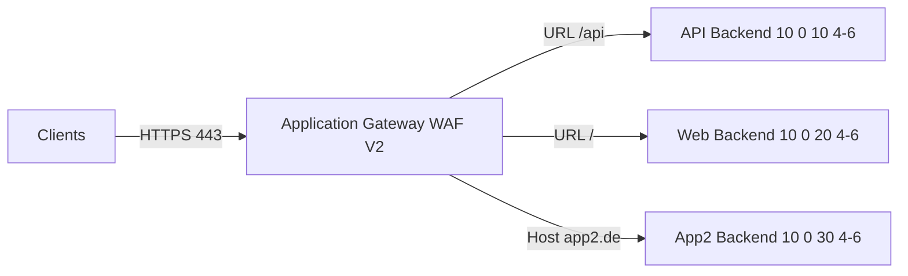
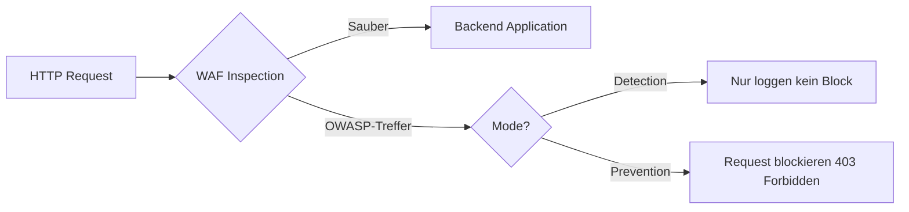
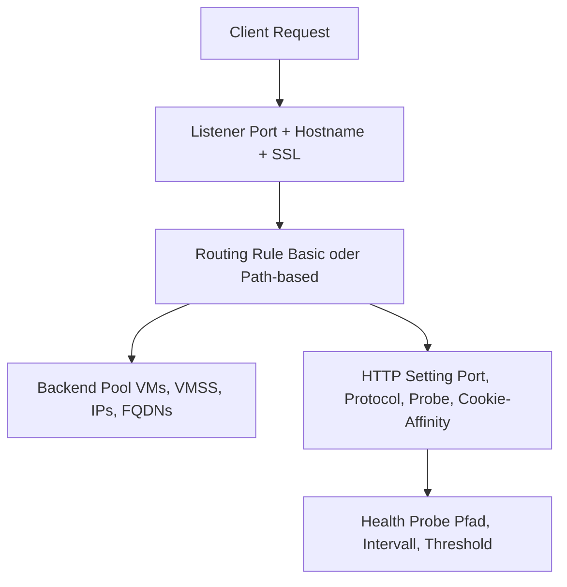
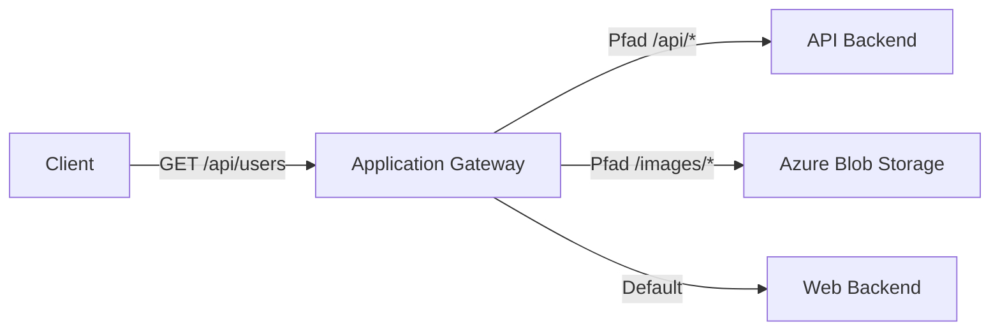
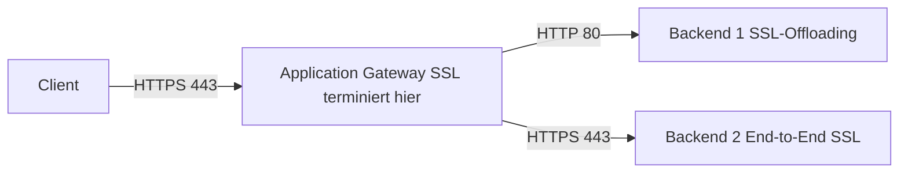
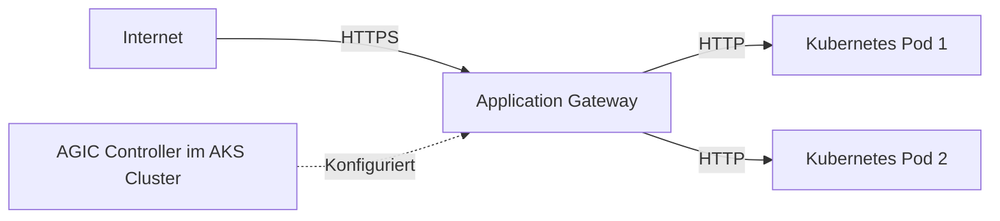

---
tags:
  - azure
  - netzwerk
  - application-gateway
  - waf
  - layer7
  - load-balancer
  - ssl
aliases:
  - AppGW
  - Application Gateway Azure
  - WAF Azure
  - Azure WAF
  - Azure AppGW
---

# Azure Application Gateway

> [!ABSTRACT] TL;DR
> Azure Application Gateway ist ein Layer-7 HTTP/S Load Balancer mit WAF (Web Application Firewall). Im Gegensatz zum Azure Load Balancer (Layer 4) versteht Application Gateway URLs, HTTP-Header und Cookies — ermöglicht URL-basiertes Routing, Multi-Site Hosting, SSL-Offloading und OWASP-basierten WAF-Schutz. Regional (eine Azure-Region), für globale Szenarien → Azure Front Door.

---

## Was ist Azure Application Gateway?

Application Gateway ist ein **regionaler Layer-7 Load Balancer** für HTTP/HTTPS:



**Hauptfeatures:**
- **URL-basiertes Routing** (path-based)
- **Multi-Site Hosting** (mehrere Domains auf einer Gateway-Instanz)
- **SSL-Offloading** und End-to-End-SSL
- **WAF** (Web Application Firewall) — OWASP 3.1/3.2
- **Autoscaling** (0 bis 125 Instanzen)
- **Availability Zone Support**

---

## SKUs

| SKU | WAF | Autoscaling | Anwendungsfall |
|-----|-----|-------------|---------------|
| **Standard_v2** | ❌ | ✅ | HTTP/S Load Balancing ohne WAF |
| **WAF_v2** | ✅ | ✅ | HTTP/S + OWASP WAF-Schutz |

> [!NOTE] v1 abgekündigt
> Application Gateway v1 (Standard, WAF ohne v2) wird am **28. April 2026** eingestellt. Migration auf v2 ist erforderlich.

---

## WAF (Web Application Firewall)

WAF schützt Webanwendungen vor bekannten Angriffen:



### OWASP Core Rule Set

| Version | Regeln | Empfehlung |
|---------|--------|-----------|
| **CRS 3.2** | Aktuellste, weniger False Positives | ✅ Empfohlen |
| **CRS 3.1** | Ältere Version, stabiler für Legacy-Apps | Für bestehende Konfigurationen |

**Schutz gegen:**
- SQL Injection (SQLi)
- Cross-Site Scripting (XSS)
- Local/Remote File Inclusion (LFI/RFI)
- Remote Code Execution
- HTTP Protocol Violations
- Bot-Angriffe (mit Bot Protection)

### WAF-Modi

```powershell
# WAF Policy erstellen
$wafPolicy = New-AzApplicationGatewayFirewallPolicy `
  -Name "waf-policy-prod" `
  -ResourceGroupName "rg-prod" `
  -Location "westeurope" `
  -PolicySetting @{
    State = "Enabled"
    Mode = "Prevention" # oder "Detection"
    RequestBodyCheck = $true
    MaxRequestBodySizeInKb = 128
  }
```

### Custom Rules

```json
{
  "name": "BlockSuspiciousUserAgent",
  "priority": 10,
  "ruleType": "MatchRule",
  "action": "Block",
  "matchConditions": [
    {
      "matchVariables": [{"variableName": "RequestHeaders", "selector": "User-Agent"}],
      "operator": "Contains",
      "matchValues": ["sqlmap", "nikto", "nmap"]
    }
  ]
}
```

### Exclusions (False Positive Management)

```powershell
# Exclusion: Bestimmten Header von WAF-Prüfung ausschließen
$exclusion = New-AzApplicationGatewayFirewallExclusion `
  -MatchVariable "RequestHeaderNames" `
  -SelectorMatchOperator "Equals" `
  -Selector "X-Custom-Header" # Dieser Header wird nicht geprüft
```

---

## Kernkomponenten



### Listeners

| Typ | Beschreibung |
|-----|-------------|
| **Basic** | Ein Port, eine Domain → eine Routing Rule |
| **Multi-site** | Mehrere Domains auf gleichem Port → verschiedene Routing Rules via Host Header |

```powershell
# Multi-site Listener für app1.example.com
$listener1 = New-AzApplicationGatewayHttpListener `
  -Name "listener-app1" `
  -FrontendIPConfiguration $frontendIP `
  -FrontendPort $port443 `
  -Protocol Https `
  -SslCertificate $sslCert1 `
  -HostName "app1.example.com" # Host-Header Matching

# Listener für app2.example.com
$listener2 = New-AzApplicationGatewayHttpListener `
  -Name "listener-app2" `
  -FrontendIPConfiguration $frontendIP `
  -FrontendPort $port443 `
  -Protocol Https `
  -SslCertificate $sslCert2 `
  -HostName "app2.example.com"
```

### Backend Pools

Backend-Ziele können sein:
- VM NICs
- VM Scale Set
- IP-Adressen (intern oder öffentlich)
- FQDNs (z.B. `myapp.azurewebsites.net`)
- Azure App Services

### HTTP Settings

```powershell
$httpSetting = New-AzApplicationGatewayBackendHttpSettings `
  -Name "httpsetting-api" `
  -Port 8080 `
  -Protocol Http `
  -CookieBasedAffinity Enabled ` # Session Affinity über Cookie
  -RequestTimeout 30 `
  -Probe $probe `
  -PickHostNameFromBackendAddress # Hostname vom Backend übernehmen
```

---

## URL-basiertes Routing (Path-Based)



```powershell
# Path-based Routing Rule
$pathMap = New-AzApplicationGatewayUrlPathMapConfig `
  -Name "path-map-prod" `
  -PathRules @(
    (New-AzApplicationGatewayPathRuleConfig `
      -Name "api-rule" `
      -Paths "/api/*" `
      -BackendAddressPool $apiPool `
      -BackendHttpSettings $apiHttpSetting),
    (New-AzApplicationGatewayPathRuleConfig `
      -Name "images-rule" `
      -Paths "/images/*" `
      -BackendAddressPool $storagePool `
      -BackendHttpSettings $storageHttpSetting)
  ) `
  -DefaultBackendAddressPool $webPool `
  -DefaultBackendHttpSettings $webHttpSetting
```

---

## SSL-Offloading und End-to-End SSL



| Modus | Gateway → Backend | Anwendungsfall |
|-------|------------------|---------------|
| **SSL-Offloading** | HTTP (unverschlüsselt) | Performance, Legacy-Backend |
| **End-to-End SSL** | HTTPS (re-encrypted) | Compliance, Sensitive Data |

```powershell
# Backend-Zertifikat für End-to-End SSL (Backend-Auth-Cert)
$backendCert = New-AzApplicationGatewayAuthenticationCertificate `
  -Name "backend-cert" `
  -CertificateFile "backend.cer" # Backend-Zertifikat (.cer, Public Key)

# HTTP Setting mit End-to-End SSL
$httpsBackendSetting = New-AzApplicationGatewayBackendHttpSettings `
  -Name "httpsetting-e2e-ssl" `
  -Port 443 `
  -Protocol Https `
  -AuthenticationCertificates $backendCert
```

---

## Autoscaling

Application Gateway V2 skaliert automatisch basierend auf Last:

```bicep
resource applicationGateway 'Microsoft.Network/applicationGateways@2023-09-01' = {
  name: 'agw-prod'
  location: location
  properties: {
    sku: {
      name: 'WAF_v2'
      tier: 'WAF_v2'
    }
    autoscaleConfiguration: {
      minCapacity: 2  // Mindestinstanzen (auch bei 0 Last)
      maxCapacity: 10 // Maximalinstanzen
    }
    // ...
  }
}
```

> [!TIP] Mindestkapazität
> `minCapacity: 0` spart Kosten, führt aber zu Kaltstart-Latenzen. `minCapacity: 2` für Hochverfügbarkeit in Produktion empfohlen.

---

## Application Gateway + AKS (AGIC)

**AGIC (Application Gateway Ingress Controller)** nutzt Application Gateway als Ingress für AKS:



```bash
# AGIC Add-on für AKS aktivieren
az aks enable-addons \
  --resource-group rg-aks \
  --name aks-prod \
  --addons ingress-appgw \
  --appgw-name agw-aks \
  --appgw-subnet-cidr "10.2.0.0/24"
```

---

## Rewrite Rules

Header und URLs können manipuliert werden:

```json
{
  "name": "AddSecurityHeaders",
  "ruleSequence": 100,
  "conditions": [],
  "actionSet": {
    "responseHeaderConfigurations": [
      {"headerName": "Strict-Transport-Security", "headerValue": "max-age=31536000"},
      {"headerName": "X-Content-Type-Options", "headerValue": "nosniff"},
      {"headerName": "X-Frame-Options", "headerValue": "DENY"}
    ]
  }
}
```

---

## Monitoring

```powershell
# Diagnostic Settings für Application Gateway
Set-AzDiagnosticSetting `
  -ResourceId $appGateway.Id `
  -WorkspaceId $logAnalyticsId `
  -Enabled $true `
  -Category ApplicationGatewayAccessLog, ApplicationGatewayPerformanceLog, ApplicationGatewayFirewallLog
```

### Wichtige KQL-Abfragen

```kusto
// WAF-Treffer der letzten 24h
AzureDiagnostics
| where Category == "ApplicationGatewayFirewallLog"
| where TimeGenerated > ago(24h)
| summarize count() by ruleId_s, ruleSetType_s, action_s
| order by count_ desc

// Fehlerhafte Backend-Antworten (5xx)
AzureDiagnostics
| where Category == "ApplicationGatewayAccessLog"
| where httpStatus_d >= 500
| project TimeGenerated, requestUri_s, httpStatus_d, serverRouted_s
| order by TimeGenerated desc
```

---

## Fehlerbehebung

| Problem | Ursache | Lösung |
|---------|---------|--------|
| **502 Bad Gateway** | Backend nicht erreichbar oder Health Probe fails | Backend-Pool-Health in Portal prüfen, Health Probe-Pfad prüfen |
| **WAF blockiert legitimen Traffic** | False Positive in OWASP-Regeln | WAF-Firewall-Logs analysieren, Exclusion für betroffene Regel/Variable hinzufügen |
| **SSL-Fehler zum Backend** | Ungültiges oder selbst-signiertes Backend-Cert | Backend-Zertifikat als Auth-Cert zur HTTP-Setting hinzufügen |
| **Multi-Site: falscher Backend** | Host-Header passt nicht zum Listener | Listener-HostName mit tatsächlichem Request-Host-Header vergleichen |
| **Slow Health Probe** | Timeout zu kurz, Backend startet langsam | Probe-Timeout erhöhen, `unhealthyThreshold` anpassen |

---

## Verwandte Notizen

- [[Azure Virtual Network]]
- [[Azure Load Balancer]]
- [[Azure Front Door]]
- [[Network Security Groups]]
