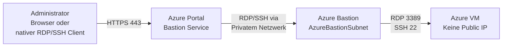
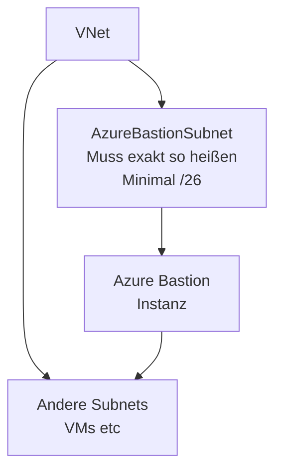

---
tags:
  - azure
  - netzwerk
  - bastion
  - rdp
  - ssh
  - sicherer-zugriff
  - jumphost
  - zero-trust
aliases:
  - Azure Bastion Host
  - Secure RDP Azure
  - SSH Azure Browser
  - Azure Jump Server Ersatz
  - Bastion Host
---

# Azure Bastion

> [!ABSTRACT] TL;DR
> Azure Bastion ist ein vollständig verwalteter Bastion-Host-Dienst der sichere RDP/SSH-Verbindungen zu Azure VMs über den Browser (Port 443/HTTPS) ermöglicht — ohne öffentliche IP-Adressen auf den VMs, ohne VPN und ohne eigenen Jump-Server. VMs bleiben vollständig vom Internet isoliert.

---

## Was ist Azure Bastion?

Azure Bastion ist ein **PaaS-basierter Bastion Host**:



**Vorteile:**
- Keine öffentliche IP auf VMs nötig
- Keine NVA, kein VPN, kein eigener Jump-Server
- MFA/Conditional Access über Azure Portal-Login
- Vollständig von Microsoft verwaltet (kein Patching)
- NSG-Regeln für RDP/SSH können geschlossen bleiben

---

## SKUs

| Feature | Basic | Standard | Premium |
|---------|-------|----------|---------|
| **Browser-basiertes RDP/SSH** | ✅ | ✅ | ✅ |
| **Shareable Links** | ✅ | ✅ | ✅ |
| **Native Client (mstsc/ssh)** | ❌ | ✅ | ✅ |
| **IP-based Connection** | ❌ | ✅ | ✅ |
| **File Transfer** | ❌ | ✅ | ✅ |
| **Tunneling/Port Forwarding** | ❌ | ✅ | ✅ |
| **Session Recording** | ❌ | ❌ | ✅ |
| **Private-Only Bastion** | ❌ | ❌ | ✅ |
| **Instanzen (Skalierung)** | 2 | 2–50 | 2–50 |
| **Preis (ca./Stunde)** | ~$0,19 | ~$0,29 | ~$0,75 |

---

## AzureBastionSubnet — Anforderungen

Das Subnet für Bastion muss spezifische Anforderungen erfüllen:



| Anforderung | Details |
|-------------|---------|
| **Subnetzname** | Exakt `AzureBastionSubnet` (case-sensitiv) |
| **Minimale Größe** | `/26` (64 IPs — mindestens 64 für Auto-Scaling) |
| **Empfohlene Größe** | `/26` für Standard, `/24` bei vielen Instanzen |
| **Delegation** | Keine Delegation erlaubt |
| **NSG** | Ja, aber spezifische Regeln erforderlich |
| **Route Table** | Nicht empfohlen (kein UDR auf Bastion-Subnet) |

### NSG-Regeln für AzureBastionSubnet

**Inbound (erforderlich):**

| Priorität | Port | Quelle | Zweck |
|-----------|------|--------|-------|
| 120 | 443 | Internet | HTTPS-Eingang von Nutzern |
| 130 | 443 | GatewayManager | Azure Gateway Manager |
| 140 | 8080, 5701 | VirtualNetwork | Bastion-interne Kommunikation |
| 150 | 443 | AzureLoadBalancer | Health Probes |

**Outbound (erforderlich):**

| Priorität | Port | Ziel | Zweck |
|-----------|------|------|-------|
| 100 | 3389, 22 | VirtualNetwork | RDP/SSH zu VMs |
| 110 | 443 | AzureCloud | Verbindung zu Azure-Diensten |
| 120 | 8080, 5701 | VirtualNetwork | Bastion-interne Kommunikation |

```powershell
# Azure Bastion erstellen
$bastionPIP = New-AzPublicIpAddress `
  -Name "pip-bastion-prod" `
  -ResourceGroupName "rg-hub" `
  -Location "westeurope" `
  -Sku Standard `
  -AllocationMethod Static

$bastion = New-AzBastion `
  -ResourceGroupName "rg-hub" `
  -Name "bastion-hub-prod" `
  -PublicIpAddress $bastionPIP `
  -VirtualNetworkId $hubVNet.Id `
  -Sku Standard `
  -ScaleUnit 2 # Standard: 2 Instanzen
```

---

## Browser-basiertes RDP/SSH

**Verbindung im Azure Portal:**
1. Azure Portal → VM → **Connect** → **Bastion**
2. Benutzername und Passwort eingeben
3. RDP/SSH-Session öffnet sich im Browser-Tab

> [!NOTE] Keine Plugin-Installation nötig
> Der Browser RDP/SSH-Client benötigt kein Plugin oder RDP-Client — funktioniert in Chrome, Edge, Firefox, Safari.

---

## Shareable Links

Temporärer Link zum Verbinden mit einer VM ohne Azure Portal Login:

```powershell
# Shareable Link erstellen
$shareableLink = New-AzBastionShareableLink `
  -ResourceGroupName "rg-hub" `
  -Name "bastion-hub-prod" `
  -TargetResourceId $vm.Id

Write-Output "Link: $($shareableLink.Bsl)"
Write-Output "Expires: $($shareableLink.ExpiresOn)"
```

> [!WARNING] Shareable Links Sicherheitsrisiko
> Shareable Links erlauben Zugriff ohne AAD-Login — der Link-Empfänger kann sich direkt verbinden. In Produktionsumgebungen nur bei konkretem Bedarf verwenden und danach sofort wieder deaktivieren/löschen.

```powershell
# Shareable Links für Bastion deaktivieren
$bastion = Get-AzBastion -ResourceGroupName "rg-hub" -Name "bastion-hub-prod"
$bastion.EnableShareableLink = $false
Set-AzBastion -InputObject $bastion
```

---

## Native Client Support (Standard/Premium)

Mit Native Client Support können lokale RDP/SSH-Clients über Bastion genutzt werden:

```bash
# SSH-Verbindung via Azure CLI und Bastion Tunnel
az network bastion ssh \
  --name "bastion-hub-prod" \
  --resource-group "rg-hub" \
  --target-resource-id "/subscriptions/{id}/resourceGroups/rg-prod/providers/Microsoft.Compute/virtualMachines/vm-app01" \
  --auth-type ssh-key \
  --username azureuser \
  --ssh-key ~/.ssh/id_rsa

# RDP-Tunnel über Bastion (dann mstsc auf localhost verbinden)
az network bastion tunnel \
  --name "bastion-hub-prod" \
  --resource-group "rg-hub" \
  --target-resource-id "/subscriptions/{id}/resourceGroups/rg-prod/providers/Microsoft.Compute/virtualMachines/vm-win01" \
  --resource-port 3389 \
  --port 10022 # Lokaler Port für Tunnel
# → mstsc /v:localhost:10022
```

---

## IP-based Connection (Standard)

Verbindung zu VMs die nicht im gleichen (oder gepeertem) VNet wie Bastion sind:

```bash
# Verbindung zu VM über IP (VM im nicht-gepeertem VNet)
az network bastion rdp \
  --name "bastion-hub-prod" \
  --resource-group "rg-hub" \
  --target-ip-address "10.5.0.4" \
  --target-port 3389
```

---

## File Transfer (Standard)

Upload und Download von Dateien in aktiven RDP-Sessions:

- **Upload:** Bastion-Toolbar → File Transfer → Upload → Datei auswählen
- **Download:** Im Bastion-Fenster → Download → Datei wird auf Client gespeichert
- Unterstützte Protokolle: RDP (Windows), SSH (Linux via SCP)

---

## Tunneling/Port Forwarding (Standard)

Beliebige TCP-Verbindungen über Bastion tunneln:

```bash
# Beliebigen Port tunneln (z.B. SQL Server 1433)
az network bastion tunnel \
  --name "bastion-hub-prod" \
  --resource-group "rg-hub" \
  --target-resource-id "/subscriptions/{id}/...virtualMachines/vm-sql01" \
  --resource-port 1433 \
  --port 14330 # Lokaler Port

# → Jetzt: SQL Server Management Studio → localhost,14330
```

---

## Session Recording (Premium)

Alle RDP/SSH-Sessions werden aufgezeichnet und in einem Storage Account gespeichert:

```powershell
# Session Recording konfigurieren
$bastion = Get-AzBastion -ResourceGroupName "rg-hub" -Name "bastion-hub-prod-premium"
$bastion.EnableSessionRecording = $true
$bastion.StorageAccountId = $storageAccount.Id
Set-AzBastion -InputObject $bastion
```

**Anwendungsfall:** Compliance-Anforderungen (PCI-DSS, ISO 27001), privilegierter Zugriff-Audit, forensische Untersuchungen.

---

## Bastion vs. Jump Server

| Merkmal | Azure Bastion | Eigener Jump Server (VM) |
|---------|--------------|--------------------------|
| **Verwaltungsaufwand** | Kein Patching | OS patchen, Monitoring, Updates |
| **Sicherheit** | Microsoft-verwaltet, kein laterales Bewegungsrisiko | Jump-Server selbst ist Angriffsziel |
| **Kosten** | ~$140-540/Monat (Standard-Premium) | VM-Kosten (~$50-200/Monat) |
| **Protokoll** | HTTPS 443 (Browser) oder Tunnel | RDP/SSH direkt oder VPN |
| **MFA/Conditional Access** | Über Azure Portal-Login | Manuell konfigurieren |
| **Session Recording** | Premium SKU | Zusätzliche Software nötig |
| **Skalierung** | Automatisch | Manuell |
| **Public IP** | Nur Bastion (nicht VM) | Jump Server hat Public IP |

> [!TIP] Empfehlung
> Für die meisten Azure-Umgebungen ist Bastion deutlich einfacher und sicherer als ein eigener Jump Server. Der höhere Preis ist durch den geringeren Verwaltungsaufwand und die bessere Sicherheitslage gerechtfertigt.

---

## Monitoring und Diagnose

```powershell
# Diagnostic Settings für Bastion
Set-AzDiagnosticSetting `
  -ResourceId $bastion.Id `
  -WorkspaceId $logAnalyticsWorkspaceId `
  -Enabled $true `
  -Category BastionAuditLogs
```

### Bastion Audit Logs — KQL

```kusto
// Alle Bastion-Verbindungen der letzten 7 Tage
AzureDiagnostics
| where Category == "BastionAuditLogs"
| where TimeGenerated > ago(7d)
| project TimeGenerated, UserAgent, OperationName, TargetResourceId, 
          userName_s, TargetVMIPAddress_s
| order by TimeGenerated desc

// Verbindungen pro Benutzer
AzureDiagnostics
| where Category == "BastionAuditLogs"
| summarize ConnectionCount=count() by userName_s
| order by ConnectionCount desc
```

---

## Kosten

| SKU | Stündliche Gebühr | Monatliche Gebühr (ca.) |
|-----|------------------|-------------------------|
| **Basic** | ~$0,19/Stunde | ~$140 |
| **Standard** (2 Scale Units) | ~$0,29/Stunde | ~$215 |
| **Premium** (2 Scale Units) | ~$0,75/Stunde | ~$555 |
| **Zusätzliche Scale Units** | ~$0,145/Stunde/Unit | |
| **Ausgehende Daten** | ~$0,08/GB | |

> [!NOTE] Kostenoptimierung
> Bastion läuft 24/7 — es gibt keine Stop-Option. Für Dev/Test-Umgebungen kann Bastion automatisch über Azure Automation gelöscht und neu erstellt werden (Deployment dauert ~5 Min).

---

## Deployment via Bicep

```bicep
resource bastionPip 'Microsoft.Network/publicIPAddresses@2023-09-01' = {
  name: 'pip-bastion-prod'
  location: location
  sku: {
    name: 'Standard'
  }
  properties: {
    publicIPAllocationMethod: 'Static'
  }
  zones: ['1', '2', '3']
}

resource bastion 'Microsoft.Network/bastionHosts@2023-09-01' = {
  name: 'bastion-hub-prod'
  location: location
  sku: {
    name: 'Standard'
  }
  properties: {
    scaleUnits: 2
    ipConfigurations: [
      {
        name: 'IpConf'
        properties: {
          subnet: {
            id: '${vnet.id}/subnets/AzureBastionSubnet'
          }
          publicIPAddress: {
            id: bastionPip.id
          }
        }
      }
    ]
    enableShareableLink: false // Deaktiviert für Sicherheit
    enableTunneling: true
    enableFileCopy: true
  }
}
```

---

## Verwandte Notizen

- [[Azure Virtual Network]]
- [[Network Security Groups]]
- [[Azure VPN Gateway]]
