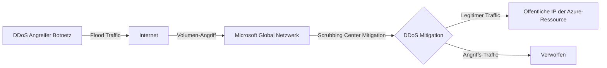
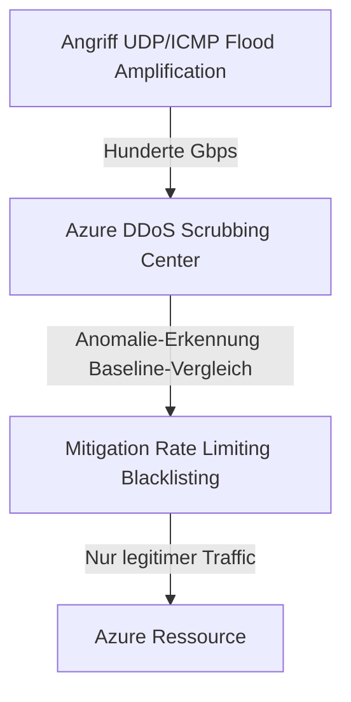
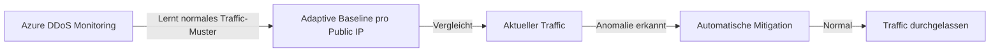
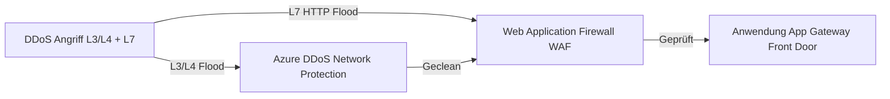
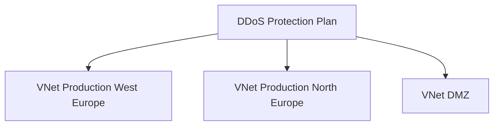

---
tags:
  - azure
  - netzwerk
  - ddos
  - sicherheit
  - ddos-protection
  - netzwerkschutz
  - angriffe
aliases:
  - DDoS Protection Azure
  - Azure DDoS
  - Azure DDoS Standard
  - Azure DDoS Network Protection
  - Azure DDoS IP Protection
---

# Azure DDoS Protection

> [!ABSTRACT] TL;DR
> Azure DDoS Protection schützt Azure-Ressourcen mit öffentlichen IP-Adressen vor Distributed Denial of Service (DDoS)-Angriffen. Network Protection (für VNets) und IP Protection (für einzelne Public IPs) bieten adaptive, automatische Mitigation. Alle Azure-Ressourcen haben bereits einen kostenlosen Basis-Schutz — die kostenpflichtigen Tiers bieten erweiterte Mitigation, Metriken, DRR-Support und SLA-Kostenerstattung.

---

## Was ist Azure DDoS Protection?

DDoS Protection erkennt und mildert **volumetrische, protokollbasierte und Application-Layer-Angriffe**:



**Alle Azure-Ressourcen** mit öffentlichen IP-Adressen haben automatisch einen **kostenlosen Basis-Schutz** durch Microsofts globale Netzwerk-Infrastruktur. Die kostenpflichtigen Tiers bieten:
- Angepasste (adaptive) Mitigation-Policies
- Detaillierte Metriken und Alerts
- DDoS Rapid Response (DRR) Support
- Kostenerstattungs-SLA

---

## DDoS Protection Tiers

| Tier | Schutz | Preis (ca.) | Anwendungsfall |
|------|--------|-------------|---------------|
| **Basis (kostenlos)** | Volumetrischer Schutz für alle Azure | Kostenlos | Alle Azure-Ressourcen |
| **IP Protection** | Adaptive Mitigation für eine Public IP | ~$200/Public IP/Monat | Einzelne IP schützen |
| **Network Protection** | Adaptive Mitigation für alle IPs im VNet | ~$2.944/Plan/Monat (bis 100 IPs) | VNets in Produktion |

> [!NOTE] Basic ist nicht mehr separat buchbar
> Azure DDoS Basic Protection ist automatisch für alle Azure-Ressourcen aktiviert und kann nicht deaktiviert werden. Es sind keine separaten Konfigurationen notwendig.

---

## Schutz-Typen

### Volumetrische Angriffe (Layer 3/4)



Beispiele:
- UDP Reflection Amplification (DNS, NTP, memcached)
- ICMP Flood
- SYN Flood (auch Layer 4)

### Protokoll-Angriffe (Layer 3/4)

- **SYN Flood** — erschöpft Server-Verbindungstabellen
- **Ping of Death** — fragmentierte ICMP-Pakete
- **Smurf** — Broadcast-Amplification

### Application-Layer-Angriffe (Layer 7)

> [!IMPORTANT] WAF für L7 erforderlich
> DDoS Protection (Network und IP) schützt **nicht** gegen Application-Layer-Angriffe (HTTP Floods, Slowloris, etc.). Für Layer-7-Schutz ist **Azure Web Application Firewall (WAF)** in Kombination mit DDoS Protection erforderlich.

---

## Adaptive Tuning

DDoS Protection erstellt **automatisch eine Baseline** für jede öffentliche IP:



**Mitigation-Policies:**
| Metrik | Beschreibung |
|--------|-------------|
| TCP SYN Packet rate | Schwellenwert für SYN-Pakete/Sekunde |
| TCP Packet rate | Allgemeine TCP-Pakete/Sekunde |
| UDP Packet rate | UDP-Pakete/Sekunde |
| Inbound Packets rate | Gesamte eingehende Pakete/Sekunde |
| Inbound Bytes rate | Gesamte eingehende Bytes/Sekunde |

Die Schwellenwerte werden automatisch angepasst wenn die normale Last sich verändert (z.B. bei geplanten Events).

---

## DDoS Metriken und Alerts

```powershell
# Alert-Regel für DDoS-Angriff erstellen
New-AzMetricAlertRuleV2 `
  -Name "alert-ddos-attack" `
  -ResourceGroupName "rg-prod" `
  -WindowSize "00:05:00" `
  -Frequency "00:01:00" `
  -TargetResourceId $publicIP.Id `
  -Condition (New-AzMetricAlertRuleV2Criteria `
    -MetricName "IfUnderDDoSAttack" `
    -TimeAggregation Maximum `
    -Operator GreaterThan `
    -Threshold 0) `
  -ActionGroupId $actionGroup.Id `
  -Severity 1
```

### Wichtige DDoS-Metriken

| Metrik | Beschreibung |
|--------|-------------|
| **IfUnderDDoSAttack** | 1 = Aktiver Angriff, 0 = Kein Angriff |
| **InboundPacketsDroppedDDoS** | Verworfen Pakete/Sekunde |
| **InboundPacketsForwardedDDoS** | Weitergeleitet Pakete/Sekunde |
| **InboundBytesDroppedDDoS** | Verworfen Bytes/Sekunde |
| **TCPPacketsDroppedDDoS** | TCP-Pakete verworfen |
| **UDPPacketsDroppedDDoS** | UDP-Pakete verworfen |

### KQL-Abfragen für DDoS-Analyse

```kusto
// DDoS-Angriffe der letzten 30 Tage
AzureMetrics
| where MetricName == "IfUnderDDoSAttack"
| where Maximum > 0
| project TimeGenerated, ResourceId, Maximum
| order by TimeGenerated desc

// Verworfen Traffic während Angriff
AzureMetrics
| where MetricName in ("InboundPacketsDroppedDDoS", "InboundBytesDroppedDDoS")
| where TimeGenerated > ago(24h)
| summarize avg(Average) by MetricName, bin(TimeGenerated, 1m)
| render timechart
```

---

## DDoS Rapid Response (DRR)

**Network Protection** Plan bietet Zugang zum DRR-Team:

- **24/7** Zugriff auf Microsoft DDoS-Sicherheitsexperten während eines Angriffs
- Direkter Draht zu Microsoft-Experten für komplexe Angriffsszenarien
- Angriffs-Analyse und Nachberichterstattung
- Empfehlungen für zukünftige Resilienz

```bash
# DRR-Support-Ticket erstellen während Angriff
# Azure Portal → Hilfe + Support → Neuer Supportfall
# Kategorie: Technisch → Netzwerk → DDoS Protection → Ongoing Attack
```

---

## DDoS Protection + WAF

**Defense in Depth** für vollständigen Schutz:



| Schutzebene | Tool | Schutz vor |
|-------------|------|-----------|
| Layer 3/4 | DDoS Network Protection | Volumetrisch, Protokoll |
| Layer 7 | WAF (AppGW oder Front Door) | HTTP Flood, SQLi, XSS |

> [!IMPORTANT] Beide Ebenen wichtig
> DDoS Protection allein schützt nicht vor Slowloris, HTTP-Floods oder anderen Application-Level-Angriffen. WAF allein wird bei volumetrischen Angriffen überwältigt. Kombinierter Einsatz deckt beide Szenarien ab.

---

## SLA-Garantie und Kostenerstattung

Wenn ein DDoS-Angriff zu **erzwungenem Scale-out** führt (z.B. Autoscaling, höhere Bandbreitskosten):

- **Network Protection** erstattet diese Mehrkosten (Compute, Networking, Application Gateway)
- Nachweis: DDoS-Angriffsreport + Azure-Kostennachweise
- Gilt nur für **Network Protection** (nicht IP Protection oder Basic)

```bash
# DDoS-Angriffsreport anfordern
az network ddos-protection show \
  --resource-group rg-connectivity \
  --name ddos-plan-prod
# Reports im Azure Portal: DDoS Protection Plan → Attack Analytics
```

---

## Integration mit Microsoft Sentinel

```powershell
# DDoS-Alerts zu Sentinel weiterleiten
# Via Azure Monitor → Diagnostic Settings → Log Analytics (Sentinel Workspace)
Set-AzDiagnosticSetting `
  -ResourceId $ddosPlan.Id `
  -WorkspaceId $sentinelWorkspaceId `
  -Enabled $true
```

**Sentinel DDoS Analytics Rules:**
- Automatische Incident-Erstellung bei Angriffen
- Korrelation mit anderen Security-Events
- Automatisierte Response (Playbooks)

---

## DDoS Protection Plan für mehrere VNets

Ein **DDoS Network Protection Plan** kann mehrere VNets schützen:



```bicep
resource ddosPlan 'Microsoft.Network/ddosProtectionPlans@2023-09-01' = {
  name: 'ddos-plan-prod'
  location: 'westeurope' // DDoS Plan ist global, Location ist metadata
  properties: {}
}

resource vnetWithDdos 'Microsoft.Network/virtualNetworks@2023-09-01' = {
  name: 'vnet-prod'
  location: location
  properties: {
    enableDdosProtection: true
    ddosProtectionPlan: {
      id: ddosPlan.id
    }
    addressSpace: {
      addressPrefixes: ['10.0.0.0/16']
    }
  }
}
```

---

## Kosten

| Tier | Kosten (ca. 2024) |
|------|-----------------|
| **Basis** | Kostenlos (inbegriffen) |
| **IP Protection** | ~$200/Public IP/Monat |
| **Network Protection** | ~$2.944/Monat (inkl. 100 Public IPs) |
| **Zusätzliche Public IPs** (Network) | ~$29,50/IP/Monat |

> [!WARNING] Kostenanalyse vor Aktivierung
> Network Protection ist teuer. Vor Aktivierung abwägen: Wie hoch ist das DDoS-Risiko? Welche Ressourcen sind wirklich exponiert? Für interne Workloads ohne Internet-Exposure ist DDoS Protection nicht sinnvoll.

---

## Fehlerbehebung und Angriffsanalyse

### Während eines Angriffs

```bash
# Angriffs-Status prüfen
az monitor metrics list \
  --resource /subscriptions/{id}/resourceGroups/rg-prod/providers/Microsoft.Network/publicIPAddresses/pip-webapp \
  --metric IfUnderDDoSAttack \
  --interval PT1M

# DRR-Support kontaktieren wenn Angriff kritisch
# Azure Portal → Support → DDoS Ongoing Attack
```

### Nach einem Angriff

```bash
# Angriffsreport herunterladen
# Azure Portal → DDoS Protection Plan → Attack Analytics → Report herunterladen
```

**Analyse-Schritte:**
1. Angriffstyp identifizieren (welche Metrik war erhöht?)
2. Angriffsdauer und -intensität dokumentieren
3. Mitigation-Effektivität prüfen (wurden Pakete korrekt verworfen?)
4. WAF-Logs auf L7-Angriffe prüfen
5. Kostenmehraufwand dokumentieren für SLA-Erstattung

---

## Verwandte Notizen

- [[Azure Virtual Network]]
- [[Azure Firewall]]
- [[Azure Application Gateway]]
- [[Azure Front Door]]
- [[Network Security Groups]]
