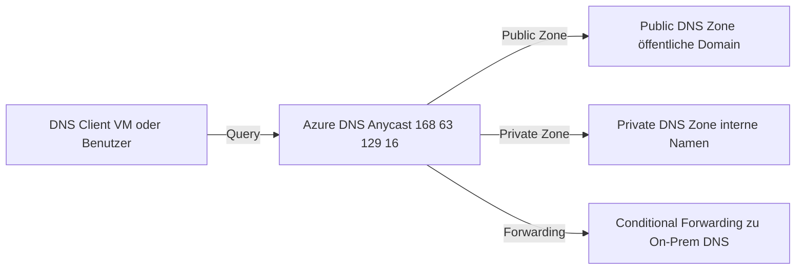
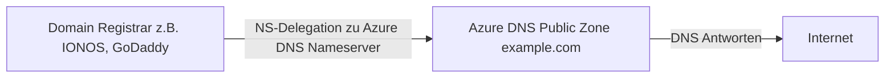
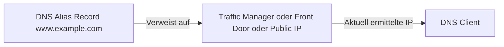
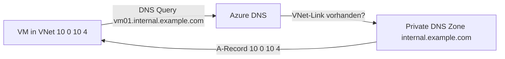
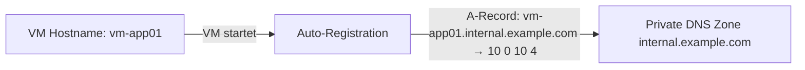
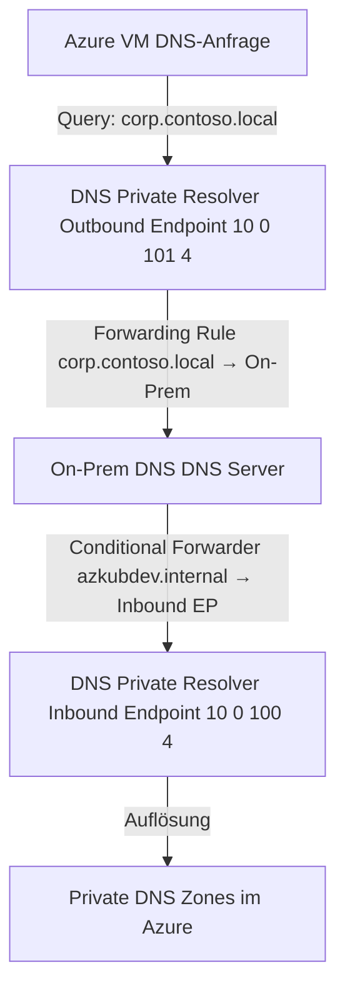
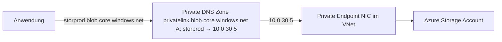
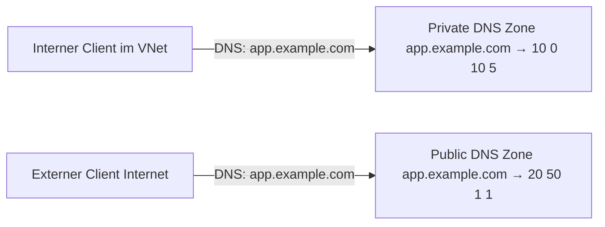

---
tags:
  - azure
  - netzwerk
  - dns
  - private-dns
  - dns-resolver
  - namensauflösung
  - hybrid
aliases:
  - Azure DNS Service
  - Private DNS Azure
  - DNS Private Resolver
  - Azure DNS Zones
  - Azure DNS Forwarding
---

# Azure DNS

> [!ABSTRACT] TL;DR
> Azure DNS ist Microsofts hochverfügbarer DNS-Hosting-Dienst mit Anycast-Netzwerk. Drei Hauptkomponenten: Public DNS Zones (öffentliche Domains hosten), Private DNS Zones (interne Namensauflösung in VNets) und DNS Private Resolver (Hybrid DNS-Integration zwischen On-Premises und Azure ohne DNS-VMs).

---

## Was ist Azure DNS?

Azure DNS hostet **DNS-Zonen** auf Microsofts globalem Anycast-Netzwerk:



**Eigenschaften:**
- **Anycast** — DNS-Anfragen werden zum nächstgelegenen Azure-DNS-Server geroutet
- **Hochverfügbar** — SLA 99,99%
- **Skalierbar** — unbegrenzte DNS-Anfragen
- **Sicher** — Azure RBAC für DNS-Verwaltung
- **Azure-integriert** — Alias Records für Azure-Ressourcen, Auto-Registration

---

## Via Azure Portal (UI)

### Öffentliche DNS-Zone erstellen

1. [Azure-Portal](https://portal.azure.com) → Suchleiste → **DNS-Zonen** → **+ Erstellen**
2. **Abonnement**, **Ressourcengruppe** und **Name** (z. B. `example.com`) eingeben → **Überprüfen + erstellen** → **Erstellen**
3. Zone öffnen → **Nameserver** notieren (4 Azure-Nameserver)
4. Beim Domainregistrar die **NS-Einträge** auf die Azure-Nameserver zeigen lassen (Delegation)

### DNS-Einträge hinzufügen

1. DNS-Zone öffnen → **+ Eintragssatz**
2. **Name**, **Typ** (A, AAAA, CNAME, MX, TXT etc.), **TTL** und **Wert** eingeben → **OK**

| Eintragstyp | Beispiel-Wert |
|-------------|---------------|
| A | `203.0.113.10` |
| CNAME | `www` → `example.com` |
| MX | Priorität + Mailserver-FQDN |
| TXT | SPF, DKIM, Verifizierungsstrings |

### Private DNS-Zone erstellen

1. **Private DNS-Zonen** → **+ Erstellen** → Name (z. B. `internal.corp`) → **Erstellen**
2. Zone → **VNET-Verknüpfungen** → **+ Hinzufügen** → VNet wählen, **Autoregistrierung** aktivieren (optional) → **OK**

### DNS Private Resolver einrichten

1. Suchleiste → **DNS Private Resolver** → **+ Erstellen**
2. **Abonnement**, **Ressourcengruppe**, **Name**, **Region** und **VNet** wählen
3. **Eingehende Endpunkte** → **+ Endpunkt hinzufügen** → Subnetz wählen
4. **Ausgehende Endpunkte** → **+ Endpunkt hinzufügen** → Subnetz + **Weiterleitungsregelsets** konfigurieren → **Überprüfen + erstellen** → **Erstellen**

> [!TIP] Delegation prüfen
> Nach der NS-Delegation mit `nslookup -type=NS example.com` prüfen, ob die Azure-Nameserver angezeigt werden. DNS-Propagierung kann bis zu 48 Stunden dauern.

---

## Public DNS Zones

Öffentliche DNS-Zonen für das Hosten von Domains in Azure:



### Domain zu Azure DNS delegieren

```powershell
# Public Zone erstellen
$zone = New-AzDnsZone -Name "example.com" -ResourceGroupName "rg-dns"

# Nameserver der Azure Zone abrufen
Write-Output $zone.NameServers
# → ns1-01.azure-dns.com
# → ns2-01.azure-dns.net
# → ns3-01.azure-dns.org
# → ns4-01.azure-dns.info

# Diese NS-Server beim Domain-Registrar als Authoritative NS eintragen
```

### Records erstellen

```powershell
# A-Record
New-AzDnsRecordSet -ZoneName "example.com" -ResourceGroupName "rg-dns" `
  -Name "www" -RecordType A -Ttl 300 `
  -DnsRecords (New-AzDnsRecordConfig -IPv4Address "20.50.1.1")

# CNAME Record
New-AzDnsRecordSet -ZoneName "example.com" -ResourceGroupName "rg-dns" `
  -Name "blog" -RecordType CNAME -Ttl 300 `
  -DnsRecords (New-AzDnsRecordConfig -Cname "myapp.azurewebsites.net")

# MX Record
New-AzDnsRecordSet -ZoneName "example.com" -ResourceGroupName "rg-dns" `
  -Name "@" -RecordType MX -Ttl 3600 `
  -DnsRecords (New-AzDnsRecordConfig -Exchange "mail.protection.outlook.com" -Preference 0)

# TXT Record (SPF)
New-AzDnsRecordSet -ZoneName "example.com" -ResourceGroupName "rg-dns" `
  -Name "@" -RecordType TXT -Ttl 3600 `
  -DnsRecords (New-AzDnsRecordConfig -Value "v=spf1 include:spf.protection.outlook.com -all")
```

---

## DNS Record Types

| Typ | Beschreibung | Beispiel |
|-----|-------------|---------|
| **A** | IPv4-Adresse | `www → 20.50.1.1` |
| **AAAA** | IPv6-Adresse | `www → 2001:db8::1` |
| **CNAME** | Kanonischer Name (Alias) | `blog → myapp.azurewebsites.net` |
| **MX** | Mail Exchange | `@ → mail.protection.outlook.com (Priorität 0)` |
| **TXT** | Freitext (SPF, DKIM, Verifizierung) | `@ → v=spf1 ...` |
| **SRV** | Service-Locator | `_sip._tcp → sipserver.example.com:5060` |
| **PTR** | Reverse-Lookup (IP → Name) | `1.1.50.20.in-addr.arpa → www.example.com` |
| **NS** | Nameserver | `@ → ns1-01.azure-dns.com` |
| **SOA** | Start of Authority | Automatisch bei Zone-Erstellung |
| **CAA** | Certification Authority Authorization | `@ → 0 issue "letsencrypt.org"` |

---

## Alias Records

**Alias Records** sind Azure-spezifisch und zeigen auf Azure-Ressourcen statt auf IP-Adressen:



```powershell
# Alias Record auf Traffic Manager
New-AzDnsRecordSet -ZoneName "example.com" -ResourceGroupName "rg-dns" `
  -Name "app" -RecordType A -Ttl 1 `
  -TargetResourceId $trafficManagerProfile.Id # Alias auf TM

# Alias Record auf Front Door
New-AzDnsRecordSet -ZoneName "example.com" -ResourceGroupName "rg-dns" `
  -Name "@" -RecordType A -Ttl 1 ` # Apex Domain!
  -TargetResourceId $frontDoorEndpoint.Id
```

**Vorteile von Alias Records:**
- Automatische Aktualisierung wenn die IP der Ziel-Ressource sich ändert
- **Apex Domain** möglich (CNAME ist auf `@` verboten, Alias funktioniert)
- Keine stale DNS-Einträge

---

## Private DNS Zones

Private DNS Zones lösen intern auf — nicht im öffentlichen Internet sichtbar:



```powershell
# Private DNS Zone erstellen
$privateZone = New-AzPrivateDnsZone `
  -Name "internal.example.com" `
  -ResourceGroupName "rg-dns"

# VNet-Link erstellen (Zone mit VNet verknüpfen)
New-AzPrivateDnsVirtualNetworkLink `
  -ZoneName "internal.example.com" `
  -ResourceGroupName "rg-dns" `
  -Name "link-vnet-prod" `
  -VirtualNetworkId $vnet.Id `
  -EnableAutoRegistration $false # Auto-Reg nur aktivieren wenn nötig

# A-Record manuell erstellen
New-AzPrivateDnsRecordSet `
  -ZoneName "internal.example.com" `
  -ResourceGroupName "rg-dns" `
  -Name "myapp-db" `
  -RecordType A `
  -Ttl 300 `
  -PrivateDnsRecords (New-AzPrivateDnsRecordConfig -IPv4Address "10.0.20.10")
```

---

## Auto-Registration

Bei aktivierter Auto-Registration werden VM-Namen **automatisch** in der Private DNS Zone registriert:



```powershell
# VNet-Link mit Auto-Registration
New-AzPrivateDnsVirtualNetworkLink `
  -EnableAutoRegistration $true # VMs registrieren sich automatisch
```

> [!NOTE] Auto-Registration Einschränkungen
> - Nur **ein** VNet-Link mit Auto-Registration pro Private DNS Zone
> - Nur für VMs (nicht für Container, App Services, etc.)
> - VM-Name + Zone-Name = vollständiger DNS-Name

---

## DNS Private Resolver

**DNS Private Resolver** löst das Hybrid-DNS-Problem ohne eigene DNS-VMs:



### Inbound Endpoint

On-Premises DNS kann Azure-private Zonen auflösen:

```powershell
New-AzDnsResolverInboundEndpoint `
  -DnsResolverName "resolver-hub-prod" `
  -ResourceGroupName "rg-dns" `
  -Name "inbound-ep" `
  -IPConfigurations @(
    @{
      SubnetId = $inboundSubnet.Id
      PrivateIpAllocationMethod = "Dynamic"
    }
  )
# → Liefert private IP (z.B. 10.0.100.4) als DNS-Ziel für On-Prem
```

### Outbound Endpoint + Forwarding Rules

Azure VMs können On-Prem DNS-Namen auflösen:

```powershell
# Outbound Endpoint
New-AzDnsResolverOutboundEndpoint `
  -DnsResolverName "resolver-hub-prod" `
  -ResourceGroupName "rg-dns" `
  -Name "outbound-ep" `
  -SubnetId $outboundSubnet.Id

# Forwarding Ruleset
$ruleset = New-AzDnsForwardingRuleset `
  -Name "ruleset-hybrid" `
  -ResourceGroupName "rg-dns" `
  -Location "westeurope" `
  -DnsResolverOutboundEndpoints @($outboundEndpoint)

# Forwarding Rule: corp.local → On-Prem DNS
New-AzDnsForwardingRule `
  -ForwardingRulesetName "ruleset-hybrid" `
  -ResourceGroupName "rg-dns" `
  -Name "rule-corp-local" `
  -DomainName "corp.local." `
  -ForwardingRuleState Enabled `
  -TargetDnsServers @(
    @{IPAddress="192.168.1.10"; Port=53},
    @{IPAddress="192.168.1.11"; Port=53}
  )

# Ruleset mit VNet verknüpfen
New-AzDnsForwardingRulesetVirtualNetworkLink `
  -ForwardingRulesetName "ruleset-hybrid" `
  -ResourceGroupName "rg-dns" `
  -Name "link-vnet-prod" `
  -VirtualNetworkId $vnet.Id
```

---

## DNS für Private Endpoints

Jeder Private Endpoint benötigt eine eigene Private DNS Zone:



**Wichtige Private DNS Zones:**
```
privatelink.blob.core.windows.net       # Azure Blob Storage
privatelink.file.core.windows.net       # Azure Files
privatelink.vaultcore.azure.net         # Azure Key Vault
privatelink.database.windows.net        # Azure SQL Database
privatelink.servicebus.windows.net      # Service Bus + Event Hubs
privatelink.azurecr.io                  # Azure Container Registry
privatelink.documents.azure.com         # Cosmos DB (SQL)
privatelink.monitor.azure.com           # Azure Monitor
```

---

## Split-Horizon DNS

Gleicher Name, unterschiedliche Antwort intern/extern:



**Implementierung:** Gleicher DNS-Name in Public Zone (öffentliche IP) und Private Zone (private IP) registriert.

---

## Azure DNS vs. Custom DNS Server

| Aspekt | Azure-provided DNS | Custom DNS Server |
|--------|-------------------|------------------|
| **Verwaltungsaufwand** | Kein | VM/Container verwalten |
| **Private DNS Zones** | ✅ Direkt | Konfiguration nötig |
| **Hybrid (On-Prem)** | Via DNS Private Resolver | Nativ mit Conditional Forwarding |
| **Kosten** | Gering (nur Abfragen) | VM-Kosten |
| **Performance** | Sehr gut (168.63.129.16) | Abhängig von VM |
| **Empfehlung (Neu)** | ✅ + DNS Private Resolver | Bei speziellen Anforderungen |

---

## Fehlerbehebung DNS

```bash
# DNS-Auflösung testen (auf Azure VM)
# Azure-provided DNS nutzen
nslookup storprod.blob.core.windows.net 168.63.129.16

# Private DNS Zone direkt testen
Resolve-DnsName -Name "storprod.blob.core.windows.net" -Server "168.63.129.16"

# Welcher DNS-Server wird genutzt?
# Linux:
cat /etc/resolv.conf

# Windows:
ipconfig /all | findstr "DNS Servers"
```

**Häufige DNS-Probleme:**

| Problem | Ursache | Lösung |
|---------|---------|--------|
| Private Endpoint löst auf öffentliche IP | VNet-Link fehlt | Private DNS Zone mit VNet verknüpfen |
| DNS-Auflösung schlägt fehl | DNS Server in VNet-Einstellungen falsch | Custom DNS auf Azure-provided DNS (168.63.129.16) als Upstream setzen |
| Conditional Forwarding klappt nicht | DNS Private Resolver Ruleset nicht mit VNet verknüpft | Forwarding Ruleset VNet-Link prüfen |
| On-Prem kann Azure-Zonen nicht auflösen | Kein Conditional Forwarder zu Inbound Endpoint | On-Prem DNS: CF für privatelink.* → Inbound Endpoint IP |

---

## Azure DNS Limits

| Ressource | Limit |
|-----------|-------|
| DNS Zonen pro Subscription | 250 (Private), 500 (Public) |
| Record Sets pro Zone | 10.000 |
| Records pro Record Set | 20 |
| Relative DNS-Namens-Länge | 63 Zeichen |
| Vollständiger DNS-Name | 253 Zeichen |
| VNet-Links pro Private Zone | 1000 |
| VNets mit Auto-Registration | 1 pro Zone |
| DNS Private Resolver pro VNet | 1 |

---

## Verwandte Notizen

- [[Azure Virtual Network]]
- [[Azure Private Link]]
- [[Azure VPN Gateway]]
- [[Azure ExpressRoute]]
