---
tags:
  - azure
  - netzwerk
  - expressroute
  - hybrid-connectivity
  - private-peering
  - bgp
  - dedizierte-verbindung
aliases:
  - ER
  - ExpressRoute Azure
  - Dedicated Connection Azure
  - Azure Private Connectivity
  - ExpressRoute Circuit
---

# Azure ExpressRoute

> [!ABSTRACT] TL;DR
> Azure ExpressRoute ist eine dedizierte private Netzwerkverbindung zwischen On-Premises-Netzwerken und Azure — ohne das öffentliche Internet. Bietet konsistente Latenz, höheren Durchsatz und SLA-garantierte Verbindung. Drei Circuit-SKUs (Local, Standard, Premium) und vier Verbindungsmodelle je nach Provider und Infrastruktur.

---

## Was ist Azure ExpressRoute?

ExpressRoute erstellt eine **private, dedizierte Netzwerkverbindung** zu Azure:

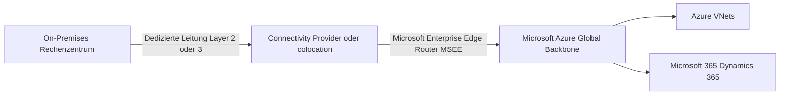

**Vorteile gegenüber VPN:**
- Kein öffentliches Internet im Datenpfad
- Konsistente Latenz (keine Internet-Jitter)
- Höherer Durchsatz (50 Mbps bis 100 Gbps)
- SLA-garantierte Verbindung
- Direkte Anbindung an Microsoft 365 (über Microsoft Peering)

---

## Verbindungsmodelle

### CloudExchange Colocation

Eigenes Equipment in einem Colocation-Rechenzentrum das auch Microsofts Equipment hostet:

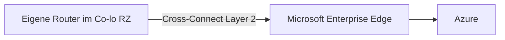

**Anbieter:** Equinix, Digital Realty, CyrusOne, Interxion

### Point-to-Point Ethernet

Direkte Ethernet-Verbindung vom eigenen RZ zum Microsoft-Netzwerk über einen Provider:

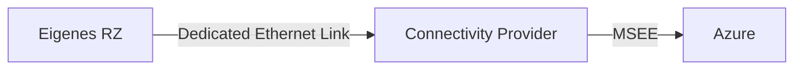

**Anbieter:** Telekom, Vodafone, BT, Orange, Telia

### Any-to-Any (IPVPN / MPLS)

Integration in ein bestehendes MPLS/IPVPN-WAN:

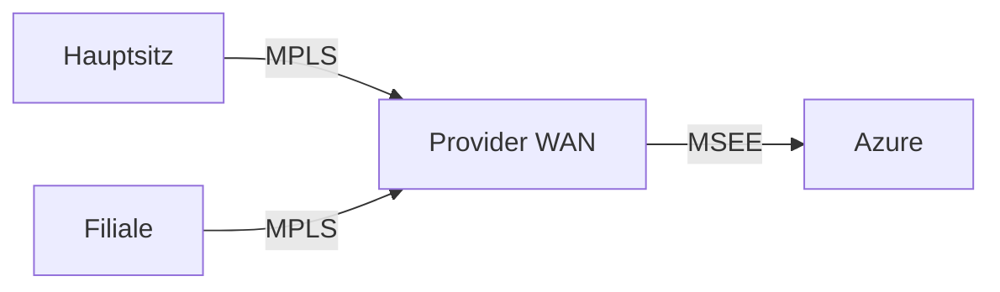

Azure erscheint als ein weiterer Standort im bestehenden WAN.

### ExpressRoute Direct

Direkte physische Verbindung zu Microsoft-Routern ohne zwischengeschalteten Provider:

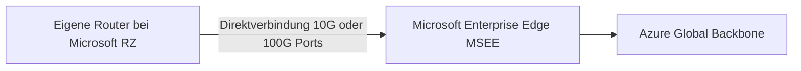

- **10 Gbps** oder **100 Gbps** dedizierte Ports
- Eigene Ports direkt beim Microsoft-Backbone
- Für höchste Durchsatzanforderungen

---

## Circuit SKUs

| SKU | Abrechnung | Regionen | M365 | Anwendungsfall |
|-----|-----------|---------|------|---------------|
| **Local** | Inkludierte Datenübertragung | Nur eine Geo-Region | ❌ | Lokale Anbindung, günstig |
| **Standard** | Metered oder Unlimited | Alle Regionen einer Geo (z.B. Europa) | ❌ | Standard-Hybridverbindung |
| **Premium** | Metered oder Unlimited | Global (alle Regionen) | ✅ | Globale Firmen, M365 |

**Geo-Regionen für Standard:** Europa, Nordamerika, Asien-Pazifik, Japan, Australien, etc.

---

## Peering-Typen

### Private Peering

Verbindet On-Premises direkt mit Azure VNets:

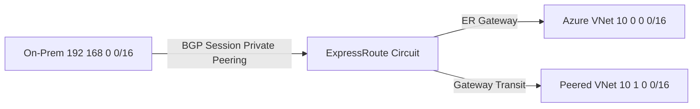

- BGP-Session zwischen On-Prem-Router und Microsoft (primärer + sekundärer Pfad)
- Routet zu Azure VNet-Adressräumen

### Microsoft Peering

Direkter Zugriff auf Microsoft-Public-Dienste (Microsoft 365, Azure PaaS) ohne Internet:

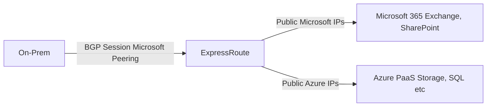

- Erfordert eigene öffentliche IP-Adressen (ASN + öffentliche IPs)
- Route-Filter konfigurieren (welche Microsoft-Services über ER)

---

## BGP-Konfiguration

ExpressRoute nutzt **BGP** für dynamisches Routing:

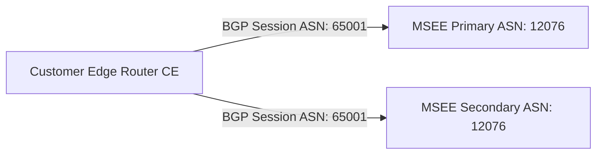

| Parameter | Wert |
|-----------|------|
| Microsoft BGP ASN | 12076 |
| Primärer BGP-Link | /30-Subnet (Peering-IP für Primary) |
| Sekundärer BGP-Link | /30-Subnet (Peering-IP für Secondary) |
| VLAN-ID | Vom Provider zugewiesen |
| MD5 Auth | Optional aber empfohlen |

```powershell
# ExpressRoute Circuit erstellen
$circuit = New-AzExpressRouteCircuit `
  -Name "er-circuit-prod" `
  -ResourceGroupName "rg-connectivity" `
  -Location "westeurope" `
  -SkuTier Standard `
  -SkuFamily MeteredData `
  -ServiceProviderName "Telekom" `
  -PeeringLocation "Frankfurt" `
  -BandwidthInMbps 500

# Private Peering konfigurieren
Add-AzExpressRouteCircuitPeeringConfig `
  -Name PrivatePeering `
  -ExpressRouteCircuit $circuit `
  -PeeringType AzurePrivatePeering `
  -PeerASN 65001 `
  -PrimaryPeerAddressPrefix "192.168.100.0/30" ` # Primary BGP Link
  -SecondaryPeerAddressPrefix "192.168.100.4/30" ` # Secondary BGP Link
  -VlanId 100
```

---

## Bandbreiten

| Bandbreite | Anwendungsfall |
|-----------|---------------|
| 50 Mbps | Kleine Unternehmen, Pilot |
| 100 Mbps | Kleines Unternehmen |
| 200 Mbps | Mittelständler |
| 500 Mbps | Mittelständler |
| 1 Gbps | Enterprise |
| 2 Gbps | Große Enterprise |
| 5 Gbps | Sehr große Enterprise |
| 10 Gbps | Große Datacenter-Integration |
| 40 Gbps | ExpressRoute Direct |
| 100 Gbps | ExpressRoute Direct |

> [!NOTE] Bandwidth-Upgrade
> Bandwidth kann jederzeit **erhöht** (nicht verringert) werden. Bei erhöhen kein Outage. Downgrade erfordert neuen Circuit.

---

## ExpressRoute Direct

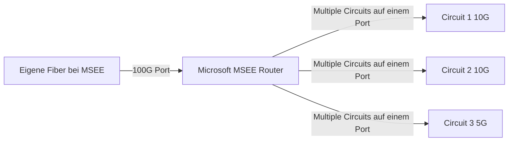

```powershell
# ExpressRoute Direct Port Pair
$directPort = New-AzExpressRoutePort `
  -Name "er-direct-100g" `
  -ResourceGroupName "rg-connectivity" `
  -Location "westeurope" `
  -PeeringLocation "Amsterdam" `
  -BandwidthInGbps 100 `
  -Encapsulation Dot1Q # oder QinQ
```

---

## ExpressRoute Global Reach

On-Premises-Standorte über Microsofts Backbone verbinden (On-Prem zu On-Prem):

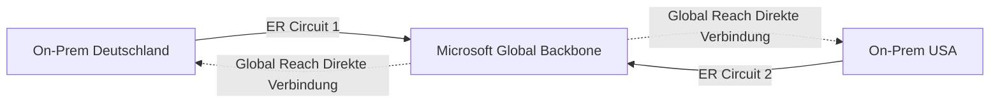

```powershell
# Global Reach zwischen zwei ER Circuits konfigurieren
Add-AzExpressRouteCircuitConnectionConfig `
  -Name "global-reach-de-us" `
  -ExpressRouteCircuit $circuitDE `
  -PeerExpressRouteCircuitPeering $circuitUS.Peerings[0].Id `
  -AddressPrefix "192.168.200.0/29" # IP-Raum für Global Reach BGP
```

---

## FastPath (Gateway Bypass)

Normaler Traffic-Pfad: On-Prem → ER Circuit → **ER Gateway** → VNet VMs

Mit FastPath: On-Prem → ER Circuit → **direkt zu VM NIC** (Gateway wird umgangen)

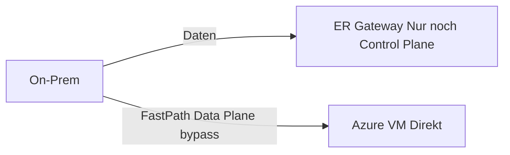

```powershell
# ExpressRoute Gateway mit FastPath
New-AzVirtualNetworkGateway `
  -GatewayType ExpressRoute `
  -GatewaySku ErGw3AZ ` # ErGw1AZ, ErGw2AZ, ErGw3AZ, ErGwScale unterstützen FastPath
  -EnableFastPathActivation $true
```

**FastPath-Anforderungen:** ErGw3AZ SKU oder höher, Ultra Performance, ErGwScale.

---

## Hochverfügbarkeit

### Zwei Circuits (empfohlen für Produktion)

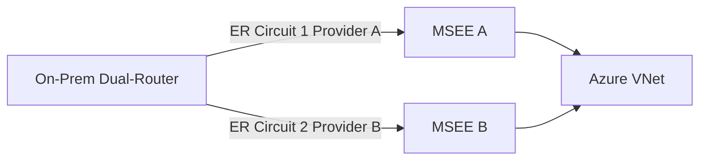

- **Geo-Redundanz:** Circuits in verschiedenen Peering-Locations (z.B. Frankfurt + Amsterdam)
- **Provider-Redundanz:** Verschiedene Provider für physische Diversität
- Beide Circuits aktiv (BGP läuft auf beiden, Load Balancing über AS Path Prepending)

---

## ExpressRoute + VPN Gateway (Failover)

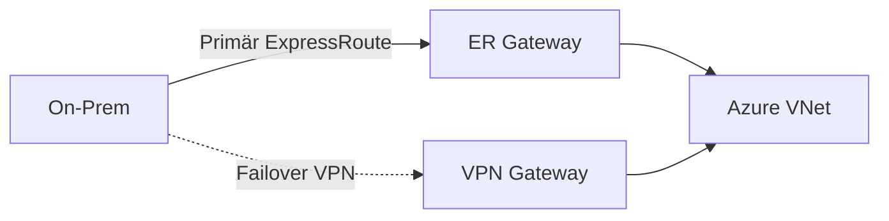

BGP-Konfiguration: ER-Routes haben kürzeren AS Path → bevorzugt. Bei ER-Ausfall übernehmen VPN-BGP-Routes automatisch.

---

## Monitoring

```powershell
# ExpressRoute Circuit Health prüfen
Get-AzExpressRouteCircuit -Name "er-circuit-prod" -ResourceGroupName "rg-connectivity" | 
  Select-Object Name, ServiceProviderProvisioningState, CircuitProvisioningState

# BGP-Routing-Informationen
Get-AzExpressRouteCircuitRouteTable `
  -ResourceGroupName "rg-connectivity" `
  -ExpressRouteCircuitName "er-circuit-prod" `
  -PeeringType AzurePrivatePeering `
  -DevicePath Primary
```

### KQL — ExpressRoute Metriken

```kusto
// BitsInPerSecond und BitsOutPerSecond
AzureMetrics
| where ResourceId contains "er-circuit-prod"
| where MetricName in ("BitsInPerSecond", "BitsOutPerSecond")
| summarize avg(Average) by MetricName, bin(TimeGenerated, 5m)
| render timechart
```

---

## Kosten und Provider-Auswahl

**Kostenkomponenten:**
| Komponente | Details |
|-----------|---------|
| **Circuit-Gebühr** | Provider-Preis (Leitung selbst) — variiert stark |
| **Azure Port Fee** | Basierend auf Bandbreite (z.B. 1 Gbps: ~$2.000/Monat) |
| **Metered Data** | Ausgehende Daten in Rechnung (Local/Standard/Premium) |
| **Unlimited Data** | Pauschal, höhere Grundgebühr aber kein Datenlimit |
| **ER Gateway** | ErGw1AZ: ~$0,37/h (~$270/Monat) |

**Provider-Auswahl Kriterien:**
- Latenz zur nächsten Peering-Location (Frankfurt, Amsterdam, Wien, etc.)
- SLA des Providers (99,9% vs. 99,99%)
- Bandbreiten-Flexibilität (Upgrade ohne Provider-Wechsel?)
- Kosten (Port Fee + Mileage)

---

## Verwandte Notizen

- [[Azure Virtual Network]]
- [[Azure VPN Gateway]]
- [[Azure Virtual WAN]]
- [[Azure Network Watcher]]
