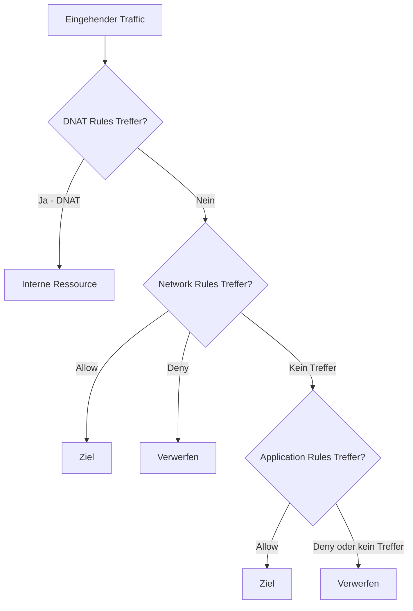
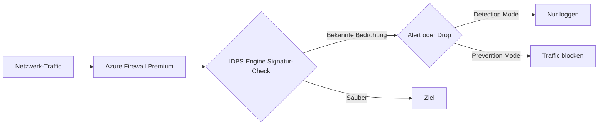
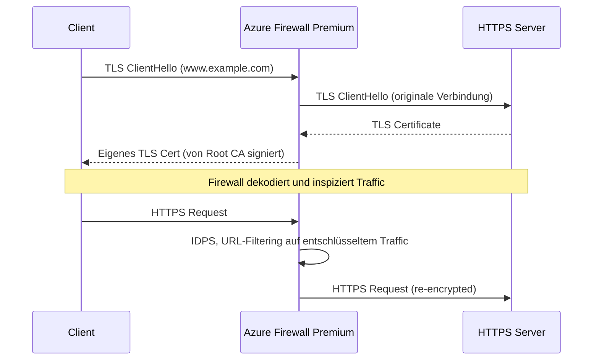
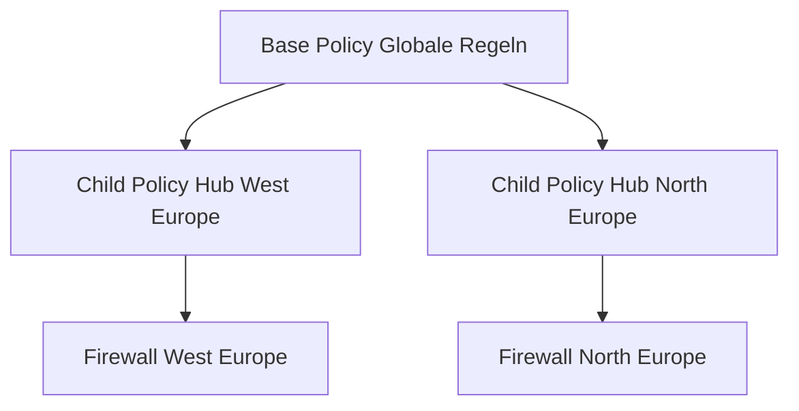
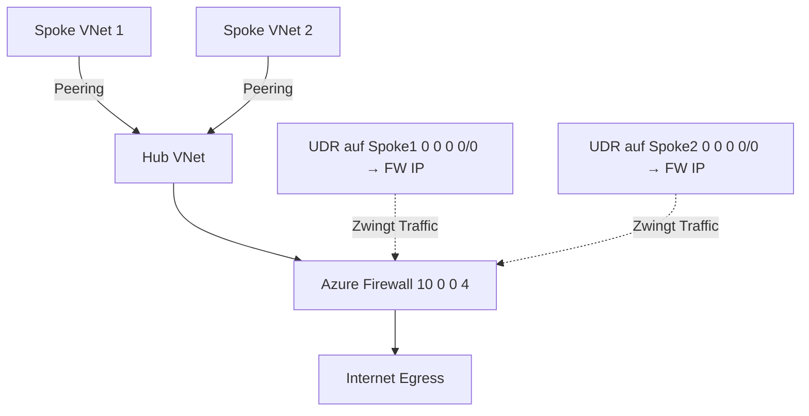

---
tags:
  - azure
  - netzwerk
  - firewall
  - azure-firewall
  - sicherheit
  - hub-spoke
  - netzwerkschutz
aliases:
  - Azure Firewall
  - Cloud Firewall Azure
  - Azure Next Generation Firewall
  - NGFW Azure
---

# Azure Firewall

> [!ABSTRACT] TL;DR
> Azure Firewall ist eine vollständig verwaltete, cloud-native Netzwerk-Firewall mit hoher Verfügbarkeit und unbegrenzter Cloud-Skalierbarkeit. Im Gegensatz zu NSGs ermöglicht Azure Firewall FQDN-basierte Filterung (Application Rules), TLS-Inspektion, IDPS und Threat Intelligence. Zentrale Platzierung im Hub eines Hub-and-Spoke-Netzwerks.

---

## Was ist Azure Firewall?

Azure Firewall ist ein **managed Network Security Service** für Azure:
- **Vollständig stateful** — verfolgt Verbindungszustände
- **Hochverfügbar** — kein eigenes Clustering nötig
- **Unbegrenzt skalierbar** — automatisches Scale-out
- **Zentral** — eine Firewall schützt alle VNets im Hub-and-Spoke
- **Integriert** — mit Azure Monitor, Defender for Cloud, Microsoft Sentinel

---

## Via Azure Portal (UI)

### Azure Firewall erstellen

1. [Azure-Portal](https://portal.azure.com) → Suchleiste → **Firewalls** → **+ Erstellen**
2. **Grundlagen:**
   - **Abonnement**, **Ressourcengruppe**, **Name** und **Region** wählen
   - **Firewall-SKU:** Standard oder Premium
   - **Firewall-Verwaltung:** Mit oder ohne Firewall Policy
3. **Firewall konfigurieren:**
   - **Virtuelles Netzwerk** wählen (muss `AzureFirewallSubnet` /26 oder größer enthalten)
   - **Öffentliche IP-Adresse** erstellen oder vorhandene wählen
4. **Firewall Policy** erstellen oder zuweisen (empfohlen)
5. **Tags** → **Überprüfen + erstellen** → **Erstellen**

### Firewall Policy und Regeln konfigurieren

1. **Firewall Policy** öffnen → **Regelsammlungen** → **+ Regelsammlung hinzufügen**
2. **Typ** wählen: **DNAT**, **Netzwerk** oder **Anwendung**
3. **Name**, **Priorität** und **Aktion** (Zulassen/Verweigern) festlegen
4. **Regeln hinzufügen** (Quelle, Ziel, Port, Protokoll) → **Hinzufügen**

### Firewall einer Policy zuordnen

1. Firewall öffnen → **Firewall Policy** → **Vorhandene hinzufügen** oder neue Policy erstellen

> [!IMPORTANT] AzureFirewallSubnet
> Das Subnetz muss exakt **`AzureFirewallSubnet`** heißen und mindestens `/26` groß sein. Ohne dieses Subnetz kann die Firewall nicht deployed werden.

---

## SKUs

| Feature | Basic | Standard | Premium |
|---------|-------|----------|---------|
| **DNAT Rules** | ✅ | ✅ | ✅ |
| **Network Rules** | ✅ | ✅ | ✅ |
| **Application Rules (FQDN)** | ✅ (begrenzt) | ✅ | ✅ |
| **Threat Intelligence** | ❌ | ✅ Alert-Only | ✅ Alert+Deny |
| **IDPS** | ❌ | ❌ | ✅ |
| **TLS Inspection** | ❌ | ❌ | ✅ |
| **URL Filtering** | ❌ | ❌ | ✅ |
| **Web Categories** | ❌ | ✅ | ✅ |
| **Preis (ca.)** | ~$0,50/h | ~$1,25/h | ~$3,50/h |
| **Anwendungsfall** | SMB, Dev/Test | Enterprise | Compliance, High Security |

---

## Regeltypen

Azure Firewall verarbeitet Regeln in dieser Reihenfolge:



### DNAT Rules (Destination NAT)

Leitet eingehenden Traffic von öffentlicher Firewall-IP zu internen Ressourcen:

```json
{
  "name": "DNAT-RDP-to-VM",
  "ruleType": "NatRule",
  "sourceAddresses": ["*"],
  "destinationAddresses": ["20.50.100.1"],
  "destinationPorts": ["33890"],
  "protocols": ["TCP"],
  "translatedAddress": "10.0.10.4",
  "translatedPort": "3389"
}
```

> [!WARNING] DNAT als Jump-Server-Ersatz
> DNAT-Regeln für RDP/SSH direkt aus dem Internet sind ein Sicherheitsrisiko. Stattdessen Azure Bastion verwenden.

### Network Rules (Layer 4)

Filtern nach IP-Adresse, Port und Protokoll:

```powershell
# Firewall Policy Network Rule hinzufügen
$networkRule = New-AzFirewallPolicyNetworkRule `
  -Name "Allow-DNS" `
  -Protocol UDP `
  -SourceAddress "10.0.0.0/8" `
  -DestinationAddress "8.8.8.8", "8.8.4.4" `
  -DestinationPort "53"

$ruleCollectionGroup = New-AzFirewallPolicyRuleCollectionGroup `
  -Name "NetworkRuleGroup" `
  -Priority 200 `
  -FirewallPolicyObject $firewallPolicy
```

### Application Rules (Layer 7 / FQDN)

Filtern nach Hostname (FQDN), URL-Kategorien oder Web-Kategorien:

```powershell
# FQDN-basierte Regel: Nur bestimmte Azure-Dienste erlauben
$appRule = New-AzFirewallPolicyApplicationRule `
  -Name "Allow-Azure-Services" `
  -Protocol @{Port=443; ProtocolType="Https"}, @{Port=80; ProtocolType="Http"} `
  -TargetFqdn `
    "*.azure.com", `
    "*.microsoft.com", `
    "*.windows.net", `
    "login.microsoftonline.com"
```

---

## IDPS (Premium — Intrusion Detection/Prevention)



**IDPS-Modi:**
| Modus | Beschreibung |
|-------|-------------|
| **Off** | Deaktiviert |
| **Alert** | Verdächtigen Traffic loggen, nicht blocken |
| **Alert and Deny** | Verdächtigen Traffic loggen und blocken |

---

## TLS Inspection (Premium)



**Voraussetzungen:**
- Root CA-Zertifikat im Azure Key Vault
- Zertifikat auf allen Clients vertrauenswürdig (via GPO oder MDM)
- Firewall Policy mit TLS-Inspection Zertifikat konfigurieren

---

## Threat Intelligence

```powershell
# Threat Intelligence Mode auf Deny setzen
$firewallPolicy = Get-AzFirewallPolicy -Name "policy-hub-prod" -ResourceGroupName "rg-hub"
$firewallPolicy.ThreatIntelMode = "Deny"
Set-AzFirewallPolicy -InputObject $firewallPolicy
```

- Basiert auf Microsoft Threat Intelligence Feed (bekannte bösartige IPs und Domains)
- Aktualisierung automatisch durch Microsoft
- **Alert**: Logging, kein Blocking
- **Alert and Deny**: Logging + Traffic wird blockiert

---

## Azure Firewall Policy

**Firewall Policy** ist die bevorzugte Methode (statt klassische Rule-Konfiguration direkt auf Firewall):



**Vorteile von Firewall Policy:**
- Hierarchische Regelsets (Base + Child Policies)
- Mehrere Firewalls teilen sich eine Policy
- Verwaltung über Azure Firewall Manager
- Unterstützt Premium-Features (IDPS, TLS, URL-Filtering)

```bicep
resource firewallPolicy 'Microsoft.Network/firewallPolicies@2023-09-01' = {
  name: 'policy-hub-prod'
  location: location
  properties: {
    sku: {
      tier: 'Premium'
    }
    threatIntelMode: 'Alert'
    intrusionDetection: {
      mode: 'Alert'
    }
  }
}
```

---

## Deployment: Hub-and-Spoke mit Force Tunneling



```powershell
# UDR für Force Tunneling durch Firewall
$route = New-AzRouteConfig `
  -Name "default-to-firewall" `
  -AddressPrefix "0.0.0.0/0" `
  -NextHopType VirtualAppliance `
  -NextHopIpAddress "10.0.0.4" # Azure Firewall Private IP

$routeTable = New-AzRouteTable `
  -Name "rt-spoke-default" `
  -ResourceGroupName "rg-spoke" `
  -Location "westeurope" `
  -Route $route

# Route Table auf Spoke-Subnet anwenden
Set-AzVirtualNetworkSubnetConfig `
  -VirtualNetwork $spokeVNet `
  -Name "snet-app" `
  -AddressPrefix "10.1.10.0/24" `
  -RouteTable $routeTable
```

---

## Azure Firewall Manager

Azure Firewall Manager ist das **zentrale Management-Portal** für:
- Multiple Azure Firewalls über Policies verwalten
- Secured Virtual Hubs (Azure Firewall in vWAN Hub)
- DDoS Protection Plan verknüpfen
- Drittanbieter-Security-Services (z.B. Zscaler, Check Point) integrieren

---

## Firewall Logs und Monitoring

```powershell
# Diagnostic Settings für Firewall aktivieren
Set-AzDiagnosticSetting `
  -ResourceId $firewall.Id `
  -WorkspaceId $logAnalyticsWorkspaceId `
  -Enabled $true `
  -Category AzureFirewallApplicationRule, AzureFirewallNetworkRule, AzureFirewallDnsProxy
```

### Nützliche KQL-Abfragen

```kusto
// Blockierte Application-Regel-Treffer
AzureDiagnostics
| where Category == "AzureFirewallApplicationRule"
| where msg_s contains "Deny"
| project TimeGenerated, msg_s
| order by TimeGenerated desc

// Top-Destinations aus Network Rules
AzureDiagnostics
| where Category == "AzureFirewallNetworkRule"
| parse msg_s with * "to " destination ". Action" action "." *
| summarize count() by destination, action
| order by count_ desc
```

---

## Azure Firewall vs. NSG

| Kriterium | NSG | Azure Firewall |
|-----------|-----|----------------|
| **Kosten** | Kostenlos | ~$1,25–3,50/Stunde |
| **Layer** | Layer 4 | Layer 4–7 |
| **FQDN-Filterung** | ❌ | ✅ |
| **TLS-Inspektion** | ❌ | ✅ (Premium) |
| **IDPS** | ❌ | ✅ (Premium) |
| **Threat Intelligence** | ❌ | ✅ |
| **Zentralisierung** | Pro-Subnet | Zentral |
| **Logging** | Flow Logs | Structured Application/Network Rules Logs |

> [!TIP] Beide zusammen nutzen
> NSGs für Mikrosegmentierung (West-Ost-Traffic zwischen Subnets), Azure Firewall für Egress-Kontrolle (Nord-Süd-Traffic zum Internet und zu Azure-Diensten).

---

## Kosten

| Komponente | Kosten (ca. westeurope 2024) |
|-----------|------------------------------|
| Firewall Standard (Bereitstellung) | $1,25/Stunde (~$900/Monat) |
| Firewall Premium (Bereitstellung) | $3,50/Stunde (~$2.500/Monat) |
| Verarbeitete Daten | $0,016/GB |
| Firewall Policy | $0,02/Deployment/Monat |
| Zusätzliche Policy-Assoziationen | $0,20/Deployment/Monat |

> [!NOTE] Kostenoptimierung
> Azure Firewall Basic (~$0,50/h) für Entwicklungs- und Test-Umgebungen nutzen. Für Produktion mind. Standard. Firewall läuft 24/7 — keine Stop/Start-Möglichkeit wie bei VMs.

---

## Verwandte Notizen

- [[Azure Virtual Network]]
- [[Network Security Groups]]
- [[Azure Virtual WAN]]
- [[Azure Private Link]]
- [[Azure DDoS Protection]]
