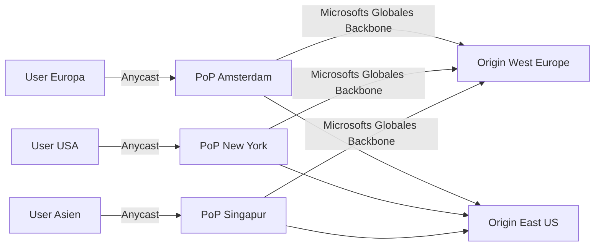
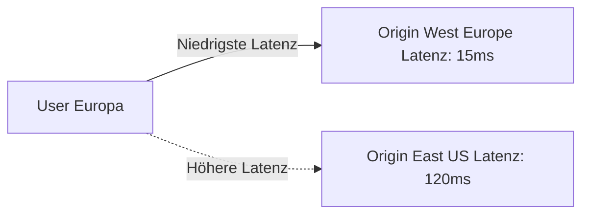
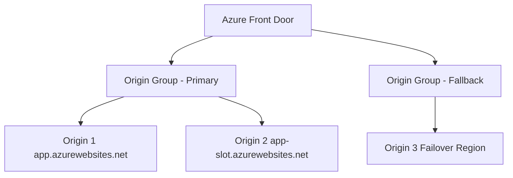
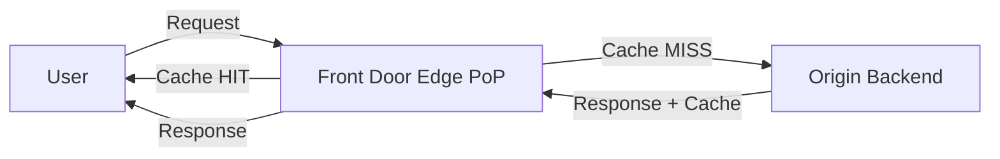
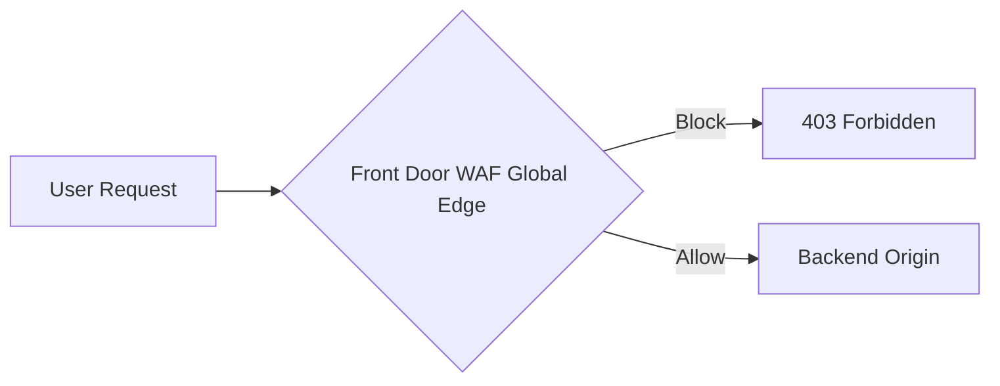
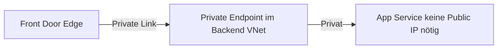

---
tags:
  - azure
  - netzwerk
  - front-door
  - cdn
  - global-load-balancer
  - waf
  - anycast
aliases:
  - AFD
  - Azure Front Door Standard
  - Azure Front Door Premium
  - Azure CDN Front Door
  - Front Door CDN
---

# Azure Front Door

> [!ABSTRACT] TL;DR
> Azure Front Door ist Microsofts globaler Layer-7 Load Balancer, CDN und WAF in einem — basierend auf dem globalen Anycast-Netzwerk von Microsoft. Traffic wird automatisch zum nächstgelegenen Microsoft-PoP geroutet, dort gecacht oder an den besten Origin weitergeleitet. Für globale Web-Apps, APIs und statische Inhalte die niedrige Latenz und hohe Verfügbarkeit benötigen.

---

## Was ist Azure Front Door?

Azure Front Door (AFD) ist eine **globale Edge-Plattform**:



**Kernfunktionen:**
- **Global Load Balancing** — bester Origin nach Latenz, Priority oder Gewichtung
- **CDN** — statische Inhalte an Edge-PoPs cachen (weltweit >100 PoPs)
- **WAF** — Web Application Firewall auf globaler Ebene
- **SSL-Terminierung** am Edge (niedrigere Latenz als bei Backend-Terminierung)
- **DDoS-Schutz** durch verteiltes Anycast-Netzwerk

---

## SKUs

| Feature | Standard | Premium |
|---------|----------|---------|
| **CDN** | ✅ | ✅ |
| **Global Load Balancing** | ✅ | ✅ |
| **WAF (Managed Rules)** | ✅ (Basic) | ✅ (Vollständig) |
| **Bot Protection** | ❌ | ✅ |
| **Private Link Origin** | ❌ | ✅ |
| **Security Reports** | ❌ | ✅ |
| **SLA** | 99,99% | 99,99% |
| **Preis (ca.)** | ~$0,50/Monat Basis + Traffic | ~$0,65/Monat Basis + Traffic |
| **Anwendungsfall** | CDN + Global LB | CDN + LB + Security + Private Backend |

---

## Routing-Methoden

### Latenz-basiert (Standard)

Traffic geht zum **geografisch nächstgelegenen** gesunden Origin:



### Priority (Active/Passive Failover)

```json
{
  "origins": [
    {"name": "primary", "priority": 1, "weight": 1000, "enabled": true},
    {"name": "secondary", "priority": 2, "weight": 1000, "enabled": true}
  ]
}
```

- Primary (Priority 1) bekommt Traffic
- Secondary (Priority 2) nur wenn Primary unhealthy

### Weighted (A/B Testing, Blue/Green)

```json
{
  "origins": [
    {"name": "blue", "priority": 1, "weight": 900},
    {"name": "green", "priority": 1, "weight": 100}
  ]
}
```

90% Traffic → blue, 10% Traffic → green

### Session Affinity

Gleicher User → immer gleicher Origin (basierend auf Cookie):

```powershell
$originGroup.SessionAffinityState = "Enabled"
$originGroup.SessionAffinityUseProxyAddress = $false
```

---

## Origins und Origin Groups



**Origin-Typen:**
- Azure App Service / Static Web Apps
- Azure Storage Blobs
- Azure Load Balancer (Public IP)
- Custom Hostname (beliebiger Server)

```bicep
resource originGroup 'Microsoft.Cdn/profiles/originGroups@2023-05-01' = {
  name: 'og-webapp-prod'
  parent: frontDoorProfile
  properties: {
    loadBalancingSettings: {
      sampleSize: 4
      successfulSamplesRequired: 3
      additionalLatencyInMilliseconds: 50 // Toleranz für Load Balancing
    }
    healthProbeSettings: {
      probePath: '/health'
      probeRequestType: 'HEAD'
      probeProtocol: 'Https'
      probeIntervalInSeconds: 100
    }
  }
}
```

---

## Caching (CDN-Funktionalität)



### Cache-Rules

```powershell
# Route mit Caching konfigurieren
$cacheConfig = @{
  queryStringCachingBehavior = "UseQueryString"
  compressionSettings = @{
    isCompressionEnabled = $true
    contentTypesToCompress = @("text/html", "text/css", "application/javascript")
  }
}
```

| Cache-Verhalten | Beschreibung |
|----------------|-------------|
| **IgnoreQueryString** | Alle Query Strings → gleicher Cache-Key |
| **UseQueryString** | Query Strings bilden Teil des Cache-Keys |
| **IgnoreSpecifiedQueryStrings** | Bestimmte QS ignorieren |
| **IncludeSpecifiedQueryStrings** | Nur bestimmte QS berücksichtigen |

### Cache Purge

```bash
# Cache für bestimmte Pfade leeren
az afd endpoint purge \
  --resource-group rg-prod \
  --profile-name afd-prod \
  --endpoint-name endpoint-webapp \
  --domains "app.example.com" \
  --content-paths "/static/*" "/"
```

---

## WAF auf Front Door

Globaler WAF-Schutz für alle Origins:



**Managed Rule Sets (Standard):**
- Microsoft_DefaultRuleSet_2.1 (DRS 2.1) — OWASP 3.2-basiert
- Microsoft_BotManagerRuleSet_1.0 (Premium) — Bot-Schutz

```bicep
resource wafPolicy 'Microsoft.Network/frontDoorWebApplicationFirewallPolicies@2022-05-01' = {
  name: 'waf-policy-afd'
  location: 'Global'
  sku: {
    name: 'Premium_AzureFrontDoor'
  }
  properties: {
    policySettings: {
      mode: 'Prevention'
      enabledState: 'Enabled'
    }
    managedRules: {
      managedRuleSets: [
        {
          ruleSetType: 'Microsoft_DefaultRuleSet'
          ruleSetVersion: '2.1'
        }
        {
          ruleSetType: 'Microsoft_BotManagerRuleSet'
          ruleSetVersion: '1.0'
        }
      ]
    }
  }
}
```

---

## Private Link Origin (Premium)

Backend ohne öffentliche IP — AFD verbindet sich über Private Link:



```bicep
resource origin 'Microsoft.Cdn/profiles/originGroups/origins@2023-05-01' = {
  properties: {
    hostName: 'myapp.azurewebsites.net'
    sharedPrivateLinkResource: {
      privateLink: {
        id: appService.id
      }
      groupId: 'sites'
      privateLinkLocation: 'westeurope'
      requestMessage: 'Front Door Private Link Request'
    }
  }
}
```

> [!NOTE] Approval erforderlich
> Nach dem Deployment muss die Private Endpoint-Verbindung auf dem App Service genehmigt werden: App Service → Networking → Private endpoint connections.

---

## Custom Domains und SSL

```bash
# Custom Domain hinzufügen
az afd custom-domain create \
  --resource-group rg-prod \
  --profile-name afd-prod \
  --custom-domain-name "app-example-com" \
  --host-name "app.example.com" \
  --minimum-tls-version TLS12 \
  --certificate-type ManagedCertificate # Azure verwaltet das TLS-Zertifikat

# DNS: CNAME auf Front Door Endpoint setzen
# app.example.com → afd-prod-endpoint.azurefd.net
```

---

## Rule Engine

Traffic-Manipulation auf Edge-Ebene:

```json
{
  "name": "SecurityHeaders",
  "order": 1,
  "conditions": [],
  "actions": [
    {
      "name": "ModifyResponseHeader",
      "parameters": {
        "headerAction": "Append",
        "headerName": "Strict-Transport-Security",
        "value": "max-age=31536000; includeSubDomains"
      }
    },
    {
      "name": "RouteConfigurationOverride",
      "parameters": {
        "cacheConfiguration": {
          "cacheBehavior": "HonorOrigin"
        }
      }
    }
  ]
}
```

---

## Geo-Filtering

Traffic aus bestimmten Ländern/Regionen blockieren:

```powershell
# WAF Custom Rule: Nur Deutschland und Österreich erlauben
$geoRule = New-AzFrontDoorWafCustomRuleObject `
  -Name "AllowDEandAT" `
  -RuleType MatchRule `
  -Priority 100 `
  -Action Block `
  -MatchCondition @(
    New-AzFrontDoorWafMatchConditionObject `
      -MatchVariable RemoteAddr `
      -OperatorProperty GeoMatch `
      -NegateCondition $true `
      -MatchValue "DE", "AT"
  )
```

---

## Front Door vs. Traffic Manager vs. Application Gateway

| Kriterium | Front Door | Traffic Manager | Application Gateway |
|-----------|-----------|----------------|---------------------|
| **Layer** | 7 (HTTP/S) | DNS (Layer 3/4) | 7 (HTTP/S) |
| **Scope** | Global | Global (DNS-basiert) | Regional |
| **CDN** | ✅ | ❌ | ❌ |
| **WAF** | ✅ | ❌ | ✅ |
| **SSL Offloading** | ✅ (am Edge) | ❌ | ✅ |
| **Protokoll** | HTTP, HTTPS | Beliebig (DNS) | HTTP, HTTPS |
| **Datenpfad** | Traffic fließt durch AFD | Traffic geht direkt zum Origin | Traffic fließt durch AGW |
| **Kosten** | Mittel-Hoch | Günstig | Mittel |
| **Anwendungsfall** | Globale HTTPS-Apps mit CDN | DNS Failover, nicht HTTP | Regionale HTTPS-Apps |

---

## Monitoring und Logs

```kusto
// Front Door Access Logs — Top-Endpunkte
AzureDiagnostics
| where Category == "FrontdoorAccessLog"
| summarize count() by requestUri_s
| order by count_ desc
| take 20

// WAF-blockierte Requests
AzureDiagnostics
| where Category == "FrontdoorWebApplicationFirewallLog"
| where action_s == "Block"
| summarize count() by ruleName_s, clientIp_s
```

---

## Verwandte Notizen

- [[Azure Virtual Network]]
- [[Azure Application Gateway]]
- [[Azure Traffic Manager]]
- [[Azure Load Balancer]]
- [[Azure DDoS Protection]]
