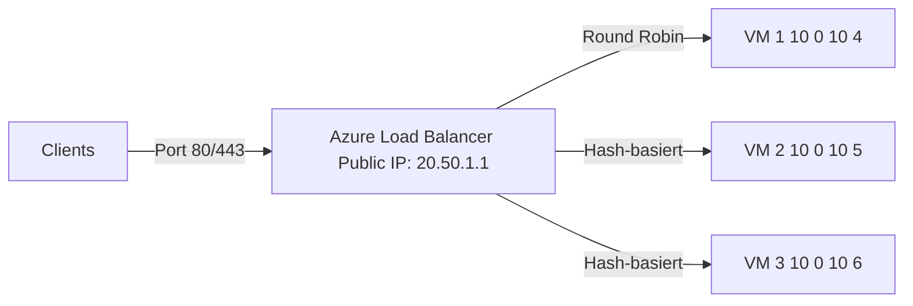
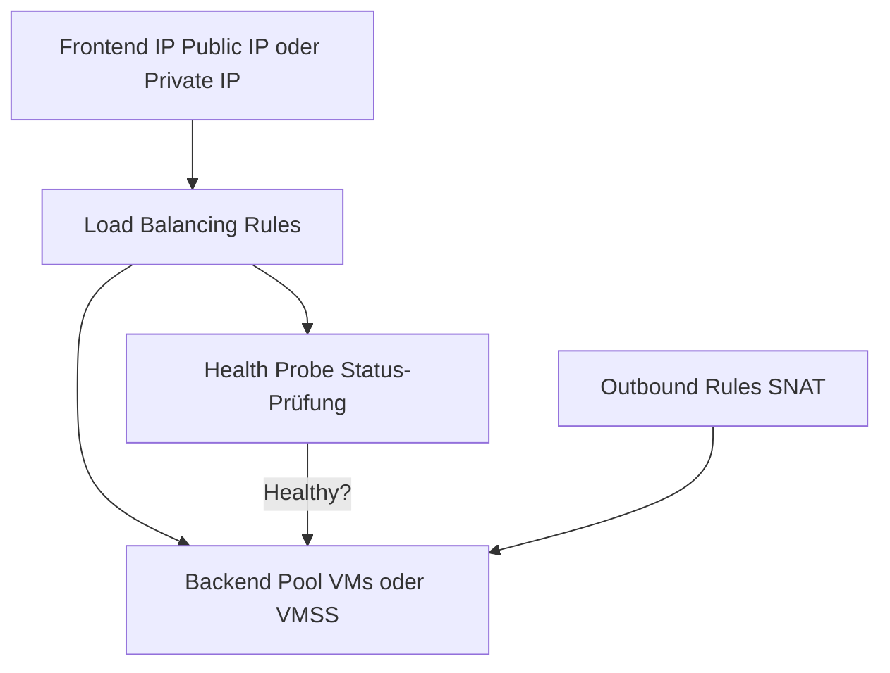
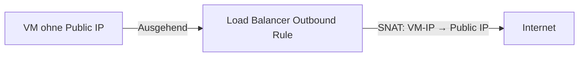
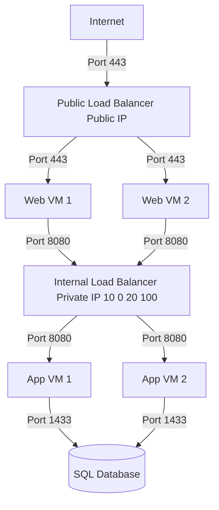
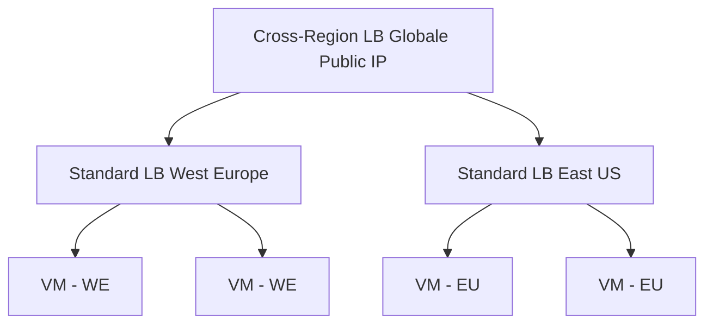

---
tags:
  - azure
  - netzwerk
  - load-balancer
  - layer4
  - tcp
  - hochverfügbarkeit
  - ha
aliases:
  - Azure LB
  - ALB
  - Azure Load Balancer Standard
  - Layer 4 Load Balancer Azure
---

# Azure Load Balancer

> [!ABSTRACT] TL;DR
> Azure Load Balancer ist ein Layer-4 (TCP/UDP) Load Balancer für Azure VMs und VM Scale Sets. Standard SKU ist der einzige empfohlene Typ (Basic wird Ende September 2025 eingestellt). Interne Load Balancer für Ost-West-Traffic, Public Load Balancer für eingehenden Internet-Traffic. Für HTTP/S und URL-basiertes Routing → Application Gateway oder Front Door.

---

## Was ist Azure Load Balancer?

Azure Load Balancer verteilt **TCP/UDP-Traffic** auf mehrere Backend-VMs:



**Eigenschaften:**
- **Layer 4** — kein Verständnis von HTTP-Headers, URLs oder Cookies
- **Vollständig verwaltet** — kein eigenes Cluster/Keepalived nötig
- **Zone-redundant** — Standard LB unterstützt Availability Zones
- **Unbegrenzte Backend-Instanzen** — keine Limits bei Standard SKU

---

## Via Azure Portal (UI)

### Load Balancer erstellen

1. [Azure-Portal](https://portal.azure.com) → Suchleiste → **Lastenausgleich** → **+ Erstellen**
2. **Grundlagen:**
   - **Abonnement**, **Ressourcengruppe**, **Name** und **Region** wählen
   - **SKU:** Standard (empfohlen) oder Basic
   - **Typ:** **Öffentlich** (internet-facing) oder **Intern** (privat)
   - **Tier:** Regional oder Global (nur Standard)
3. **Front-End-IP-Konfiguration:**
   - **+ Front-End-IP-Konfiguration hinzufügen**
   - Name, öffentliche IP-Adresse (neu erstellen oder vorhandene) oder privates Subnetz wählen
4. **Back-End-Pools:**
   - **+ Back-End-Pool hinzufügen** → Name vergeben → **VMs oder VMSS** zuordnen
5. **Eingehende Regeln:**
   - **+ Lastenausgleichsregel hinzufügen** → Frontend-IP, Backend-Pool, Port, Protokoll und **Integritätstest** konfigurieren
6. **Ausgehende Regeln** (optional): SNAT für ausgehenden Datenverkehr konfigurieren
7. **Tags** → **Überprüfen + erstellen** → **Erstellen**

### Integritätstest (Health Probe) hinzufügen

1. Load Balancer → **Integritätstests** → **+ Hinzufügen**
2. **Name**, **Protokoll** (HTTP/HTTPS/TCP), **Port** und **Intervall** konfigurieren → **Hinzufügen**

> [!TIP] Standard SKU für Produktion
> Der **Standard SKU** unterstützt Availability Zones, HTTPS Health Probes und ist für Produktionsworkloads zwingend empfohlen. Basic SKU wird abgekündigt.

---

## SKUs: Basic vs. Standard

> [!DANGER] Basic Load Balancer End-of-Life
> Azure Basic Load Balancer wird am **30. September 2025** eingestellt. Alle Basic LBs müssen auf Standard migriert werden.

| Feature | Basic (veraltet) | Standard |
|---------|-----------------|----------|
| **Backend Pool** | VMs in Availability Set oder VMSS | Beliebige VMs, VMSS, IP-basiert |
| **Availability Zones** | ❌ | ✅ Zone-redundant oder Zonal |
| **Outbound Rules (SNAT)** | Automatisch (unkontrolliert) | Explizit konfigurierbar |
| **SLA** | Kein SLA | **99,99% SLA** |
| **Health Probes** | TCP, HTTP | TCP, HTTP, **HTTPS** |
| **NSG** | Optional | **Erforderlich** (kein implizites Allow) |
| **IPv6** | ❌ | ✅ |
| **Preis** | Kostenlos | ~$0,025/Stunde + $0,008/GB |
| **Empfehlung** | **Nicht mehr nutzen** | **Immer verwenden** |

---

## Load Balancing Algorithmus

Standard: **5-Tupel Hash** (für Session-Persistenz bei gleichen Clients):

```
Hash(Quell-IP, Quell-Port, Ziel-IP, Ziel-Port, Protokoll) → Backend-VM
```

**Alternative: 2-Tupel Hash** (nur Quell-IP und Protokoll → gleiche Client-IP → gleiche VM):
```powershell
# Persistence auf Source IP setzen
$lbRule.LoadDistribution = "SourceIP" # 2-Tupel
# Oder: $lbRule.LoadDistribution = "SourceIPProtocol" # 3-Tupel
```

---

## Komponenten eines Load Balancers



### Frontend IP Configurations

```powershell
# Public Load Balancer erstellen
$publicIP = New-AzPublicIpAddress `
  -Name "pip-lb-prod" `
  -ResourceGroupName "rg-prod" `
  -Location "westeurope" `
  -Sku Standard `
  -AllocationMethod Static `
  -Zone 1, 2, 3 # Zone-redundant

$frontendIP = New-AzLoadBalancerFrontendIpConfig `
  -Name "frontend-public" `
  -PublicIpAddress $publicIP

# Internal Load Balancer Frontend
$frontendIPInternal = New-AzLoadBalancerFrontendIpConfig `
  -Name "frontend-internal" `
  -SubnetId $subnet.Id `
  -PrivateIpAddress "10.0.10.100" `
  -PrivateIpAddressVersion IPv4
```

### Backend Pools

```powershell
# IP-basierter Backend Pool (empfohlen für Standard LB)
$backendPool = New-AzLoadBalancerBackendAddressPoolConfig -Name "backend-pool-prod"

# VMs zum Backend Pool hinzufügen
$nic = Get-AzNetworkInterface -Name "nic-vm-app01" -ResourceGroupName "rg-prod"
$nic.IpConfigurations[0].LoadBalancerBackendAddressPools = @($backendPool)
Set-AzNetworkInterface -NetworkInterface $nic
```

### Health Probes

```powershell
# HTTP Health Probe
$probe = New-AzLoadBalancerProbeConfig `
  -Name "hp-http-80" `
  -Protocol Http `
  -Port 80 `
  -RequestPath "/health" `
  -IntervalInSeconds 15 `
  -ProbeCount 2 # VM gilt als down nach 2 fehlgeschlagenen Probes
```

**Probe-Typen:**
| Typ | Port | Kriterium |
|-----|------|-----------|
| TCP | Beliebig | Verbindung erfolgreich = healthy |
| HTTP | 80 | HTTP 200 = healthy |
| HTTPS | 443 | HTTP 200 über TLS = healthy |

> [!TIP] Health Probe Best Practice
> Dedikaten `/health`-Endpoint in der Anwendung implementieren, der echten Applikationsstatus prüft (z.B. DB-Verbindung). Nicht nur `200 OK` zurückgeben ohne echten Health-Check.

### Load Balancing Rules

```powershell
# Load Balancing Rule: Port 443 auf Backend
$lbRule = New-AzLoadBalancerRuleConfig `
  -Name "rule-https" `
  -FrontendIpConfiguration $frontendIP `
  -BackendAddressPool $backendPool `
  -Probe $probe `
  -Protocol Tcp `
  -FrontendPort 443 `
  -BackendPort 443 `
  -IdleTimeoutInMinutes 4 `
  -EnableFloatingIP $false `
  -DisableOutboundSnat $true # Outbound über explizite Outbound Rules
```

**Floating IP (Direct Server Return):**
- Aktiviert wenn Backend-VMs die Ziel-IP im Paket sehen müssen
- Erforderlich für SQL Server AlwaysOn Availability Groups
- Frontend-IP muss auch auf VM-Loopback konfiguriert werden

---

## Outbound Rules (SNAT)

Standard Load Balancer hat **kein automatisches Outbound SNAT** — es muss explizit konfiguriert werden:



```powershell
# Outbound Rule für SNAT
$outboundRule = New-AzLoadBalancerOutboundRuleConfig `
  -Name "outbound-snat-rule" `
  -FrontendIpConfiguration @($frontendIP) `
  -BackendAddressPool $backendPool `
  -Protocol All `
  -IdleTimeoutInMinutes 4 `
  -AllocatedOutboundPorts 1024 # Ports pro VM für SNAT
```

> [!WARNING] SNAT Port Exhaustion
> Wenn viele VMs über einen Load Balancer nach außen gehen, können SNAT-Ports ausgehen (64.512 Ports pro Public IP, aufgeteilt auf alle Backend-VMs). Lösung: Mehrere Public IPs für Outbound Rules, oder NAT Gateway verwenden.

---

## Internal vs. Public Load Balancer



| Typ | Frontend IP | Anwendungsfall |
|-----|-------------|---------------|
| **Public LB** | Öffentliche IP | Eingehender Internet-Traffic |
| **Internal LB** | Private IP im VNet | Ost-West-Traffic, Tier-basierte Architektur |

---

## Cross-Region Load Balancer

Global verteilter Load Balancer auf Basis mehrerer regionaler Standard LBs:



---

## HA Ports

**High Availability Ports** — Load Balancing auf **allen Ports gleichzeitig** (nur Internal LB):

```powershell
# HA Port Rule für Network Virtual Appliance
$haPortRule = New-AzLoadBalancerRuleConfig `
  -Name "ha-ports-nva" `
  -FrontendIpConfiguration $frontendIP `
  -BackendAddressPool $backendPool `
  -Probe $probe `
  -Protocol All ` # HA Ports
  -FrontendPort 0 ` # 0 = alle Ports
  -BackendPort 0 ` # 0 = alle Ports
  -EnableFloatingIP $true
```

**Anwendungsfall:** Traffic zu Network Virtual Appliances (Firewalls, IDS/IPS) leiten — alle Protokolle und Ports werden durch die NVA geleitet.

---

## Load Balancer + Availability Zones

```powershell
# Zone-redundanter Standard LB (Frontend IP über alle Zonen)
$publicIP = New-AzPublicIpAddress `
  -Name "pip-lb-zone-redundant" `
  -ResourceGroupName "rg-prod" `
  -Location "westeurope" `
  -Sku Standard `
  -AllocationMethod Static `
  -Zone 1, 2, 3 # Keine Zone = Zone-redundant

# Zonal Frontend (nur Zone 1)
$publicIPZonal = New-AzPublicIpAddress `
  -Zone 1 # Nur Zone 1
```

---

## Load Balancer vs. Application Gateway vs. Front Door

| Kriterium | Load Balancer | Application Gateway | Front Door |
|-----------|--------------|--------------------|-----------| 
| **Layer** | 4 (TCP/UDP) | 7 (HTTP/S) | 7 (HTTP/S) |
| **Scope** | Regional | Regional | Global |
| **SSL Offloading** | ❌ | ✅ | ✅ |
| **URL-basiertes Routing** | ❌ | ✅ | ✅ |
| **WAF** | ❌ | ✅ (WAF V2) | ✅ |
| **CDN** | ❌ | ❌ | ✅ |
| **Protokoll** | TCP, UDP | HTTP, HTTPS, WebSocket | HTTP, HTTPS |
| **Private Backend** | ✅ | ✅ | ✅ (Premium) |
| **Anwendungsfall** | VM-to-VM, Non-HTTP | HTTPS Apps in einer Region | Globale HTTPS Apps |

---

## Fehlerbehebung

| Problem | Ursache | Lösung |
|---------|---------|--------|
| **Backend-VMs gesund, aber Traffic schlägt fehl** | NSG blockiert Health Probe | NSG-Regel für `AzureLoadBalancer` Service Tag auf Port des Probes |
| **HTTP Health Probe schlägt fehl** | App gibt kein 200 zurück | `/health`-Endpoint prüfen, App-Logs ansehen |
| **SNAT-Fehler** | Port Exhaustion | Mehr Public IPs für Outbound Rules oder NAT Gateway |
| **VM wird nie vom LB erreicht** | VM nicht im Backend Pool | Backend Pool-Mitgliedschaft prüfen |
| **Ungleichmäßige Last** | Session Persistence | Distribution Mode von SourceIP auf Standard (5-Tupel) ändern |

```bash
# Backend Health Status anzeigen
az network lb show \
  --resource-group rg-prod \
  --name lb-webapp-prod \
  --query backendAddressPools[].loadBalancerBackendAddresses \
  --output table

# Health Probe Status
az network lb probe show \
  --resource-group rg-prod \
  --lb-name lb-webapp-prod \
  --name hp-http-80
```

---

## Verwandte Notizen

- [[Azure Virtual Network]]
- [[Network Security Groups]]
- [[Azure Application Gateway]]
- [[Azure Front Door]]
