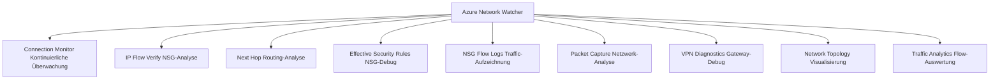
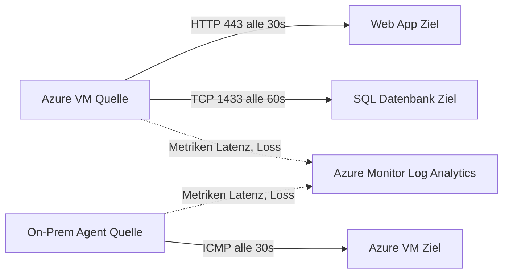
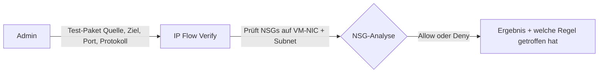
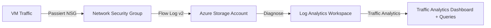
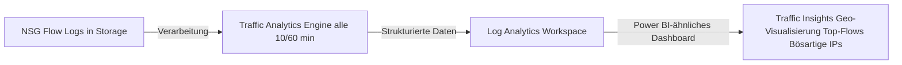
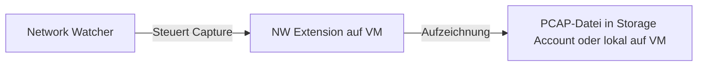
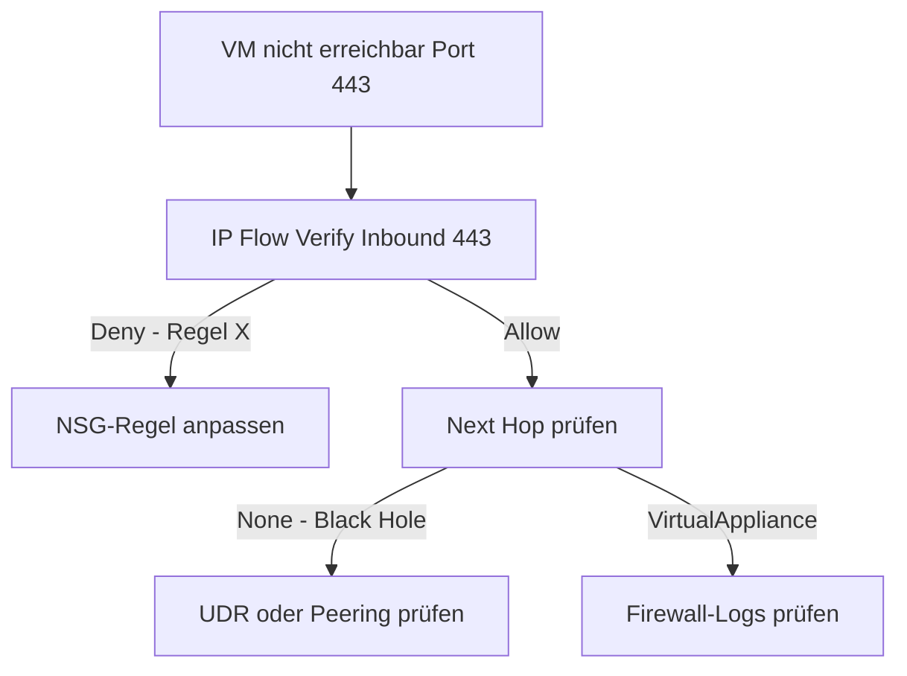

---
tags:
  - azure
  - netzwerk
  - network-watcher
  - monitoring
  - troubleshooting
  - diagnose
  - nsg-flow-logs
  - verbindungsüberwachung
aliases:
  - Azure Network Watcher
  - Netzwerkdiagnose Azure
  - Connection Monitor Azure
  - Traffic Analytics Azure
  - Network Diagnostics Azure
---

# Azure Network Watcher

> [!ABSTRACT] TL;DR
> Azure Network Watcher ist die zentrale Diagnose- und Monitoring-Plattform für Azure-Netzwerke. Von IP Flow Verify (NSG-Diagnose) über Connection Monitor (kontinuierliche Konnektivitätsüberwachung) bis Packet Capture auf VMs — Network Watcher deckt alle Troubleshooting-Szenarien ab. Automatisch pro Region aktiviert.

---

## Was ist Azure Network Watcher?

Network Watcher ist ein **regionaler Netzwerk-Diagnose-Dienst**:



**Aktivierung:** Network Watcher wird automatisch aktiviert wenn eine Ressource in einer Region erstellt wird. Kein manuelles Setup nötig für Basis-Features.

---

## Connection Monitor

**Connection Monitor** überwacht Konnektivität und Latenz zwischen Endpunkten kontinuierlich:



### Connection Monitor erstellen

```powershell
# Connection Monitor für Web App
New-AzNetworkWatcherConnectionMonitor `
  -NetworkWatcherName "NetworkWatcher_westeurope" `
  -ResourceGroupName "NetworkWatcherRG" `
  -Name "cm-webapp-monitoring" `
  -Location "westeurope" `
  -TestGroup @(
    @{
      Name = "test-group-https"
      Disable = $false
      TestConfigurations = @(@{
        Name = "https-443"
        Protocol = "Tcp"
        DestinationPort = 443
        TestFrequencySec = 30
        SuccessThreshold = @{ChecksFailedPercent = 10; RoundTripTimeMs = 1000}
      })
      Sources = @(@{Name = "vm-source"; ResourceId = $vm.Id})
      Destinations = @(@{Name = "webapp"; Address = "myapp.azurewebsites.net"})
    }
  )
```

### Wichtige Metriken

| Metrik | Beschreibung | Alert bei |
|--------|-------------|----------|
| **ChecksFailedPercent** | Prozent fehlgeschlagener Prüfungen | >5% |
| **RoundTripTimeMs** | Latenz in Millisekunden | >500ms |
| **ProbesFailedPercent** | Legacy (für ältere CMs) | — |

---

## IP Flow Verify

**IP Flow Verify** analysiert ob ein bestimmtes Paket durch eine NSG erlaubt oder blockiert wird — und **warum**:



```bash
# IP Flow Verify via Azure CLI
az network watcher test-ip-flow \
  --resource-group rg-prod \
  --vm vm-webapp01 \
  --direction Inbound \
  --local 10.0.10.4:443 \
  --remote 1.2.3.4:54321 \
  --protocol TCP

# Output:
# {
#   "access": "Allow",
#   "ruleName": "Allow-HTTPS-Inbound"
# }
```

```powershell
# PowerShell
Test-AzNetworkWatcherIPFlow `
  -NetworkWatcher $networkWatcher `
  -TargetVirtualMachineId $vm.Id `
  -Direction Inbound `
  -Protocol TCP `
  -RemoteIPAddress "1.2.3.4" `
  -LocalIPAddress "10.0.10.4" `
  -LocalPort 443 `
  -RemotePort 54321
```

**Anwendungsfälle:**
- VM nicht per HTTPS erreichbar → IP Flow Verify zeigt welche NSG-Regel blockiert
- Ausgehende Verbindung zu DB schlägt fehl → Outbound-Check auf VM-NIC

---

## Next Hop

**Next Hop** zeigt wohin ein Paket von einer VM geroutet wird (basierend auf effektiver Routing-Tabelle):

```bash
# Next Hop prüfen
az network watcher show-next-hop \
  --resource-group rg-prod \
  --vm vm-app01 \
  --source-ip 10.0.10.4 \
  --dest-ip 8.8.8.8

# Output:
# {
#   "nextHopIpAddress": "10.0.0.4",  # Azure Firewall IP
#   "nextHopType": "VirtualAppliance",
#   "routeTableId": "rt-spoke-default"
# }
```

| Next Hop Typ | Beschreibung |
|-------------|-------------|
| `Internet` | Direkt ins Internet |
| `VirtualNetworkGateway` | Über VPN/ER Gateway |
| `VirtualAppliance` | Über NVA (z.B. Azure Firewall) |
| `VnetLocal` | Im VNet |
| `None` | Traffic wird verworfen (Black Hole Route) |

---

## Effective Security Rules

Zeigt die **effektiven NSG-Regeln** einer VM-NIC (Kombination aus Subnet-NSG und NIC-NSG):

```bash
# Effective Security Rules
az network nic list-effective-nsg \
  --resource-group rg-prod \
  --name nic-vm-app01 \
  --output table
```

Im Portal: VM → Networking → Effective security rules (Button rechts oben)

**Ausgabe zeigt:**
- Alle Regeln aus Subnet-NSG
- Alle Regeln aus NIC-NSG  
- Default-Regeln
- Verarbeitungsreihenfolge (nach Priorität)

---

## NSG Flow Logs

**NSG Flow Logs** zeichnen alle Netzwerkverbindungen auf die durch NSGs gehen:



### Flow Log aktivieren

```powershell
# NSG Flow Log Version 2
Set-AzNetworkWatcherFlowLog `
  -NetworkWatcherName "NetworkWatcher_westeurope" `
  -ResourceGroupName "NetworkWatcherRG" `
  -Name "flowlog-nsg-prod" `
  -TargetResourceId $nsg.Id `
  -StorageAccountId $storageAccount.Id `
  -Enabled $true `
  -FormatVersion 2 `
  -RetentionPolicyEnabled $true `
  -RetentionPolicyDays 30 `
  -EnableTrafficAnalytics `
  -TrafficAnalyticsInterval 10 ` # Minuten: 10 oder 60
  -TrafficAnalyticsWorkspaceId $logAnalyticsWorkspace.Id
```

### Flow Log Format (v2)

```json
{
  "Version": 2,
  "flows": [
    {
      "rule": "DefaultRule_AllowInternetOutBound",
      "flows": [
        {
          "mac": "000D3A123456",
          "flowTuples": [
            "1705311000,10.0.0.4,52.230.1.2,54321,443,T,O,A,B,,,,"
          ]
        }
      ]
    }
  ]
}
```

**Format der FlowTuples:**
`Timestamp, SourceIP, DestIP, SrcPort, DstPort, Protocol, Direction, Action, FlowState, PacketsSrcToDest, BytesSrcToDest, PacketsDestToSrc, BytesDestToSrc`

---

## Traffic Analytics

Traffic Analytics wertet Flow Logs aus und visualisiert den Traffic:



### Nützliche Traffic Analytics KQL-Abfragen

```kusto
// Malicious Traffic (bekannte böse IPs laut Threat Intelligence)
AzureNetworkAnalytics_CL
| where TimeGenerated > ago(24h)
| where FlowType_s == "MaliciousFlow"
| summarize count() by SrcIP_s, DestIP_s, DestPort_d
| order by count_ desc

// Top Inbound Traffic-Quellen
AzureNetworkAnalytics_CL
| where FlowDirection_s == "I"
| where TimeGenerated > ago(1h)
| summarize TotalBytes = sum(BytesSentFromNode_d) by SrcIP_s
| order by TotalBytes desc
| take 10

// Offene Ports pro VM
AzureNetworkAnalytics_CL
| where TimeGenerated > ago(1h)
| where FlowDirection_s == "I" and FlowStatus_s == "A"
| distinct DestIP_s, DestPort_d, L4Protocol_s
| order by DestIP_s, DestPort_d
```

---

## Packet Capture

**Packet Capture** startet eine Netzwerk-Paketaufzeichnung direkt auf einer VM:



### Voraussetzungen

- **Azure Network Watcher Extension** muss auf der VM installiert sein:

```powershell
# Extension auf Windows VM installieren
Set-AzVMExtension `
  -ResourceGroupName "rg-prod" `
  -VMName "vm-app01" `
  -Name "AzureNetworkWatcherExtension" `
  -Publisher "Microsoft.Azure.NetworkWatcher" `
  -ExtensionType "NetworkWatcherAgentWindows" `
  -TypeHandlerVersion "1.4"
```

### Packet Capture starten

```powershell
# Packet Capture für 30 Minuten
New-AzNetworkWatcherPacketCapture `
  -NetworkWatcherName "NetworkWatcher_westeurope" `
  -ResourceGroupName "NetworkWatcherRG" `
  -PacketCaptureName "capture-vm-app01" `
  -TargetVirtualMachineId $vm.Id `
  -StorageAccountId $storageAccount.Id `
  -TimeLimitInSeconds 1800 `
  -Filter @(
    @{Protocol="TCP"; RemoteIPAddress=""; LocalIPAddress=""; LocalPort="443"; RemotePort=""}
  )
```

---

## VPN Diagnostics

**VPN Diagnostics** analysiert Azure VPN Gateways bei Verbindungsproblemen:

```powershell
# VPN Gateway Troubleshooting starten
$container = Get-AzStorageContainer -Name "vpnlogs" -Context $storageContext

Start-AzVirtualNetworkGatewayTroubleshoot `
  -ResourceGroupName "rg-hub" `
  -Name "vpngw-hub-prod" `
  -StorageAccountId $storageAccount.Id `
  -StorageAccountSasKey $sasToken `
  -ResultBlobName "vpn-troubleshoot-result.txt"

# Ergebnis abrufen (nach Abschluss, dauert ~5-10 Min)
Get-AzVirtualNetworkGatewayTroubleshoot `
  -ResourceGroupName "rg-hub" `
  -Name "vpngw-hub-prod"
```

---

## Connection Troubleshoot

Point-in-Time-Analyse einer Verbindung mit Hop-by-Hop-Details:

```bash
# Verbindungsanalyse: VM zu Web App
az network watcher test-connectivity \
  --resource-group rg-prod \
  --source-resource vm-app01 \
  --dest-address "myapp.azurewebsites.net" \
  --dest-port 443 \
  --protocol TCP

# Output zeigt: Hops, Latenz, Status, ob Verbindung erfolgreich
```

---

## Network Topology

**Network Topology** visualisiert alle Netzwerk-Ressourcen in einer Region:

Im Portal: Network Watcher → Topology → Subscription + RG auswählen

- Zeigt VNets, Subnets, VMs, NICs, NSGs, Route Tables, Gateways
- Verbindungen und Beziehungen zwischen Ressourcen
- Export als JSON möglich

---

## Network Watcher Extension

Für **Packet Capture** und **Connection Monitor** (On-Prem-Agents) muss die Extension auf VMs installiert sein:

| OS | Extension-Name | Publisher |
|----|---------------|-----------|
| Windows | `NetworkWatcherAgentWindows` | `Microsoft.Azure.NetworkWatcher` |
| Linux | `NetworkWatcherAgentLinux` | `Microsoft.Azure.NetworkWatcher` |

```bicep
resource nwExtension 'Microsoft.Compute/virtualMachines/extensions@2023-03-01' = {
  name: 'AzureNetworkWatcherExtension'
  parent: vm
  location: location
  properties: {
    publisher: 'Microsoft.Azure.NetworkWatcher'
    type: 'NetworkWatcherAgentLinux'
    typeHandlerVersion: '1.4'
    autoUpgradeMinorVersion: true
  }
}
```

---

## Typische Troubleshooting-Szenarien

### Szenario 1: VM nicht erreichbar



### Szenario 2: Langsame Verbindung

```
Connection Monitor → Latenz > Threshold
→ Hop-by-Hop Analyse mit Connection Troubleshoot
→ Welcher Hop verursacht Latenz?
→ DNS? Routing? Applikations-Backend?
```

### Szenario 3: VPN-Tunnel nicht stabil

```
VPN Diagnostics → Logs analysieren
→ IKE-Fehler → Policy-Mismatch prüfen
→ DPD-Timeouts → MTU oder NAT-T prüfen
→ BGP-Probleme → BGP-Peer-Status prüfen
```

---

## Kosten

| Feature | Kosten |
|---------|--------|
| **Connection Monitor** | ~$0,018/Test pro Stunde |
| **NSG Flow Logs** | Storage-Kosten (~$0,035/GB) |
| **Traffic Analytics** | ~$0,10/GB verarbeitete Daten |
| **Packet Capture** | Kostenlos (nur Storage-Kosten) |
| **IP Flow Verify, Next Hop, etc.** | Kostenlos |

---

## Verwandte Notizen

- [[Azure Virtual Network]]
- [[Network Security Groups]]
- [[Azure VPN Gateway]]
- [[Azure ExpressRoute]]
