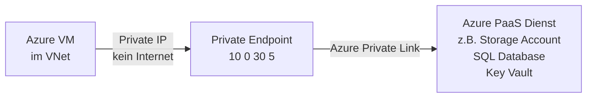
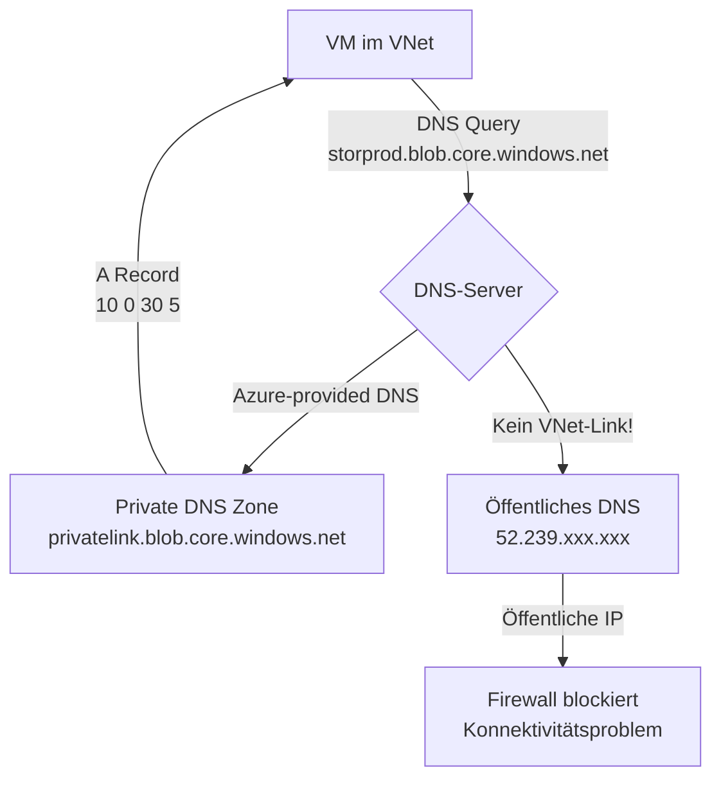
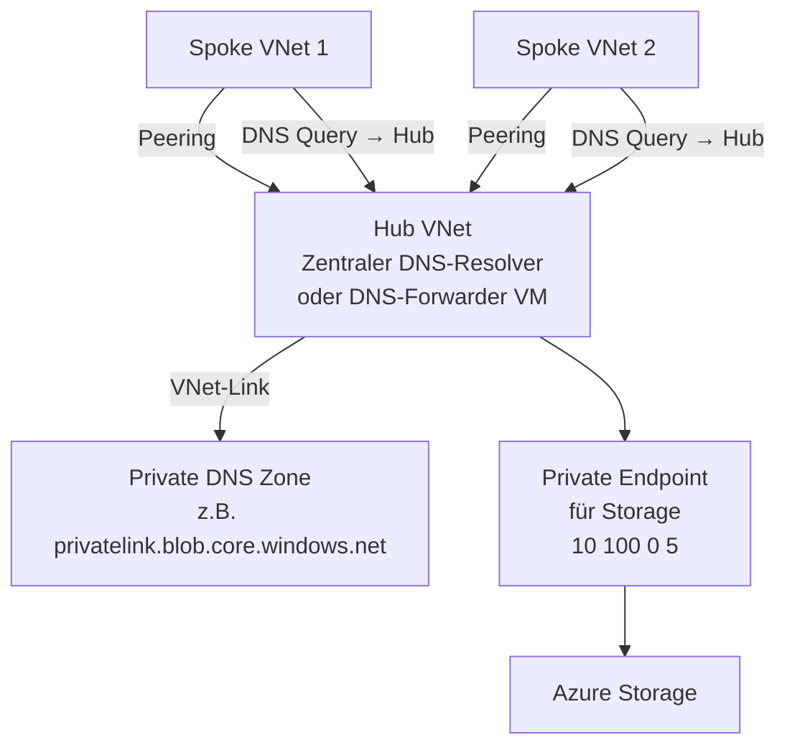
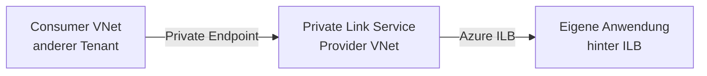
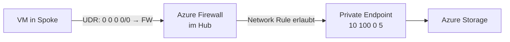
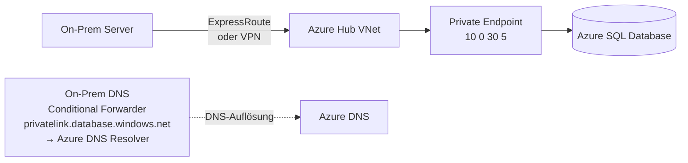

---
tags:
  - azure
  - netzwerk
  - private-link
  - private-endpoint
  - netzwerksicherheit
  - dns
  - zero-trust
aliases:
  - Private Endpoint Azure
  - Azure Private Link Service
  - Private Link Azure
  - Azure Private Endpoint
---

# Azure Private Link

> [!ABSTRACT] TL;DR
> Azure Private Link ermöglicht den Zugriff auf Azure-PaaS-Dienste (Storage, SQL, Key Vault, etc.) und eigene Dienste über **private IP-Adressen im VNet** — ohne Datenübertragung über das öffentliche Internet. Ein Private Endpoint ist die NIC im VNet die eine private IP bekommt und den Datenverkehr an den Azure-Dienst weiterleitet.

---

## Was ist Azure Private Link?

Azure Private Link besteht aus zwei Konzepten:



1. **Private Endpoint** — Eine NIC (mit privater IP) im VNet, die den Datenverkehr zu einem Azure-Dienst oder einem Private Link Service leitet
2. **Private Link Service** — Ermöglicht es, eigene Dienste über Private Link anzubieten (hinter Azure Load Balancer)

---

## Private Endpoints

### Vorteile

| Aspekt | Ohne Private Endpoint | Mit Private Endpoint |
|--------|----------------------|---------------------|
| **Datenübertragung** | Über öffentliches Internet | Privat (Microsoft-Backbone) |
| **IP-Adresse** | Öffentliche IP des Dienstes | **Private IP im VNet** |
| **Routing** | Internet-Routing | VNet-Routing |
| **Firewall nötig** | Ja (Public IP) | NSG auf Subnet |
| **On-Prem-Zugriff** | Über Internet/VPN | Via ExpressRoute/VPN + DNS |
| **NSG-Support** | Eingeschränkt | ✅ (Network Policy aktivieren) |

### Private Endpoint erstellen

```bicep
resource privateEndpoint 'Microsoft.Network/privateEndpoints@2023-09-01' = {
  name: 'pe-kv-prod-001'
  location: location
  properties: {
    subnet: {
      id: privateEndpointSubnet.id
    }
    privateLinkServiceConnections: [
      {
        name: 'connection-kv'
        properties: {
          privateLinkServiceId: keyVault.id
          groupIds: ['vault'] // Unterschiedlich je nach Dienst
        }
      }
    ]
  }
}
```

```powershell
# Private Endpoint für Storage Account
$connection = New-AzPrivateLinkServiceConnection `
  -Name "pe-connection-storage" `
  -PrivateLinkServiceId $storageAccount.Id `
  -GroupId "blob" # Blob, file, queue, table, web, dfs

New-AzPrivateEndpoint `
  -Name "pe-storage-prod" `
  -ResourceGroupName "rg-prod" `
  -Location "westeurope" `
  -Subnet $privateEndpointSubnet `
  -PrivateLinkServiceConnection $connection
```

---

## Unterstützte Azure-Dienste

| Dienst | Group IDs |
|--------|-----------|
| **Azure Storage** | blob, file, queue, table, web, dfs |
| **Azure SQL Database** | sqlServer |
| **Azure Key Vault** | vault |
| **Azure Container Registry** | registry |
| **Azure Service Bus** | namespace |
| **Azure Event Hubs** | namespace |
| **Azure Cosmos DB** | Sql, MongoDB, Cassandra, etc. |
| **Azure App Service** | sites |
| **Azure Kubernetes Service** | management |
| **Azure Monitor** | azuremonitor |
| **Azure Batch** | batchAccount |
| **Azure Machine Learning** | amlworkspace |
| **Azure Synapse Analytics** | Sql, SqlOnDemand, Dev |

---

## DNS-Integration (Kritisch!)

**Das häufigste Problem** mit Private Endpoints ist fehlerhafte DNS-Auflösung:



### Private DNS Zones — Tabelle nach Dienst

| Dienst | Private DNS Zone |
|--------|----------------|
| Azure Storage (Blob) | `privatelink.blob.core.windows.net` |
| Azure Storage (File) | `privatelink.file.core.windows.net` |
| Azure Storage (Queue) | `privatelink.queue.core.windows.net` |
| Azure Storage (Table) | `privatelink.table.core.windows.net` |
| Azure Key Vault | `privatelink.vaultcore.azure.net` |
| Azure SQL Database | `privatelink.database.windows.net` |
| Azure Container Registry | `privatelink.azurecr.io` |
| Azure Service Bus | `privatelink.servicebus.windows.net` |
| Azure Event Hubs | `privatelink.servicebus.windows.net` |
| Azure Cosmos DB (SQL) | `privatelink.documents.azure.com` |
| Azure App Service | `privatelink.azurewebsites.net` |
| Azure Monitor | `privatelink.monitor.azure.com` |

```bicep
// Private DNS Zone für Key Vault
resource privateDnsZone 'Microsoft.Network/privateDnsZones@2020-06-01' = {
  name: 'privatelink.vaultcore.azure.net'
  location: 'global'
}

// VNet-Link (Zone mit VNet verknüpfen)
resource privateDnsZoneVnetLink 'Microsoft.Network/privateDnsZones/virtualNetworkLinks@2020-06-01' = {
  parent: privateDnsZone
  name: 'link-vnet-prod'
  location: 'global'
  properties: {
    virtualNetwork: {
      id: vnet.id
    }
    registrationEnabled: false // Nur für Auflösung, nicht Auto-Registration
  }
}

// DNS Zone Group für Private Endpoint (automatisch A-Record erstellen)
resource privateDnsZoneGroup 'Microsoft.Network/privateEndpoints/privateDnsZoneGroups@2023-09-01' = {
  parent: privateEndpoint
  name: 'kv-dns-zone-group'
  properties: {
    privateDnsZoneConfigs: [
      {
        name: 'kv-config'
        properties: {
          privateDnsZoneId: privateDnsZone.id
        }
      }
    ]
  }
}
```

---

## Hub-Spoke mit Private Endpoints und zentralem DNS

**Empfohlene Architektur** für große Umgebungen:



**Regel:** Private DNS Zones nur mit dem **Hub VNet** verknüpfen, nicht mit jedem Spoke. VMs in Spoke-VNets nutzen Hub als DNS (über Peering erreichbar).

---

## Private Endpoint vs. Service Endpoint

| Merkmal | Private Endpoint | Service Endpoint |
|---------|-----------------|-----------------|
| **IP im VNet** | ✅ Private IP | ❌ Öffentliche IP des Dienstes |
| **On-Prem-Zugriff** | ✅ (via ER/VPN) | ❌ (nur aus erlaubten VNets) |
| **DNS-Änderung nötig** | ✅ (Private DNS Zone) | ❌ |
| **NSG auf Endpoint** | ✅ (Policy aktivieren) | ❌ |
| **Kosten** | Pro Endpoint + Stunden + Daten | Kostenlos |
| **Komplexität** | Höher | Niedriger |
| **Empfehlung (Neu)** | ✅ **Empfohlen** | Legacy-Szenario |

---

## Network Policies für Private Endpoints

Standardmäßig gelten NSGs und Route Tables **nicht** für Private Endpoint Traffic. Network Policies müssen aktiviert werden:

```powershell
# NSG-Support für Private Endpoints auf dem Subnet aktivieren
$subnet = Get-AzVirtualNetworkSubnetConfig -Name "snet-private-endpoints" -VirtualNetwork $vnet
$subnet.PrivateEndpointNetworkPolicies = "Enabled" # NSGs gelten jetzt für PE-Traffic
$subnet.PrivateLinkServiceNetworkPolicies = "Enabled"
Set-AzVirtualNetwork -VirtualNetwork $vnet
```

```bicep
resource subnet 'Microsoft.Network/virtualNetworks/subnets@2023-09-01' = {
  properties: {
    addressPrefix: '10.0.30.0/24'
    privateEndpointNetworkPolicies: 'Enabled' // NSGs auf PE anwenden
    privateLinkServiceNetworkPolicies: 'Enabled'
  }
}
```

---

## Private Link Service (Eigene Dienste anbieten)

Mit **Private Link Service** können eigene Dienste über Private Link angeboten werden:



**Anwendungsfall:** SaaS-Anbieter möchte seinen Dienst ohne öffentliche IP für Kunden anbieten.

```powershell
# Private Link Service erstellen (erfordert Standard ILB)
New-AzPrivateLinkService `
  -Name "pls-myservice" `
  -ResourceGroupName "rg-prod" `
  -Location "westeurope" `
  -IpConfigurations @(
    New-AzPrivateLinkServiceIpConfig `
      -Name "ipconfig" `
      -PrivateIpAllocationMethod Dynamic `
      -Subnet $natSubnet # Eigenes NAT-Subnet für PLS
  ) `
  -LoadBalancerFrontendIpConfigurations @($ilbFrontend) `
  -AutoApprovalSubscriptions @("sub-id-1", "sub-id-2") # Auto-Approve für bestimmte Subs
```

---

## Private Link + Azure Firewall

Traffic zu Private Endpoints kann über Azure Firewall geleitet werden:



> [!NOTE] Routing-Verhalten
> Mit Network Policy aktiviert und UDR auf dem Spoke-Subnet: Traffic zu Private Endpoints läuft durch die Firewall und kann gefiltert werden. Ohne Policy umgehen Private Endpoints UDRs.

---

## On-Prem Zugriff auf Private Endpoints

On-Prem-Systeme können über ExpressRoute oder VPN auf Private Endpoints zugreifen:



**DNS-Konfiguration für On-Prem:**
- Conditional Forwarder: `privatelink.database.windows.net` → Azure DNS Private Resolver IP
- Alternativ: DNS Private Resolver Inbound Endpoint als Forwarder-Ziel

---

## Fehlerbehebung

### DNS löst öffentliche IP auf

```bash
# Private Endpoint IP testen
nslookup storprod.blob.core.windows.net
# Erwartet: 10.0.30.x (Private IP)
# Erhält: 52.x.x.x (Öffentliche IP) → DNS-Problem!

# Lösung prüfen:
# 1. Private DNS Zone für privatelink.blob.core.windows.net vorhanden?
# 2. VNet-Link zur DNS Zone vorhanden?
# 3. A-Record in DNS Zone vorhanden? (sollte automatisch erstellt werden)
```

### Konnektivitätsfehler

```bash
# NSG auf Private Endpoint Subnet prüfen
az network nic list-effective-nsg \
  --resource-group rg-prod \
  --name nic-pe-storage-prod

# Routing prüfen
az network nic show-effective-route-table \
  --resource-group rg-prod \
  --name nic-pe-storage-prod

# Private Endpoint Verbindungsstatus prüfen
az network private-endpoint show \
  --resource-group rg-prod \
  --name pe-storage-prod \
  --query "privateLinkServiceConnections[].privateLinkServiceConnectionState"
```

| Fehler | Ursache | Lösung |
|--------|---------|--------|
| DNS → Öffentliche IP | Private DNS Zone fehlt oder kein VNet-Link | DNS Zone + VNet-Link + DNS Zone Group erstellen |
| Connection pending | Provider hat nicht genehmigt | Am Private Link Service genehmigen |
| NSG blockiert | Network Policy nicht aktiviert, NSG zu restriktiv | Network Policy aktivieren, NSG prüfen |
| Timeout | UDR fehlt oder Firewall blockiert | Routes und Firewall-Rules prüfen |

---

## Verwandte Notizen

- [[Azure Virtual Network]]
- [[Azure Key Vault]]
- [[Azure DNS]]
- [[Azure Firewall]]
- [[Network Security Groups]]
