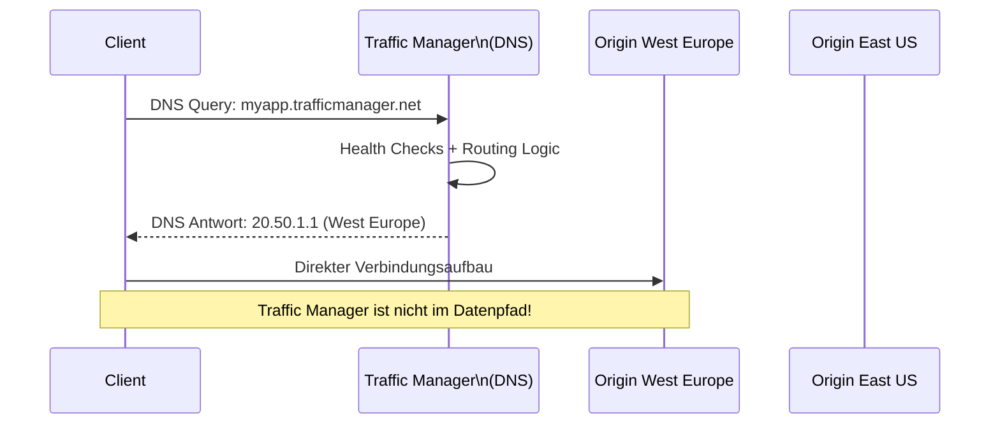
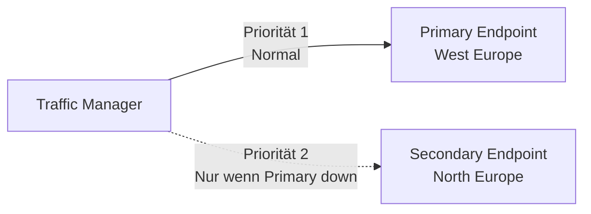
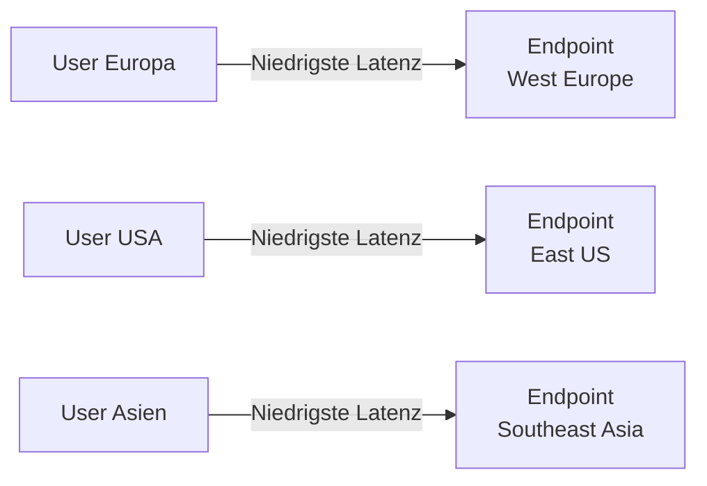
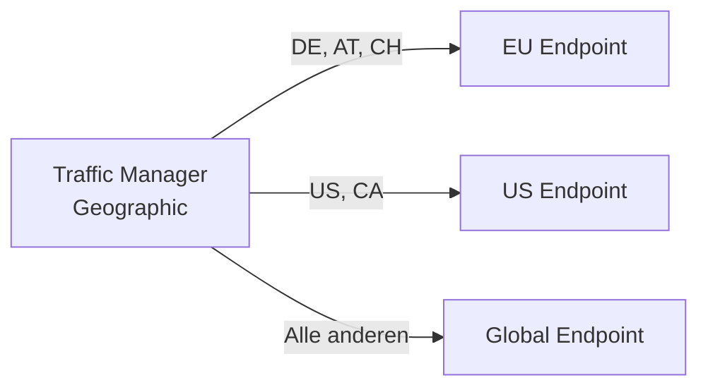
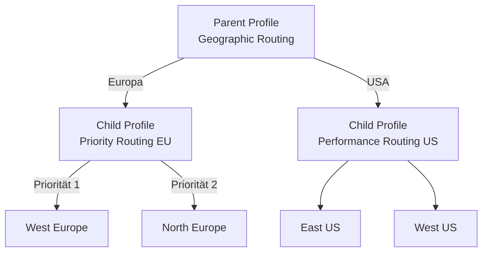
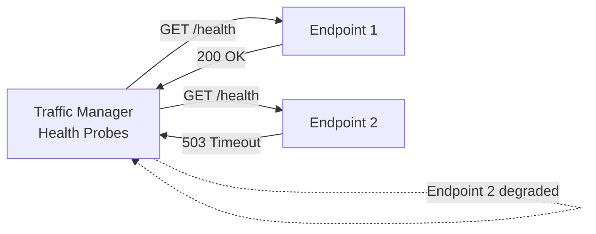
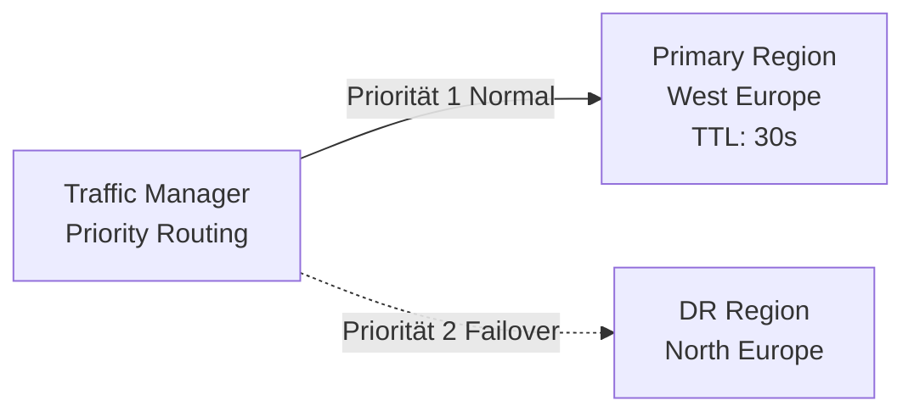

---
tags:
  - azure
  - netzwerk
  - traffic-manager
  - dns
  - load-balancer
  - failover
  - global
aliases:
  - ATM
  - Azure Traffic Manager DNS
  - DNS Load Balancing Azure
  - Traffic Manager Azure
---

# Azure Traffic Manager

> [!ABSTRACT] TL;DR
> Azure Traffic Manager ist ein DNS-basierter globaler Load Balancer. Im Gegensatz zu Front Door fließt der eigentliche Traffic **nicht** durch Traffic Manager — er liefert nur DNS-Antworten die auf den besten Endpoint zeigen. Ideal für Global Load Balancing nicht-HTTP-basierter Protokolle und einfache DNS-basierte Failover-Szenarien.

---

## Was ist Azure Traffic Manager?

Traffic Manager ist ein **DNS-basierter Lastverteiler** auf globaler Ebene:



**Wichtig:** Traffic Manager ist **kein Proxy** — der Traffic fließt direkt zwischen Client und Origin. Traffic Manager liefert nur die DNS-Antwort.

**Vorteile:**
- Funktioniert für alle Protokolle (HTTP, SMTP, RDP, TCP, UDP)
- Kein Traffic-Engpass (Traffic Manager ist nicht im Datenpfad)
- Kosteneffektiv für DNS-basiertes Failover
- Kombination mit App-spezifischen Load Balancern möglich

---

## Routing-Methoden

### Priority (Active/Passive Failover)



Konfiguration:
```powershell
# Traffic Manager Profile mit Priority Routing
$profile = New-AzTrafficManagerProfile `
  -Name "tm-myapp-prod" `
  -ResourceGroupName "rg-prod" `
  -TrafficRoutingMethod Priority `
  -RelativeDnsName "myapp-prod" ` # → myapp-prod.trafficmanager.net
  -Ttl 30 `
  -MonitorProtocol Https `
  -MonitorPort 443 `
  -MonitorPath "/health"

# Primary Endpoint
Add-AzTrafficManagerEndpointConfig `
  -TrafficManagerProfile $profile `
  -EndpointName "primary-westeurope" `
  -Type AzureEndpoints `
  -TargetResourceId $appServiceWE.Id `
  -EndpointStatus Enabled `
  -Priority 1

# Secondary Endpoint
Add-AzTrafficManagerEndpointConfig `
  -TrafficManagerProfile $profile `
  -EndpointName "secondary-northeurope" `
  -Type AzureEndpoints `
  -TargetResourceId $appServiceNE.Id `
  -EndpointStatus Enabled `
  -Priority 2

Set-AzTrafficManagerProfile -TrafficManagerProfile $profile
```

### Performance (Niedrigste Latenz)



- Basiert auf Azure Latenz-Messungen zwischen PoPs und Endpoints
- **Nicht** die tatsächliche Endbenutzer-Latenz (dafür Real User Measurements)

### Weighted (Prozentuale Verteilung)

```powershell
# Weighted Routing: 80% stable, 20% canary
New-AzTrafficManagerEndpoint `
  -ProfileName "tm-myapp" `
  -ResourceGroupName "rg-prod" `
  -Type AzureEndpoints `
  -Name "stable" `
  -TargetResourceId $stableApp.Id `
  -Weight 800 # Gewichtung 0-1000

New-AzTrafficManagerEndpoint `
  -ProfileName "tm-myapp" `
  -ResourceGroupName "rg-prod" `
  -Type AzureEndpoints `
  -Name "canary" `
  -TargetResourceId $canaryApp.Id `
  -Weight 200 # 20% Anteil
```

### Geographic

Traffic wird basierend auf **geografischem Standort des Benutzers** geroutet:



**Anwendungsfälle:** Datenschutz (DSGVO — EU-Nutzer → EU-Rechenzentrum), Content-Lokalisierung.

> [!WARNING] Geographic Routing + Failover
> Bei Geographic Routing gibt es kein automatisches Failover! Wenn der einzige Endpoint für eine Region down ist, erhalten Nutzer aus dieser Region Fehler. Lösung: Nested Profiles kombinieren.

### Multivalue

Gibt **mehrere gesunde Endpoints** in der DNS-Antwort zurück (nur für externe Endpoints mit IPv4/IPv6):

```powershell
New-AzTrafficManagerProfile `
  -TrafficRoutingMethod Multivalue `
  -MaxReturn 3 # Bis zu 3 Endpoints in der DNS-Antwort
```

Der Client wählt dann selbst einen Endpoint aus (z.B. Round-Robin auf Client-Seite).

### Subnet

Spezifische IP-Ranges zu bestimmten Endpoints routen:

```powershell
New-AzTrafficManagerEndpoint `
  -Name "corp-network" `
  -SubnetMapping @(
    @{First="10.0.0.0"; Last="10.255.255.255"},
    @{First="192.168.0.0"; Scope=16}
  )
```

---

## Endpoint-Typen

| Typ | Beschreibung |
|-----|-------------|
| **Azure Endpoints** | Azure-Ressourcen (App Service, Public IP, Cloud Service) |
| **External Endpoints** | Beliebige Hosts (On-Prem, andere Clouds, externe Services) |
| **Nested Profiles** | Anderes Traffic Manager Profile als Endpoint |

### Nested Profiles (Komplexe Szenarien)



**Vorteil:** Geographic Routing mit automatischem Failover innerhalb der Region.

---

## Health Monitoring



| Parameter | Beschreibung | Empfehlung |
|-----------|-------------|-----------|
| **Protokoll** | HTTP, HTTPS, TCP | HTTPS bevorzugen |
| **Port** | Monitoring-Port | 443 |
| **Pfad** | Health-Endpoint | `/health` oder `/ping` |
| **Intervall** | 10s oder 30s | 10s für schnelleres Failover |
| **Toleranz** | Anzahl Fehlversuche bevor Degraded | 3 |

```powershell
# Traffic Manager Profile mit schnellem Health Monitoring
$profile = New-AzTrafficManagerProfile `
  -MonitorProtocol Https `
  -MonitorPort 443 `
  -MonitorPath "/health" `
  -MonitorIntervalInSeconds 10 `
  -MonitorTimeoutInSeconds 9 `
  -MonitorToleratedNumberOfFailures 3
```

---

## Typische Szenarien

### Active/Passive Disaster Recovery



Failover-Zeit = TTL + Monitor-Intervall × Toleranz
Beispiel: 30s TTL + (10s × 3) = **60 Sekunden** bis zum Failover

### Blue/Green Deployment

```powershell
# Schrittweiser Rollout: Start mit 10% auf Green
Set-AzTrafficManagerEndpoint -Name "blue" -Weight 900
Set-AzTrafficManagerEndpoint -Name "green" -Weight 100

# Nach Validierung: 50/50
Set-AzTrafficManagerEndpoint -Name "blue" -Weight 500
Set-AzTrafficManagerEndpoint -Name "green" -Weight 500

# Green ist stabil: 100% auf Green
Set-AzTrafficManagerEndpoint -Name "blue" -Weight 0 # Deaktivieren
```

---

## Traffic Manager vs. Front Door

| Merkmal | Traffic Manager | Front Door |
|---------|----------------|-----------|
| **Mechanismus** | DNS-basiert | Anycast-Proxy |
| **Traffic im Datenpfad** | ❌ (nur DNS) | ✅ (Proxy) |
| **Protokoll** | Alle (HTTP, SMTP, RDP...) | Nur HTTP/HTTPS |
| **SSL-Offloading** | ❌ | ✅ |
| **CDN** | ❌ | ✅ |
| **WAF** | ❌ | ✅ |
| **URL-Routing** | ❌ | ✅ |
| **Latenz-Optimierung** | DNS-Level | Edge-Level (TCP-Connection zu PoP) |
| **Kosten** | Günstig | Teurer |
| **Anwendungsfall** | Non-HTTP, einfaches Failover | HTTPS, globale Webanwendungen |

> [!TIP] Kombination möglich
> Traffic Manager + Application Gateway: Traffic Manager verteilt auf regionale Application Gateways. So erhält man DNS-basiertes Global LB mit regionalem Layer-7 Load Balancing.

---

## TTL und Failover

**TTL** (Time-to-Live) bestimmt wie lang DNS-Resolver die Antwort cachen:

| TTL | Failover-Zeit | Risiko |
|-----|--------------|--------|
| **300s** (5 Min) | ~5 Min | Langsames Failover |
| **60s** (1 Min) | ~1 Min | Höhere DNS-Last |
| **30s** | ~30s | Empfohlen für Produktion |
| **10s** | ~10s + Monitor | Schnellstes Failover, hohe DNS-Last |

---

## Real User Measurements (RUM)

RUM misst tatsächliche Latenz von echten Benutzern zu Azure-Regionen:

```html
<!-- JavaScript-Snippet in Webanwendung einbinden -->
<script src="https://az-um6.trafficmanager.net/trafficmanager.js">
</script>
<script>
  MYLOADTEST.TrafficManager.addScript(
    "https://az-um6.trafficmanager.net/RUM_Measurement.js"
  );
</script>
```

- Verbessert Performance-Routing mit realen Latenzdaten
- Optional aber empfohlen für Performance-Routing-Methode

---

## Traffic View

Traffic View zeigt eine Visualisierung woher User kommen und wohin sie geroutet werden — nützlich für Kapazitätsplanung.

```powershell
# Traffic View aktivieren
$profile.TrafficViewEnrollmentStatus = "Enabled"
Set-AzTrafficManagerProfile -TrafficManagerProfile $profile
```

---

## Fehlerbehebung DNS

| Problem | Ursache | Lösung |
|---------|---------|--------|
| **NXDOMAIN** | Traffic Manager Profile gelöscht oder DNS falsch | Profile-Status prüfen, DNS-Delegation prüfen |
| **Endpoint nicht verändert nach Failover** | TTL zu hoch | DNS-Cache leeren (`ipconfig /flushdns`), TTL reduzieren |
| **Performance-Routing ineffektiv** | Kein RUM aktiviert | Real User Measurements einbinden |
| **Endpoint immer Degraded** | Health Probe schlägt fehl | Endpoint-URL manuell testen, NSG/Firewall prüfen |

```bash
# Traffic Manager DNS auflösen und testen
nslookup myapp-prod.trafficmanager.net
dig myapp-prod.trafficmanager.net

# Endpoint-Status prüfen
az network traffic-manager endpoint show \
  --resource-group rg-prod \
  --profile-name tm-myapp-prod \
  --type azureEndpoints \
  --name primary-westeurope \
  --query "endpointMonitorStatus" \
  --output tsv
```

---

## Verwandte Notizen

- [[Azure Front Door]]
- [[Azure Load Balancer]]
- [[Azure Application Gateway]]
- [[Azure VPN Gateway]]
