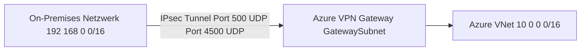
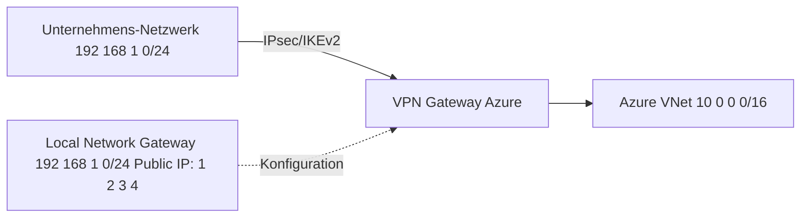
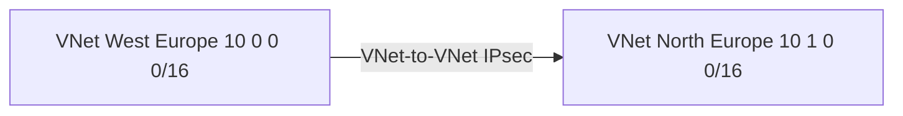
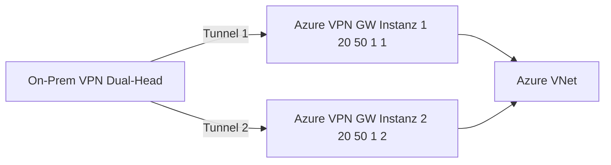
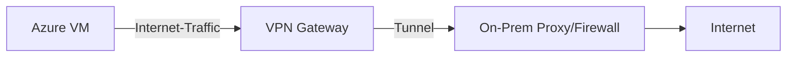
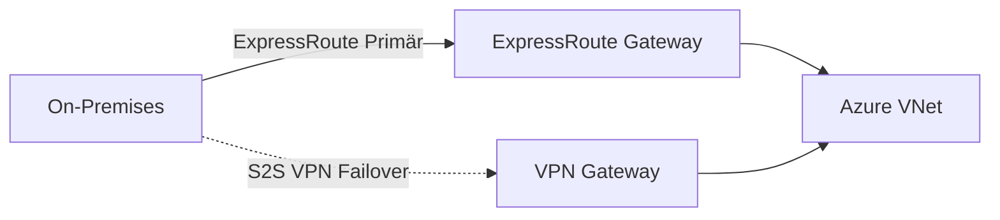

---
tags:
  - azure
  - netzwerk
  - vpn-gateway
  - site-to-site
  - point-to-site
  - ipsec
  - hybrid
  - on-premises
aliases:
  - Azure VPN
  - S2S VPN Azure
  - P2S VPN
  - VPN Gateway Azure
  - Azure Site-to-Site VPN
---

# Azure VPN Gateway

> [!ABSTRACT] TL;DR
> Azure VPN Gateway verbindet Azure VNets mit On-Premises-Netzwerken (Site-to-Site) oder einzelnen Client-Geräten (Point-to-Site) über IPsec/IKE-verschlüsselte Tunnel. Für höheren Durchsatz und garantierte Latenz ist ExpressRoute besser geeignet — VPN Gateway ist die kostengünstigere Hybridlösung.

---

## Was ist Azure VPN Gateway?

Ein VPN Gateway ist eine verwaltete Azure-Ressource die verschlüsselte IPsec/IKE-Tunnel terminiert:



**Anwendungsfälle:**
- **Site-to-Site (S2S)** — On-Prem Netzwerk zu Azure VNet
- **Point-to-Site (P2S)** — Einzelne Clients (Laptops) zu Azure VNet
- **VNet-to-VNet** — Zwei Azure VNets in verschiedenen Regionen verbinden

---

## Via Azure Portal (UI)

### VPN Gateway erstellen

1. [Azure-Portal](https://portal.azure.com) → Suchleiste → **VPN-Gateways** → **+ Erstellen**
2. **Grundlagen:**
   - **Abonnement**, **Ressourcengruppe**, **Name** und **Region** wählen
   - **Gatewaytyp:** VPN
   - **VPN-Typ:** Routenbasiert (empfohlen) oder Richtlinienbasiert
   - **SKU** wählen (z. B. VpnGw2, VpnGw2AZ für Zone-Redundanz)
   - **Generation:** Generation2
   - **Virtuelles Netzwerk** wählen (muss `GatewaySubnet` /27 oder größer enthalten)
   - **Öffentliche IP-Adresse** erstellen (bei AZ-SKU: Zone-redundante IP)
3. **Tags** → **Überprüfen + erstellen** → **Erstellen**

> [!WARNING] Deployment-Dauer
> Das Erstellen eines VPN-Gateways dauert **30–45 Minuten**. Währenddessen keine Änderungen am GatewaySubnet vornehmen.

### Site-to-Site-Verbindung einrichten

1. **Lokale Netzwerkgateways** → **+ Erstellen** → IP des On-Prem-VPN-Geräts und On-Prem-Adressraum eingeben
2. VPN Gateway → **Verbindungen** → **+ Hinzufügen**
3. **Typ:** Site-to-Site (IPsec) → **Lokales Netzwerkgateway** wählen → **Gemeinsam verwendeter Schlüssel (PSK)** eingeben → **OK**

### Point-to-Site (P2S) konfigurieren

1. VPN Gateway → **Point-to-Site-Konfiguration** → **Jetzt konfigurieren**
2. **Adresspool** für VPN-Clients (z. B. `172.16.0.0/24`), **Tunneltyp** (OpenVPN/IKEv2) und **Authentifizierungstyp** wählen
3. Zertifikat hochladen (Root-Zertifikat) → **Speichern** → VPN-Clientpaket herunterladen

---

## Gateway-SKUs und Durchsatz

| SKU | Max. Throughput | S2S Tunnel | P2S Verbindungen | BGP | Anmerkung |
|-----|----------------|-----------|------------------|-----|-----------|
| **VpnGw1** | 650 Mbps | 30 | 250 | ✅ | Produktions-Einstieg |
| **VpnGw2** | 1 Gbps | 30 | 500 | ✅ | |
| **VpnGw3** | 1,25 Gbps | 30 | 1000 | ✅ | |
| **VpnGw4** | 5 Gbps | 100 | 5000 | ✅ | |
| **VpnGw5** | 10 Gbps | 100 | 10000 | ✅ | |
| **VpnGw1AZ** | 650 Mbps | 30 | 250 | ✅ | Zone-redundant |
| **VpnGw2AZ** | 1 Gbps | 30 | 500 | ✅ | Zone-redundant |
| **Basic** | 100 Mbps | 10 | 128 | ❌ | **Veraltet, nicht für Produktion** |

> [!NOTE] Zone-redundante SKUs
> SKUs mit `AZ` suffix (VpnGw1AZ, VpnGw2AZ, etc.) sind zone-redundant und deploymen über Availability Zones. Empfohlen für kritische Produktion.

---

## Site-to-Site VPN (S2S)



### Komponenten einer S2S-Verbindung

1. **VPN Gateway** — Gateway-Ressource im GatewaySubnet
2. **Local Network Gateway** — Repräsentation des On-Prem-Geräts (IP + Adressräume)
3. **Connection** — Verknüpft beide und konfiguriert den Tunnel

```powershell
# 1. VPN Gateway erstellen (dauert 30-45 Minuten!)
$gwPIP = New-AzPublicIpAddress `
  -Name "pip-vpngw-prod" `
  -ResourceGroupName "rg-hub" `
  -Location "westeurope" `
  -Sku Standard `
  -AllocationMethod Static `
  -Zone 1, 2, 3

$gwIPConfig = New-AzVirtualNetworkGatewayIpConfig `
  -Name "gwipconfig" `
  -SubnetId $gwSubnet.Id `
  -PublicIpAddressId $gwPIP.Id

$vpnGateway = New-AzVirtualNetworkGateway `
  -Name "vpngw-hub-prod" `
  -ResourceGroupName "rg-hub" `
  -Location "westeurope" `
  -IpConfigurations $gwIPConfig `
  -GatewayType Vpn `
  -VpnType RouteBased `
  -GatewaySku VpnGw2AZ `
  -EnableBgp $false

# 2. Local Network Gateway (On-Prem beschreiben)
$localGW = New-AzLocalNetworkGateway `
  -Name "lgw-onprem" `
  -ResourceGroupName "rg-hub" `
  -Location "westeurope" `
  -GatewayIpAddress "1.2.3.4" ` # Öffentliche IP des On-Prem VPN-Geräts
  -AddressPrefix @("192.168.0.0/24", "192.168.1.0/24") # On-Prem Adressräume

# 3. VPN Connection erstellen
New-AzVirtualNetworkGatewayConnection `
  -Name "conn-onprem" `
  -ResourceGroupName "rg-hub" `
  -Location "westeurope" `
  -VirtualNetworkGateway1 $vpnGateway `
  -LocalNetworkGateway2 $localGW `
  -ConnectionType IPsec `
  -SharedKey "VerySecurePreSharedKey123!" `
  -EnableBgp $false
```

### Unterstützte On-Prem-Geräte

Azure-zertifizierte VPN-Geräte (Auswahl):
- Cisco ASA, IOS, ISR
- Palo Alto Networks
- Fortinet FortiGate
- Juniper SRX, J-Series
- Check Point
- SonicWall
- Ubiquiti UniFi

---

## Point-to-Site VPN (P2S)

Einzelne Clients verbinden sich zu Azure:


### Verbindungsprotokolle

| Protokoll | Port | OS-Support | Authentifizierung |
|-----------|------|-----------|-----------------|
| **OpenVPN** | TCP 443 | Windows, Mac, Linux, iOS, Android | Azure AD / Zertifikat / RADIUS |
| **SSTP** | TCP 443 | Windows only | Zertifikat |
| **IKEv2** | UDP 500/4500 | Windows, Mac, iOS | Zertifikat |

### P2S mit Entra ID (Azure AD) Authentifizierung

```powershell
# P2S Konfiguration mit Azure AD Auth
$tenantId = "your-tenant-id"
$vpnGateway = Get-AzVirtualNetworkGateway -Name "vpngw-hub-prod" -ResourceGroupName "rg-hub"

Set-AzVirtualNetworkGateway `
  -VirtualNetworkGateway $vpnGateway `
  -VpnClientProtocol OpenVPN `
  -VpnClientAddressPool "172.16.0.0/24" `
  -AadTenantUri "https://login.microsoftonline.com/$tenantId" `
  -AadAudienceId "41b23e61-6c1e-4545-b367-cd054e0ed4b4" ` # Azure VPN App-ID
  -AadIssuerUri "https://sts.windows.net/$tenantId/"

# VPN-Client-Konfiguration herunterladen
$vpnClientUrl = Get-AzVpnClientConfiguration `
  -ResourceGroupName "rg-hub" `
  -Name "vpngw-hub-prod"
```

---

## VNet-to-VNet Verbindungen

VNets in verschiedenen Regionen oder Subscriptions verbinden:



> [!TIP] VNet Peering vs. VNet-to-VNet
> **VNet Peering** ist schneller, kostengünstiger und hat niedrigere Latenz (kein Gateway-Hop). **VNet-to-VNet** ist sinnvoll wenn die VNets in verschiedenen Subscriptions/Tenants sind und kein Peering möglich ist, oder wenn Verschlüsselung zwischen VNets explizit gefordert wird.

---

## BGP-Konfiguration

BGP (Border Gateway Protocol) ermöglicht dynamisches Routing:

```powershell
# VPN Gateway mit BGP erstellen
New-AzVirtualNetworkGateway `
  -Name "vpngw-bgp-prod" `
  -GatewaySku VpnGw2AZ `
  -EnableBgp $true `
  -BgpPeeringAddress "10.0.0.254" `
  -Asn 65001 # Azure-seitige ASN (nicht 65515, 65534-65535 verwenden)

# Local Network Gateway mit BGP
New-AzLocalNetworkGateway `
  -Name "lgw-onprem-bgp" `
  -GatewayIpAddress "1.2.3.4" `
  -BgpPeeringAddress "192.168.255.254" `
  -Asn 65002 # On-Prem ASN
```

**BGP-Vorteile:**
- Automatisches Route-Learning (keine manuelle Pflege der Local Network Gateway Adressräume)
- Failover und Load Balancing über mehrere VPN-Verbindungen
- Transitrouting möglich

---

## Active-Active Konfiguration

Zwei aktive VPN-Gateways für höhere Verfügbarkeit:



```powershell
# Active-Active VPN Gateway (erfordert zwei Public IPs)
$gwPIP1 = New-AzPublicIpAddress -Name "pip-vpngw-1" ...
$gwPIP2 = New-AzPublicIpAddress -Name "pip-vpngw-2" ...

$gwIPConfig1 = New-AzVirtualNetworkGatewayIpConfig -Name "gwipconfig1" -PublicIpAddressId $gwPIP1.Id -SubnetId $gwSubnet.Id
$gwIPConfig2 = New-AzVirtualNetworkGatewayIpConfig -Name "gwipconfig2" -PublicIpAddressId $gwPIP2.Id -SubnetId $gwSubnet.Id

New-AzVirtualNetworkGateway `
  -IpConfigurations @($gwIPConfig1, $gwIPConfig2) `
  -EnableActiveActiveFeature `
  -Asn 65001 # BGP wird bei Active-Active empfohlen
```

---

## Forced Tunneling

Gesamten Internet-Traffic aus Azure über On-Prem routen (Compliance, Proxy):



```powershell
# UDR: Standard-Route zum VPN Gateway
$route = New-AzRouteConfig `
  -Name "force-tunnel" `
  -AddressPrefix "0.0.0.0/0" `
  -NextHopType VirtualNetworkGateway
```

---

## Custom IKE Policy

```powershell
# Eigene IKE-Richtlinie (z.B. für strenge Compliance)
$ikePolicy = New-AzIpsecPolicy `
  -IkeEncryption AES256 `
  -IkeIntegrity SHA256 `
  -DhGroup DHGroup14 `
  -IpsecEncryption AES256 `
  -IpsecIntegrity SHA256 `
  -PfsGroup PFS2048 `
  -SALifeTimeSeconds 27000 `
  -SADataSizeKilobytes 10240000

New-AzVirtualNetworkGatewayConnection `
  -IpsecPolicies $ikePolicy
```

---

## VPN + ExpressRoute Coexistence



Beide Gateways im gleichen GatewaySubnet möglich — bei ER-Ausfall übernimmt VPN automatisch (wenn BGP konfiguriert).

---

## Diagnose und Troubleshooting

```powershell
# VPN Gateway Troubleshooting starten
$storageContext = New-AzStorageContext -StorageAccountName "stadiagstor" -StorageAccountKey "key..."
$container = Get-AzStorageContainer -Name "vpnlogs" -Context $storageContext

Start-AzVirtualNetworkGatewayTroubleshoot `
  -ResourceGroupName "rg-hub" `
  -Name "vpngw-hub-prod" `
  -StorageAccountId $storageAccount.Id `
  -StorageAccountSasKey $sasToken `
  -ResultBlobName "vpn-diagnostics.txt"
```

### Häufige Fehler

| Fehler | Ursache | Lösung |
|--------|---------|--------|
| **IKE Phase 1 failed** | Shared Key falsch oder IKE-Policy-Mismatch | PSK auf beiden Seiten vergleichen, IKE-Policy angleichen |
| **Tunnel connected, kein Traffic** | Routing-Problem oder NSG | Route Table und NSG auf GatewaySubnet prüfen |
| **P2S Verbindung failed** | Zertifikat ungültig | Root-CA-Zertifikat neu hochladen |
| **BGP Peer down** | BGP-ASN falsch oder IP nicht erreichbar | BGP-Konfiguration auf beiden Seiten vergleichen |

---

## Kosten

| Komponente | Preis (ca.) |
|-----------|------------|
| **VpnGw1** (nicht-AZ) | ~$0,19/Stunde (~$140/Monat) |
| **VpnGw2** | ~$0,38/Stunde (~$280/Monat) |
| **VpnGw1AZ** | ~$0,284/Stunde (~$210/Monat) |
| **S2S Verbindung** | ~$0,05/Stunde (~$36/Monat) |
| **P2S Verbindung** | $0,01/Verbindung/Stunde |
| **Ausgehende Daten** | ~$0,087/GB (ab 10 GB/Monat) |

> [!TIP] Kostenoptimierung
> VPN Gateway läuft 24/7 — keine Stop-Möglichkeit. Bei Dev/Test-Umgebungen ggf. nächtliche Automatisierung zum Löschen und Neuerstellen erwägen (aber 30-45 Min. Deployment beachten).

---

## Verwandte Notizen

- [[Azure Virtual Network]]
- [[Azure ExpressRoute]]
- [[Azure Virtual WAN]]
- [[Azure Bastion]]
