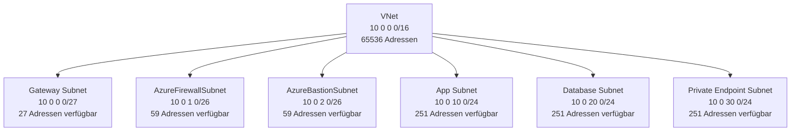
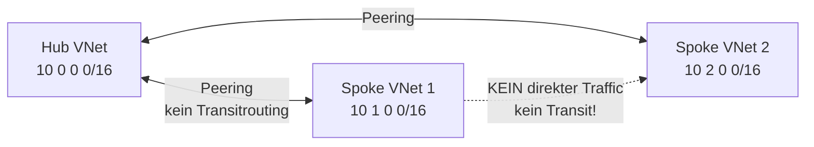
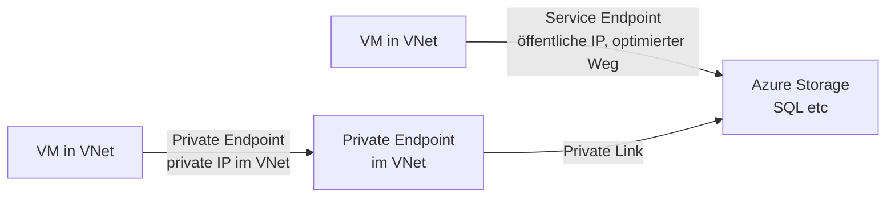
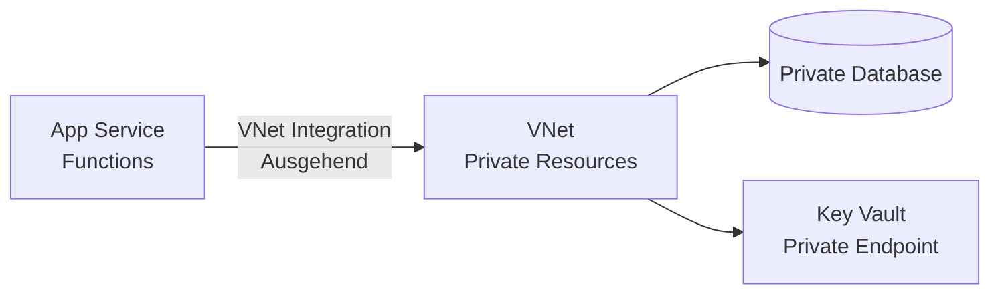
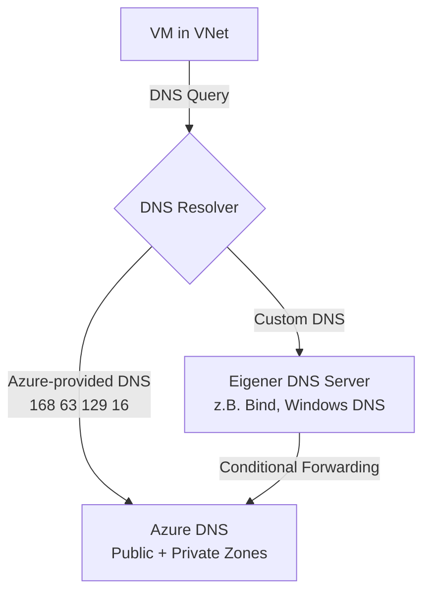
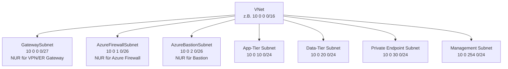

---
tags:
  - azure
  - netzwerk
  - vnet
  - virtual-network
  - subnets
  - peering
  - networking
aliases:
  - VNet
  - Virtual Network Azure
  - Azure VNet
  - Azure Netzwerk
---

# Azure Virtual Network

> [!ABSTRACT] TL;DR
> Azure Virtual Network (VNet) ist das fundamentale Netzwerk-Bausteinstein in Azure — ein privater, logisch isolierter Netzwerkraum in der Azure-Cloud. Alle Azure-Ressourcen (VMs, App Services, AKS, etc.) werden in VNets deployed und kommunizieren über VNet-Routing miteinander. VNet Peering verbindet VNets, Private Endpoints bringen Azure-PaaS-Dienste ins VNet.

---

## Was ist ein Azure Virtual Network?

Ein **Virtual Network (VNet)** ist ein logisch isoliertes Netzwerk in Azure:
- Vollständige Kontrolle über IP-Adressen, DNS, Routing und Sicherheit
- Layer-3 Netzwerk (kein Layer-2 Broadcast/Multicast)
- Ressourcen im VNet können miteinander kommunizieren (standardmäßig)
- Isolation von anderen VNets und dem Internet (kein Zugriff ohne explizite Konfiguration)
- Kostenfrei (VNet selbst kostet nichts — nur Traffic und spezielle Features kosten)

---

## Adressräume und Subnets planen

### IP-Adressraum

VNets verwenden **RFC 1918 private Adressbereiche** (empfohlen):

| Bereich | CIDR | Verfügbare Hosts |
|---------|------|-----------------|
| `10.0.0.0/8` | Groß | ~16 Mio |
| `172.16.0.0/12` | Mittel | ~1 Mio |
| `192.168.0.0/16` | Klein | ~65.000 |

**Planung ist entscheidend:**
- Überlappende Adressräume verhindern VNet Peering
- Überlappungen mit On-Prem-Netzwerk verhindern VPN/ExpressRoute
- Zu kleine Adressräume sind später schwer erweiterbar (neues VNet + Peering)



### Reservierte IP-Adressen pro Subnet

Azure reserviert in **jedem Subnet** 5 IP-Adressen:

| Adresse | Zweck |
|---------|-------|
| Erste (z.B. .0) | Netzwerk-Adresse |
| Zweite (.1) | Standard-Gateway (Azure Router) |
| Dritte (.2) | DNS Mapping (Azure DNS) |
| Vierte (.3) | DNS Mapping (Azure DNS) |
| Letzte (.255 bei /24) | Broadcast-Adresse |

> [!IMPORTANT] Subnet-Größe
> Ein `/29`-Subnet hat 8 IPs, davon 5 reserviert = **3 nutzbare IPs**. Für GatewaySubnet mindestens `/27` nehmen.

---

## VNet Peering

VNet Peering verbindet zwei VNets direkt über Microsofts Backbone (kein Gateway, kein verschlüsselter Tunnel):



| Merkmal | Regional Peering | Global Peering |
|---------|-----------------|----------------|
| **Regionen** | Gleiche Region | Verschiedene Regionen |
| **Latenz** | Sehr niedrig | Etwas höher |
| **Kosten** | Günstiger | Teurer (Egress-Traffic) |
| **Verschlüsselung** | Nein (Backbone) | Nein (Backbone) |

**Kein Transitrouting** — Spoke 1 kann nicht über Hub zu Spoke 2:

```powershell
# VNet Peering erstellen
Add-AzVirtualNetworkPeering `
  -Name "hub-to-spoke1" `
  -VirtualNetwork $hubVNet `
  -RemoteVirtualNetworkId $spoke1VNet.Id `
  -AllowForwardedTraffic `
  -AllowGatewayTransit # Hub stellt Gateway für Spokes bereit

Add-AzVirtualNetworkPeering `
  -Name "spoke1-to-hub" `
  -VirtualNetwork $spoke1VNet `
  -RemoteVirtualNetworkId $hubVNet.Id `
  -AllowForwardedTraffic `
  -UseRemoteGateways # Spoke nutzt Gateway des Hubs
```

---

## Service Endpoints vs. Private Endpoints

Ein häufiger Vergleich — zwei verschiedene Ansätze für sicheren PaaS-Zugriff:



| Merkmal | Service Endpoint | Private Endpoint |
|---------|-----------------|-----------------|
| **IP-Adresse** | Öffentliche IP des Azure-Dienstes | **Private IP im VNet** |
| **Erreichbarkeit** | Nur aus erlaubten VNets | Aus VNet, on-prem (via ER/VPN), Peered VNets |
| **DNS** | Öffentlicher DNS-Name | Private DNS Zone (privatelink.*) |
| **NSG-Support** | Eingeschränkt | Vollständig (nach Policy-Aktivierung) |
| **Kosten** | Kostenlos | Pro Endpoint + Datengebühren |
| **On-Prem-Zugriff** | Nein | Ja (via ExpressRoute/VPN) |
| **Empfehlung** | Legacy, einfache Fälle | **Neue Deployments, Produktion** |

---

## VNet Integration für App Services / Functions

App Services und Azure Functions können **ausgehenden Traffic** über ein VNet routen:



- **Regional VNet Integration**: App Service im gleichen VNet (kein Gateway nötig)
- **Gateway-required VNet Integration**: Legacy, für App Services in anderen Regionen

```bash
# VNet Integration für App Service aktivieren
az webapp vnet-integration add \
  --resource-group rg-prod \
  --name app-myapp \
  --vnet vnet-prod \
  --subnet snet-app-integration
```

---

## Delegated Subnets

Einige Azure-Dienste benötigen ein **dediziertes Subnet** mit Delegation:

| Dienst | Delegation | Minimale Subnet-Größe |
|--------|-----------|----------------------|
| Azure SQL Managed Instance | `Microsoft.Sql/managedInstances` | /27 |
| Azure Container Apps | `Microsoft.App/environments` | /27 |
| Azure Databricks (Host) | `Microsoft.Databricks/workspaces` | /26 |
| Azure Kubernetes Service | `Microsoft.ContainerService/managedClusters` | Variabel |
| Azure NetApp Files | `Microsoft.NetApp/volumes` | /28 |

```bicep
resource delegatedSubnet 'Microsoft.Network/virtualNetworks/subnets@2023-09-01' = {
  parent: virtualNetwork
  name: 'snet-sql-mi'
  properties: {
    addressPrefix: '10.0.50.0/27'
    delegations: [
      {
        name: 'sql-mi-delegation'
        properties: {
          serviceName: 'Microsoft.Sql/managedInstances'
        }
      }
    ]
  }
}
```

---

## DNS in VNets



| Option | Beschreibung | Anwendungsfall |
|--------|-------------|---------------|
| **Azure-provided DNS** (168.63.129.16) | Automatisch, löst Private DNS Zones + Public DNS auf | Einfache Szenarien |
| **Custom DNS Server** | Eigener DNS im VNet | Conditional Forwarding zu On-Prem, Split-horizon |
| **Azure DNS Private Resolver** | Managed DNS für Hybrid-Szenarien | Empfohlen für Hybrid ohne eigene DNS-VMs |

```powershell
# Custom DNS Server für VNet setzen
$vnet = Get-AzVirtualNetwork -Name "vnet-prod" -ResourceGroupName "rg-prod"
$vnet.DhcpOptions.DnsServers = @("10.0.0.10", "10.0.0.11") # Eigene DNS-Server-IPs
Set-AzVirtualNetwork -VirtualNetwork $vnet
```

---

## VNet-Diagnose

### Effective Routes (Routing-Tabelle einer NIC)

```bash
# Effective Routes einer VM-NIC anzeigen
az network nic show-effective-route-table \
  --resource-group rg-prod \
  --name nic-vm-app01 \
  --output table
```

### Effective NSGs (aktive NSG-Regeln auf einer NIC)

```bash
# Effective NSG-Regeln anzeigen
az network nic list-effective-nsg \
  --resource-group rg-prod \
  --name nic-vm-app01 \
  --output table
```

---

## VNet Flow Logs

VNet Flow Logs (neu, ersetzt NSG Flow Logs auf VNet-Ebene):

```powershell
# VNet Flow Log aktivieren
New-AzNetworkWatcherFlowLog `
  -Name "flowlog-vnet-prod" `
  -NetworkWatcherName "NetworkWatcher_westeurope" `
  -ResourceGroupName "NetworkWatcherRG" `
  -TargetResourceId $vnet.Id `
  -StorageAccountId $storageAccount.Id `
  -Enabled $true `
  -FormatVersion 2
```

---

## VNet Encryption

Azure ermöglicht **Verschlüsselung des VM-zu-VM-Traffics** innerhalb eines VNets (und über Peering):

```powershell
# VNet Encryption aktivieren (erfordert unterstützte VM-SKUs)
$vnet.Encryption = @{
  Enabled = $true
  Enforcement = "AllowUnencrypted" # Oder "DropUnencrypted"
}
Set-AzVirtualNetwork -VirtualNetwork $vnet
```

> [!NOTE] VNet Encryption
> VNet Encryption nutzt hardwarebasierte Verschlüsselung auf unterstützten VM-SKUs. Nicht alle VM-Größen unterstützen dies. `AllowUnencrypted` erlaubt unverschlüsselte VMs im VNet, `DropUnencrypted` blockiert Traffic von nicht-unterstützten VMs.

---

## Subnet Design Best Practices



| Subnet | Namens-Konvention | Minimale Größe |
|--------|-------------------|---------------|
| VPN/ER Gateway | `GatewaySubnet` (exakt!) | /27 |
| Azure Firewall | `AzureFirewallSubnet` (exakt!) | /26 |
| Azure Firewall Management | `AzureFirewallManagementSubnet` | /26 |
| Azure Bastion | `AzureBastionSubnet` (exakt!) | /26 |
| Application | `snet-app-prod` | /24 |
| Database | `snet-data-prod` | /24 |
| Private Endpoints | `snet-pe-prod` | /24 |

> [!TIP] Naming Conventions
> Azure erfordert exakte Namen für GatewaySubnet, AzureFirewallSubnet und AzureBastionSubnet. Diese können nicht umbenannt werden.

---

## IPv6 Dual Stack

Azure VNets unterstützen **IPv4/IPv6 Dual Stack**:

```powershell
# VNet mit IPv6 Dual Stack
$ipv6Prefix = New-AzVirtualNetworkSubnetConfig `
  -Name "snet-app" `
  -AddressPrefix @("10.0.10.0/24", "ace:cab:deca:deed::/64")

$vnet = New-AzVirtualNetwork `
  -Name "vnet-dualstack" `
  -ResourceGroupName "rg-prod" `
  -Location "westeurope" `
  -AddressPrefix @("10.0.0.0/16", "ace:cab:deca::/48") `
  -Subnet $ipv6Prefix
```

---

## Verwandte Notizen

- [[Azure RBAC]]
- [[Network Security Groups]]
- [[Azure Firewall]]
- [[Azure Private Link]]
- [[Azure DNS]]
- [[Azure VPN Gateway]]
- [[Azure ExpressRoute]]
