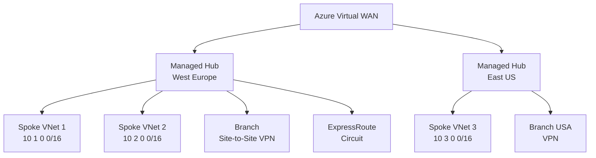
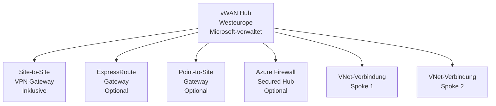
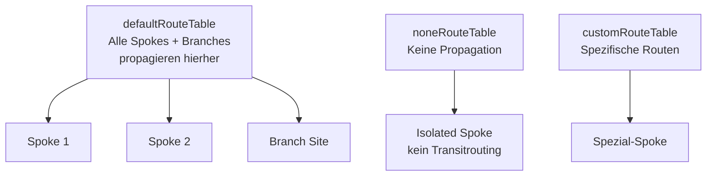
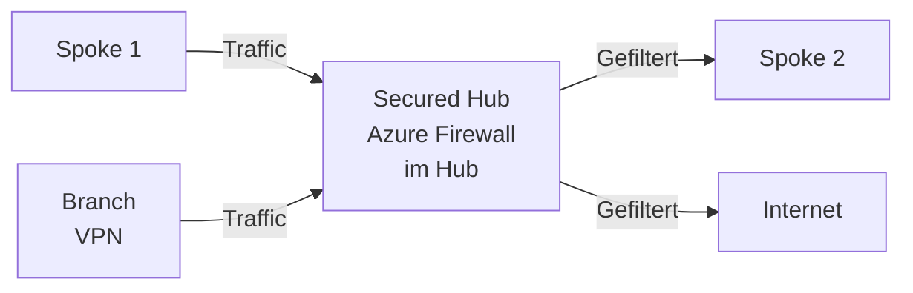
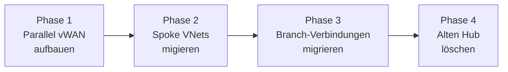

---
tags:
  - azure
  - netzwerk
  - virtual-wan
  - vwan
  - hub-spoke
  - wan
  - branch-konnektivität
  - sd-wan
aliases:
  - vWAN
  - Virtual WAN Azure
  - Azure WAN
  - Azure vWAN
  - Secured Virtual Hub
---

# Azure Virtual WAN

> [!ABSTRACT] TL;DR
> Azure Virtual WAN (vWAN) ist ein Microsoft-verwalteter Netzwerk-Hub-Dienst der Branch-Konnektivität, VNet-Verbindungen, ExpressRoute und VPN in einer einzigen, optimierten Plattform vereint. vWAN vereinfacht Hub-and-Spoke-Architekturen erheblich: Microsoft verwaltet die Hub-Router, automatisches Transitrouting ist inklusive — und Azure Firewall kann direkt in den Hub integriert werden (Secured Virtual Hub).

---

## Was ist Azure Virtual WAN?

Azure Virtual WAN ist ein **verwalteter Netzwerkdienst** der ein globales Wide Area Network auf Basis von Microsofts Backbone aufbaut:



**Kernunterschiede zu klassischem Hub-and-Spoke:**
- Microsoft verwaltet den Hub-Router (kein eigenes NVA oder UDR-Management für Transitrouting)
- Automatisches Transitrouting (Spoke1 → Hub → Spoke2 ohne manuelle UDRs)
- Integrierte VPN-, ExpressRoute- und P2S-Gateways im Hub

---

## SKUs

| Feature | Basic | Standard |
|---------|-------|----------|
| **Site-to-Site VPN** | ✅ | ✅ |
| **Point-to-Site VPN** | ❌ | ✅ |
| **ExpressRoute** | ❌ | ✅ |
| **VNet-to-VNet via Hub** | ❌ | ✅ |
| **Transitrouting** | ❌ | ✅ |
| **Azure Firewall (Secured Hub)** | ❌ | ✅ |
| **Custom Route Tables** | ❌ | ✅ |
| **Anwendungsfall** | Nur einfaches S2S VPN | Vollständiges Enterprise-WAN |

> [!TIP] Empfehlung
> Für neue Deployments immer **Standard** wählen. Basic ist sehr eingeschränkt und eine spätere Migration zu Standard ist möglich.

---

## Hub-Architektur

Ein **vWAN Hub** ist ein von Microsoft verwaltetes virtuelles Netzwerk (~mind. /24 Adressraum):



```powershell
# Virtual WAN erstellen
$vwan = New-AzVirtualWan `
  -Name "vwan-prod" `
  -ResourceGroupName "rg-connectivity" `
  -Location "westeurope" `
  -VirtualWANType Standard

# Hub erstellen
$hub = New-AzVirtualHub `
  -VirtualWan $vwan `
  -ResourceGroupName "rg-connectivity" `
  -Name "hub-westeurope" `
  -AddressPrefix "10.100.0.0/24" ` # Hub-Adressraum
  -Location "westeurope" `
  -HubRoutingPreference ExpressRoute # Bevorzugte Route wenn mehrere Optionen
```

---

## VNet-Verbindungen zum Hub

Spoke VNets werden über **Verbindungen** an den Hub angebunden (kein Peering-Management nötig):

```powershell
# VNet mit Hub verbinden
New-AzVirtualHubVnetConnection `
  -ResourceGroupName "rg-connectivity" `
  -VirtualHubName "hub-westeurope" `
  -Name "conn-spoke1" `
  -RemoteVirtualNetwork $spoke1VNet `
  -EnableInternetSecurity $true ` # Internet-Traffic durch Firewall
  -RoutingConfiguration @{
    AssociatedRouteTable = @{Id = "$hubId/hubRouteTables/defaultRouteTable"}
    PropagatedRouteTables = @{
      Labels = @("default")
      Ids = @(@{Id = "$hubId/hubRouteTables/defaultRouteTable"})
    }
  }
```

---

## Site-to-Site VPN in vWAN

Branch-Verbindungen werden als **VPN Sites** konfiguriert:

```powershell
# VPN Site (Branch) erstellen
$vpnSite = New-AzVpnSite `
  -Name "site-branch-berlin" `
  -ResourceGroupName "rg-connectivity" `
  -Location "westeurope" `
  -VirtualWan $vwan `
  -AddressSpace @("192.168.1.0/24") ` # Branch-Adressraum
  -IpAddress "1.2.3.4" ` # Öffentliche IP des Branch-VPN-Geräts
  -BgpProperty @{
    Asn = 65002
    BgpPeeringAddress = "169.254.21.2"
    PeerWeight = 0
  }

# Verbindung zu Hub-Gateway
New-AzVpnConnection `
  -ResourceGroupName "rg-connectivity" `
  -ParentResourceName "hub-westeurope-vpngw" `
  -Name "conn-site-berlin" `
  -VpnSite $vpnSite `
  -VpnSiteLinkConnections @(
    @{
      Name = "link1"
      VpnSiteLink = $vpnSite.VpnSiteLinks[0]
      ConnectionBandwidth = 200
      VpnConnectionProtocolType = "IKEv2"
      SharedKey = "SecurePreSharedKey123!"
      EnableBgp = $true
    }
  )
```

---

## Routing in vWAN

vWAN verwendet **Route Tables** für Traffic-Steuerung:



### Custom Route Tables (Mikrosegmentierung)

```powershell
# Custom Route Table erstellen
$customRT = New-AzVHubRouteTable `
  -ResourceGroupName "rg-connectivity" `
  -VirtualHubName "hub-westeurope" `
  -Name "rt-production" `
  -Label "production"

# Spoke mit Custom Route Table assoziieren
# Association: Spoke empfängt Routen aus diesem Route Table
# Propagation: Spoke propagiert seine Routen in diesen Route Table
```

**Routing-Konzepte:**
| Konzept | Beschreibung |
|---------|-------------|
| **Association** | Route Table aus dem Spoke seine Routen lernt (Empfang) |
| **Propagation** | Route Tables in die Spoke seine Routen propagiert (Senden) |
| **Static Routes** | Manuelle Routen im Hub (z.B. 0.0.0.0/0 → Azure Firewall) |

---

## Secured Virtual Hub

Azure Firewall direkt im vWAN Hub integrieren:



```powershell
# Azure Firewall Policy für Secured Hub
$fwPolicy = New-AzFirewallPolicy `
  -Name "fwpolicy-vwan-hub" `
  -ResourceGroupName "rg-connectivity" `
  -Location "westeurope" `
  -SkuTier Standard

# Secured Hub erstellen (Hub + Firewall)
New-AzVirtualHub `
  -Name "hub-secured-westeurope" `
  -AzureFirewall (New-AzFirewall `
    -Name "fw-vwan-hub" `
    -FirewallPolicyId $fwPolicy.Id `
    -SkuName AZFW_Hub) `
  -Location "westeurope"
```

**Traffic-Lenkung:**
- **Internet Traffic**: Spoke → Hub → Firewall → Internet
- **Private Traffic**: Spoke → Hub → Firewall → anderer Spoke/Branch

---

## vWAN vs. klassisches Hub-and-Spoke

| Merkmal | vWAN | Klassisches Hub-and-Spoke |
|---------|------|--------------------------|
| **Hub-Router** | Microsoft-verwaltet | Selbst (NVA oder Azure Route Server) |
| **Transitrouting** | Automatisch | Manuelle UDRs oder NVA |
| **S2S VPN Setup** | Einfach (VPN Sites) | VPN Gateway + LNG + Connection |
| **Skalierung Branches** | Einfach, Standardisiert | Komplex bei vielen Branches |
| **Multi-Hub** | Nativ (globales vWAN) | Manuell via Peering |
| **SD-WAN Integration** | Direkt (Partner-Lösung) | Manuell über NVA |
| **Kosten** | Hub-Gebühren + Verbindungen | Gateway + NVA-VM-Kosten |
| **Flexibilität Routing** | Eingeschränkter (Route Tables) | Vollständig (manuelle UDRs) |
| **Anwendungsfall** | Viele Branches, SD-WAN | Wenige Verbindungen, volle Kontrolle |

---

## Branch-Konnektivität (SD-WAN)

vWAN ist in SD-WAN-Lösungen von Partnern integrierbar:

| Partner | Lösung |
|---------|--------|
| **Cisco** | Meraki, Catalyst SD-WAN (Viptela) |
| **VMware** | SD-WAN (VeloCloud) |
| **Barracuda** | CloudGen WAN |
| **Fortinet** | FortiGate SD-WAN |
| **Versa Networks** | FlexVNF |
| **Open Systems** | SD-WAN |

**Vorteile der SD-WAN-Integration:**
- Automatisches Provisioning von Branch-VPN-Sites
- Intelligentes Traffic-Routing (Best-Path-Selektion)
- Zentrale Verwaltung über SD-WAN-Orchestrator

---

## Monitoring (vWAN Insights)

```bash
# vWAN Insights aktivieren (im Azure Portal)
# Monitor → Insights → Virtual WAN

# Via CLI: Route-Informationen anzeigen
az network vhub get-effective-routes \
  --resource-group rg-connectivity \
  --name hub-westeurope \
  --resource-type VirtualNetwork \
  --resource-id /subscriptions/{id}/resourceGroups/rg-spokes/providers/Microsoft.Network/virtualNetworks/vnet-spoke1
```

### vWAN-Metriken in Azure Monitor

| Metrik | Beschreibung |
|--------|-------------|
| **VirtualHubDataProcessed** | Verarbeitetes Traffic-Volumen |
| **BgpPeerStatus** | BGP-Peer-Status (0=down, 1=up) |
| **ExpressRouteGatewayCountOfRoutesAdvertised** | Anzahl advertiser Routen |
| **VpnGatewayTunnelEgressBytes** | Ausgehende VPN-Tunnel-Bytes |

---

## Kosten

| Komponente | Preis (ca.) |
|-----------|------------|
| **Hub-Gebühr** | ~$0,25/Stunde (~$185/Monat) |
| **VPN Connection-Einheit** | ~$0,10/Stunde pro Scale-Unit |
| **P2S Gateway Scale-Unit** | ~$0,145/Stunde pro Scale-Unit |
| **ExpressRoute Gateway** | ~$0,37/Stunde (ErGw1) |
| **VNet-Verbindung** | ~$0,05/Stunde pro Verbindung |
| **Verarbeitete Daten** | ~$0,02/GB |

---

## Migration von Hub-and-Spoke zu vWAN

**Migrationsphasen:**



1. **Neues vWAN + Hub** in derselben Region erstellen
2. **Test-Spoke** an vWAN anbinden und testen
3. **Produktions-Spokes** schrittweise migrieren (alte Peerings löschen, neue VNet-Verbindungen erstellen)
4. **VPN-Verbindungen** vom alten VPN Gateway zu vWAN VPN Gateway migrieren
5. **ExpressRoute** vom alten ER Gateway zum vWAN Hub ER Gateway migrieren
6. **Alten Hub löschen**

---

## Verwandte Notizen

- [[Azure Virtual Network]]
- [[Azure Firewall]]
- [[Azure VPN Gateway]]
- [[Azure ExpressRoute]]
