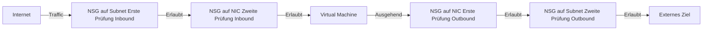
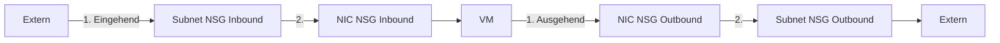
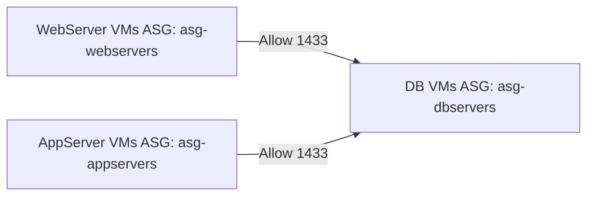
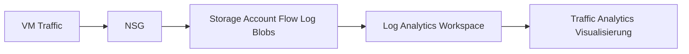
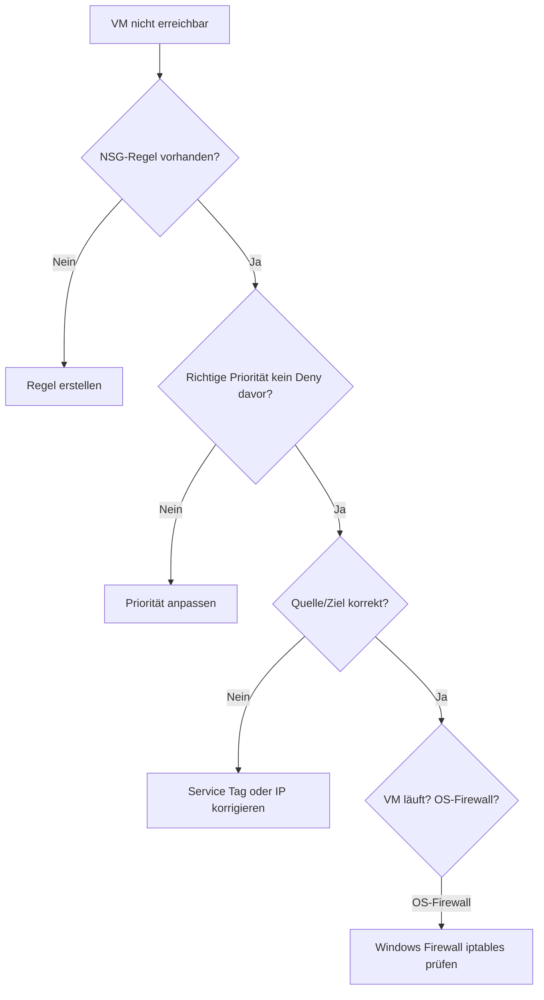

---
tags:
  - azure
  - netzwerk
  - nsg
  - security-groups
  - firewall
  - netzwerksicherheit
  - network-security
aliases:
  - NSG
  - Network Security Group
  - Azure Netzwerksicherheitsgruppe
  - Azure NSG
---

# Network Security Groups

> [!ABSTRACT] TL;DR
> Network Security Groups (NSGs) sind die grundlegenden Netzwerk-Zugriffssteuerungslisten in Azure — vergleichbar mit einer statusbehafteten Firewall auf Layer 4. NSGs filtern TCP/UDP/ICMP-Traffic auf Subnet- und NIC-Ebene anhand von Prioritätsregeln. Für komplexere Szenarien (FQDN-Filterung, Layer 7) wird Azure Firewall benötigt.

---

## Was sind Network Security Groups?

Eine **NSG** ist eine Sammlung von Sicherheitsregeln, die eingehenden und ausgehenden Netzwerktraffic filtern:

- **Stateful** — Rückgabe-Traffic wird automatisch erlaubt (keine explizite Outbound-Regel für erlaubten Inbound nötig)
- **Layer 4** — Filterung nach IP, Port und Protokoll (kein FQDN, kein HTTP-Header)
- **Kostenlos** — NSGs selbst kosten nichts, nur Flow Logs verursachen Kosten
- **Zuordnung** — NSG kann einem Subnet oder einer NIC (Netzwerkkarte) zugeordnet werden



---

## Regelstruktur

Jede NSG-Regel besteht aus:

| Feld | Beschreibung | Beispiel |
|------|-------------|---------|
| **Priorität** | 100–4096 (niedrigere Zahl = höhere Priorität) | 300 |
| **Name** | Beschreibender Name | `Allow-HTTPS-Inbound` |
| **Protokoll** | TCP, UDP, ICMP, * (alle) | TCP |
| **Quell-Port** | Port oder Range (* = alle) | * |
| **Ziel-Port** | Port oder Range | 443 |
| **Quelle** | IP, CIDR, Service Tag, ASG | `Internet` |
| **Ziel** | IP, CIDR, Service Tag, ASG | `VirtualNetwork` |
| **Aktion** | Allow oder Deny | Allow |

```powershell
# NSG erstellen
$nsg = New-AzNetworkSecurityGroup `
  -Name "nsg-webapp-prod" `
  -ResourceGroupName "rg-prod" `
  -Location "westeurope"

# Regel hinzufügen: HTTPS erlauben
$nsg | Add-AzNetworkSecurityRuleConfig `
  -Name "Allow-HTTPS-Inbound" `
  -Priority 300 `
  -Direction Inbound `
  -Access Allow `
  -Protocol Tcp `
  -SourceAddressPrefix Internet `
  -SourcePortRange * `
  -DestinationAddressPrefix * `
  -DestinationPortRange 443

# Regel hinzufügen: HTTP mit Redirect (allow 80 for redirect)
$nsg | Add-AzNetworkSecurityRuleConfig `
  -Name "Allow-HTTP-Inbound" `
  -Priority 310 `
  -Direction Inbound `
  -Access Allow `
  -Protocol Tcp `
  -SourceAddressPrefix Internet `
  -SourcePortRange * `
  -DestinationAddressPrefix * `
  -DestinationPortRange 80

$nsg | Set-AzNetworkSecurityGroup
```

---

## Default-Regeln

Jede NSG enthält unveränderliche **Default-Regeln** (Priorität 65000+):

### Inbound Default-Regeln

| Priorität | Name | Quelle | Ziel | Protokoll | Aktion |
|-----------|------|--------|------|-----------|--------|
| 65000 | `AllowVnetInBound` | VirtualNetwork | VirtualNetwork | * | Allow |
| 65001 | `AllowAzureLoadBalancerInBound` | AzureLoadBalancer | * | * | Allow |
| 65500 | `DenyAllInBound` | * | * | * | **Deny** |

### Outbound Default-Regeln

| Priorität | Name | Quelle | Ziel | Protokoll | Aktion |
|-----------|------|--------|------|-----------|--------|
| 65000 | `AllowVnetOutBound` | VirtualNetwork | VirtualNetwork | * | Allow |
| 65001 | `AllowInternetOutBound` | * | Internet | * | Allow |
| 65500 | `DenyAllOutBound` | * | * | * | **Deny** |

> [!NOTE] DenyAllOutBound
> Obwohl `DenyAllOutBound` bei Priorität 65500 existiert, erlaubt `AllowInternetOutBound` bei 65001 standardmäßig allen ausgehenden Internet-Traffic. Für restriktivere Kontrolle: eigene Deny-Regeln mit niedrigerer Priorität hinzufügen.

---

## NSG auf Subnet vs. NIC

Die **Verarbeitungsreihenfolge** unterscheidet sich je nach Richtung:



**Best Practice:** NSG auf **Subnet-Ebene** zuweisen (nicht auf NIC-Ebene), außer wenn unterschiedliche Regeln für einzelne VMs im gleichen Subnet benötigt werden.

| Ansatz | Vorteil | Nachteil |
|--------|---------|---------|
| NSG auf Subnet | Zentrale Verwaltung, alle VMs im Subnet | Keine VM-spezifische Kontrolle |
| NSG auf NIC | Individuelle VM-Kontrolle | Viele NSGs zu verwalten |
| Beides | Maximale Flexibilität | Komplexer, schwerer zu debuggen |

---

## Application Security Groups (ASGs)

ASGs ermöglichen **logische Gruppierung** von VMs ohne IP-Adressen in Regeln:



```powershell
# ASGs erstellen
$asgWeb = New-AzApplicationSecurityGroup -Name "asg-webservers" -ResourceGroupName "rg-prod" -Location "westeurope"
$asgDb = New-AzApplicationSecurityGroup -Name "asg-dbservers" -ResourceGroupName "rg-prod" -Location "westeurope"

# NSG-Regel: WebServer dürfen SQL-Server auf Port 1433 ansprechen
$nsg | Add-AzNetworkSecurityRuleConfig `
  -Name "Allow-WebToDb-SQL" `
  -Priority 200 `
  -Direction Inbound `
  -Access Allow `
  -Protocol Tcp `
  -SourceApplicationSecurityGroupId $asgWeb.Id `
  -SourcePortRange * `
  -DestinationApplicationSecurityGroupId $asgDb.Id `
  -DestinationPortRange 1433

# VM-NIC zur ASG hinzufügen
$nic = Get-AzNetworkInterface -Name "nic-webserver01" -ResourceGroupName "rg-prod"
$nic.IpConfigurations[0].ApplicationSecurityGroups = @($asgWeb)
Set-AzNetworkInterface -NetworkInterface $nic
```

**Vorteile von ASGs:**
- Keine IP-Adressen in Regeln — Regeln bleiben gültig wenn IPs sich ändern
- Logische Gruppierung entspricht der Anwendungsarchitektur
- VMs können mehreren ASGs angehören

---

## NSG Flow Logs

NSG Flow Logs zeichnen **alle Netzwerkverbindungen** auf die durch die NSG fließen:



**Flow Log v2 Format** (JSON pro Flow):
```json
{
  "time": "2024-01-15T10:30:00Z",
  "systemId": "...",
  "properties": {
    "Version": 2,
    "flows": [
      {
        "rule": "DefaultRule_AllowInternetOutBound",
        "flows": [
          {
            "mac": "000D3A123456",
            "flowTuples": [
              "1705311000,10.0.0.4,52.230.1.2,54321,443,T,O,A,B,,,"
            ]
          }
        ]
      }
    ]
  }
}
```

```powershell
# NSG Flow Logs aktivieren (v2)
Set-AzNetworkWatcherFlowLog `
  -NetworkWatcherName "NetworkWatcher_westeurope" `
  -ResourceGroupName "NetworkWatcherRG" `
  -Name "flowlog-nsg-webapp" `
  -TargetResourceId $nsg.Id `
  -StorageAccountId $storageAccount.Id `
  -Enabled $true `
  -FormatVersion 2 `
  -RetentionPolicyEnabled $true `
  -RetentionPolicyDays 30
```

### Traffic Analytics Abfragen (KQL)

```kusto
// Blockierte Verbindungen der letzten Stunde
AzureNetworkAnalytics_CL
| where TimeGenerated > ago(1h)
| where FlowStatus_s == "D" // D = Denied
| summarize count() by SrcIP_s, DestPort_d, NSGRule_s
| order by count_ desc
| take 20

// Top-Quellen für eingehenden Traffic
AzureNetworkAnalytics_CL
| where FlowDirection_s == "I"
| summarize BytesReceived = sum(BytesSentToNode_d) by SrcIP_s
| order by BytesReceived desc
```

---

## Effective Security Rules

Zeigt welche NSG-Regeln **tatsächlich** für eine VM-NIC gelten (Kombination aus Subnet-NSG und NIC-NSG):

```bash
# Effective Security Rules über CLI
az network nic list-effective-nsg \
  --resource-group rg-prod \
  --name nic-vm-app01 \
  --output table
```

Im Portal: VM → Networking → Effective security rules

---

## Typische NSG-Regeln

### Webserver-Subnet

```powershell
# HTTP und HTTPS erlauben, alles andere blockieren
$rules = @(
  @{Name="Allow-HTTP"; Priority=100; Port=80; Source="Internet"},
  @{Name="Allow-HTTPS"; Priority=110; Port=443; Source="Internet"},
  @{Name="Allow-RDP-Bastion"; Priority=200; Port=3389; Source="AzureBastionSubnet-IP"},
  @{Name="Deny-All"; Priority=4096; Port="*"; Source="*"; Action="Deny"}
)
```

### Datenbank-Subnet

```powershell
# Nur App-Tier auf SQL-Port erlauben
@{Name="Allow-SQL-from-App"; Priority=100; Port=1433; Source="10.0.10.0/24"}, # App-Subnet
@{Name="Deny-All-Inbound"; Priority=4096; Port="*"; Source="*"; Action="Deny"}
```

### Wichtige Service Tags

| Service Tag | Beschreibung |
|-------------|-------------|
| `Internet` | Alle öffentlichen IPs |
| `VirtualNetwork` | Alle Adressen im VNet + Peerings |
| `AzureLoadBalancer` | Azure Load Balancer Health Probes |
| `AzureCloud` | Alle Azure-Datacenter IPs |
| `Storage` | Azure Storage Service |
| `Sql` | Azure SQL Datenbanken |
| `AzureActiveDirectory` | Azure AD Endpoints |
| `AzureMonitor` | Azure Monitor / Log Analytics |
| `GatewayManager` | Azure VPN/ER Gateway Management |

---

## NSG vs. Azure Firewall

| Merkmal | NSG | Azure Firewall |
|---------|-----|----------------|
| **Layer** | Layer 4 (TCP/UDP/ICMP) | Layer 4–7 |
| **FQDN-Filterung** | ❌ | ✅ (Application Rules) |
| **URL-Filterung** | ❌ | ✅ (Premium) |
| **TLS-Inspektion** | ❌ | ✅ (Premium) |
| **Threat Intelligence** | ❌ | ✅ |
| **IDPS** | ❌ | ✅ (Premium) |
| **Zentralisierung** | Pro Subnet/NIC | Zentral für alle VNets |
| **Kosten** | Kostenlos | ~$1,25/Stunde + Traffic |
| **Anwendungsfall** | Basis-Segmentierung | Erweiterte Sicherheit, Hub-Firewall |

> [!TIP] NSG + Azure Firewall zusammen
> Best Practice für Hub-and-Spoke: NSGs auf Subnets für Mikrosegmentierung + Azure Firewall im Hub für zentrale Egress-Kontrolle und FQDN-Filterung. Beide Ebenen zusammen.

---

## Fehlerbehebung

### VM nicht erreichbar — Checkliste



**IP Flow Verify** (schnellste Diagnose):
```bash
# Prüfen: Kommt Traffic von 1.2.3.4 auf Port 443 zur VM durch?
az network watcher test-ip-flow \
  --resource-group rg-prod \
  --vm vm-webapp01 \
  --direction Inbound \
  --protocol TCP \
  --local 10.0.10.4:443 \
  --remote 1.2.3.4:12345 \
  --output table
# → Zeigt: Allow/Deny und welche Regel getroffen hat
```

---

## Verwandte Notizen

- [[Azure Virtual Network]]
- [[Azure Firewall]]
- [[Azure Network Watcher]]
- [[Azure Bastion]]
