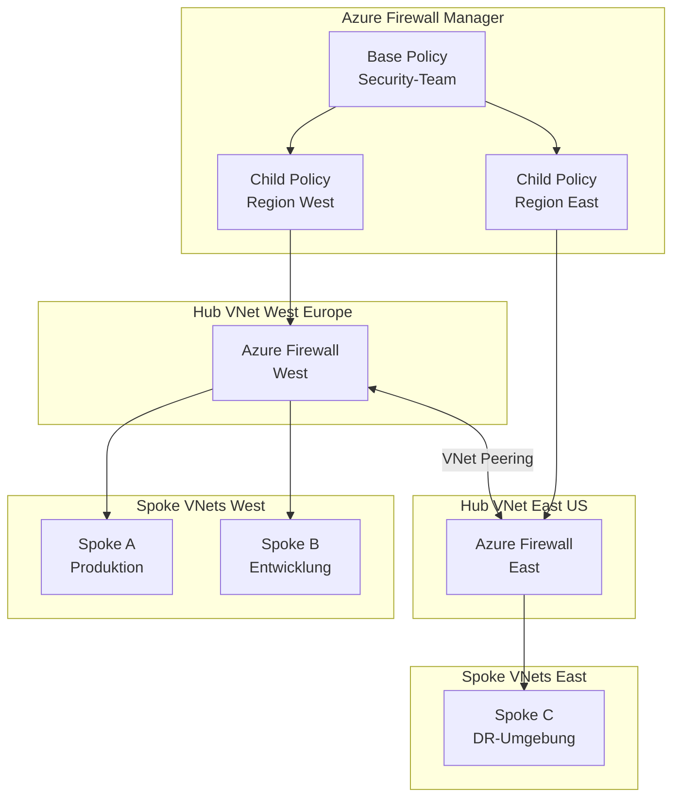
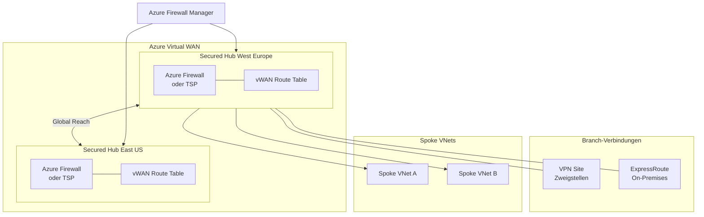
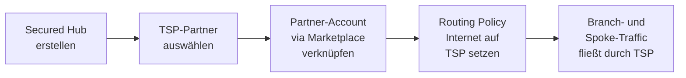

---
tags:
  - azure
  - sicherheit
  - firewall
  - netzwerk
  - policy
  - vwan
  - hub-and-spoke
aliases:
  - Firewall Manager
  - AFM
  - Azure Firewall Manager
---

# Azure Firewall Manager

> [!ABSTRACT] TL;DR
> Azure Firewall Manager ist der zentrale Verwaltungsdienst für Azure Firewall Policies und Netzwerksicherheit über mehrere Regionen und Subscriptions hinweg. Er ermöglicht Policy-Vererbung (Base → Child), die Integration von Drittanbieter-Sicherheitslösungen (Trusted Security Partners) in Virtual WAN Hubs und die einheitliche Verwaltung von IP Groups, DDoS-Plänen und Routing-Policies — alles über eine einzige Oberfläche.

---

## Was ist Azure Firewall Manager?

Azure Firewall Manager ist ein zentraler Sicherheitsverwaltungsdienst, der globale und regionale Sicherheitsrichtlinien für cloudbasierte Perimeter bereitstellt. Er wurde entwickelt, um die Herausforderung der skalierbaren Firewall-Verwaltung in großen, verteilten Azure-Umgebungen zu lösen.

Ohne Firewall Manager musste jede Azure Firewall einzeln konfiguriert werden — Regeländerungen mussten manuell auf alle Instanzen übertragen werden, was fehleranfällig und zeitaufwändig ist. Firewall Manager führt das Konzept der **Firewall Policy** als eigenständige Azure-Ressource ein, die unabhängig von einer konkreten Firewall-Instanz existiert und mehreren Firewalls gleichzeitig zugewiesen werden kann.

> [!NOTE] Abgrenzung zu Azure Firewall
> Azure Firewall Manager verwaltet Firewalls — er **ist** selbst keine Firewall. Die eigentliche Traffic-Filterung übernimmt weiterhin Azure Firewall (oder ein Trusted Security Partner). Firewall Manager ist die Steuerungsebene (*Control Plane*), Azure Firewall die Datenebene (*Data Plane*).

**Kernfunktionen im Überblick:**

- Zentrales Management von Azure Firewall Policies für mehrere Firewalls und Regionen
- Policy-Hierarchie mit Vererbung (Base Policy → Child Policies)
- Integration von Trusted Security Partners (Zscaler, Check Point, iboss) in vWAN
- Verwaltung von IP Groups als wiederverwendbare Adressobjekte
- DDoS Protection Plan-Verwaltung und -Zuordnung
- Routing-Steuerung für Secured Virtual Hubs

---

## Firewall Manager vs. direktes Azure Firewall Management

| Feature | Firewall Manager | Direkte Firewall-Verwaltung |
|---|---|---|
| **Zentrale Regeländerungen** | ✅ Eine Policy, n Firewalls | ❌ Jede Firewall einzeln |
| **Policy-Vererbung** | ✅ Base → Child möglich | ❌ Nicht verfügbar |
| **Multi-Region-Überblick** | ✅ Einzelne Ansicht | ❌ Pro Firewall navigieren |
| **Trusted Security Partner** | ✅ Integriert (vWAN) | ❌ Nicht unterstützt |
| **IP Groups-Verwaltung** | ✅ Zentralisiert | ⚠️ Nur pro Firewall |
| **DDoS Plan-Zuordnung** | ✅ Über Manager | ❌ Manuell pro VNet |
| **Policy-as-Code (Bicep/ARM)** | ✅ Policy als eigenständige Ressource | ⚠️ Eingeschränkt |
| **RBAC auf Policy-Ebene** | ✅ Fein granular | ❌ Nur auf Firewall-Ebene |
| **Eigene Kosten** | ⚠️ Aufpreis pro Policy + Firewall | Keine zusätzlichen Kosten |
| **Empfohlen ab** | ≥ 3 Firewalls oder Multi-Region | < 3 Firewalls, einfache Setups |

---

## Firewall Policy-Hierarchie und Vererbung

### Konzept

Eine **Firewall Policy** ist eine Azure-Ressource (Typ: `Microsoft.Network/firewallPolicies`), die Regelsammlungen, Threat Intelligence-Einstellungen, DNS-Proxy-Konfiguration und IDPS-Einstellungen enthält. Policies können in einer **Eltern-Kind-Hierarchie** angeordnet werden:

```
Base Policy (Zentral, Security-Team)
├── Child Policy Region A (lokales Team A)
│   ├── Firewall Hub-A-West
│   └── Firewall Hub-A-East
└── Child Policy Region B (lokales Team B)
    └── Firewall Hub-B
```

### Was wird vererbt, was kann überschrieben werden?

> [!IMPORTANT] Vererbungsregeln im Detail
> Die Vererbung in Azure Firewall Manager funktioniert **additiv**, nicht substitutiv. Child Policies erben alle Regeln der Base Policy — sie können diese **nicht überschreiben oder deaktivieren**.

| Aspekt | Vererbungsverhalten |
|---|---|
| **DNAT-Regeln** | Werden von Base zu Child vererbt, Child kann eigene hinzufügen |
| **Netzwerkregeln** | Vererbt; Child-Regeln werden **nach** Base-Regeln ausgewertet |
| **Anwendungsregeln** | Vererbt; Child-Regeln ergänzen Base-Regeln |
| **Threat Intelligence** | Child kann strengere Modi wählen (Alert → Deny), nicht lockerer |
| **DNS-Proxy-Einstellungen** | Vollständig vererbt, kein Override möglich |
| **IDPS-Einstellungen** | Vererbt; Child kann eigene Signaturen überschreiben |
| **TLS-Inspektion** | Vererbt vom Parent |
| **Regelpriorität** | Base-Regeln haben immer höhere Priorität als Child-Regeln |

> [!WARNING] Sicherheits-Implikation der Vererbung
> Da Base-Policy-Regeln nicht deaktiviert werden können, muss die Base Policy sorgfältig gestaltet sein. Ein versehentliches `Allow Any Any` in der Base Policy kann nicht durch eine Child Policy blockiert werden. Die Base Policy sollte ausschließlich vom zentralen Security-Team verwaltet werden.

### Policy-Regelpriorität

Innerhalb einer Policy werden Regelsammlungen nach ihrer **Prioritätsnummer** (100–65000, niedrigere Zahl = höhere Priorität) ausgewertet. Regelsammlungsgruppen fügen eine weitere Hierarchieebene hinzu:

```
Regelsammlungsgruppe (Priorität 100)
├── Regelsammlung Typ DNAT (Priorität 200)
│   └── Regel 1: DNAT SSH → 10.0.1.4:22
└── Regelsammlung Typ Netzwerk (Priorität 300)
    ├── Regel 1: Allow TCP 443 Any → Internet
    └── Regel 2: Deny Any Any

Regelsammlungsgruppe (Priorität 500)
└── Regelsammlung Typ Anwendung (Priorität 600)
    └── Regel 1: Allow FQDN *.microsoft.com
```

---

## Hub-and-Spoke Topologie

### Architektur-Überblick



> [!TIP] UDR-Routing im Hub-and-Spoke
> Damit der gesamte Spoke-Traffic durch die Hub-Firewall geleitet wird, müssen in jedem Spoke-VNet **User Defined Routes (UDR)** konfiguriert werden, die die private IP der Azure Firewall als Next Hop für `0.0.0.0/0` setzen. Firewall Manager kann dies für Secured Virtual Hubs automatisch übernehmen — bei klassischem Hub-and-Spoke muss dies manuell oder per Automation erfolgen.

---

## Secured Virtual Hub (vWAN-Integration)

### Konzept

Ein **Secured Virtual Hub** ist ein Azure Virtual WAN Hub, in den Azure Firewall (und optional ein Trusted Security Partner) direkt integriert ist. Im Gegensatz zum klassischen Hub-and-Spoke (wo der Hub ein normales VNet ist) übernimmt Firewall Manager beim Secured Hub auch das **Routing automatisch** — keine manuellen UDRs erforderlich.



### Traffic-Routing im Secured Hub

Firewall Manager steuert drei Traffic-Kategorien im Secured Hub:

| Traffic-Typ | Beschreibung | Routing-Ziel |
|---|---|---|
| **Internet Traffic** | Ausgehend zu Public Internet | Azure Firewall oder Trusted Security Partner |
| **Private Traffic** | Zwischen Spokes / Branch zu Spoke | Azure Firewall |
| **Branch-to-Branch** | VPN-Site zu VPN-Site | Azure Firewall (optional) |

---

## Trusted Security Partners

### Was sind Trusted Security Partners?

Trusted Security Partners (TSP) sind Drittanbieter-Sicherheitslösungen, die direkt in Azure Virtual WAN Secured Hubs integriert werden können. Aktuell unterstützte Partner:

| Partner | Kategorie | Einsatzschwerpunkt |
|---|---|---|
| **Zscaler Internet Access** | Cloud-native Security | Zero Trust Internet Access, SSL-Inspektion |
| **Check Point CloudGuard** | Next-Gen Firewall | Advanced Threat Prevention, IPS |
| **iboss** | Cloud Security Platform | Web Filtering, DLP im Internet-Pfad |

> [!NOTE] TSP vs. Azure Firewall
> Trusted Security Partners filtern ausschließlich den **Internet-Traffic** (Branch → Internet und Spoke → Internet). Für **privaten Traffic** (Spoke ↔ Spoke, On-Premises ↔ Spoke) wird weiterhin Azure Firewall benötigt. In einem Secured Hub können beide parallel betrieben werden.

### TSP-Aktivierungsablauf



---

## IP Groups

IP Groups sind Azure-Ressourcen (Typ: `Microsoft.Network/ipGroups`), die eine benannte Sammlung von IP-Adressen, CIDR-Bereichen und IP-Bereichen darstellen. Sie können in Firewall-Regeln (sowohl in Policies als auch direkt in Azure Firewall) als Quelle oder Ziel referenziert werden.

**Vorteile:**
- Zentrale Pflege von Adressobjekten — Änderung an einer Stelle, wirkt in allen Regeln
- Bessere Lesbarkeit der Firewall-Regeln (`Gruppe-Backend-Server` statt `10.1.2.0/24, 10.1.3.0/24`)
- Unterstützung für bis zu 5.000 IP-Adressen pro Gruppe
- Bis zu 50 IP Groups pro Azure Firewall Policy

### IP Group per PowerShell erstellen und Policy zuordnen

```powershell
# Variablen
$ResourceGroup = "rg-security-prod"
$Location      = "westeurope"

# IP Group erstellen
$IpGroup = New-AzIpGroup `
    -ResourceGroupName $ResourceGroup `
    -Location $Location `
    -Name "ipg-backend-servers" `
    -IpAddress @("10.1.2.0/24", "10.1.3.4", "10.1.3.5")

Write-Output "IP Group erstellt: $($IpGroup.Id)"

# Bestehende Firewall Policy abrufen
$Policy = Get-AzFirewallPolicy `
    -ResourceGroupName $ResourceGroup `
    -Name "afwp-base-policy"

# Netzwerkregel mit IP Group als Quelle definieren
$Rule = New-AzFirewallPolicyNetworkRule `
    -Name "allow-backend-https" `
    -SourceIpGroup $IpGroup.Id `
    -DestinationAddress "0.0.0.0/0" `
    -DestinationPort "443" `
    -Protocol "TCP"

# Regelsammlung erstellen
$RuleCollection = New-AzFirewallPolicyFilterRuleCollection `
    -Name "rc-backend-allow" `
    -Priority 300 `
    -Rule $Rule `
    -ActionType "Allow"

# Regelsammlungsgruppe in der Policy erstellen
$RuleCollectionGroup = New-AzFirewallPolicyRuleCollectionGroup `
    -FirewallPolicyObject $Policy `
    -Name "rcg-backend" `
    -Priority 300 `
    -RuleCollection $RuleCollection

Write-Output "Regelsammlungsgruppe zugeordnet: $($RuleCollectionGroup.Name)"
```

---

## Policy-as-Code mit Bicep

### Firewall Policy mit Regelsammlung

```bicep
@description('Azure-Region für alle Ressourcen')
param location string = resourceGroup().location

@description('Name der Base Firewall Policy')
param basePolicyName string = 'afwp-base-policy'

@description('Name der Child Firewall Policy')
param childPolicyName string = 'afwp-child-westeurope'

// ── Base Policy ────────────────────────────────────────────────────────────────
resource basePolicy 'Microsoft.Network/firewallPolicies@2023-09-01' = {
  name: basePolicyName
  location: location
  properties: {
    sku: {
      tier: 'Premium'
    }
    threatIntelMode: 'Deny'
    dnsSettings: {
      enableProxy: true
    }
  }
}

// ── Regelsammlungsgruppe in der Base Policy ────────────────────────────────────
resource baseRuleCollectionGroup 'Microsoft.Network/firewallPolicies/ruleCollectionGroups@2023-09-01' = {
  parent: basePolicy
  name: 'rcg-global-deny'
  properties: {
    priority: 100
    ruleCollections: [
      {
        ruleCollectionType: 'FirewallPolicyFilterRuleCollection'
        name: 'rc-block-malicious'
        priority: 100
        action: {
          type: 'Deny'
        }
        rules: [
          {
            ruleType: 'ApplicationRule'
            name: 'block-known-bad-domains'
            protocols: [
              { protocolType: 'Http',  port: 80  }
              { protocolType: 'Https', port: 443 }
            ]
            targetFqdns: [
              'malware-domain-example.invalid'
            ]
            sourceAddresses: [ '*' ]
          }
        ]
      }
    ]
  }
}

// ── Child Policy (erbt von Base) ───────────────────────────────────────────────
resource childPolicy 'Microsoft.Network/firewallPolicies@2023-09-01' = {
  name: childPolicyName
  location: location
  properties: {
    sku: {
      tier: 'Premium'
    }
    basePolicy: {
      id: basePolicy.id
    }
  }
}

// ── Regelsammlungsgruppe in der Child Policy ───────────────────────────────────
resource childRuleCollectionGroup 'Microsoft.Network/firewallPolicies/ruleCollectionGroups@2023-09-01' = {
  parent: childPolicy
  name: 'rcg-regional-rules'
  dependsOn: [ baseRuleCollectionGroup ]
  properties: {
    priority: 500
    ruleCollections: [
      {
        ruleCollectionType: 'FirewallPolicyFilterRuleCollection'
        name: 'rc-allow-internal'
        priority: 100
        action: {
          type: 'Allow'
        }
        rules: [
          {
            ruleType: 'NetworkRule'
            name: 'allow-spoke-to-spoke'
            ipProtocols: [ 'TCP', 'UDP' ]
            sourceAddresses:      [ '10.1.0.0/16' ]
            destinationAddresses: [ '10.2.0.0/16' ]
            destinationPorts:     [ '*' ]
          }
        ]
      }
    ]
  }
}

// ── Outputs ────────────────────────────────────────────────────────────────────
output basePolicyId  string = basePolicy.id
output childPolicyId string = childPolicy.id
```

> [!TIP] Bicep-Deployment in der CI/CD-Pipeline
> Das Template kann mit `az deployment group create --template-file firewall-policy.bicep --resource-group rg-security-prod` deployed werden. In GitHub Actions oder Azure DevOps lässt sich so eine vollständige Policy-as-Code-Strategie umsetzen — Regeländerungen werden als Pull Request eingereicht, geprüft und automatisch deployed.

---

## DDoS Protection Plan-Verwaltung

Azure Firewall Manager ermöglicht es, einen **DDoS Network Protection Plan** zentral zu verwalten und mehreren VNets in verschiedenen Subscriptions zuzuordnen — ohne dass für jedes VNet eine separate Zuordnung im Netzwerk-Bereich vorgenommen werden muss.

> [!IMPORTANT] DDoS-Lizenzierung
> Ein DDoS Network Protection Plan kostet ca. 2.944 €/Monat (Stand 2024) und deckt bis zu 100 öffentliche IP-Adressen ab. Firewall Manager reduziert den Verwaltungsaufwand, ändert aber nichts an den Lizenzkosten. Jede weitere Public IP über 100 hinaus wird separat berechnet.

```powershell
# DDoS Protection Plan erstellen
$DdosPlan = New-AzDdosProtectionPlan `
    -ResourceGroupName "rg-security-prod" `
    -Location "westeurope" `
    -Name "ddos-plan-prod"

# VNet mit DDoS Plan verknüpfen (auch über Firewall Manager UI möglich)
$VNet = Get-AzVirtualNetwork `
    -ResourceGroupName "rg-network-prod" `
    -Name "vnet-hub-westeurope"

$VNet.DdosProtectionPlan = New-Object `
    Microsoft.Azure.Commands.Network.Models.PSResourceId
$VNet.DdosProtectionPlan.Id = $DdosPlan.Id
$VNet.EnableDdosProtection   = $true

Set-AzVirtualNetwork -VirtualNetwork $VNet
Write-Output "DDoS Protection aktiviert für: $($VNet.Name)"
```

---

## Monitoring und Diagnose

### Azure Monitor Integration

Azure Firewall Manager selbst erzeugt Aktivitätslogs (Azure Activity Log). Die eigentlichen Firewall-Logs werden von der Azure Firewall-Instanz generiert und über **Diagnostic Settings** an Log Analytics, Storage Accounts oder Event Hubs weitergeleitet.

**Empfohlene Log Analytics-Tabellen:**

| Tabelle | Inhalt |
|---|---|
| `AZFWNetworkRule` | Netzwerkregelauswertungen (strukturiertes Log) |
| `AZFWApplicationRule` | Anwendungsregelauswertungen |
| `AZFWNatRule` | DNAT-Regelauswertungen |
| `AZFWThreatIntel` | Threat Intelligence-Treffer |
| `AZFWIdpsSignature` | IDPS-Signatur-Treffer (nur Premium) |
| `AZFWDnsQuery` | DNS-Proxy-Anfragen |
| `AzureDiagnostics` | Legacy-Logs (ältere Firewall-Versionen) |

### KQL-Abfragen für Firewall Monitoring

```kusto
// Top 10 gesperrte Ziele (Netzwerkregeln)
AZFWNetworkRule
| where Action == "Deny"
| summarize BlockCount = count() by DestinationIp, DestinationPort, Protocol
| top 10 by BlockCount desc
| project DestinationIp, DestinationPort, Protocol, BlockCount

// Threat Intelligence Treffer der letzten 24 Stunden
AZFWThreatIntel
| where TimeGenerated > ago(24h)
| project TimeGenerated, SourceIp, DestinationIp, DestinationPort, ThreatDescription, Action
| order by TimeGenerated desc

// Anwendungsregel-Traffic nach FQDN (Top 20)
AZFWApplicationRule
| where Action == "Allow"
| summarize RequestCount = count() by Fqdn
| top 20 by RequestCount desc

// IDPS-Signaturtreffer nach Schweregrad
AZFWIdpsSignature
| summarize HitCount = count() by SignatureId, Description, Severity, Action
| order by HitCount desc

// Firewall-Durchsatz (Bytes pro Minute) der letzten Stunde
AzureMetrics
| where ResourceProvider == "MICROSOFT.NETWORK"
| where MetricName == "DataProcessed"
| where TimeGenerated > ago(1h)
| summarize AvgBytes = avg(Total) by bin(TimeGenerated, 1m), Resource
| render timechart
```

> [!TIP] Vorgefertigte Workbooks nutzen
> Im Azure Portal unter **Azure Firewall Manager → Azure Monitor Workbooks** sind vorgefertigte Dashboards für Traffic-Analyse, Top-Quellen/-Ziele und Threat Intelligence verfügbar. Diese können als Ausgangspunkt für eigene Dashboards genutzt und direkt in das Team-Dashboard eingebettet werden.

---

## Einsatzszenarien

### Szenario 1: Unternehmensweites Hub-and-Spoke

**Anforderung:** 5 Regionen, 3 Geschäftsbereiche (BU), zentrales Security-Team will globale Block-Regeln durchsetzen, BU-Teams brauchen eigene Allow-Regeln.

**Lösung:**
- 1 Base Policy (Security-Team) mit globalen Deny-Regeln und Threat Intelligence = Deny
- 3 Child Policies (je BU) mit BU-spezifischen Allow-Regeln
- 5 Azure Firewalls in Hub-VNets, je mit der regionalen Child Policy verknüpft
- RBAC: Security-Team hat Contributor auf Base Policy, BU-Teams nur auf eigene Child Policy

### Szenario 2: vWAN mit Hybrid-Sicherheit

**Anforderung:** Zweigstellen über VPN angebunden, Internet-Traffic soll über Zscaler gefiltert werden, interner Traffic über Azure Firewall.

**Lösung:**
- Secured Virtual Hub mit Azure Firewall + Zscaler als TSP
- Routing Policy: Internet → Zscaler, Private → Azure Firewall
- Firewall Manager steuert beide Pfade zentral ohne manuelle UDR-Konfiguration

### Szenario 3: Migration von klassischen NSG-only-Setups

**Anforderung:** Bestehende Umgebung nutzt nur NSGs, FQDN-Filterung und zentrales Logging fehlen.

> [!WARNING] Migrations-Reihenfolge beachten
> Bei der Migration von bestehenden Firewall-Rules zu Firewall Manager Policies sollte die Reihenfolge sein:
> - **Schritt 1:** Firewall Policy erstellen und mit bestehender Firewall verknüpfen (ohne Regeln)
> - **Schritt 2:** Regeln schrittweise in die Policy migrieren und parallel testen
> - **Schritt 3:** Klassische Firewall-Rules erst nach vollständiger Validierung deaktivieren
>
> Niemals alle Regeln gleichzeitig migrieren — das Risiko von Produktionsausfällen ist zu hoch.

---

## Troubleshooting

### Häufige Probleme und Lösungen

> [!WARNING] Policy-Änderungen werden nicht übernommen
> **Ursache:** Firewall-Policy-Updates propagieren asynchron. Bei großen Regelmengen kann die Propagation bis zu 10 Minuten dauern.
> **Lösung:** Provisionierungsstatus der Policy prüfen — erst nach `Succeeded` ist die Policy aktiv.

```powershell
# Policy-Provisionierungsstatus prüfen
Get-AzFirewallPolicy `
    -Name "afwp-base-policy" `
    -ResourceGroupName "rg-security-prod" `
    | Select-Object Name, ProvisioningState, ThreatIntelMode
```

> [!WARNING] Traffic wird unerwartet blockiert trotz Allow-Regel
> **Ursache A:** Eine höher-priorisierte Deny-Regel in der Base Policy greift zuerst.
> **Lösung A:** KQL-Abfrage auf `AZFWNetworkRule` mit `Action == "Deny"` für Quelle/Ziel — die `PolicyName`-Spalte zeigt, welche Policy die Blockierung ausgelöst hat.
> **Ursache B:** Threat Intelligence blockiert die IP/Domain.
> **Lösung B:** `AZFWThreatIntel` auf die betroffene IP prüfen und ggf. Whitelist-Eintrag in der Policy ergänzen.

> [!BUG] Bekanntes Limit: IP Groups über 5.000 Einträge
> IP Groups unterstützen maximal 5.000 IP-Adressen. Bei größeren Listen muss auf mehrere IP Groups aufgeteilt werden. Eine einzelne Firewall-Regel kann bis zu 10 IP Groups referenzieren.

> [!WARNING] Secured Hub Routing funktioniert nicht nach Aktivierung
> **Ursache:** Nach dem Aktivieren einer Routing Policy im Secured Hub müssen die Spoke-VNets neu mit dem Hub verbunden oder die Route Tables manuell aktualisiert werden.
> **Lösung:** Im Azure Portal unter **vWAN → Hub → Virtual Network Connections** den Connection-Status prüfen und eine "Route Table Association" neu erzwingen.

### Alle Firewalls einer Policy auflisten

```powershell
# Alle Firewalls auflisten, die eine Policy verwenden
$Policy = Get-AzFirewallPolicy `
    -Name "afwp-base-policy" `
    -ResourceGroupName "rg-security-prod"

$Policy.Firewalls | ForEach-Object {
    $Parts = $_.Id -split "/"
    Get-AzFirewall `
        -Name $Parts[-1] `
        -ResourceGroupName $Parts[4] `
        | Select-Object Name, ProvisioningState, Location
}

# IP Group-Details und Anzahl der Einträge anzeigen
Get-AzIpGroup -ResourceGroupName "rg-security-prod" `
    | Select-Object Name, ProvisioningState, `
        @{N="IPCount"; E={$_.IpAddresses.Count}}
```

---

## Kosten

> [!IMPORTANT] Kostentransparenz
> Azure Firewall Manager selbst hat keine eigenen Grundgebühren — die Kosten entstehen durch die **Firewall Policies** und die **Azure Firewall-Instanzen** sowie optional den **DDoS Protection Plan**.

| Kostenfaktor | Preis (ca., West Europe, Stand 2024) |
|---|---|
| **Azure Firewall Standard** | ~0,34 €/h Instanzpreis + ~0,009 €/GB Daten |
| **Azure Firewall Premium** | ~0,51 €/h Instanzpreis + ~0,009 €/GB Daten |
| **Firewall Policy Standard** | ~0,87 €/Monat pro Policy (erste TB Daten inklusive) |
| **Firewall Policy Premium** | ~0,87 €/Monat + IDPS/TLS-Inspektion-Aufschlag |
| **Policy-Zuordnung zu Firewall** | Inklusive — keine Extra-Gebühr pro Zuweisung |
| **IP Groups** | Kostenlos |
| **DDoS Network Protection Plan** | ~2.944 €/Monat (deckt 100 Public IPs ab) |
| **Trusted Security Partners** | Nach Partnerpreisliste (Zscaler, Check Point, iboss) |

> [!TIP] Kostensparende Maßnahmen
> - Azure Firewalls in Nicht-Produktionsumgebungen nachts stoppen — die Policy bleibt erhalten, nur die Firewall-Instanz wird deallokiert (`Stop-AzFirewall`)
> - Shared Child Policy für mehrere Dev/Test-Firewalls verwenden — eine Policy, mehrere Firewalls ohne Mehrkosten pro Zuweisung
> - Log Analytics-Retention für Firewall-Logs auf 30–90 Tage begrenzen (Standard: 90 Tage) und ältere Logs in günstigem Storage-Tier archivieren

---

## Verwandte Notizen

- [[Azure Firewall]]
- [[Azure Virtual WAN]]
- [[Azure Monitor Grundlagen]]
- [[Microsoft Defender for Cloud]]
- [[Azure Web Application Firewall]]
