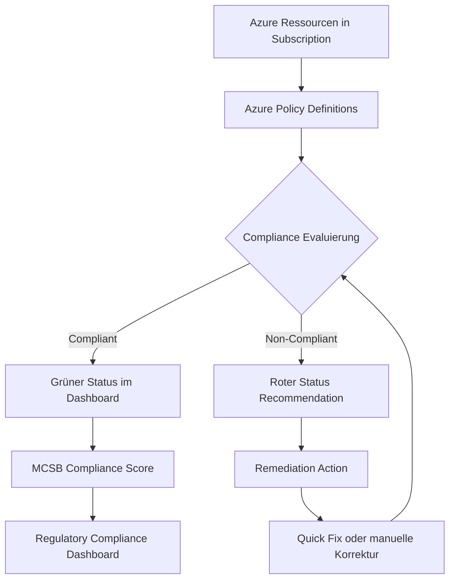
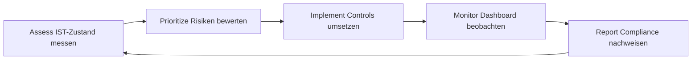
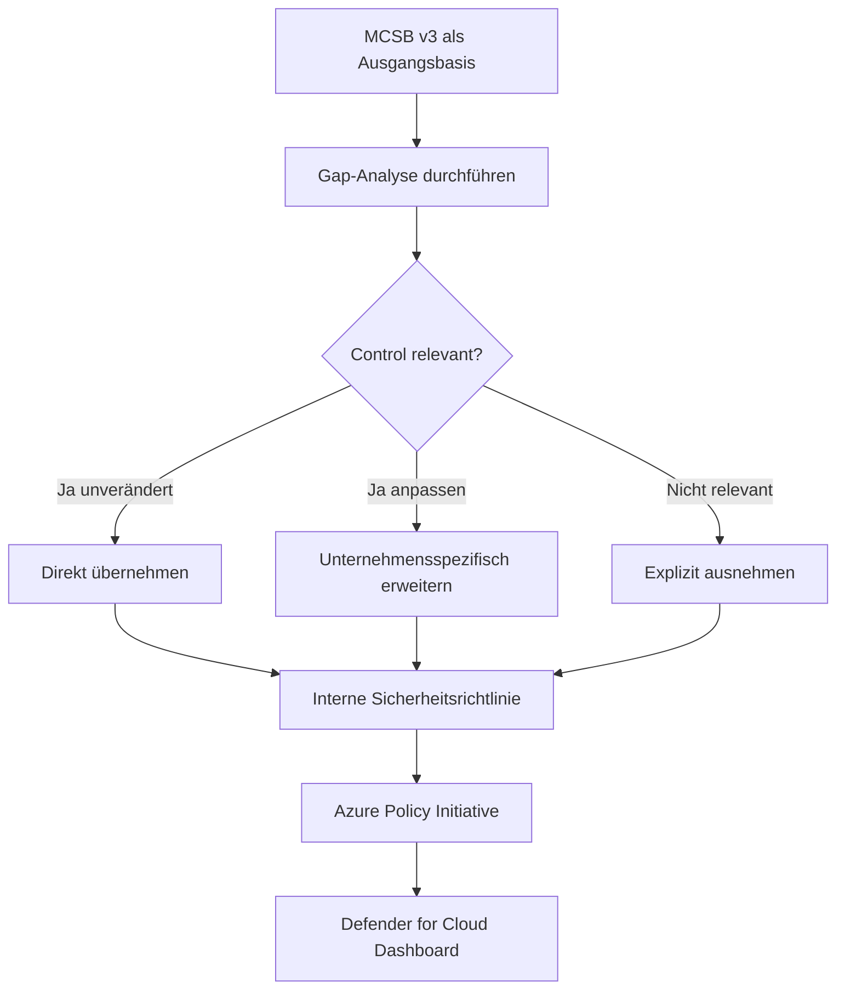

---
tags:
  - azure
  - security
  - compliance
  - mcsb
  - benchmark
  - defender-for-cloud
  - azure-policy
aliases:
  - Azure Security Benchmark
  - ASB
  - MCSB
  - Microsoft Cloud Security Benchmark
  - MCSB v3
---

# Azure Security Benchmark (MCSB)

> [!ABSTRACT] TL;DR
> Das **Microsoft Cloud Security Benchmark (MCSB)** ist der offizielle Sicherheitsstandard von Microsoft für Azure-Umgebungen. Er definiert **12 Kontrollbereiche** mit über 90 Controls, mappt auf CIS Controls v8, NIST CSF und ISO 27001, und bildet die Grundlage für das Regulatory Compliance Dashboard in Defender for Cloud sowie für eigene Azure Policy Initiativen.

---

## Was ist das Microsoft Cloud Security Benchmark?

Das **Microsoft Cloud Security Benchmark (MCSB)** — bis Version 2 als *Azure Security Benchmark (ASB)* bekannt — ist ein von Microsoft entwickeltes Framework mit sicherheitsrelevanten Best Practices für Cloud-Workloads. Es adressiert primär Azure, deckt seit MCSB v3 aber auch **Multi-Cloud-Szenarien** (AWS, GCP) ab, sofern Microsoft-Dienste dort genutzt werden.

MCSB ist kein eigenständiges Zertifizierungsschema, sondern ein **opinioniertes Mapping** auf etablierte Industriestandards. Statt eine neue Sprache zu erfinden, übersetzt MCSB CIS Controls v8, NIST CSF und ISO 27001 in konkrete, azure-native Empfehlungen mit direkt umsetzbaren Maßnahmen.

> [!NOTE] Namensänderung ASB → MCSB
> Mit **Version 3** erfolgte die Umbenennung von *Azure Security Benchmark* zu *Microsoft Cloud Security Benchmark*. Der Scope wurde von Azure-only auf Multi-Cloud erweitert. In Defender for Cloud erscheint die zugehörige Policy Initiative als *„Microsoft Cloud Security Benchmark"*. Ältere Dokumentationen und ARM-Templates können noch den Begriff *ASB* verwenden.

---

## Die 12 Kontrollbereiche

MCSB v3 gliedert sich in **12 Control Domains**. Jeder Bereich umfasst mehrere nummerierte Controls mit konkreten Sicherheitsanforderungen und Implementierungsanleitungen.

| Kürzel | Name | Controls (ca.) | Beispiel-Control |
|:------:|------|:--------------:|-----------------|
| **NS** | Network Security | 10 | NS-1: Netzwerksegmentierung mit VNets und NSGs implementieren |
| **IM** | Identity Management | 9 | IM-1: Zentralisiertes Identitätssystem (Entra ID) verwenden |
| **PA** | Privileged Access | 8 | PA-1: Benutzer mit hohen Rechten durch PIM schützen |
| **DP** | Data Protection | 9 | DP-1: Sensitive Daten entdecken und klassifizieren |
| **AM** | Asset Management | 7 | AM-1: Security-Team Sichtbarkeit auf alle Assets gewähren |
| **LT** | Logging & Threat Detection | 9 | LT-1: Threat Detection Capability in Defender for Cloud aktivieren |
| **IR** | Incident Response | 5 | IR-1: Incident Response Plan dokumentieren und testen |
| **PV** | Posture & Vulnerability Management | 7 | PV-1: Azure Security Baseline-Konfigurationen definieren |
| **ES** | Endpoint Security | 3 | ES-1: EDR-Lösung (Defender for Endpoint) einsetzen |
| **BR** | Backup & Recovery | 4 | BR-1: Regelmäßige automatisierte Backups sicherstellen |
| **DS** | DevOps Security | 7 | DS-1: Sicherheit in DevOps-Pipelines integrieren |
| **GS** | Governance & Strategy | 11 | GS-1: Sicherheitsstrategie dokumentieren und kommunizieren |

> [!TIP] Priorisierung beim Einstieg
> Beginne mit **IM**, **PA** und **NS** — diese drei Bereiche haben den größten Einfluss auf die Angriffsfläche und lassen sich in Defender for Cloud am schnellsten messen und verbessern. Controls mit „Quick Fix"-Button im Dashboard sind besonders für Early Wins geeignet.

---

## MCSB Control vs. Service Baseline

> [!IMPORTANT] Zwei Granularitätsstufen
> MCSB kennt zwei komplementäre Ebenen: abstrakte **Controls** und dienstspezifische **Service Baselines**. Beide zusammen ergeben ein vollständiges Sicherheitsbild.

| Ebene | Beschreibung | Beispiel |
|-------|-------------|---------|
| **MCSB Control** | Allgemeine Sicherheitsanforderung, gilt für alle Azure-Ressourcen | NS-2: Private Networks zum Verbinden von Azure-Diensten nutzen |
| **Service Baseline** | Spezifische Implementierungsempfehlung für einen bestimmten Azure-Dienst | Azure VM Baseline: Just-in-Time VM Access aktivieren, Disk Encryption erzwingen |

**Service Baselines** übersetzen die abstrakten Controls auf die konkreten Einstellungen und Konfigurationsparameter eines bestimmten Azure-Dienstes. Microsoft stellt Baselines für über 80 Dienste bereit.

### Beispiele: VM Baseline vs. AKS Baseline

**Azure VM Security Baseline** (Auswahl):
- Disk Encryption (Azure Disk Encryption oder Encryption at Host)
- Just-in-Time VM Access via Defender for Cloud
- Guest Configuration Policy aktivieren
- Microsoft Antimalware Extension installieren
- Secure Boot und vTPM für Trusted Launch VMs

**AKS Security Baseline** (Auswahl):
- RBAC für Kubernetes-API aktivieren
- Private Cluster (kein öffentlicher API-Server)
- Azure Policy Add-on für AKS
- Defender for Containers aktivieren
- Workload Identity statt Pod-Identitäten

---

## Mapping zu Industriestandards

MCSB v3 mappt jeden Control auf mehrere etablierte Frameworks. Dieses Mapping ermöglicht es, mit einer einzigen Compliance-Messung mehrere Standards gleichzeitig nachzuweisen.

| MCSB-Bereich | CIS Controls v8 | NIST CSF | ISO 27001:2022 | SOC 2 |
|:------------:|----------------|:--------:|:-------------:|:-----:|
| NS | CIS 12, 13 | PR.AC, PR.DS | A.8.20–A.8.23 | CC6.6, CC6.7 |
| IM | CIS 5, 6 | PR.AC, PR.MA | A.5.15–A.5.17 | CC6.1, CC6.2 |
| PA | CIS 5, 12 | PR.AC | A.5.18, A.8.2 | CC6.3 |
| DP | CIS 3 | PR.DS | A.8.10–A.8.12 | CC6.7, P5 |
| AM | CIS 1, 2 | ID.AM | A.8.1–A.8.3 | CC6.1 |
| LT | CIS 8 | DE.AE, DE.CM | A.8.15, A.8.16 | CC7.2, CC7.3 |
| IR | CIS 17 | RS.RP, RS.CO | A.5.24–A.5.28 | CC7.4, CC7.5 |
| PV | CIS 7, 18 | ID.RA, PR.IP | A.8.8 | CC7.1 |
| ES | CIS 10 | PR.IP | A.8.7 | CC6.8 |
| BR | CIS 11 | PR.IP, RC.RP | A.8.13, A.8.14 | A1.2, A1.3 |
| DS | CIS 16 | PR.IP | A.8.25–A.8.30 | CC8.1 |
| GS | CIS 17, 18 | ID.GV, PR.IP | A.5.1–A.5.4 | CC1.1–CC1.5 |

> [!NOTE] Vollständiges Mapping
> Das offizielle, vollständige Control-Mapping ist im MCSB-Excel-Download unter `aka.ms/benchmarkv3` von Microsoft verfügbar. Die Tabelle oben zeigt eine vereinfachte Übersicht der primären Mappings.

---

## MCSB in Defender for Cloud

**Microsoft Defender for Cloud** integriert MCSB als Standard-Compliance-Initiative. Das **Regulatory Compliance Dashboard** zeigt den Compliance-Status aller abonnierten Subscriptions in Echtzeit auf Basis automatisierter Policy-Evaluierungen.

### Wie der Compliance-Status gemessen wird



### Measurement-Mechanismus im Detail

- **Policy Definitions** — Für jeden MCSB Control existieren eine oder mehrere Azure Policy Definitionen, die den gewünschten Soll-Zustand einer Ressource beschreiben
- **Policy Initiative** — Alle MCSB Policies sind in einer einzigen *Policy Set Definition* gebündelt, die automatisch neuen Subscriptions in Defender for Cloud zugewiesen wird
- **Compliance-Score** — Der Prozentsatz der als Compliant bewerteten Controls ergibt den Gesamt-Score (0–100 %)
- **Recommendations** — Non-compliant Controls erscheinen als Sicherheitsempfehlungen mit Schweregrad (Hoch / Mittel / Niedrig) und betroffenen Ressourcen

> [!WARNING] Score ≠ vollständige Sicherheit
> Ein hoher Compliance-Score bedeutet nicht automatisch eine sichere Umgebung. MCSB misst ausschließlich konfigurationsbasierte Controls, die per Policy prüfbar sind. Laufzeit-Angriffe, Zero-Days oder Insider Threats werden durch den Score nicht erfasst.

---

## Implementierungsprozess



### Phase 1 — Assess

- Defender for Cloud aktivieren (mindestens Free Tier / Foundational CSPM)
- MCSB-Initiative ist automatisch zugewiesen — `Defender for Cloud → Regulatory Compliance` aufrufen
- Aktuellen Compliance-Score und Anzahl offener Recommendations notieren
- Betroffene Ressourcen pro Control analysieren

### Phase 2 — Prioritize

- Controls nach Schweregrad und Anzahl betroffener Ressourcen sortieren
- Quick Wins identifizieren: Controls mit „Fix"-Button haben automatisierte Remediation
- Owner für jeden der 12 Kontrollbereiche benennen
- Zielscore und Zeitplan festlegen

### Phase 3 — Implement

- Manuelle Remediation oder Defender for Cloud Quick Fix nutzen
- Bicep / Terraform / Azure Policy für automatisierte und reproduzierbare Remediation
- Service Baselines als Implementierungsleitfaden pro Dienst heranziehen

### Phase 4 — Monitor

- Alert-Regeln für Score-Verschlechterungen einrichten (Logic App + Defender for Cloud Connector)
- Wöchentliche Compliance-Reports aus Dashboard exportieren
- KQL-Abfragen für Trendanalyse in Log Analytics

### Phase 5 — Report

- PDF-Export direkt aus dem Regulatory Compliance Dashboard
- Compliance-Daten per REST API für eigene Dashboards (Power BI)
- Continuous Export zu Log Analytics für historische Trendanalyse

---

## Code-Beispiele

### PowerShell: Compliance-Score abfragen

```powershell
# Voraussetzung: Az.Security Modul
Install-Module -Name Az.Security -Force -Scope CurrentUser
Connect-AzAccount

$subscriptionId = (Get-AzContext).Subscription.Id

# Alle Regulatory Compliance Standards abrufen
$complianceStandards = Get-AzSecurityRegulatoryComplianceStandard
$mcsb = $complianceStandards |
    Where-Object { $_.Name -like "*MicrosoftCloudSecurityBenchmark*" }

Write-Host "Standard         : $($mcsb.Name)"
Write-Host "Passed Controls  : $($mcsb.PassedControls)"
Write-Host "Failed Controls  : $($mcsb.FailedControls)"
Write-Host "Skipped Controls : $($mcsb.SkippedControls)"

# Compliance-Score berechnen
$total = $mcsb.PassedControls + $mcsb.FailedControls
$score = if ($total -gt 0) {
    [math]::Round(($mcsb.PassedControls / $total) * 100, 1)
} else { 0 }
Write-Host "Compliance-Score : $score %"

# Alle Control-Details mit Status ausgeben
Get-AzSecurityRegulatoryComplianceControl -StandardName $mcsb.Name |
    Select-Object Name, State, PassedAssessments, FailedAssessments |
    Sort-Object State, Name |
    Format-Table -AutoSize
```

### PowerShell: MCSB Policy Initiative zuweisen

```powershell
# MCSB Policy Initiative einer Subscription zuweisen

$subscriptionId = (Get-AzContext).Subscription.Id
$scope          = "/subscriptions/$subscriptionId"
$assignmentName = "mcsb-$(Get-Date -Format 'yyyyMMdd')"

# Built-in MCSB Initiative abrufen
$initiative = Get-AzPolicySetDefinition |
    Where-Object { $_.Properties.DisplayName -like "*Microsoft Cloud Security Benchmark*" }

Write-Host "Initiative gefunden: $($initiative.Properties.DisplayName)"

# Zuweisung erstellen mit System-Assigned Managed Identity (für Remediation)
$assignment = New-AzPolicyAssignment `
    -Name                $assignmentName `
    -DisplayName         "MCSB — Produktion" `
    -Scope               $scope `
    -PolicySetDefinition $initiative `
    -IdentityType        SystemAssigned `
    -Location            "westeurope"

Write-Host "Assignment erstellt : $($assignment.Name)"
Write-Host "Identity Principal  : $($assignment.Identity.PrincipalId)"

# Non-compliant Ressourcen auflisten
Get-AzPolicyState -SubscriptionId $subscriptionId |
    Where-Object { $_.ComplianceState -eq "NonCompliant" } |
    Select-Object ResourceId, PolicyDefinitionName, ComplianceState |
    Sort-Object PolicyDefinitionName |
    Format-Table -AutoSize
```

### KQL: Compliance-Status in Log Analytics abfragen

```kusto
// MCSB Recommendations nach Kontrollbereich zusammenfassen
// Voraussetzung: Continuous Export von Defender for Cloud zu Log Analytics konfiguriert

SecurityRecommendation
| where TimeGenerated > ago(7d)
| where RecommendationState == "Active"
| extend ControlDomain = extract(@"^([A-Z]{2})-\d+", 1, RecommendationName)
| summarize
    Gesamt  = count(),
    Hoch    = countif(RecommendationSeverity == "High"),
    Mittel  = countif(RecommendationSeverity == "Medium"),
    Niedrig = countif(RecommendationSeverity == "Low")
  by ControlDomain
| order by Hoch desc
| project ControlDomain, Gesamt, Hoch, Mittel, Niedrig
```

```kusto
// MCSB Compliance-Score-Verlauf über 30 Tage als Zeitreihe
// Datenquelle: SecurityRegulatoryCompliance (aus Continuous Export)

SecurityRegulatoryCompliance
| where TimeGenerated > ago(30d)
| where StandardName has "MicrosoftCloudSecurityBenchmark"
| summarize
    PassedControls = max(PassedControls),
    FailedControls = max(FailedControls)
  by bin(TimeGenerated, 1d)
| extend ComplianceScore = round(
    100.0 * PassedControls / (PassedControls + FailedControls), 1)
| project TimeGenerated, ComplianceScore, PassedControls, FailedControls
| render timechart
    with (title = "MCSB Compliance-Score (letzte 30 Tage)")
```

### Bicep: Eigene Policy Initiative auf Basis von MCSB

```bicep
// Unternehmenseigene Policy Initiative basierend auf ausgewählten MCSB-Controls

targetScope = 'subscription'

@description('Umgebungsbezeichnung für Metadaten')
param environment string = 'production'

// Policy Set Definition mit ausgewählten MCSB-Controls
resource mcsbInitiative 'Microsoft.Authorization/policySetDefinitions@2021-06-01' = {
  name: 'custom-mcsb-unternehmensbaseline'
  properties: {
    displayName: 'Unternehmens-Sicherheitsbaseline (MCSB-basiert)'
    description: 'Interne Sicherheitsrichtlinie auf Basis von MCSB v3'
    policyType: 'Custom'
    metadata: {
      category: 'Security'
      version: '1.0.0'
    }
    parameters: {}
    policyDefinitionGroups: [
      { name: 'NS', displayName: 'Network Security' }
      { name: 'IM', displayName: 'Identity Management' }
      { name: 'LT', displayName: 'Logging & Threat Detection' }
      { name: 'DP', displayName: 'Data Protection' }
    ]
    policyDefinitions: [
      // NS-1: NSG auf Subnetzen erzwingen
      {
        policyDefinitionId: '/providers/Microsoft.Authorization/policyDefinitions/e37009a5-160e-4b5e-bfa6-1df4fa5f0e4b'
        policyDefinitionReferenceId: 'NS-01-NSGRequired'
        groupNames: [ 'NS' ]
        parameters: {}
      }
      // IM-6: MFA für privilegierte Accounts
      {
        policyDefinitionId: '/providers/Microsoft.Authorization/policyDefinitions/9297c21d-2ed6-4474-b48f-163f75654ce3'
        policyDefinitionReferenceId: 'IM-06-MFARequired'
        groupNames: [ 'IM' ]
        parameters: {}
      }
      // LT-1: Diagnostic Settings für Storage Accounts
      {
        policyDefinitionId: '/providers/Microsoft.Authorization/policyDefinitions/59759c62-9a22-4cdf-ae64-074495983fef'
        policyDefinitionReferenceId: 'LT-01-DiagnosticSettings'
        groupNames: [ 'LT' ]
        parameters: {}
      }
      // DP-3: Secure Transfer (HTTPS only) für Storage Accounts
      {
        policyDefinitionId: '/providers/Microsoft.Authorization/policyDefinitions/404c3081-a854-4457-ae30-26a93ef643f9'
        policyDefinitionReferenceId: 'DP-03-HttpsOnly'
        groupNames: [ 'DP' ]
        parameters: {}
      }
    ]
  }
}

// Initiative der aktuellen Subscription zuweisen
resource initiativeAssignment 'Microsoft.Authorization/policyAssignments@2022-06-01' = {
  name: 'custom-mcsb-assignment'
  properties: {
    displayName: 'Unternehmens-Sicherheitsbaseline — ${environment}'
    description: 'Automatische Zuweisung der MCSB-basierten Unternehmensrichtlinie'
    policyDefinitionId: mcsbInitiative.id
    // Audit-Modus: Deployments werden nicht blockiert, nur protokolliert
    enforcementMode: 'DoNotEnforce'
    metadata: {
      environment: environment
      assignedBy: 'Security Team'
    }
  }
}

output initiativeId string = mcsbInitiative.id
output assignmentId string = initiativeAssignment.id
```

---

## MCSB als Grundlage für interne Sicherheitsrichtlinien

MCSB ist als **Ausgangspunkt** für eigene Sicherheitsrichtlinien konzipiert — nicht als starres Regelwerk. Unternehmen passen es an ihre Risikolage, Branchenanforderungen und technischen Gegebenheiten an.

### Empfohlener Anpassungsprozess



### Praxistipps

> [!TIP] Audit vor Enforce
> Führe die eigene Policy Initiative zunächst im Modus `DoNotEnforce` (Audit) ein. So werden Verstöße sichtbar, ohne Deployments zu blockieren. Erst nach Stabilisierung der Umgebung auf `Default` (Enforce) umstellen — besonders für `Deny`-Policies kritisch.

> [!TIP] Exemptions sauber dokumentieren
> Policy Exemptions sind legitim für Legacy-Systeme oder begründete Ausnahmen. Jede Exemption muss mit **Begründung**, **verantwortlicher Person** und **Ablaufdatum** versehen werden. Defender for Cloud zeigt exempted Controls separat an — sie fließen nicht negativ in den Score ein.

> [!TIP] Built-in Initiative als Vorlage exportieren
> ```bash
> # MCSB-Initiative per Azure CLI als JSON exportieren
> az policy set-definition show \
>   --name "1f3afdf9-d0c9-4c3d-847f-89da613e70a8" \
>   --output json > mcsb-initiative-export.json
> ```
> Die exportierte JSON-Datei dient als Vorlage für die eigene Custom Initiative.

> [!WARNING] Custom Initiativen erhalten keine automatischen Updates
> Microsoft aktualisiert die MCSB Built-in Initiative regelmäßig (neue Controls, geänderte Policy Definitions). **Custom Initiativen** erhalten diese Updates **nicht automatisch**. Plane mindestens halbjährliche Reviews und vergleiche deine Initiative mit der aktuellen Built-in Version.

> [!IMPORTANT] Management Group Scope empfohlen
> Weise die MCSB-Initiative auf **Management Group**-Ebene zu, nicht auf einzelne Subscriptions. So gilt die Richtlinie automatisch für alle aktuellen und zukünftigen Subscriptions unterhalb der Management Group — ohne manuelle Nachpflege.

---

## Reporting und Compliance-Nachweis

### Export-Optionen im Überblick

| Methode | Format | Automation | Empfohlener Einsatz |
|---------|:------:|:----------:|---------------------|
| Regulatory Compliance Dashboard → PDF | PDF | Manuell | Audits, Management-Präsentationen |
| Continuous Export → Log Analytics | JSON / KQL | Automatisch | Trendanalyse, SIEM-Integration |
| Continuous Export → Event Hub | JSON | Automatisch | SIEM (Sentinel, Splunk, QRadar) |
| Azure REST API | JSON | Automatisch | Power BI, Custom Dashboards |
| Microsoft Graph Security API | JSON | Automatisch | Multi-Cloud Compliance Reporting |

### Compliance-Daten per REST API (Beispiel-Response)

```json
{
  "id": "/subscriptions/{subscriptionId}/providers/Microsoft.Security/regulatoryComplianceStandards/MicrosoftCloudSecurityBenchmark",
  "name": "MicrosoftCloudSecurityBenchmark",
  "type": "Microsoft.Security/regulatoryComplianceStandards",
  "properties": {
    "state": "Passed",
    "passedControls": 68,
    "failedControls": 14,
    "skippedControls": 9,
    "unsupportedControls": 2
  }
}
```

### Continuous Export zu Log Analytics konfigurieren

```powershell
# Continuous Export von Defender for Cloud zu Log Analytics aktivieren
# Voraussetzung: Log Analytics Workspace bereits vorhanden

$subscriptionId = (Get-AzContext).Subscription.Id
$workspaceId    = "/subscriptions/$subscriptionId/resourceGroups/rg-security/providers/Microsoft.OperationalInsights/workspaces/law-security"

$body = @{
    properties = @{
        isEnabled         = $true
        exportedDataTypes = @(
            "Security recommendations"
            "Regulatory compliance assessments"
            "Security alerts"
        )
        workspaceSettings = @{
            workspaceResourceId = $workspaceId
        }
    }
} | ConvertTo-Json -Depth 10

Invoke-AzRestMethod `
    -Path    "/subscriptions/$subscriptionId/providers/Microsoft.Security/automations/exportToWorkspace?api-version=2019-01-01-preview" `
    -Method  PUT `
    -Payload $body

Write-Host "Continuous Export zu Log Analytics konfiguriert."
```

---

## Troubleshooting

> [!WARNING] Initiative nicht im Dashboard sichtbar
> **Ursache:** MCSB-Initiative noch nicht der Subscription zugewiesen oder Defender for Cloud ist nicht aktiviert.
> **Lösung:** `Defender for Cloud → Environment Settings → [Subscription] → Security Policies` → MCSB-Schalter aktivieren.

> [!WARNING] Compliance-Score sinkt nach Microsoft-Update
> Microsoft aktualisiert MCSB-Policies periodisch. Neue Controls können den Score absenken, obwohl sich an der eigenen Umgebung nichts geändert hat.
> **Lösung:** Release Notes im Microsoft Security Blog und `aka.ms/mcsb` prüfen, neue Controls evaluieren und priorisieren.

> [!BUG] Policy-State zeigt „Not Started" oder „Unknown"
> **Ursache:** Policy-Evaluierungszyklus läuft noch (bis zu 24 h nach Zuweisung) oder die Ressource liegt außerhalb des zugewiesenen Scopes.
> **Lösung:** Evaluierung manuell anstoßen:
> ```bash
> az policy state trigger-scan --subscription $subscriptionId
> ```

> [!DANGER] Deny-Policy blockiert produktive Deployments
> Wenn Controls auf `Deny` gesetzt sind, werden non-compliant Deployments sofort abgelehnt — auch in Produktion.
> **Lösung:** In Development-Environments stets `DoNotEnforce` verwenden. `Deny`-Policies erst nach vollständiger Remediation und ausgiebigem Testen in Production aktivieren.

---

## Verwandte Notizen

- [[Microsoft Defender for Cloud]]
- [[Azure RBAC]]
- [[Azure Policy]]
- [[Log Analytics Workspace]]
