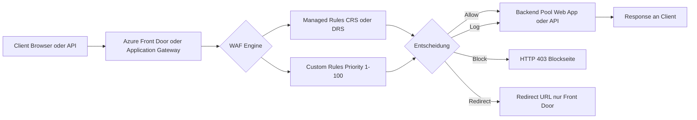
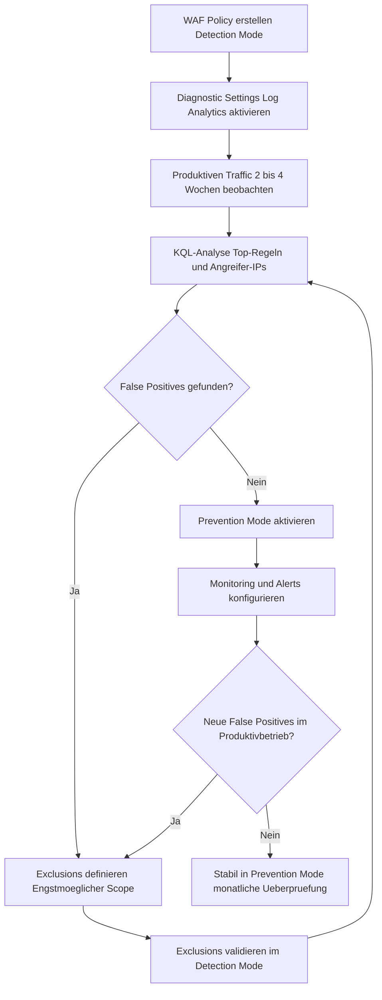

---
tags:
  - azure
  - security
  - waf
  - networking
  - firewall
  - owasp
aliases:
  - Azure WAF
  - WAF
  - Web Application Firewall Azure
---

# Azure Web Application Firewall

> [!ABSTRACT] TL;DR
> Azure WAF (Web Application Firewall) schützt Webanwendungen vor häufigen Exploits wie SQL Injection, XSS und anderen OWASP Top-10-Angriffen. Sie wird auf **Application Gateway**, **Front Door** oder **Azure CDN** betrieben, arbeitet regelbasiert (OWASP CRS / Microsoft DRS) und lässt sich mit Custom Rules, Geo-Filtering, Bot Protection und Rate Limiting präzise anpassen. Der empfohlene Workflow: Detection Mode → Log-Analyse → Exclusions → Prevention Mode.

---

## Was ist Azure WAF?

Azure WAF ist ein cloudnativer Layer-7-Schutz für HTTP/HTTPS-Anwendungen. Sie analysiert eingehende Anfragen anhand vordefinierter und benutzerdefinierter Regelwerke und kann bösartige Anfragen blockieren, protokollieren oder umleiten — bevor sie das Backend erreichen.

WAF sitzt als Komponente auf drei Azure-Diensten:

| Einstiegspunkt | Scope | Typischer Use Case |
|---|---|---|
| **Application Gateway** | Regional | Interne/externe Apps pro Region |
| **Front Door** | Global (Anycast) | Globale Multi-Region-Apps |
| **Azure CDN** (Akamai/Verizon) | Global | Statische Content-Delivery mit WAF |

> [!NOTE] WAF ist keine eigenständige Ressource
> WAF wird immer als **Policy** erstellt und dann einem Application Gateway Listener, einer Front Door Route oder einem CDN Endpoint zugewiesen — nie direkt als Standalone-Dienst provisioniert.

---

## WAF-Plattformvergleich

| Kriterium | Application Gateway WAF | Front Door WAF | Azure CDN WAF |
|---|---|---|---|
| **Scope** | Regional | Global (PoP-Netzwerk) | Global |
| **SKU** | WAF_v2 | Standard / Premium | Akamai / Verizon |
| **Rule Set** | CRS 3.2 / DRS 2.1 | DRS 2.1 / CRS 3.2 | CRS 3.1 |
| **Bot Manager** | ✅ (BotManagerRuleSet 1.0) | ✅ (BotManagerRuleSet 1.0) | ❌ |
| **Custom Rules** | ✅ | ✅ (inkl. Redirect) | ✅ |
| **Rate Limiting** | ✅ (Custom Rules) | ✅ (nativ + Custom Rules) | Eingeschränkt |
| **Geo-Filtering** | ✅ | ✅ | ✅ |
| **TLS Termination** | ✅ | ✅ | ✅ |
| **Private Backend** | ✅ (VNet-Integration) | ✅ (Private Link Premium) | ❌ |
| **Policy-Scope** | Pro Listener | Pro Route / Global | Pro Endpoint |
| **Latenz** | Niedrig (Regional) | Sehr niedrig (Anycast) | Sehr niedrig |

> [!TIP] Wann welche WAF-Plattform wählen?
> - **Application Gateway WAF**: Wenn das Backend im eigenen VNet liegt oder strenge Datenhaltungsanforderungen bestehen (Region-Lock)
> - **Front Door WAF**: Für global verteilte Apps mit niedrigster Latenz und zentralem Policy-Management über alle Regionen
> - **CDN WAF**: Ausschließlich für statische Inhalte — dynamische Backends sind nur eingeschränkt schützbar

---

## Request-Flow durch die WAF



> [!NOTE] Verarbeitungsreihenfolge
> Custom Rules werden **vor** Managed Rules ausgewertet. Innerhalb der Custom Rules bestimmt die **Priority** (1 = höchste) die Reihenfolge. Bei einem Match stoppt die Regelkette sofort (First-Match-Wins).

---

## OWASP Regelwerke: CRS vs. DRS

### Core Rule Set (CRS 3.2) — OWASP Community Standard

Das OWASP CRS ist das universelle Open-Source-Regelwerk, das von der Community gepflegt wird. Es deckt die breiteste Angriffsfläche ab, erzeugt aber ohne Tuning eine höhere False-Positive-Rate.

### Default Rule Set (DRS 2.1) — Microsoft-optimiert

DRS 2.1 basiert auf CRS, wird aber von Microsoft speziell für Azure-Workloads optimiert: weniger False Positives, automatische Updates, bessere Integration mit dem Bot Manager Rule Set. **Empfehlung für Neuinstallationen: DRS 2.1.**

### OWASP Regelgruppen

| Regelgruppe | ID-Bereich | Schutzziel | Beispiel-Angriff |
|---|---|---|---|
| **Protocol Enforcement** | 920xxx | HTTP-Protokoll-Konformität | Malformed Headers, HTTP Request Smuggling |
| **Protocol Attack** | 921xxx | HTTP-spezifische Angriffe | Header Injection, Response Splitting |
| **Application Attack — LFI** | 930xxx | Local File Inclusion | `../../etc/passwd` im URI |
| **Application Attack — RFI** | 931xxx | Remote File Inclusion | `?page=http://evil.com/shell.php` |
| **Application Attack — RCE** | 932xxx | Remote Code Execution | Shell-Befehle in Parametern |
| **Application Attack — PHP** | 933xxx | PHP-spezifische Exploits | `eval()`, `system()` in Requests |
| **Application Attack — Node.js** | 934xxx | Node.js Prototype Pollution | `__proto__`-Manipulation |
| **Application Attack — XSS** | 941xxx | Cross-Site Scripting | `<script>alert(1)</script>` |
| **Application Attack — SQLi** | 942xxx | SQL Injection | `' OR 1=1--`, UNION SELECT |
| **Application Attack — Session** | 943xxx | Session Fixation | Cookie-Manipulation |
| **Application Attack — Java** | 944xxx | Java-Exploits | Log4Shell (`${jndi:ldap://...}`) |
| **Scanner Detection** | 913xxx | Vulnerability Scanner | Nikto, sqlmap User-Agents |

> [!WARNING] Anomalie-Score-Modus
> Im CRS/DRS-Anomalie-Modus löst eine einzelne Regel keinen Block aus. Stattdessen akkumulieren Regeln einen **Score** (1–5 Punkte). Erst ab einem Schwellwert (Standard: **5**) wird blockiert. Das reduziert False Positives erheblich — einzelne Regeltreffer allein sind noch kein Angriff.

---

## WAF-Modi

### Detection Mode

- Alle Anfragen werden **durchgelassen**, unabhängig von Regeltreffern
- Regeltreffer werden in den WAF-Logs erfasst (`AzureDiagnostics`)
- **Kein Einfluss** auf die Anwendungsverfügbarkeit
- Ideal für die initiale Einführungsphase und das Tuning

### Prevention Mode

- Anfragen, die Regeln verletzen, werden aktiv **blockiert** (HTTP 403)
- Der Client erhält eine konfigurierbare Blockierungsseite
- Alle Entscheidungen werden weiterhin geloggt

> [!IMPORTANT] Niemals direkt in den Prevention Mode
> Aktiviere Prevention Mode **nur** nach einer ausreichenden Detection-Phase (mindestens 2–4 Wochen produktiver Traffic) und nach dem Bereinigen aller False Positives durch Exclusions.

---

## Custom Rules

Custom Rules ermöglichen granulare, anwendungsspezifische Regeln **oberhalb** der Managed Rules.

### Struktur einer Custom Rule

| Feld | Beschreibung | Werte |
|---|---|---|
| **Name** | Eindeutiger Regelname | String |
| **Priority** | Auswertungsreihenfolge | 1–100 (1 = höchste) |
| **Rule Type** | Art der Regel | `MatchRule`, `RateLimitRule` |
| **Match Conditions** | Was geprüft wird | IP, Geo, Header, URI, Body, Cookie, Query |
| **Action** | Was bei Match passiert | `Allow`, `Block`, `Log`, `Redirect` (nur FD) |

### Match-Variablen im Überblick

| Variable | Beschreibung |
|---|---|
| `RemoteAddr` | Client-IP (nach X-Forwarded-For) |
| `RequestUri` | Vollständiger URI inkl. Query String |
| `RequestHeaders` | Beliebiger Header-Wert |
| `RequestBody` | POST-Body (bis 128 KB) |
| `RequestCookies` | Cookie-Wert |
| `QueryString` | Einzelner Query-Parameter |
| `PostArgs` | Formularfelder |
| `SocketAddr` | Tatsächliche Client-IP (ohne Proxy-Auflösung) |

---

## Bot Protection

Der **Microsoft Bot Manager Rule Set (BotManagerRuleSet 1.0)** klassifiziert Bots in drei Kategorien:

| Kategorie | Beschreibung | Standard-Aktion |
|---|---|---|
| **Good Bots** | Suchmaschinen (Google, Bing), Monitoring | `Allow` |
| **Bad Bots** | Scraper, Credential Stuffing, DDoS-Tools | `Block` |
| **Unknown Bots** | Nicht klassifiziert | `Log` |

> [!TIP] Bot Manager separat aktivieren
> Der Bot Manager Rule Set wird **zusätzlich** zum Managed Rule Set (CRS/DRS) aktiviert. Er ist nicht Teil des OWASP-Regelwerks und muss explizit in der WAF Policy eingeschaltet werden.

---

## Rate Limiting

Rate Limiting wird über Custom Rules vom Typ `RateLimitRule` umgesetzt:

- **RateLimitDurationInMinutes**: Zeitfenster (1 oder 5 Minuten)
- **RateLimitThreshold**: Maximale Anfragen im Zeitfenster pro Client-IP

> [!NOTE] Rate Limiting auf Front Door vs. Application Gateway
> Front Door bietet ab dem **Premium SKU** ein natives Rate-Limiting direkt in den Routing-Regeln. Auf Application Gateway ist Rate Limiting ausschließlich über Custom Rules verfügbar.

---

## Geo-Filtering

Geo-Filtering blockiert oder erlaubt Traffic anhand des Herkunftslandes (ISO 3166-1 Alpha-2 Ländercodes):

```json
{
  "name": "BlockHighRiskCountries",
  "priority": 10,
  "ruleType": "MatchRule",
  "matchConditions": [
    {
      "matchVariables": [{ "variableName": "RemoteAddr" }],
      "operator": "GeoMatch",
      "negationCondition": false,
      "matchValues": ["RU", "CN", "KP", "IR"]
    }
  ],
  "action": "Block"
}
```

> [!WARNING] Geo-IP-Datenbanken sind nicht 100 % präzise
> VPN-Anbieter und Tor-Exit-Nodes können Geo-Blocking umgehen. Kombiniere Geo-Filtering stets mit weiteren Schutzmechanismen wie Bot Protection und Rate Limiting für eine effektivere Abwehr.

---

## WAF Exclusions (False Positives behandeln)

Exclusions erlauben es, bestimmte Request-Teile von der WAF-Auswertung auszunehmen — ohne Regeln vollständig zu deaktivieren.

### Exclusion-Selektoren

| Selector | Beschreibung | Beispiel |
|---|---|---|
| `RequestHeaderNames` | Bestimmter Request-Header | `X-Custom-Token` |
| `RequestCookieNames` | Bestimmter Cookie | `auth_session` |
| `RequestArgNames` | Query-Parameter oder POST-Argument | `search_query` |
| `RequestBodyPostArgNames` | POST-Formularfeld | `comment_body` |
| `RequestBodyJsonArgNames` | JSON-Body-Feld (App GW v2) | `$.user.description` |

### Exclusion-Scope

Exclusions können auf drei Ebenen greifen:

- **Rule Set-weit** — Ausnahme für alle Regeln (sehr weitreichend, vermeiden)
- **Rule Group-weit** — Ausnahme für eine gesamte Regelgruppe
- **Einzelne Regel** — Bevorzugt: Ausnahme nur für eine spezifische Regel-ID

> [!DANGER] Weite Exclusions vermeiden
> Eine Exclusion wie „RequestBodyPostArgNames CONTAINS \*" deaktiviert effektiv alle Body-Prüfungen. Immer den engstmöglichen Scope wählen — idealerweise Regel-ID + konkreter Selector-Match. Weite Exclusions sind ein häufiger Angriffspunkt bei WAF-Audits.

---

## WAF Policies

Eine WAF Policy ist die zentrale Konfigurationseinheit, die Managed Rules, Custom Rules, Exclusions und den WAF-Modus zusammenfasst.

### Policy-Zuordnung

- **Application Gateway**: Policy wird einem oder mehreren **Listenern** zugewiesen (HTTP/HTTPS-Ports). Verschiedene Listener können verschiedene Policies haben.
- **Front Door**: Policy wird einer oder mehreren **Routing-Rules** (Routes) zugewiesen — oder global für alle Domains.
- **Per-Site Policy (App GW)**: Über `pathBasedRule`-Zuordnung können verschiedene URL-Pfade unterschiedliche Policies erhalten.

> [!TIP] Zentrale Policy-Verwaltung
> Nutze **Azure Firewall Manager** für die übergreifende Verwaltung von WAF Policies, wenn du mehrere Application Gateways oder Front Door Profiles betreibst. So werden Regeln zentral ausgerollt, ohne jede Resource einzeln zu konfigurieren.

---

---

## Via Azure Portal / Defender for Cloud (UI)

> [!TIP]
> Portal: **[portal.azure.com](https://portal.azure.com)**

**WAF-Richtlinie erstellen:**
1. [portal.azure.com](https://portal.azure.com) → **+ Ressource erstellen** → **WAF-Richtlinie**
2. **Zuordnung** wählen: **Application Gateway** oder **Front Door und CDN**
3. Ressourcengruppe, Name und Region → **Erstellen**

**WAF-Modus konfigurieren:**
- WAF-Richtlinie öffnen → **Richtlinieneinstellungen** → Modus: **Erkennung** oder **Prävention** → **Speichern**

**Verwaltete Regeln anzeigen:**
- WAF-Richtlinie → **Verwaltete Regeln** → OWASP-Regelsatz-Version wählen (CRS 3.2 / DRS 2.1)
- Einzelne Regelgruppen aktivieren/deaktivieren

**Custom Rules hinzufügen:**
- WAF-Richtlinie → **Benutzerdefinierte Regeln** → **+ Benutzerdefinierte Regel hinzufügen**
- Bedingungen (IP, Header, URI) und Aktion (Zulassen/Blockieren/Protokollieren) festlegen

**WAF einem Application Gateway zuordnen:**
- Application Gateway öffnen → **Web Application Firewall** → WAF-Richtlinie zuweisen

**WAF-Protokolle analysieren:**
- Application Gateway → **Diagnoseeinstellungen** → Log Analytics Workspace → `AzureDiagnostics`-Tabelle abfragen

---

## Deployment mit Bicep

```bicep
// WAF Policy mit Custom Rules, Managed Rule Set (DRS 2.1) und Bot Manager
resource wafPolicy 'Microsoft.Network/ApplicationGatewayWebApplicationFirewallPolicies@2023-09-01' = {
  name: 'waf-policy-prod'
  location: 'westeurope'
  properties: {
    policySettings: {
      mode: 'Prevention'
      state: 'Enabled'
      requestBodyCheck: true
      maxRequestBodySizeInKb: 128
      fileUploadLimitInMb: 100
    }
    managedRules: {
      managedRuleSets: [
        {
          ruleSetType: 'Microsoft_DefaultRuleSet'
          ruleSetVersion: '2.1'
        }
        {
          ruleSetType: 'Microsoft_BotManagerRuleSet'
          ruleSetVersion: '1.0'
        }
      ]
      exclusions: [
        {
          // Cookie 'auth_session' von SQLi-Prüfung ausnehmen
          matchVariable: 'RequestCookieNames'
          selectorMatchOperator: 'Equals'
          selector: 'auth_session'
          exclusionManagedRuleSets: [
            {
              ruleSetType: 'Microsoft_DefaultRuleSet'
              ruleSetVersion: '2.1'
              ruleGroups: [
                {
                  ruleGroupName: 'REQUEST-942-APPLICATION-ATTACK-SQLI'
                  rules: [
                    { ruleId: '942200' }
                    { ruleId: '942260' }
                  ]
                }
              ]
            }
          ]
        }
      ]
    }
    customRules: [
      {
        name: 'BlockHighRiskCountries'
        priority: 10
        ruleType: 'MatchRule'
        matchConditions: [
          {
            matchVariables: [
              { variableName: 'RemoteAddr' }
            ]
            operator: 'GeoMatch'
            negationConditon: false
            matchValues: [ 'RU', 'CN', 'KP', 'IR' ]
          }
        ]
        action: 'Block'
        state: 'Enabled'
      }
      {
        name: 'RateLimitPerIP'
        priority: 20
        ruleType: 'RateLimitRule'
        rateLimitDurationInMinutes: 1
        rateLimitThreshold: 100
        matchConditions: [
          {
            matchVariables: [
              { variableName: 'RemoteAddr' }
            ]
            operator: 'IPMatch'
            negationConditon: false
            matchValues: [ '0.0.0.0/0' ]
          }
        ]
        action: 'Block'
        state: 'Enabled'
      }
    ]
  }
}
```

---

## Verwaltung mit PowerShell

### WAF Policy erstellen und konfigurieren

```powershell
# WAF Policy erstellen
$wafPolicy = New-AzApplicationGatewayFirewallPolicy `
    -Name "waf-policy-prod" `
    -ResourceGroupName "rg-webapp-prod" `
    -Location "westeurope"

# Managed Rule Sets konfigurieren: DRS 2.1 + Bot Manager
$managedRuleSet = New-AzApplicationGatewayFirewallPolicyManagedRuleSet `
    -RuleSetType "Microsoft_DefaultRuleSet" `
    -RuleSetVersion "2.1"

$botRuleSet = New-AzApplicationGatewayFirewallPolicyManagedRuleSet `
    -RuleSetType "Microsoft_BotManagerRuleSet" `
    -RuleSetVersion "1.0"

$managedRules = New-AzApplicationGatewayFirewallPolicyManagedRule `
    -ManagedRuleSet $managedRuleSet, $botRuleSet

# Custom Rule: Geo-Blocking für Hochrisiko-Länder
$geoMatchVariable = New-AzApplicationGatewayFirewallMatchVariable `
    -VariableName "RemoteAddr"

$geoCondition = New-AzApplicationGatewayFirewallCondition `
    -MatchVariable $geoMatchVariable `
    -Operator "GeoMatch" `
    -MatchValue @("RU", "CN", "KP", "IR") `
    -NegationCondition $false

$geoRule = New-AzApplicationGatewayFirewallCustomRule `
    -Name "BlockHighRiskGeo" `
    -Priority 10 `
    -RuleType "MatchRule" `
    -MatchCondition $geoCondition `
    -Action "Block" `
    -State "Enabled"

# Policy-Einstellungen
$policySettings = New-AzApplicationGatewayFirewallPolicySetting `
    -Mode "Prevention" `
    -State "Enabled" `
    -MaxRequestBodySizeInKb 128 `
    -FileUploadLimitInMb 100 `
    -RequestBodyCheck $true

# Alles zusammensetzen
Set-AzApplicationGatewayFirewallPolicy `
    -InputObject $wafPolicy `
    -CustomRule $geoRule `
    -ManagedRule $managedRules `
    -PolicySetting $policySettings
```

### Exclusion zu bestehender Policy hinzufügen

```powershell
# Bestehende Policy laden
$policy = Get-AzApplicationGatewayFirewallPolicy `
    -Name "waf-policy-prod" `
    -ResourceGroupName "rg-webapp-prod"

# Exclusion: Cookie 'auth_session' von SQLi-Regel 942200 ausnehmen
$exclusionRule = New-AzApplicationGatewayFirewallPolicyExclusionManagedRule `
    -Rule "942200"

$exclusionRuleGroup = New-AzApplicationGatewayFirewallPolicyExclusionManagedRuleGroup `
    -RuleGroup "REQUEST-942-APPLICATION-ATTACK-SQLI" `
    -Rule $exclusionRule

$exclusionRuleSet = New-AzApplicationGatewayFirewallPolicyExclusionManagedRuleSet `
    -RuleSetType "Microsoft_DefaultRuleSet" `
    -RuleSetVersion "2.1" `
    -RuleGroup $exclusionRuleGroup

$exclusion = New-AzApplicationGatewayFirewallPolicyExclusion `
    -MatchVariable "RequestCookieNames" `
    -SelectorMatchOperator "Equals" `
    -Selector "auth_session" `
    -ExclusionManagedRuleSet $exclusionRuleSet

# Exclusion zur Policy hinzufügen und speichern
$policy.ManagedRules.Exclusions.Add($exclusion)
$policy | Set-AzApplicationGatewayFirewallPolicy
Write-Host "Exclusion erfolgreich gespeichert." -ForegroundColor Green
```

---

## WAF Logs und KQL-Abfragen

WAF-Logs landen im **Log Analytics Workspace** über Diagnostic Settings. Relevante Log-Kategorien:

- `ApplicationGatewayFirewallLog` — für Application Gateway WAF
- `FrontdoorWebApplicationFirewallLog` — für Front Door WAF

### Alle blockierten Anfragen der letzten 24 Stunden

```kusto
AzureDiagnostics
| where ResourceType == "APPLICATIONGATEWAYS"
    and Category == "ApplicationGatewayFirewallLog"
    and action_s == "Blocked"
    and TimeGenerated > ago(24h)
| project TimeGenerated,
          clientIp_s,
          requestUri_s,
          ruleName_s,
          ruleId_s,
          Message
| order by TimeGenerated desc
```

### Top-10-Angreifer-IPs nach Anzahl blockierter Requests (letzte 7 Tage)

```kusto
AzureDiagnostics
| where ResourceType == "APPLICATIONGATEWAYS"
    and Category == "ApplicationGatewayFirewallLog"
    and action_s == "Blocked"
    and TimeGenerated > ago(7d)
| summarize BlockCount = count() by clientIp_s
| top 10 by BlockCount desc
| render barchart
```

### Häufigste ausgelöste Regeln — für Tuning-Analyse

```kusto
AzureDiagnostics
| where ResourceType == "APPLICATIONGATEWAYS"
    and Category == "ApplicationGatewayFirewallLog"
    and TimeGenerated > ago(7d)
| summarize HitCount = count() by ruleId_s, ruleName_s, action_s
| order by HitCount desc
| take 20
```

### False-Positive-Kandidaten (Detected auf legitimen API-Pfaden)

```kusto
AzureDiagnostics
| where ResourceType == "APPLICATIONGATEWAYS"
    and Category == "ApplicationGatewayFirewallLog"
    and action_s == "Detected"
    and TimeGenerated > ago(7d)
| where requestUri_s contains "/api/"
       or requestUri_s contains "/admin/"
       or requestUri_s contains "/upload/"
| summarize DetectCount = count() by ruleId_s, requestUri_s, clientIp_s
| where DetectCount > 10
| order by DetectCount desc
```

---

## Tuning-Prozess: Detection → Prevention



### Schrittweise Tuning-Anleitung

**Schritt 1 — Baseline erfassen**
Aktiviere die WAF im Detection Mode und warte mindestens 2–4 Wochen mit vollem Produktionstraffic. Feiertage und Lastspitzen (z. B. Sales-Kampagnen) sollten abgedeckt sein.

**Schritt 2 — Log-Analyse**
Nutze die KQL-Abfrage „Häufigste ausgelöste Regeln" und gruppiere nach `ruleId_s`. Fokussiere auf Regeln mit hohem `Detected`-Count und bekannten, legitimen Request-URIs.

**Schritt 3 — False Positives klassifizieren**
Prüfe für jede Top-Regel: Handelt es sich um einen echten Angriffsversuch oder um legitime Applikationslogik? Nutze dafür `requestUri_s`, `matchVariableName_s` und `matchVariableValue_s` aus den Logs.

**Schritt 4 — Exclusions setzen**
Erstelle Exclusions so granular wie möglich — immer auf Regel-ID-Ebene, nie auf Rule-Set-Ebene. Teste jede Exclusion erneut im Detection Mode und bestätige, dass der Regeltreff ausbleibt.

**Schritt 5 — Prevention Mode aktivieren**
Sobald alle bekannten False Positives adressiert sind, wechsle in den Prevention Mode. Kommuniziere den Wechsel ans Entwicklungsteam und halte einen Rollback-Plan bereit (zurück zu Detection Mode).

**Schritt 6 — Kontinuierliches Monitoring**
Richte Azure Monitor Alerts auf hohe `Blocked`-Counts ein. Überprüfe monatlich neue WAF-Log-Muster und passe Exclusions bei Applikationsänderungen (Deployments, neue Features) an.

---

## Best Practices

> [!TIP] DRS 2.1 statt CRS 3.2 bevorzugen
> Microsoft DRS 2.1 ist für Azure-Workloads optimiert, hat eine niedrigere False-Positive-Rate und erhält automatische Updates ohne manuelle Versionsverwaltung. Wechsel zu CRS 3.2 nur, wenn spezifische Community-Regeln zwingend benötigt werden.

> [!TIP] Anomalie-Score-Schwellwert anpassen
> Der Standard-Schwellwert von 5 ist für die meisten Anwendungen ein guter Ausgangspunkt. Bei hochsensiblen Apps (Banking, Healthcare, Behörden) den Schwellwert auf **3** senken — aber erst nach vollständigem Tuning, um keine legitimen Anfragen zu blockieren.

> [!WARNING] RequestBody-Prüfung bei File-Uploads
> Die WAF prüft standardmäßig nur die ersten **128 KB** des Request-Bodys. Bei File-Upload-Endpunkten müssen diese explizit via Exclusion ausgenommen oder das Limit erhöht werden — sonst werden große Uploads geblockt (HTTP 413 oder 403).

> [!IMPORTANT] WAF-Logs verursachen Kosten
> Log Analytics Ingestion wird nach Datenvolumen abgerechnet. Bei hochfrequentiertem Traffic die **Sampling-Rate** konfigurieren oder WAF-Logs in ein **Storage Account** (Archivierung, günstiger) leiten und nur Alert-relevante Daten nach Log Analytics schreiben.

> [!NOTE] WAF ist keine vollständige Sicherheitslösung
> WAF ist kein Ersatz für sichere Coding-Practices, DAST/SAST im CI/CD, Secret Management, Netzwerksegmentierung (NSGs) und Identity Protection. Kombiniere WAF stets mit **Microsoft Defender for Cloud** für eine vollständige Defense-in-Depth-Strategie.

---

## Verwandte Notizen

- [[Azure Application Gateway]] — WAF läuft als integrierte Komponente auf Application Gateway WAF_v2
- [[Azure Front Door]] — Globale WAF-Plattform mit Anycast-Routing und nativem Rate Limiting
- [[Azure Firewall]] — Komplementärer Schutz auf Layer 3/4 (kein HTTP Deep Packet Inspection)
- [[Azure Firewall Manager]] — Zentrale Policy-Verwaltung für WAF Policies über mehrere Ressourcen
- [[Microsoft Defender for Cloud]] — Sicherheitslage-Management, WAF-Empfehlungen und Threat Intelligence
- [[Azure API Management]] — Ergänzender API-Schutz (Rate Limiting, OAuth 2.0, JWT-Validierung) vor dem Backend
- [[Log Analytics Workspace]] — Ziel für WAF Diagnostic Logs und Ausgangspunkt für KQL-Abfragen
- [[Azure Monitor Grundlagen]] — Alerting, Dashboards und Metriken für WAF-Ereignisse
