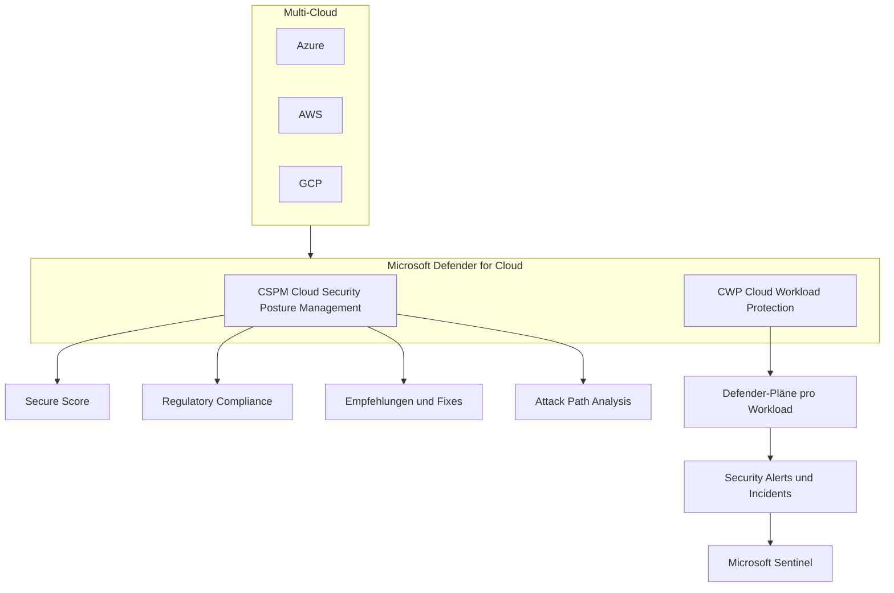
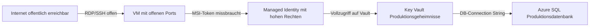
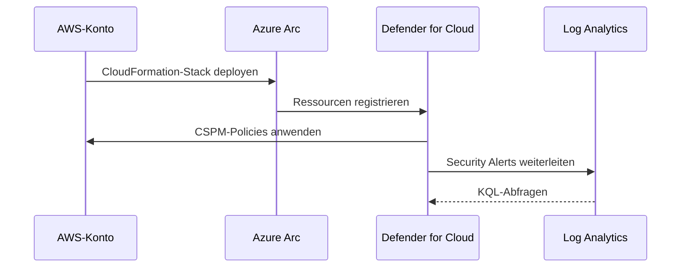
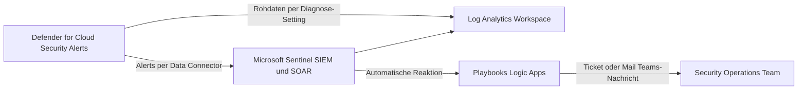
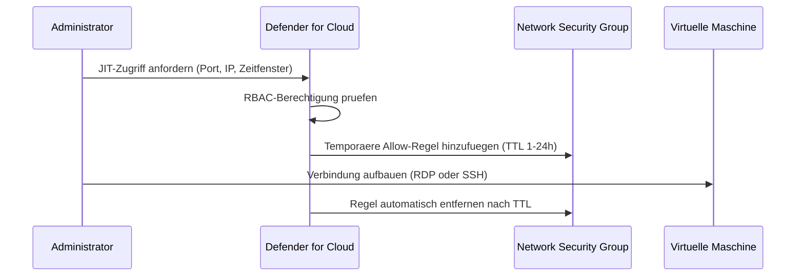
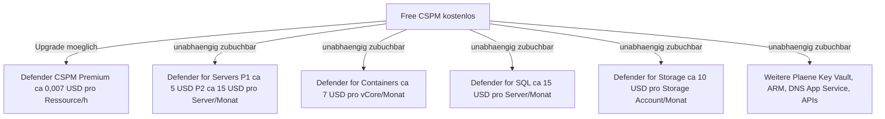

---
tags:
  - azure
  - sicherheit
  - defender
  - cspm
  - cloud-security
  - microsoft-365
aliases:
  - MDfC
  - Defender for Cloud
  - Azure Security Center
  - Microsoft Defender
status: published
---

# Microsoft Defender for Cloud

> [!ABSTRACT] TL;DR
> Microsoft Defender for Cloud ist die zentrale Cloud-Sicherheitsplattform von Microsoft. Sie kombiniert **CSPM** (Cloud Security Posture Management) für kontinuierliche Sicherheitsbewertung mit **CWP** (Cloud Workload Protection) für aktiven Bedrohungsschutz — und deckt dabei Azure, AWS und GCP in einem einzigen Dashboard ab.

---

## Was ist Microsoft Defender for Cloud?

Microsoft Defender for Cloud (früher: *Azure Security Center* + *Azure Defender*) ist eine nativ in Azure integrierte Sicherheitsplattform, die zwei Kernaufgaben erfüllt:

- **CSPM — Cloud Security Posture Management:** Kontinuierliche Bewertung der Sicherheitskonfiguration, Empfehlungen zur Härtung und Messung der Compliance gegenüber Regulierungsstandards (z. B. ISO 27001, CIS, DSGVO).
- **CWP — Cloud Workload Protection:** Aktiver Bedrohungsschutz für spezifische Workloads (VMs, Container, SQL, Storage, APIs usw.) mit Echtzeit-Alerts und Angriffsanalysen.

Der Dienst lässt sich ohne Agent-Installation für grundlegende CSPM-Funktionen nutzen (Free Tier), während erweiterte Defender-Pläne agentenlose oder agentbasierte Deep-Scans aktivieren.



---

## CSPM — Cloud Security Posture Management

### Secure Score

Der **Secure Score** ist die zentrale Kennzahl für den Sicherheitsstatus eines Azure-Abonnements. Er berechnet sich aus dem Verhältnis der erfüllten Sicherheitskontrollen zur maximal erreichbaren Punktzahl.

- Score von 0–100 %
- Jede **Sicherheitskontrolle** (Control) bündelt thematisch verwandte Empfehlungen
- Empfehlungen haben unterschiedliche Gewichtungen (Punkte pro Control)
- Schnelles Erhöhen des Scores: Empfehlungen mit hoher Punktzahl und *Quick Fix* priorisieren

```powershell
# Secure Score für alle Subscriptions abrufen
Get-AzSecuritySecureScore | Select-Object -Property DisplayName, Score, MaxScore, Percentage

# Secure Score einer spezifischen Subscription
Get-AzSecuritySecureScore -Name "ascScore" | Format-List
```

> [!TIP] Ziel-Score
> Ein Secure Score über **70 %** gilt als solide Baseline. Neueinrichtungen starten oft unter 30 % — priorisiere Controls mit dem besten Verhältnis aus Aufwand und Punktgewinn.

### Empfehlungen (Recommendations)

Jede Empfehlung enthält:

| Feld | Beschreibung |
|------|-------------|
| **Severity** | Low / Medium / High / Critical |
| **Freshness** | Wann wurde die Ressource zuletzt geprüft |
| **Quick Fix** | Ein-Klick-Remediation für einfache Fälle |
| **Affected Resources** | Liste der nicht-konformen Ressourcen |
| **Remediation Steps** | Schritt-für-Schritt-Anleitung |
| **Azure Policy** | Zugehörige Policy-Definition |

### Regulatory Compliance

Defender for Cloud mappt Empfehlungen automatisch auf Compliance-Frameworks:

- Microsoft Cloud Security Benchmark (MCSB) — Standard-Framework
- CIS Azure Foundations Benchmark
- ISO 27001:2013 / ISO 27001:2022
- NIST SP 800-53
- PCI DSS
- SOC 2
- DSGVO (EU GDPR)
- BSI C5 (Deutschland)

> [!NOTE] Custom Standards
> Eigene Compliance-Frameworks lassen sich über **Custom Standards** mit selbst definierten Azure Policy-Definitionen erstellen.

---

## Workload Protection — Defender-Pläne (CWP)

Jeder Defender-Plan schützt einen spezifischen Dienst-Typ und wird **pro Abonnement** aktiviert. Die Abrechnung erfolgt nutzungsbasiert.

### Übersicht aller Defender-Pläne

| Defender-Plan | Geschützte Ressource | Schutzart | Preis (ca.) |
|---------------|---------------------|-----------|-------------|
| **Defender for Servers P1** | Azure VMs, Arc-Server | MDE-Integration, JIT, ANH | ~$5 / Server / Monat |
| **Defender for Servers P2** | Azure VMs, Arc-Server | P1 + FIM, Vulnerability Assessment, Agentless | ~$15 / Server / Monat |
| **Defender for SQL (Azure)** | Azure SQL DB, Managed Instance | SQL Injection, anomale Zugriffe | ~$15 / Server / Monat |
| **Defender for SQL (Maschinen)** | SQL auf VMs und Arc | Identische Alerts wie Azure SQL | ~$15 / Server / Monat |
| **Defender for Containers** | AKS, ARO, Arc K8s | Runtime-Bedrohung, Image-Scan, Fehlkonfig | ~$7 / vCore / Monat |
| **Defender for App Service** | Azure App Service | Anfrage-Anomalien, PHP/ASP-Exploits | ~$15 / App Service Plan / Monat |
| **Defender for Storage** | Blob, Files, ADLS Gen2 | Malware-Scan, Datenzugriff-Anomalien | ~$10 / Storage Account / Monat |
| **Defender for Key Vault** | Azure Key Vault | Anomale Zugriffsversuche, Token-Missbrauch | ~$0,02 / 10k Ops |
| **Defender for ARM** | Azure Resource Manager | Subscription-Hijacking, verdächtige ARM-Calls | ~$4 / Abonnement / Monat |
| **Defender for DNS** | Azure DNS | DNS-Exfiltration, DGA-Domains | ~$0,70 / 1M Queries |
| **Defender for APIs** | Azure API Management | API-Missbrauch, Credential-Stuffing | ~$0,007 / API-Aufruf |
| **Defender for DevOps** | GitHub, Azure DevOps | SAST, Secret Scanning, IaC-Scan | im Defender CSPM enthalten |
| **Defender CSPM (Premium)** | Alle Ressourcentypen | Attack Path, Cloud Security Graph, Agentless | ~$0,007 / Ressource / Stunde |

> [!WARNING] Kostenexplosion vermeiden
> Defender-Pläne werden auf **Subscription-Ebene** aktiviert und gelten für **alle** Ressourcen des Typs. Bei großen Umgebungen immer zuerst mit einer Test-Subscription evaluieren und Kosten mit dem Azure-Preisrechner schätzen.

### Defender for Servers — Plan-Vergleich

| Feature | Plan 1 | Plan 2 |
|---------|--------|--------|
| Microsoft Defender for Endpoint (MDE) | ✅ | ✅ |
| Just-in-Time VM Access | ✅ | ✅ |
| Adaptive Network Hardening | ✅ | ✅ |
| Adaptive Application Controls | ❌ | ✅ |
| File Integrity Monitoring | ❌ | ✅ |
| Agentless Vulnerability Assessment | ❌ | ✅ |
| Agentless Disk-Scanning | ❌ | ✅ |
| Qualys / MDSVM Vulnerability Scanner | ❌ | ✅ |

---

## Defender CSPM — Premium Plan

Der **Defender CSPM Premium Plan** erweitert das kostenlose CSPM um kritische Analysefähigkeiten:

### Cloud Security Graph

Ein intern aufgebauter Graph, der alle Azure-Ressourcen, ihre Beziehungen, Netzwerkpfade, Identitäten und Konfigurationen modelliert. Basis für Attack Path Analysis und Security Explorer.

### Attack Path Analysis

Visualisiert realistische Angriffspfade durch die Cloud-Umgebung — z. B. von einer öffentlich erreichbaren VM über einen fehlkonfigurierten Service Principal bis zu einem Key Vault mit Produktionsgeheimnissen.



> [!DANGER] Kritische Angriffspfade
> Ein Angriffspfad endet immer an einem **High-Value Asset** (Schlüssel, Datenbank, Identitätssystem). Microsoft empfiehlt, alle vom System erkannten kritischen Pfade **innerhalb von 24 Stunden** zu schließen.

### Agentless Scanning

- **Disk-Scanning:** Snapshots laufender VMs werden analysiert, ohne Agent zu installieren — Malware-Erkennung, veraltete Pakete, unsichere Konfigurationen
- **Agentless Secret Scanning:** Suche nach hartkodierten Secrets (API-Keys, Passwörter, Zertifikate) in VM-Dateisystemen
- **Agentless Container Posture:** Analyse von Container-Images in ACR ohne laufende Workload

---

## Multi-Cloud Support

Defender for Cloud unterstützt neben Azure auch AWS und GCP als externe Clouds.

### AWS-Integration



- **AWS Connector** via CloudFormation-Stack einrichten
- Unterstützte Dienste: EC2, ECS, EKS, RDS, S3, Lambda
- CSPM-Empfehlungen gegen **AWS Foundations Benchmark (CIS)**
- Defender for Servers Plan 2 auf EC2-Instanzen via Arc-Agent

### GCP-Integration

- **GCP Connector** via Workload Identity Federation
- Unterstützte Dienste: Compute Engine, GKE, Cloud SQL, Cloud Storage
- Empfehlungen gegen **GCP CIS Benchmark**

> [!NOTE] Azure Arc als Brücke
> Alle nicht-Azure-Server (on-premises, AWS EC2, GCP Compute) werden über **Azure Arc** in Defender for Cloud eingebunden. Arc ist kostenlos — nur die Defender-Pläne sind kostenpflichtig.

---

## Defender for DevOps

Defender for DevOps integriert Sicherheitsprüfungen direkt in CI/CD-Pipelines.

### Unterstützte Plattformen

| Plattform | Integration | Scan-Typ |
|-----------|------------|---------|
| **GitHub** | GitHub App | SAST, Secret Scanning, IaC-Scan |
| **Azure DevOps** | ADO Extension | SAST, Secret Scanning, IaC-Scan |
| **GitLab** | Connector (Preview) | SAST, Secret Scanning |

### Funktionen

- **SAST (Static Application Security Testing):** Code-Schwachstellen-Analyse via Microsoft Security DevOps Action
- **Secret Scanning:** Erkennt versehentlich eingecheckte API-Keys, Passwörter, Tokens
- **IaC-Scanning:** Fehlkonfigurationen in Terraform, ARM, Bicep, Kubernetes YAML
- **PR-Annotationen:** Sicherheitsbefunde direkt als Pull-Request-Kommentare

```yaml
# GitHub Actions — Microsoft Security DevOps
name: MSDO Security Scan
on: [push, pull_request]
jobs:
  msdo:
    runs-on: ubuntu-latest
    steps:
      - uses: actions/checkout@v3
      - uses: microsoft/security-devops-action@latest
        id: msdo
      - uses: github/codeql-action/upload-sarif@v3
        with:
          sarif_file: ${{ steps.msdo.outputs.sarifFile }}
```

---

## Security Alerts und Incidents

### Alert-Typen

| Kategorie | Beispiel-Alert |
|-----------|---------------|
| **VM / Server** | Suspicious process executed, Fileless attack detected |
| **Container** | Container running in privileged mode, Crypto mining detected |
| **SQL** | SQL Injection attempt, Unusual data exfiltration |
| **Key Vault** | High volume of operations, Access from unusual location |
| **Storage** | Unusual data exfiltration, Access from Tor exit node |
| **ARM** | Suspicious management activity, Mass resource deletion |
| **DNS** | DNS exfiltration, Communication with C2 server |

### Incident-Korrelation

Defender for Cloud korreliert verwandte Alerts automatisch zu **Incidents**. Ein Incident fasst alle Alerts zusammen, die zur selben Angriffskette gehören — ähnlich wie in Microsoft Sentinel.

> [!TIP] Alert-Tuning — False Positives reduzieren
> - **Alert Suppression Rules:** Alerts für bekannte Ausnahmen (z. B. Wartungsskripte) dauerhaft unterdrücken
> - **Severity-Filter:** Nur High/Critical Alerts in Sentinel weiterleiten, Low/Medium lokal behandeln
> - **Exemptions:** Ressourcen von bestimmten Empfehlungen ausnehmen (wirkt auf Secure Score)

```powershell
# Alert Suppression Rule erstellen (via PowerShell + REST API)
$body = @{
    properties = @{
        alertType             = "VM_SuspectExecutablePath"
        reason                = "KnownValue"
        state                 = "Enabled"
        comment               = "Internes Wartungsskript auf Jump-Host"
        expiryDateUtc         = "2025-12-31T00:00:00Z"
    }
} | ConvertTo-Json -Depth 5

Invoke-AzRestMethod -Method PUT `
    -Path "/subscriptions/{subId}/providers/Microsoft.Security/alertsSuppressionRules/JumpHostMaintenance?api-version=2019-01-01-preview" `
    -Payload $body
```

---

## Integration mit Microsoft Sentinel

Microsoft Defender for Cloud und Sentinel sind komplementäre Dienste — MDfC erkennt Bedrohungen, Sentinel korreliert und reagiert automatisiert.



### Verbindung einrichten

- In Sentinel: **Datenconnectors → Microsoft Defender for Cloud** aktivieren
- Granularität: Pro Subscription oder Tenant-weit (via MDfC Tenant-Einstellungen)
- Alle MDfC-Alerts werden als **SecurityAlert**-Events in Sentinel importiert
- Incidents aus MDfC können mit Sentinel-Incidents zusammengeführt werden (**Bi-directional Sync**)

> [!IMPORTANT] Kein doppeltes Alerting
> Wenn Sentinel als SIEM genutzt wird: MDfC-Alerts in Sentinel zentralisieren und **lokale E-Mail-Benachrichtigungen in MDfC deaktivieren**, um Alert-Fatigue zu vermeiden.

### KQL-Abfragen für Security Alerts

```kusto
// Alle kritischen MDfC-Alerts der letzten 7 Tage
SecurityAlert
| where TimeGenerated > ago(7d)
| where AlertSeverity in ("High", "Critical")
| where ProductName == "Microsoft Defender for Cloud"
| summarize Count = count() by AlertName, AlertSeverity
| sort by Count desc

// Alerts nach betroffener Ressource gruppiert
SecurityAlert
| where TimeGenerated > ago(24h)
| where ProductName == "Microsoft Defender for Cloud"
| extend Resource = tostring(Entities[0].HostName)
| summarize AlertCount = count(), Severities = make_set(AlertSeverity) by Resource
| sort by AlertCount desc

// JIT-Zugriffe der letzten 30 Tage (Activity Log)
AzureActivity
| where TimeGenerated > ago(30d)
| where OperationNameValue == "MICROSOFT.SECURITY/LOCATIONS/JITNETWORKACCESSPOLICIES/INITIATE/ACTION"
| project TimeGenerated, Caller, CallerIpAddress, ResourceGroup, ActivityStatus
| sort by TimeGenerated desc
```

---

## Adaptive Network Hardening

ANH analysiert den tatsächlichen Datenverkehr von VMs und vergleicht ihn mit den konfigurierten NSG-Regeln. Daraus generiert MDfC **Härtungsempfehlungen**:

- Zu weit geöffnete Ports schließen oder einschränken
- Quell-IP-Ranges einengen (z. B. RDP nur aus Corporate-IP erlauben)
- Ungenutzte Allow-Regeln entfernen

```powershell
# ANH-Empfehlungen für eine VM abrufen
Get-AzSecurityAdaptiveNetworkHardening `
    -ResourceGroupName "rg-prod" `
    -ResourceNamespace "Microsoft.Compute" `
    -ResourceType "virtualMachines" `
    -ResourceName "vm-jumphost"
```

> [!NOTE] Voraussetzung für ANH
> ANH benötigt den **MMA/AMA-Agent** oder die **MDE-Integration** auf der VM sowie aktiviertes **Network Watcher** in der Region.

---

## Just-in-Time VM Access

JIT schützt Management-Ports (RDP 3389, SSH 22, WinRM 5985/5986) vor dauerhafter Exposition. Ports werden nur für einen definierten Zeitraum für eine spezifische Quell-IP geöffnet.

### Funktionsweise



### JIT per PowerShell aktivieren

```powershell
# JIT-Policy für eine VM konfigurieren
$JitPolicy = @{
    id    = "/subscriptions/{subId}/resourceGroups/rg-prod/providers/Microsoft.Compute/virtualMachines/vm-jumphost"
    ports = @(
        @{
            number                     = 22
            protocol                   = "TCP"
            allowedSourceAddressPrefix = @("*")
            maxRequestAccessDuration   = "PT3H"
        },
        @{
            number                     = 3389
            protocol                   = "TCP"
            allowedSourceAddressPrefix = @("*")
            maxRequestAccessDuration   = "PT1H"
        }
    )
}

Set-AzJitNetworkAccessPolicy `
    -Kind "Basic" `
    -Location "westeurope" `
    -Name "JitPolicy-vm-jumphost" `
    -ResourceGroupName "rg-prod" `
    -VirtualMachine $JitPolicy
```

> [!TIP] JIT und Azure Bastion kombinieren
> JIT und **Azure Bastion** ergänzen sich ideal: Bastion vermeidet Public IPs komplett, JIT schützt zusätzlich vor nicht-autorisiertem Zugriff auf Netzwerkebene, wenn direkte Verbindungen nötig sind.

---

## File Integrity Monitoring

FIM überwacht Änderungen an kritischen Systemdateien, Registry-Schlüsseln und Verzeichnissen auf Windows- und Linux-VMs.

### Standard-Überwachungspfade

| Betriebssystem | Überwachte Bereiche |
|---------------|---------------------|
| **Windows** | `C:\Windows\System32`, `C:\Windows\SysWOW64`, Registry `HKLM\SOFTWARE\Microsoft\Windows NT\CurrentVersion` |
| **Linux** | `/etc`, `/bin`, `/sbin`, `/usr/bin`, `/boot` |

### FIM per Bicep aktivieren

```bicep
resource fimWorkspaceSolution 'Microsoft.OperationsManagement/solutions@2015-11-01-preview' = {
  name: 'ChangeTracking(${workspaceName})'
  location: location
  properties: {
    workspaceResourceId: logAnalyticsWorkspace.id
  }
  plan: {
    name: 'ChangeTracking(${workspaceName})'
    publisher: 'Microsoft'
    product: 'OMSGallery/ChangeTracking'
    promotionCode: ''
  }
}
```

### FIM-Änderungen per KQL auswerten

```kusto
// FIM-Änderungen der letzten 24 Stunden
ConfigurationChange
| where TimeGenerated > ago(24h)
| where ConfigChangeType in ("Files", "Registry", "WindowsServices", "Daemons")
| project TimeGenerated, Computer, ConfigChangeType, FieldsChanged, FileSystemPath
| sort by TimeGenerated desc

// Häufig geänderte Pfade — Rauscher identifizieren
ConfigurationChange
| where TimeGenerated > ago(7d)
| where ConfigChangeType == "Files"
| summarize ChangeCount = count() by FileSystemPath, Computer
| sort by ChangeCount desc
| take 20
```

> [!WARNING] FIM-Rauschen reduzieren
> Standard-Deployment-Prozesse (z. B. Windows Update, Ansible, Puppet) erzeugen viele FIM-Events. Bekannte Update-Pfade durch **Ausschlusslisten** von der Alarmierung ausschließen — nicht aber aus der Protokollierung entfernen.

---

## Kosten im Überblick



> [!TIP] Kosten optimieren
> - **Free CSPM** reicht für Empfehlungen und Secure Score — kein Budget benötigt
> - Defender-Pläne **selektiv aktivieren**: Nur Pläne für Dienste aktivieren, die tatsächlich genutzt werden
> - **Defender for Servers P1** statt P2, wenn agentloses Scanning nicht benötigt wird
> - Jeder Defender-Plan bietet **30 Tage kostenlosen Test** — Evaluierung vor Commitment empfohlen

---

## Praxistipps

> [!TIP] Empfohlene Onboarding-Reihenfolge
> - Free CSPM aktivieren und Baseline-Secure-Score messen
> - Kritische Empfehlungen (High Severity) mit Quick Fix schließen
> - Defender for Servers P2 für Produktions-VMs aktivieren
> - JIT für alle Management-Ports einrichten
> - Defender for Containers aktivieren (falls AKS vorhanden)
> - Defender CSPM Premium für Attack Path Analysis evaluieren
> - Sentinel-Connector einrichten und Playbooks für kritische Alerts definieren

> [!WARNING] Häufige Fehler und Fallstricke
> - **Defender auf Management-Subscriptions vergessen:** Oft werden Test- und Dev-Subscriptions ausgenommen — gerade dort entstehen Fehlkonfigurationen, die in Prod übernommen werden.
> - **JIT und direkte NSG-Regeln kombinieren:** Manuelle NSG-Allow-Regeln für RDP/SSH überschreiben die JIT-Logik. Immer prüfen, ob eine dauerhafte Regel JIT umgeht.
> - **FIM ohne Ausschlusslisten:** Erzeugt massives Rauschen und führt zu Alert-Fatigue im SOC.
> - **Empfehlungen ignorieren statt exemptieren:** Ressourcen, für die eine Empfehlung absichtlich nicht gilt, per **Exemption** ausklammern — nicht einfach ignorieren, da dies den Secure Score verfälscht.

---

## Verwandte Notizen

- [[Microsoft Defender for Containers]]
- [[Azure Security Benchmark]]
- [[Azure Firewall Manager]]
- [[Log Analytics Workspace]]
- [[Azure RBAC]]
