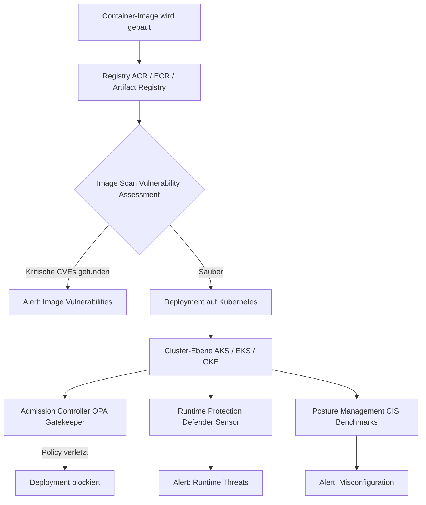
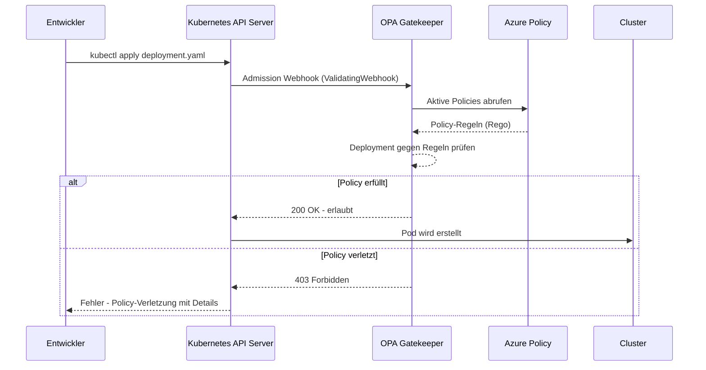
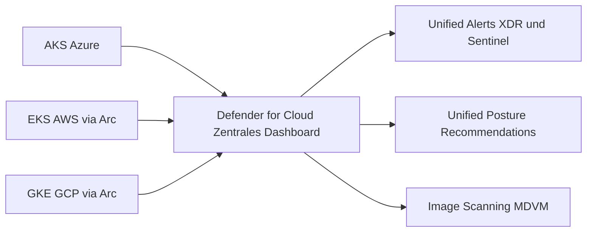

---
tags:
  - azure
  - security
  - defender
  - containers
  - kubernetes
  - microsoft-365
aliases:
  - Defender for Containers
  - MDfC Containers
---

# Microsoft Defender for Containers

> [!ABSTRACT] TL;DR
> Microsoft Defender for Containers ist die cloudnative Sicherheitslösung für containerisierte Workloads in Azure, AWS und GCP. Sie schützt auf drei Ebenen — **Registry** (Image Scanning), **Cluster** (Runtime-Bedrohungserkennung & Posture) und **Host** (Defender Sensor als DaemonSet). Alerts fließen zentral in Microsoft Defender XDR und Microsoft Sentinel ein.

---

## Was ist Microsoft Defender for Containers?

Microsoft Defender for Containers ist ein Tarif (Plan) innerhalb von **Microsoft Defender for Cloud** und bietet umfassenden Schutz für containerisierte Workloads — von der Image-Erstellung in der Registry bis zur Laufzeit auf dem Cluster-Node. Die Lösung richtet sich an Teams, die Kubernetes-Cluster (AKS, EKS, GKE) und Container-Registrierungen (ACR, ECR, Artifact Registry) betreiben.

Die drei Kernfunktionen im Überblick:

- **Vulnerability Assessment** — Schwachstellen in Container-Images automatisch erkennen (via Microsoft Defender Vulnerability Management)
- **Runtime Threat Detection** — Verdächtige Aktivitäten in laufenden Containern und auf Node-Ebene aufspüren
- **Security Posture Management** — Fehlkonfigurationen in Kubernetes gegen CIS Benchmarks prüfen und Admission-Policies durchsetzen

> [!NOTE] Kein eigenständiges Produkt
> Defender for Containers wird über **Microsoft Defender for Cloud** aktiviert und abgerechnet. Der Plan muss pro Subscription aktiviert werden und gilt dann für alle Kubernetes-Cluster und Container-Registrierungen in dieser Subscription.

---

## Schutzebenen

Defender for Containers arbeitet auf drei unabhängigen, sich ergänzenden Ebenen.



### Übersicht der Schutzebenen

| Schutzebene | Methode | Anforderung | Alert-Typ |
|:------------|:--------|:------------|:----------|
| **Registry** | Agentless Image Scanning (MDVM) | ACR / ECR / AR verbunden | `Container image vulnerability` |
| **Cluster – Posture** | Kubernetes API Audit Logs | Defender-Plan aktiv | `Kubernetes misconfiguration` |
| **Cluster – Runtime** | Defender Sensor (DaemonSet) | Agent auf Nodes deployt | `K8S_*`, `AKS_*` |
| **Cluster – Admission** | Azure Policy / OPA Gatekeeper | Add-on aktiviert | `K8S_ADMISSION_*` |
| **Host** | Defender Sensor + Log Analytics | DaemonSet + Workspace | `VM_*`, `Container_*` |

---

## Container Image Scanning

### Agentless vs. Agent-basiertes Scanning

> [!INFO] Zwei Scan-Ansätze
> Beide Methoden nutzen im Hintergrund **Microsoft Defender Vulnerability Management (MDVM)** als CVE-Datenbank und Scan-Engine. Sie unterscheiden sich jedoch erheblich in Deployment, Zeitpunkt und Coverage.

| Kriterium | Agentless Scanning | Agent-basiertes Scanning |
|:----------|:-------------------|:-------------------------|
| **Deployment** | Kein Agent nötig | Defender Sensor (DaemonSet) |
| **Scan-Zeitpunkt** | Bei Push in Registry + alle 24 h | Laufzeit — direkt auf dem Node |
| **Coverage** | Alle Images in der Registry | Nur aktuell gestartete Container |
| **Cluster-Overhead** | Keiner | CPU + RAM des DaemonSet-Pods |
| **Multi-Cloud** | ACR, ECR (AWS), AR (GCP) | Alle Arc-verbundenen Cluster |
| **Latenz** | Minuten nach Push | Nahezu Echtzeit |

### Vulnerability Assessment in ACR

Ist Defender for Containers aktiv, scannt MDVM automatisch alle Images in verbundenen **Azure Container Registries (ACR)**:

- Bei jedem `docker push` in die Registry
- Periodisch alle 24 Stunden für bereits vorhandene Images
- Bei Pull, sofern das Image seit dem letzten Scan verändert wurde

Erkannte Schwachstellen erscheinen als **Recommendations** in Defender for Cloud unter dem Titel *„Container images in ACR should have vulnerability findings resolved"* und sind nach CVE-Schweregrad (Critical, High, Medium, Low) gefiltert.

> [!TIP] Nur produktiv genutzte Images priorisieren
> Viele Registries enthalten veraltete oder nie eingesetzte Images. Priorisiere Schwachstellen in Images, die tatsächlich auf Produktionsclustern laufen — diese sind in der Recommendation mit dem betroffenen Cluster verknüpft.

> [!WARNING] Agentless Scanning erfordert Connector-Einrichtung
> Für ECR (AWS) und Artifact Registry (GCP) muss die Cloud-Umgebung über **Defender for Cloud Multicloud Connectors** angebunden sein. Ohne aktiven Connector werden keine Images dieser Registries gescannt.

---

## Runtime Protection

### Defender Sensor (DaemonSet)

Der **Defender Sensor** ist ein Kubernetes DaemonSet, das auf jedem Node des Clusters ausgeführt wird. Er überwacht systemnahe Aktivitäten auf Betriebssystemebene (eBPF / auditd) und meldet Anomalien an Defender for Cloud.

```yaml
# Typische Ressourcen-Anforderungen des Defender Sensor Pods
resources:
  requests:
    cpu: 100m
    memory: 64Mi
  limits:
    cpu: 500m
    memory: 256Mi
```

> [!WARNING] DaemonSet-Overhead einplanen
> Jeder Node erhält genau einen Defender Sensor Pod. Bei Clustern mit vielen kleinen Nodes (z. B. Spot-Node-Pools mit 2 vCPU / 4 GiB) ist der Memory-Overhead von ca. **64–256 MiB pro Node** zu berücksichtigen. Empfehlung: Für Produktions-Node-Pools mindestens **256 MiB RAM** als Buffer reservieren.

Der Sensor erkennt unter anderem:

- Privilegierte Container-Ausführungen und Container-Escapes
- Credential-Dumping innerhalb von Containern (z. B. `env`, `/proc/*/environ`)
- Reverse Shells und Command-and-Control-Verbindungen
- Verdächtige Prozesse — Kryptominer, Port-Scanner, Exploit-Frameworks
- Manipulation sensibler Verzeichnisse (`/etc`, `/root`, `/var/run/docker.sock`)

### Unterstützte Cluster-Typen

| Cluster-Typ | Onboarding | Sensor-Deployment |
|:------------|:-----------|:------------------|
| **AKS (Azure)** | Automatisch via Defender-Plan | Automatisch als AKS-Extension |
| **Arc-enabled Kubernetes** | Manuelle Arc-Verbindung + Extension | Automatisch nach Extension-Install |
| **EKS (AWS)** | Arc-Connector oder nativer AWS-Connector | Via Arc-Extension |
| **GKE (GCP)** | Arc-Connector oder nativer GCP-Connector | Via Arc-Extension |

---

## Kubernetes Security Posture

### Fehlkonfigurationen erkennen — CIS Benchmarks

Defender for Containers prüft Kubernetes-Konfigurationen kontinuierlich gegen den **CIS Kubernetes Benchmark** sowie Azure-eigene Best Practices. Die Prüfung erfolgt rein agentless über die Kubernetes API und Audit Logs — ohne DaemonSet.

Typische erkannte Fehlkonfigurationen:

- Container laufen als Root (`runAsNonRoot` nicht gesetzt)
- Privilegierte Container (`privileged: true` im SecurityContext)
- Fehlendes Read-Only-Root-Filesystem (`readOnlyRootFilesystem: false`)
- Fehlende Resource Limits (CPU/Memory)
- Öffentlich exponierte Kubernetes API ohne RBAC-Einschränkung
- Übermäßige RBAC-Rechte (ClusterAdmin für reguläre ServiceAccounts)
- Fehlende Network Policies (alle Pods kommunizieren uneingeschränkt)

> [!IMPORTANT] Posture-Scanning ohne Agent
> Das CIS-Benchmark-Scanning nutzt ausschließlich die **Kubernetes Audit Logs** und die **Kubernetes API** — kein DaemonSet erforderlich. Es genügt, den Defender-Plan zu aktivieren; die Ergebnisse erscheinen innerhalb weniger Stunden in Defender for Cloud.

---

## Admission Controller — OPA Gatekeeper

### Funktionsweise

Der **Admission Controller** blockiert oder warnt bei Deployments, die definierte Sicherheitsrichtlinien verletzen, noch *bevor* der Pod gestartet wird. In Azure geschieht dies über das **Azure Policy Add-on für Kubernetes**, das intern **OPA Gatekeeper** als Webhook-Engine verwendet.



### Eingebaute Policies (Auswahl)

| Policy-Name | Beschreibung | Empfohlener Effekt |
|:------------|:-------------|:-------------------|
| `K8s-no-privileged-containers` | Verhindert privilegierte Container | Deny |
| `K8s-container-no-privilege-escalation` | Kein `allowPrivilegeEscalation` | Deny |
| `K8s-require-read-only-rootfs` | Read-Only Root Filesystem erzwingen | Audit → Deny |
| `K8s-allowed-registries` | Nur zugelassene Image-Registries erlauben | Deny |
| `K8s-resource-limits` | CPU/Memory Limits für alle Container | Deny |
| `K8s-no-latest-tag` | `:latest`-Tag in Images verbieten | Audit → Deny |
| `K8s-no-host-namespace` | Kein `hostPID`, `hostIPC`, `hostNetwork` | Deny |

> [!TIP] Erst im Audit-Modus starten, dann auf Deny umstellen
> Neue Policies sollten zunächst im **Audit-Modus** deployt werden: Verstöße werden geloggt, aber nicht blockiert. Nach Analyse der Audit-Ergebnisse und Anpassung der Workloads kann auf **Deny** umgestellt werden — so werden keine laufenden Deployments unerwartet unterbrochen.

> [!WARNING] Breaking Change bei Deny-Umstellung
> Wenn OPA Gatekeeper von Audit auf Deny umgestellt wird, können CI/CD-Pipelines mit ungültigen Manifesten sofort fehlschlagen. Teste die Umstellung immer in einer **Staging-Umgebung** und stelle sicher, dass alle Manifeste die Policy-Anforderungen erfüllen.

---

## Security Alerts

Defender for Containers generiert Alerts bei verdächtigen Aktivitäten im Cluster, in Containern und auf Node-Ebene. Alerts sind in Schweregrade eingeteilt: **High**, **Medium**, **Low** und **Informational**.

### Wichtige Alert-Kategorien

| Alert-Präfix | Kategorie | Beispiel-Alert |
|:------------|:----------|:---------------|
| `K8S_` | Kubernetes-Kontrollebene | `K8S_PrivilegedContainer` |
| `AKS_` | AKS-spezifische Aktivitäten | `AKS_SensitiveMount` |
| `Container_` | Container-Runtime-Aktivitäten | `Container_MaliciousCommandInContainer` |
| `CONTAINER_` | Image- / Registry-bezogen | `CONTAINER_ImageFromSuspiciousRegistry` |
| `K8S_NODE_` | Node-Ebene (Host-OS) | `K8S_NODE_DomainLookup` |

### Alerts, die häufig getuned werden müssen

> [!WARNING] False Positives reduzieren
> Folgende Alerts erzeugen in Dev/Test-Umgebungen oder bei bestimmten Tooling-Stacks regelmäßig false positives:
>
> - **`K8S_PrivilegedContainer`** — wird durch Monitoring-Agents (Prometheus Node Exporter, Datadog Agent, Falco) ausgelöst, die legitim privilegiert laufen müssen
> - **`Container_MaliciousCommandInContainer`** — CI/CD-Runner starten Debug-Tools (`curl`, `wget`, `nc`) im Container
> - **`AKS_SensitiveMount`** — legitime Log-Mounts auf `/var/log` oder `/proc` durch Logging-Agents
> - **`K8S_NODE_DomainLookup`** — normale DNS-Auflösung wird bei hohem Volumen als C2-Kommunikation fehlinterpretiert
>
> Nutze **Alert Suppression Rules** in Defender for Cloud, um bekannte, legitime Aktivitäten gezielt auszublenden, ohne den gesamten Alert-Typ zu deaktivieren.

---

## Integration mit Defender XDR und Microsoft Sentinel

### Microsoft Defender XDR

Alle Container-Alerts fließen automatisch in **Microsoft Defender XDR** ein, wo sie mit Identitäts-, Endpoint- und Cloud-Alerts korreliert und zu **Incidents** zusammengefasst werden.

- **Automatische Korrelation**: Container-Alert + verdächtige Entra-ID-Anmeldung = ein Incident
- **Attack Story**: Visualisierung der vollständigen Angriffskette vom Image-Pull bis zur lateralen Bewegung
- **Automated Investigation & Response (AIR)**: Automatisierte Untersuchung für bekannte Container-Angriffsmuster

### Microsoft Sentinel

Defender for Containers wird über den **Microsoft Defender for Cloud**-Connector an Sentinel angebunden:

- Alerts erscheinen in der Tabelle `SecurityAlert` — das Feld `AlertType` enthält den jeweiligen Alert-Präfix (`K8S_`, `AKS_`, `Container_`)
- Incidents werden aus Sentinel-Analytics-Rules erstellt und mit weiteren Log-Quellen (`ContainerLog`, `AzureDiagnostics`) korreliert
- **Bidirektionale Synchronisation**: In Sentinel geschlossene Incidents werden automatisch in Defender for Cloud aktualisiert

---

## Multi-Cloud Support

### AWS (EKS) und GCP (GKE) einbinden

Defender for Containers schützt nicht nur Azure-native Workloads. Über **Azure Arc** und die **Multicloud-Connectors** werden EKS- und GKE-Cluster in das zentrale Dashboard integriert.



### EKS-Cluster via Azure Arc einbinden

```bash
# Schritt 1: EKS-Cluster mit Azure Arc verbinden
az connectedk8s connect \
  --name my-eks-cluster \
  --resource-group rg-multicloud \
  --location westeurope

# Schritt 2: Verbindungsstatus prüfen
az connectedk8s show \
  --name my-eks-cluster \
  --resource-group rg-multicloud \
  --query "connectivityStatus"

# Schritt 3: Defender-Extension auf dem Arc-Cluster aktivieren
az k8s-extension create \
  --name microsoft-defender \
  --extension-type microsoft.azuredefender.kubernetes \
  --scope cluster \
  --cluster-name my-eks-cluster \
  --resource-group rg-multicloud \
  --cluster-type connectedClusters \
  --configuration-settings "logAnalyticsWorkspaceResourceID=/subscriptions/<sub-id>/resourceGroups/<rg>/providers/Microsoft.OperationalInsights/workspaces/<ws-name>"

# Schritt 4: Extension-Status überprüfen
az k8s-extension show \
  --name microsoft-defender \
  --cluster-name my-eks-cluster \
  --resource-group rg-multicloud \
  --cluster-type connectedClusters \
  --query "installState"
```

> [!NOTE] GKE-Einrichtung ist analog
> Für GKE-Cluster wird derselbe Arc-Onboarding-Prozess verwendet. Alternativ steht in Defender for Cloud ein **nativer AWS/GCP-Connector** zur Verfügung, der Arc-Schritte für ECR-Image-Scanning teilweise automatisiert — Runtime-Schutz erfordert jedoch weiterhin den Arc-Connected-Cluster.

---

## Kosten

> [!IMPORTANT] Preismodell
> Defender for Containers wird **pro vCore der Kubernetes-Nodes** abgerechnet — stündlich, basierend auf den tatsächlich laufenden Node-vCores im Cluster. Image Scanning (MDVM) ist im Plan enthalten.

| Ressource | Preis (ca., Stand 2024) | Hinweis |
|:----------|:------------------------|:--------|
| AKS-Nodes | ~0,0113 USD / vCore / h | Alle Node Pools in der Subscription |
| Arc-Cluster (EKS/GKE) | ~0,0113 USD / vCore / h | Gleicher Preis wie AKS |
| Image Scanning (MDVM) | Im Plan enthalten | Kein Aufpreis pro Image |
| Admission Controller | Kostenlos | Azure Policy Add-on ist gratis |
| Agentless-Only (ohne DaemonSet) | Im Plan enthalten | Kein Rabatt für Agent-losen Betrieb |

> [!TIP] Kosten optimieren
> - **Dev/Test-Cluster ausschließen**: Defender-Plan nur auf Produktions-Subscriptions oder dedizierte Resource Groups begrenzen (via Defender for Cloud Scope-Einstellungen)
> - **Spot-Node-Pools**: Nodes in Spot-Pools werden nur für die tatsächliche Laufzeit berechnet — bei Auto-Scale-down entstehen keine Kosten
> - **Azure Pricing Calculator**: Vor der Aktivierung kalkulieren — bei großen Clustern (100+ Nodes à 8 vCPU) können monatliche Kosten schnell 1.000+ USD erreichen

---

## Einrichtung & Aktivierung

### Defender for Containers per PowerShell aktivieren

```powershell
# Defender for Containers auf Subscription-Ebene aktivieren
Set-AzSecurityPricing `
  -Name "Containers" `
  -PricingTier "Standard"

# Aktivierung überprüfen
Get-AzSecurityPricing -Name "Containers" |
  Select-Object Name, PricingTier, FreeTrialRemainingTime

# Azure Policy Add-on (Admission Controller) für AKS-Cluster aktivieren
az aks enable-addons `
  --addons azure-policy `
  --name myAKSCluster `
  --resource-group rg-production

# Auto-Provisioning des Defender Sensors für alle AKS-Cluster einschalten
Set-AzSecurityAutoProvisioningSetting `
  -Name "mma-agent" `
  -EnableAutoProvision
```

### Defender Sensor Status prüfen

```bash
# DaemonSet-Status im AKS-Cluster prüfen
kubectl get daemonset microsoft-defender-collector-ds \
  --namespace kube-system

# Alle Defender-Sensor-Pods anzeigen
kubectl get pods \
  --namespace kube-system \
  --selector app=microsoft-defender-collector \
  --output wide

# Logs eines Sensor-Pods abrufen (letzte 50 Zeilen)
kubectl logs \
  --namespace kube-system \
  --selector app=microsoft-defender-collector \
  --tail=50

# OPA Gatekeeper Webhook-Status prüfen
kubectl get validatingwebhookconfiguration | grep gatekeeper
kubectl get constrainttemplate
```

### Bicep: Defender for Containers auf Subscription-Ebene

```bicep
targetScope = 'subscription'

resource defenderForContainers 'Microsoft.Security/pricings@2023-01-01' = {
  name: 'Containers'
  properties: {
    pricingTier: 'Standard'
    extensions: [
      {
        name: 'AgentlessDiscoveryForKubernetes'
        isEnabled: 'True'
      }
      {
        name: 'ContainerRegistriesVulnerabilityAssessments'
        isEnabled: 'True'
      }
    ]
  }
}
```

---

## KQL-Abfragen für Container-Security-Alerts

### Alle Container-Alerts der letzten 7 Tage

```kusto
SecurityAlert
| where TimeGenerated > ago(7d)
| where AlertType has_any ("K8S_", "AKS_", "Container_", "CONTAINER_")
| project
    TimeGenerated,
    AlertName,
    AlertSeverity,
    AlertType,
    CompromisedEntity,
    Description,
    RemediationSteps
| sort by TimeGenerated desc
```

### High-Severity-Alerts nach Cluster gruppiert

```kusto
SecurityAlert
| where TimeGenerated > ago(30d)
| where AlertSeverity == "High"
| where AlertType has_any ("K8S_", "AKS_", "Container_")
| extend ClusterName = tostring(parse_json(ExtendedProperties)["Kubernetes cluster name"])
| summarize
    AlertCount  = count(),
    LatestAlert = max(TimeGenerated)
    by ClusterName, AlertType
| sort by AlertCount desc
```

### Privilegierte Container-Starts erkennen

```kusto
SecurityAlert
| where AlertType == "K8S_PrivilegedContainer"
| extend Props    = parse_json(ExtendedProperties)
| extend
    Namespace = tostring(Props["Kubernetes namespace"]),
    PodName   = tostring(Props["Pod name"]),
    Image     = tostring(Props["Container image"]),
    NodeName  = tostring(Props["Node name"])
| project TimeGenerated, Namespace, PodName, Image, NodeName, AlertSeverity
| sort by TimeGenerated desc
```

### Image-Schwachstellen aus Defender for Cloud

```kusto
SecurityRecommendation
| where RecommendationName has "container image"
| where RecommendationState == "Unhealthy"
| project
    TimeGenerated,
    RecommendationName,
    RecommendationState,
    ResourceId,
    RecommendationSeverity
| sort by RecommendationSeverity asc, TimeGenerated desc
```

### Verdächtige Container-Aktivitäten — stündliche Korrelation

```kusto
SecurityAlert
| where TimeGenerated > ago(24h)
| where AlertType has_any ("K8S_", "Container_")
| extend ClusterName = tostring(parse_json(ExtendedProperties)["Kubernetes cluster name"])
| extend Namespace   = tostring(parse_json(ExtendedProperties)["Kubernetes namespace"])
| summarize
    AlertTypes  = make_set(AlertType),
    AlertCount  = count(),
    MaxSeverity = max(AlertSeverity)
    by ClusterName, Namespace, bin(TimeGenerated, 1h)
| where AlertCount > 2
| sort by AlertCount desc
```

---

## Praxistipps & Best Practices

> [!TIP] Stufenweises Rollout nach Umgebung
> Aktiviere Defender for Containers zunächst nur für **Produktions-Subscriptions**. Dev/Test-Umgebungen können später hinzugefügt werden. So lernst du das Alert-Verhalten deiner Workloads kennen, bevor du Suppression Rules definierst.

> [!TIP] Least Privilege für den Defender Sensor
> Der DaemonSet-ServiceAccount benötigt erhöhte Berechtigungen auf dem Host-Node. Überprüfe regelmäßig via `kubectl describe clusterrolebinding`, welche Rechte dem Sensor zugewiesen sind, und stelle sicher, dass er **keine `cluster-admin`-Rechte** besitzt.

> [!IMPORTANT] CIS-Empfehlungen priorisieren
> Nicht alle CIS-Recommendations sind sofort umsetzbar. Priorisiere nach Schweregrad:
>
> - **High** → sofort beheben (Woche 1)
> - **Medium** → im nächsten Sprint
> - **Low** → Backlog, mittelfristig planen
>
> Nutze den **Secure Score** in Defender for Cloud als Fortschrittsindikator.

> [!DANGER] Kein Defender Sensor bedeutet keine Runtime-Erkennung
> Auch ohne DaemonSet (Agentless-only) ist ein Basisschutz aktiv — Image Scanning und Posture-Management funktionieren weiterhin. Jedoch fehlen **Runtime Threat Detection** und **Host-Level Alerts** vollständig. Für Produktionscluster mit sensiblen Workloads ist der Sensor nicht optional.

> [!WARNING] Netzwerk-Anforderungen für den Sensor prüfen
> Der Defender Sensor benötigt ausgehende HTTPS-Verbindungen zu Azure-Diensten (`*.ods.opinsights.azure.com`, `*.oms.opinsights.azure.com`). Bei Clustern mit restriktiven Egress-Firewalls oder Private Link müssen diese Endpunkte explizit erlaubt werden — sonst bleibt der Sensor stumm, ohne Fehlermeldung im Portal.

---

## Verwandte Notizen

- [[Microsoft Defender for Cloud]]
- [[Azure Kubernetes Service]]
- [[Azure Security Benchmark]]
- [[Microsoft Defender XDR]]
- [[Microsoft Sentinel]]
- [[Azure Container Registry]]
