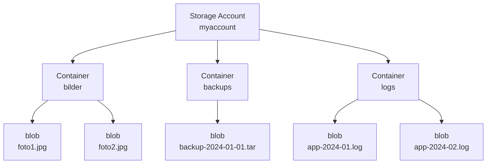

---
tags:
  - azure
  - storage
  - blob-storage
  - object-storage
  - lifecycle-management
aliases:
  - Azure Blob
  - Blob Storage Azure
  - Object Storage Azure
---

# Azure Blob Storage

> [!ABSTRACT]
> Azure Blob Storage ist der skalierbarer Objektspeicher von Microsoft Azure für unstrukturierte Daten. Er eignet sich für Videos, Bilder, Backups, Logs, Static Websites und Big-Data-Workloads. Mit Milliarden von Objekten und Exabytes an Kapazität ist er der Kern der Azure-Speicherplattform.

---

## Was ist Blob Storage?

Blob Storage (Binary Large Object) ist ein **Objektspeicher** für unstrukturierte Daten. Im Gegensatz zu Dateisystemen gibt es keine echte Verzeichnisstruktur — Objekte werden in flachen Containern gespeichert und über HTTP/HTTPS-URLs adressiert.

**Typische Anwendungsfälle:**
- Bilder, Videos, Audio-Dateien für Web-Apps
- VM-Backups und Disaster Recovery
- Log-Dateien und Monitoring-Daten
- Static Website Hosting
- Big Data Pipelines (Input/Output)
- Software-Distribution und Container Images

---

## Blob-Typen

| Typ | Max Größe | Anwendungsfall | Besonderheiten |
|-----|-----------|----------------|----------------|
| **Block Blob** | 190,7 TiB | Dateien, Bilder, Videos, Backups | In Blöcken hochgeladen (max 4.000 MiB/Block), parallel uploadbar |
| **Append Blob** | 195 GiB | Log-Dateien, Streaming-Daten | Nur Anhängen am Ende möglich, kein Überschreiben |
| **Page Blob** | 8 TiB | VHD-Dateien, nicht-verwaltete Disks | Zufälliger Read/Write-Zugriff, 512-Byte-Pages |

> [!NOTE]
> Für neue Anwendungen sind **Block Blobs** die Standardwahl. Page Blobs werden hauptsächlich für Legacy-Unmanaged-Disks verwendet. Managed Disks sind die moderne Alternative zu Page Blobs.

---

## Hierarchie: Account → Container → Blob



**URL-Schema:**
```
https://{account}.blob.core.windows.net/{container}/{blob-name}
```

Virtuelle Verzeichnisse entstehen durch `/` im Blob-Namen:
```
https://myaccount.blob.core.windows.net/backups/2024/01/backup.tar.gz
```

---

## Anonymous Access Levels

| Level | Container auflisten | Blob lesen | Beschreibung |
|-------|---------------------|------------|--------------|
| **Private** (Standard) | Nein | Nein | Nur mit Authentifizierung |
| **Blob** | Nein | Ja | Blobs öffentlich lesbar, aber kein Container-Listing |
| **Container** | Ja | Ja | Alles öffentlich (Container + alle Blobs) |

> [!WARNING]
> Anonymous Access ist standardmäßig auf Account-Ebene **deaktiviert** und muss explizit aktiviert werden. Für Produktionsdaten niemals Container-Level verwenden. Nutze stattdessen SAS-Tokens oder Entra ID-Auth.

---

## Blob Access Tiers

Tiers können pro Blob oder als Container-Default gesetzt werden:

| Tier | Speicherkosten | Zugriffskosten (Lesen) | Mindest-Speicherdauer | Anwendungsfall |
|------|---------------|------------------------|----------------------|----------------|
| **Hot** | ~0,018 $/GB/Monat | Niedrig | Keine | Aktive Daten, häufiger Zugriff |
| **Cool** | ~0,01 $/GB/Monat | Mittel | 30 Tage | Selten genutzte Daten |
| **Cold** | ~0,004 $/GB/Monat | Hoch | 90 Tage | Quartals-Backups |
| **Archive** | ~0,00099 $/GB/Monat | Sehr hoch | 180 Tage | Compliance, Langzeitarchiv |

```powershell
# Tier eines einzelnen Blobs ändern
$ctx = New-AzStorageContext -StorageAccountName "myaccount" -UseConnectedAccount
$blob = Get-AzStorageBlob -Container "backups" -Blob "backup-old.tar" -Context $ctx
$blob.BlobClient.SetAccessTier("Cool")
```

---

## Lifecycle Management Policies

Automatisiertes Blob-Management durch JSON-Richtlinien:

```json
{
  "rules": [
    {
      "name": "log-lifecycle",
      "enabled": true,
      "type": "Lifecycle",
      "definition": {
        "filters": {
          "blobTypes": ["blockBlob"],
          "prefixMatch": ["logs/"]
        },
        "actions": {
          "baseBlob": {
            "tierToCool": { "daysAfterModificationGreaterThan": 30 },
            "tierToCold": { "daysAfterModificationGreaterThan": 60 },
            "tierToArchive": { "daysAfterModificationGreaterThan": 90 },
            "delete": { "daysAfterModificationGreaterThan": 365 }
          }
        }
      }
    },
    {
      "name": "backup-cleanup",
      "enabled": true,
      "type": "Lifecycle",
      "definition": {
        "filters": {
          "blobTypes": ["blockBlob"],
          "prefixMatch": ["backups/daily/"]
        },
        "actions": {
          "baseBlob": {
            "delete": { "daysAfterModificationGreaterThan": 90 }
          }
        }
      }
    }
  ]
}
```

---

## Blob Versioning

Automatische Versionierung jeder Blob-Änderung:

- Jede Schreiboperation erstellt eine neue Version
- Frühere Versionen sind über Version-ID abrufbar
- Versionen belegen Speicherplatz und erzeugen Kosten
- Kombination mit Lifecycle Management empfohlen (alte Versionen archivieren/löschen)

```powershell
# Versioning aktivieren
Update-AzStorageBlobServiceProperty `
    -ResourceGroupName "myRG" `
    -StorageAccountName "myaccount" `
    -IsVersioningEnabled $true

# Alle Versionen eines Blobs anzeigen
$ctx = New-AzStorageContext -StorageAccountName "myaccount" -UseConnectedAccount
Get-AzStorageBlob -Container "mycontainer" -Blob "datei.txt" -IncludeVersion -Context $ctx
```

> [!TIP]
> Versioning und Soft Delete zusammen aktivieren für maximalen Datenschutz. Lifecycle Management sollte Versionen nach einer definierten Zeit löschen um Kosten zu kontrollieren.

---

## Soft Delete

Schutz gegen versehentliches Löschen:

```powershell
# Soft Delete aktivieren (30 Tage)
$ctx = New-AzStorageContext -StorageAccountName "myaccount" -UseConnectedAccount
Enable-AzStorageDeleteRetentionPolicy -RetentionDays 30 -Context $ctx

# Gelöschte Blobs anzeigen
Get-AzStorageBlob -Container "mycontainer" -Context $ctx -IncludeDeleted | 
    Where-Object { $_.IsDeleted }

# Blob wiederherstellen
$blob = Get-AzStorageBlob -Container "mycontainer" -Blob "wichtig.txt" `
    -Context $ctx -IncludeDeleted | Where-Object { $_.IsDeleted } | Select-Object -First 1
$blob.BlobBaseClient.Undelete()
```

---

## Point-in-Time Restore

Gesamten Container auf einen früheren Zeitpunkt zurücksetzen.

**Voraussetzungen (alle müssen aktiv sein):**
1. Blob Soft Delete
2. Blob Versioning
3. Change Feed

```powershell
# Alle Voraussetzungen aktivieren
Update-AzStorageBlobServiceProperty `
    -ResourceGroupName "myRG" `
    -StorageAccountName "myaccount" `
    -IsVersioningEnabled $true `
    -IsChangeFeedEnabled $true `
    -ChangeFeedRetentionInDays 14

Enable-AzStorageDeleteRetentionPolicy -RetentionDays 14 -Context $ctx

# Restore auf 6 Stunden zurück
$time = (Get-Date).AddHours(-6).ToUniversalTime()
Invoke-AzStorageBlobRestore `
    -ResourceGroupName "myRG" `
    -StorageAccountName "myaccount" `
    -TimeToRestore $time `
    -BlobRestoreRange @{StartRange=""; EndRange=""}
```

---

## Change Feed

Geordnetes, unveränderliches Log aller Blob-Änderungen im Account:

- Speicherort: `$blobchangefeed` Container
- Format: Apache Avro
- Aufbewahrung: Konfigurierbar (1–7 Tage oder unbegrenzt)
- Anwendungsfall: Audit Log, Event-getriebene Pipelines, Daten-Synchronisation

---

## Blob Events via Event Grid

Automatische Events bei Blob-Änderungen:

```json
{
  "eventType": "Microsoft.Storage.BlobCreated",
  "subject": "/blobServices/default/containers/mycontainer/blobs/newfile.txt",
  "data": {
    "api": "PutBlob",
    "url": "https://myaccount.blob.core.windows.net/mycontainer/newfile.txt",
    "contentType": "application/octet-stream",
    "contentLength": 1024
  }
}
```

**Unterstützte Events:**
- `BlobCreated` — Blob hochgeladen oder kopiert
- `BlobDeleted` — Blob gelöscht
- `BlobInventoryPolicyCompleted` — Inventory-Bericht fertig
- `BlobTierChanged` — Access Tier geändert

---

## Immutable Blob Storage (WORM)

Write Once Read Many — Compliance und unveränderliche Datenspeicherung:

| Policy | Beschreibung | Anwendungsfall |
|--------|-------------|----------------|
| **Time-based Retention** | Blobs gesperrt für definierten Zeitraum | Compliance, Regulatorik |
| **Legal Hold** | Gesperrt bis Hold manuell entfernt | Rechtliche Verfahren |

> [!IMPORTANT]
> Immutability Policies auf Container-Ebene können nach dem Sperren nicht mehr deaktiviert werden. Versionslevel-Immutability erlaubt mehr Flexibilität. Testphase nutzen bevor produktiv!

---

## Blob Snapshots

Read-only Punkt-in-Zeit-Kopie eines Blobs:

```powershell
# Snapshot erstellen
$ctx = New-AzStorageContext -StorageAccountName "myaccount" -UseConnectedAccount
$blob = Get-AzStorageBlob -Container "mycontainer" -Blob "datei.txt" -Context $ctx
$snapshot = $blob.ICloudBlob.CreateSnapshot()

# Snapshots anzeigen
Get-AzStorageBlob -Container "mycontainer" -Context $ctx -IncludeSnapshot | 
    Where-Object { $_.SnapshotTime -ne $null }
```

> [!NOTE]
> Snapshots sind inkrementell — sie speichern nur die geänderten Blöcke seit dem letzten Snapshot. Bei aktiviertem Versioning wird Snapshots durch Versioning ersetzt.

---

## Large File Upload (Block Blob API)

```python
from azure.storage.blob import BlobServiceClient
from azure.identity import DefaultAzureCredential

credential = DefaultAzureCredential()
service = BlobServiceClient(
    account_url="https://myaccount.blob.core.windows.net",
    credential=credential
)

container = service.get_container_client("uploads")

# Großes File mit Parallel-Upload (max Blöcke: 50.000 à 4.000 MiB = 190 TiB)
with open("/pfad/zur/grossendatei.bin", "rb") as f:
    container.upload_blob(
        name="grossendatei.bin",
        data=f,
        overwrite=True,
        max_concurrency=8,        # Parallele Threads
        chunk_size=4 * 1024 * 1024  # 4 MiB Chunks
    )
    print("Upload abgeschlossen")
```

---

## Static Website Hosting

```powershell
# Static Website auf Storage Account aktivieren
$ctx = New-AzStorageContext -StorageAccountName "myaccount" -UseConnectedAccount
Enable-AzStorageStaticWebsite `
    -Context $ctx `
    -IndexDocument "index.html" `
    -ErrorDocument404Path "404.html"

# Dateien in $web Container hochladen
Get-ChildItem "./dist/" -Recurse | ForEach-Object {
    $blobName = $_.FullName.Replace(".\dist\", "").Replace("\", "/")
    Set-AzStorageBlobContent `
        -File $_.FullName `
        -Container "`$web" `
        -Blob $blobName `
        -Context $ctx `
        -Force
}

# Website-URL abrufen
(Get-AzStorageAccount -ResourceGroupName "myRG" -Name "myaccount").PrimaryEndpoints.Web
```

**URL-Format:** `https://{account}.z{n}.web.core.windows.net/`

---

## CDN-Integration

Azure CDN für globale Distribution statischer Inhalte:

```powershell
# CDN Profil und Endpoint für Blob Storage erstellen
New-AzCdnProfile `
    -ResourceGroupName "myRG" `
    -ProfileName "mycdn" `
    -Location "Global" `
    -SkuName "Standard_Microsoft"

New-AzCdnEndpoint `
    -ResourceGroupName "myRG" `
    -ProfileName "mycdn" `
    -EndpointName "myapp-cdn" `
    -Location "Global" `
    -OriginHostHeader "myaccount.blob.core.windows.net" `
    -OriginName "blob-origin" `
    -OriginHostName "myaccount.blob.core.windows.net"
```

---

## NFSv3 Support

Blob Storage über NFS3 als Dateisystem mounten (Linux):

**Voraussetzungen:** Hierarchical Namespace aktiviert, NFS v3 aktiviert, VNet-Integration

```bash
# NFS v3 Mount auf Linux
sudo apt-get install nfs-common
sudo mkdir /mnt/blobstore

sudo mount -t nfs \
    -o vers=3,proto=tcp,sec=sys \
    myaccount.blob.core.windows.net:/myaccount/mycontainer \
    /mnt/blobstore
```

---

## Kosten-Übersicht

| Kategorie | Hot | Cool | Cold | Archive |
|-----------|-----|------|------|---------|
| Speicher ($/GB/Monat) | ~0,018 | ~0,010 | ~0,004 | ~0,001 |
| Lese-Operationen ($/10k) | ~0,004 | ~0,01 | ~0,10 | ~5,50 |
| Schreib-Operationen ($/10k) | ~0,05 | ~0,10 | ~0,18 | ~0,11 |
| Egress ($/GB, > 5 GB/Monat) | ~0,087 | ~0,087 | ~0,087 | ~0,087 |

> [!TIP]
> Egress-Kosten entfallen vollständig, wenn Daten innerhalb derselben Azure-Region verbleiben (z. B. VM liest Blob im gleichen Rechenzentrum).

---

## Verwandte Notizen

- [[Azure Storage Grundlagen]]
- [[Azure Data Lake Storage Gen2]]
- [[Azure Files]]
- [[Azure Queue Storage]]
- [[Azure Managed Disks]]
