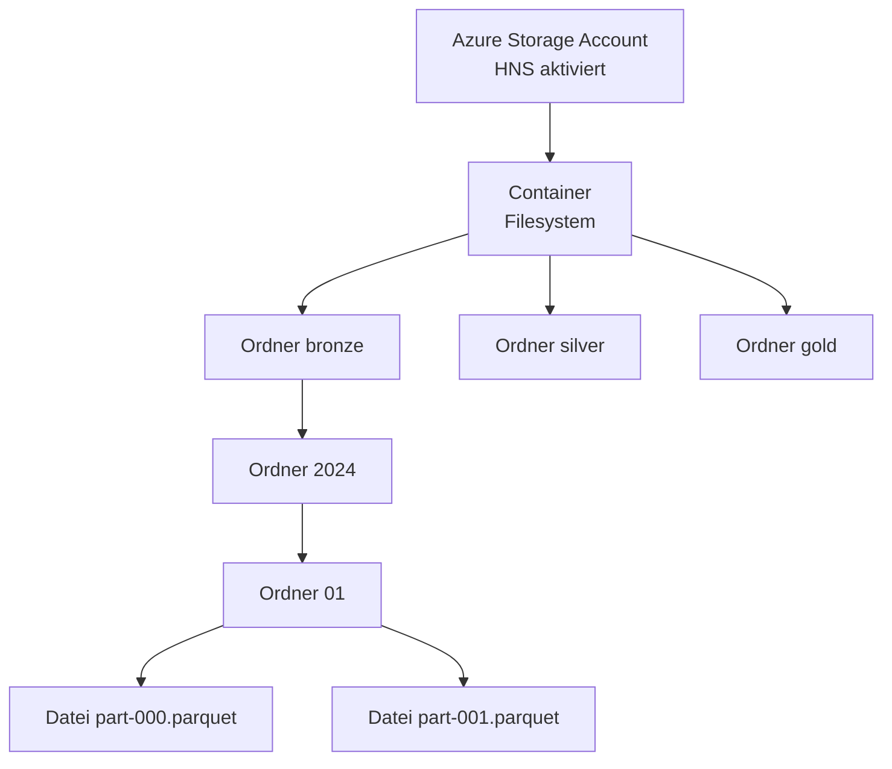
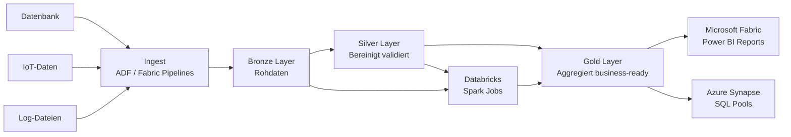
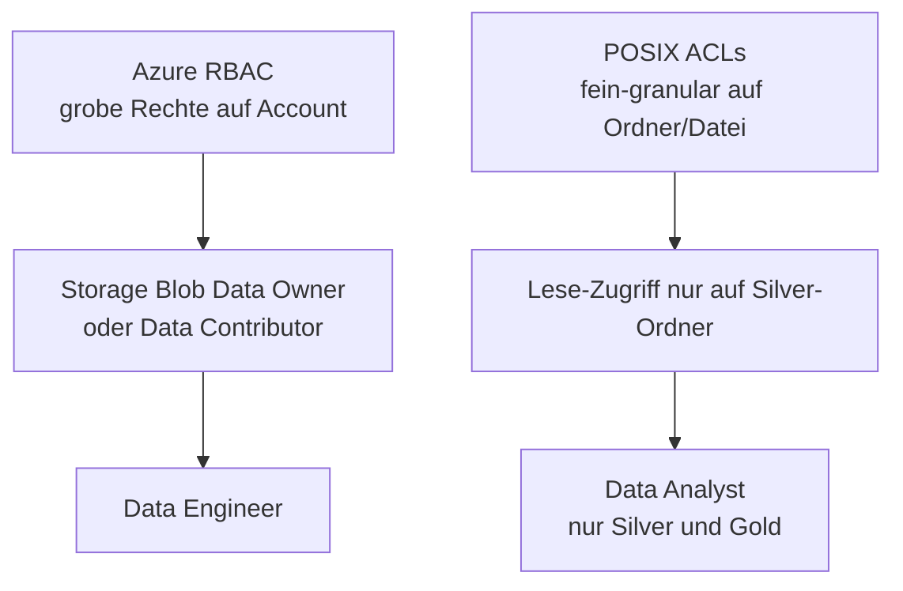

---
tags:
  - azure
  - storage
  - data-lake
  - adls-gen2
  - analytics
  - fabric
  - synapse
  - databricks
aliases:
  - ADLS Gen2
  - Azure Data Lake Gen2
  - Data Lake Storage Azure
---

# Azure Data Lake Storage Gen2

> [!ABSTRACT] TL;DR
> Azure Data Lake Storage Gen2 (ADLS Gen2) kombiniert die Skalierbarkeit von Azure Blob Storage mit einem hierarchischen Namespace für Enterprise-Analytics-Workloads. Es ist die Grundlage für Microsoft Fabric, Azure Synapse Analytics und Azure Databricks-Pipelines in der Medallion-Architektur.

---

## Was ist ADLS Gen2?

ADLS Gen2 ist **kein separater Dienst** — es ist ein normaler **Azure Blob Storage Account mit aktiviertem Hierarchical Namespace (HNS)**. Diese Kombination bringt:

- Echter Verzeichnisbaum mit atomaren Operationen
- POSIX-kompatible ACLs auf Ordner- und Dateiebene
- Optimierte Leistung für Analytics-Workloads (rename, delete von Ordnern in O(1))
- Kompatibel mit Hadoop ABFS Driver (`abfs://` und `abfss://`)



---

## Hierarchical Namespace (HNS)

| Merkmal | Ohne HNS (normaler Blob) | Mit HNS (ADLS Gen2) |
|---------|--------------------------|----------------------|
| **Verzeichnis** | Simuliert durch `/` im Namen | Echter Verzeichnis-Knoten |
| **Umbenennen** | Alle Blobs einzeln kopieren + löschen (teuer) | Atomare Operation O(1) |
| **Ordner löschen** | Alle Blobs einzeln löschen | Atomare Operation O(1) |
| **ACLs** | Nicht unterstützt | POSIX ACLs pro Datei/Ordner |
| **Atomic Directory Ops** | Nein | Ja |
| **Analytics Performance** | Suboptimal | Optimiert |

> [!IMPORTANT]
> HNS kann nach der Account-Erstellung **nicht mehr deaktiviert** werden. Es kann auch nicht nachträglich aktiviert werden (nur bei neuen Accounts). Plane die Entscheidung sorgfältig.

---

## Anwendungsfälle und Medallion-Architektur



**Schichten der Medallion-Architektur:**

| Layer | Inhalt | Format | Verzeichnisstruktur |
|-------|--------|--------|---------------------|
| **Bronze** | Rohdaten, unbereinigt | JSON, CSV, Parquet | `bronze/{quelle}/{jahr}/{monat}/{tag}/` |
| **Silver** | Bereinigt, validiert, dedupliziert | Delta Lake / Parquet | `silver/{entität}/{jahr}/{monat}/` |
| **Gold** | Aggregiert, business-ready | Delta Lake / Parquet | `gold/{domäne}/{tabelle}/` |

---

## POSIX ACLs

ADLS Gen2 unterstützt POSIX-kompatible ACLs auf Ordner- und Dateiebene:

### ACL-Typen

| Typ | Beschreibung |
|-----|-------------|
| **Access ACL** | Steuert Zugriff auf bestimmtes Objekt |
| **Default ACL** | Vorlage für neue Objekte in einem Verzeichnis (nur Ordner) |

### Berechtigungen

| Permission | Wert | Ordner | Datei |
|-----------|------|--------|-------|
| **Read (r)** | 4 | Ordnerinhalt auflisten | Datei lesen |
| **Write (w)** | 2 | Dateien/Ordner erstellen | Datei überschreiben |
| **Execute (x)** | 1 | Ordner traversieren | Ausführen |

```python
from azure.storage.filedatalake import DataLakeServiceClient
from azure.identity import DefaultAzureCredential

credential = DefaultAzureCredential()
service = DataLakeServiceClient(
    account_url="https://myaccount.dfs.core.windows.net",
    credential=credential
)

fs = service.get_file_system_client("mycontainer")

# ACL auf Ordner setzen
dir_client = fs.get_directory_client("silver/kundendaten")
# Format: user::rwx,group::r-x,other::---,user:oid:r-x
acl = "user::rwx,group::r-x,other::---"
dir_client.set_access_control(acl=acl)

# Named User (via Object ID) hinzufügen
named_acl = f"user::rwx,group::r-x,other::---,user:{object_id}:r-x"
dir_client.set_access_control(acl=named_acl)

# Default ACL setzen (für neue Dateien im Ordner)
default_acl = "default:user::rwx,default:group::r-x,default:other::---"
full_acl = acl + "," + default_acl
dir_client.set_access_control(acl=full_acl)

# ACL lesen
props = dir_client.get_access_control()
print(f"Owner: {props['owner']}")
print(f"ACL: {props['acl']}")
```

---

## RBAC und ACLs kombinieren



| Ebene | Methode | Granularität | Anwendungsfall |
|-------|---------|-------------|----------------|
| **Account/Container** | RBAC (Entra ID Rollen) | Grob | Grundlegende Zugriffskontrolle |
| **Ordner/Datei** | POSIX ACLs | Fein | Daten-Domänen, Mandanten-Trennung |

> [!TIP]
> Weise `Storage Blob Data Owner` per RBAC zu — dieser darf ACLs setzen. `Storage Blob Data Contributor` kann Daten lesen/schreiben, aber keine ACLs ändern.

---

## Partitionierungsstrategien

Die Verzeichnisstruktur hat **direkten Einfluss** auf Query-Performance:

```
# Zeitbasierte Partitionierung (empfohlen für zeitreihen-Daten)
bronze/events/{jahr}/{monat}/{tag}/{stunde}/part-*.parquet

# Entitätsbasierte Partitionierung
silver/kunden/{land}/{region}/kunden.parquet

# Multi-dimensionale Partitionierung
gold/umsatz/jahr=2024/monat=01/region=DE/umsatz.parquet
```

**Best Practices:**

| Empfehlung | Begründung |
|-----------|-----------|
| Hohe Kardinalität vermeiden (z. B. pro Kunden-ID) | Zu viele kleine Dateien → schlechte Performance |
| Optimale Dateigröße: 256 MiB – 1 GiB | Spark/Synapse liest Dateien parallel |
| Parquet oder Delta Lake verwenden | Spaltenbasiert, komprimiert, Predicate Pushdown |
| Partition Pruning nutzen | WHERE-Klausel auf Partition-Spalten filtern |

---

## Multi-Protocol Access

ADLS Gen2 ist über zwei APIs zugänglich:

| API | Protokoll | Endpoint | Anwendungsfall |
|-----|-----------|----------|----------------|
| **Blob API** | REST | `blob.core.windows.net` | AzCopy, Legacy-Tools |
| **DFS API** | REST | `dfs.core.windows.net` | Analytics, ACL-Operationen |
| **ABFS Driver** | Hadoop ABFS | `abfs[s]://` | Databricks, Synapse Spark |

```python
# Databricks: ADLS Gen2 mounten via ABFS
spark.conf.set(
    "fs.azure.account.auth.type.myaccount.dfs.core.windows.net",
    "OAuth"
)
spark.conf.set(
    "fs.azure.account.oauth.provider.type.myaccount.dfs.core.windows.net",
    "org.apache.hadoop.fs.azurebfs.oauth2.ClientCredsTokenProvider"
)
spark.conf.set(
    "fs.azure.account.oauth2.client.id.myaccount.dfs.core.windows.net",
    "<client-id>"
)
spark.conf.set(
    "fs.azure.account.oauth2.client.secret.myaccount.dfs.core.windows.net",
    "<client-secret>"
)
spark.conf.set(
    "fs.azure.account.oauth2.client.endpoint.myaccount.dfs.core.windows.net",
    "https://login.microsoftonline.com/<tenant-id>/oauth2/token"
)

# DataFrame lesen
df = spark.read.parquet("abfss://mycontainer@myaccount.dfs.core.windows.net/silver/kunden/")
df.show()
```

---

## Ingest-Optionen

| Methode | Anwendungsfall | Throughput |
|---------|----------------|-----------|
| **Azure Data Factory** | ETL-Pipelines, Batch-Ingest | Hoch |
| **Microsoft Fabric Pipelines** | Fabric-native Ingest | Hoch |
| **AzCopy** | Bulk-Upload von On-Prem | Sehr hoch |
| **Databricks Auto Loader** | Streaming-Ingest neuer Dateien | Hoch |
| **Event Hubs → Capture** | Streaming zu ADLS Gen2 | Sehr hoch |
| **Azure Stream Analytics** | Real-Time Analytics Output | Mittel |

```bash
# AzCopy: Ordner rekursiv hochladen (ADLS Gen2 DFS Endpoint)
azcopy copy "/lokale/daten/" \
    "https://myaccount.dfs.core.windows.net/mycontainer/bronze/daten/" \
    --recursive \
    --put-md5
```

---

## Performance-Empfehlungen

| Parameter | Empfehlung |
|-----------|-----------|
| **Dateigröße** | 256 MiB – 1 GiB pro Datei |
| **Parallelität** | 8–16 parallele Threads (AzCopy, SDK) |
| **Kompression** | Snappy (schnell) oder GZIP (kleiner) |
| **Format** | Parquet > ORC > CSV für Analytics |
| **Partition-Tiefe** | Maximal 4–5 Ebenen |
| **Small Files Problem** | Compaction-Jobs regelmäßig ausführen |

---

## Vergleich: ADLS Gen2 vs. Blob Storage vs. Azure Files

| Merkmal | ADLS Gen2 | Blob Storage | Azure Files |
|---------|-----------|-------------|------------|
| **Namespace** | Hierarchisch (HNS) | Flach | Hierarchisch |
| **Protokoll** | REST, ABFS, NFS 3.0 | REST, NFS 3.0 | SMB, NFS 4.1 |
| **ACLs** | POSIX ACLs | Nicht unterstützt | NTFS ACLs |
| **Analytics-Optimierung** | Ja | Eingeschränkt | Nein |
| **Atomic Directory Ops** | Ja | Nein | Ja |
| **Max Kapazität** | 5 PiB | 5 PiB | 100 TiB/Share |
| **Anwendungsfall** | Big Data, Analytics | Objekte, Backups | File Shares, AVD |

---

## Bicep-Beispiel: Storage Account mit HNS

```bicep
param location string = resourceGroup().location
param storageAccountName string

resource storageAccount 'Microsoft.Storage/storageAccounts@2023-01-01' = {
  name: storageAccountName
  location: location
  kind: 'StorageV2'
  sku: {
    name: 'Standard_LRS'
  }
  properties: {
    isHnsEnabled: true          // Hierarchical Namespace aktivieren
    accessTier: 'Hot'
    supportsHttpsTrafficOnly: true
    minimumTlsVersion: 'TLS1_2'
    allowBlobPublicAccess: false
    networkAcls: {
      defaultAction: 'Deny'
      bypass: 'AzureServices'
    }
  }
}

// Container (Filesystem) erstellen
resource blobService 'Microsoft.Storage/storageAccounts/blobServices@2023-01-01' = {
  parent: storageAccount
  name: 'default'
}

resource bronzeContainer 'Microsoft.Storage/storageAccounts/blobServices/containers@2023-01-01' = {
  parent: blobService
  name: 'bronze'
  properties: {
    publicAccess: 'None'
  }
}

resource silverContainer 'Microsoft.Storage/storageAccounts/blobServices/containers@2023-01-01' = {
  parent: blobService
  name: 'silver'
  properties: {
    publicAccess: 'None'
  }
}

resource goldContainer 'Microsoft.Storage/storageAccounts/blobServices/containers@2023-01-01' = {
  parent: blobService
  name: 'gold'
  properties: {
    publicAccess: 'None'
  }
}

output storageAccountId string = storageAccount.id
output dfsEndpoint string = storageAccount.properties.primaryEndpoints.dfs
```

---

## Kosten

| Kategorie | Kosten | Hinweis |
|-----------|--------|---------|
| Speicher (Hot LRS) | ~0,018 $/GB/Monat | Gleich wie Blob Storage |
| HNS-Operationen (Iterative write) | ~0,0039 $ / 10.000 Ops | Nur bei HNS aktiviert |
| Hierarchical Namespace Operationen | ~0,0039 $ / 10.000 Ops | Directory-spezifische Ops |
| Soft Delete | Zusätzliche Speicherkosten | Pro gelöschte Datei/Ordner |

> [!NOTE]
> ADLS Gen2 ist minimal teurer als normaler Blob Storage durch die HNS-Operationen. Der Mehrwert durch Analytics-Performance überwiegt die Mehrkosten bei Analytics-Workloads deutlich.

---

## Verwandte Notizen

- [[Azure Storage Grundlagen]]
- [[Azure Blob Storage]]
- [[Azure Files]]
- [[Azure RBAC]]
