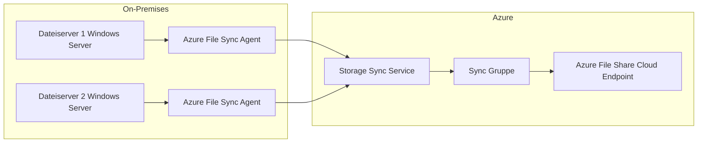

---
tags:
  - azure
  - storage
  - azure-files
  - smb
  - nfs
  - file-sync
  - avd
aliases:
  - Azure Files SMB
  - Azure File Share
  - Azure Files NFS
---

# Azure Files

> [!ABSTRACT] TL;DR
> Azure Files ist ein vollständig verwalteter Cloud-Dateifreigabedienst, der SMB 3.x und NFS 4.1 Protokolle unterstützt. Er ermöglicht das Ersetzen oder Ergänzen lokaler Dateiserver ohne Infrastrukturverwaltung — mit Active Directory Authentifizierung, Snapshots und Azure File Sync für Hybrid-Szenarien.

---

## Was ist Azure Files?

Azure Files bietet **vollständig verwaltete Dateifreigaben** in der Cloud, die gleichzeitig von mehreren Maschinen gemountet werden können:

- **SMB 3.x** für Windows, Linux (CIFS), macOS
- **NFS 4.1** für Linux und macOS (nur Premium Tier)
- **REST API** für plattformunabhängigen Zugriff
- Active Directory Authentication (Entra ID, AD DS, Entra Domain Services)
- Snapshots für Point-in-Time Recovery

**Typische Anwendungsfälle:**
- Lift & Shift von Dateiserver-Workloads in die Cloud
- Gemeinsame Dateifreigaben für mehrere VMs
- FSLogix Profile Container für Azure Virtual Desktop (AVD)
- Konfigurationsdateien für Container und Anwendungen
- CI/CD Shared Storage

---

## SMB vs. NFS

| Merkmal | SMB 3.x | NFS 4.1 |
|---------|---------|---------|
| **Protokollversion** | SMB 2.x, 3.0, 3.1.1 | NFS 4.1 |
| **OS-Unterstützung** | Windows, Linux (cifs-utils), macOS | Linux, macOS |
| **Authentifizierung** | Entra ID Kerberos, AD DS, Entra DS, Account Key | Storage Account Key (Netzwerkebene) |
| **Verschlüsselung in Transit** | SMB 3.0+ AES-128/256 | TLS (via Private Endpoint) |
| **Tier** | Standard (HDD) + Premium (SSD) | Nur Premium (SSD) |
| **Windows ACLs / NTFS** | Ja (vollständig) | Nein (POSIX ACLs) |
| **Anwendungsfall** | Windows-Workloads, AD-Umgebungen | Linux-Workloads, HPC, Containerisierung |

> [!IMPORTANT]
> NFS 4.1 ist nur mit **Premium File Shares** und einem **Private Endpoint** (oder VNet Service Endpoint) verfügbar. Öffentlicher Internetzugriff wird für NFS nicht unterstützt.

---

## Tiers und Performance

| Tier | Speichertyp | IOPS | Throughput | Kosten-Modell | Anwendungsfall |
|------|-------------|------|------------|---------------|----------------|
| **Transaction Optimized** | Standard HDD | Bis 10.000 | Bis 60 MiB/s | Pay-as-you-go | Allgemein, wenige IOPS |
| **Hot** | Standard HDD | Bis 10.000 | Bis 60 MiB/s | Pay-as-you-go | Aktive Workloads |
| **Cool** | Standard HDD | Bis 10.000 | Bis 60 MiB/s | Pay-as-you-go | Archiv, Backup |
| **Premium** | SSD | 100 + 1/GiB (min 3.000) | 60 + 0,1/GiB MiB/s | Provisioned (reserviert) | Datenbanken, AVD, HPC |

> [!NOTE]
> Bei **Premium File Shares** wird die Kapazität vorab reserviert (Provisioned Model) — du zahlst für die reservierte Kapazität, nicht für den tatsächlichen Verbrauch. Minimum: 100 GiB.

---

## Azure File Sync

Hybrid-Lösung: On-Premises Server + Azure Files als Cloud-Backend mit Cloud Tiering:



**Konzepte:**
- **Storage Sync Service:** Azure-Ressource, die Sync-Gruppen verwaltet
- **Sync Group:** Verbindet Cloud Endpoint (Azure Files) mit Server Endpoints
- **Server Endpoint:** Lokaler Pfad auf Windows Server (mind. Windows Server 2012 R2)
- **Cloud Tiering:** Wenig genutzte Dateien werden in Azure ausgelagert, lokal nur als Stub

```powershell
# Azure File Sync Agent installieren (auf Windows Server)
# Download von: aka.ms/AFS/agent

# Registrierung des Servers
Register-AzStorageSyncServer `
    -ResourceGroupName "myRG" `
    -StorageSyncServiceName "mySyncService"

# Sync Group und Server Endpoint erstellen
New-AzStorageSyncGroup -ResourceGroupName "myRG" `
    -StorageSyncServiceName "mySyncService" `
    -Name "mySyncGroup"

New-AzStorageSyncServerEndpoint `
    -ResourceGroupName "myRG" `
    -StorageSyncServiceName "mySyncService" `
    -SyncGroupName "mySyncGroup" `
    -ServerLocalPath "D:\DatenFreigabe" `
    -CloudTiering On `
    -VolumeFreeSpacePercent 20
```

---

## Active Directory Authentifizierung

| Methode | Beschreibung | Voraussetzung | Kerberos |
|---------|-------------|---------------|---------|
| **Entra ID Kerberos** | Moderne AD-Auth über Entra ID | Entra ID Tenant, Azure AD Join | Ja |
| **AD DS (On-Premises)** | Lokales Active Directory | AD DS, Password Hash Sync oder Trust | Ja |
| **Entra Domain Services** | Managed AD in Azure | AADDS konfiguriert | Ja |

```powershell
# AD DS Authentication aktivieren
$storageAccount = Get-AzStorageAccount -ResourceGroupName "myRG" -Name "myaccount"
Set-AzStorageAccount `
    -ResourceGroupName "myRG" `
    -Name "myaccount" `
    -EnableActiveDirectoryDomainServicesForFile $true `
    -ActiveDirectoryDomainName "corp.contoso.com" `
    -ActiveDirectoryNetBiosDomainName "CORP" `
    -ActiveDirectoryForestName "corp.contoso.com" `
    -ActiveDirectoryDomainGuid "xxxxxxxx-xxxx-xxxx-xxxx-xxxxxxxxxxxx" `
    -ActiveDirectoryDomainSid "S-1-5-21-..." `
    -ActiveDirectoryAzureStorageSid "S-1-5-21-..."
```

---

## Share-Level RBAC

Grobe Zugriffssteuerung auf Share-Ebene via Azure RBAC:

| Rolle | Beschreibung |
|-------|-------------|
| **Storage File Data SMB Share Reader** | Lesen und Ausführen (Read-Only) |
| **Storage File Data SMB Share Contributor** | Lesen, Schreiben, Ausführen |
| **Storage File Data SMB Share Elevated Contributor** | Ändern von NTFS-Berechtigungen |

```powershell
# RBAC-Zuweisung für Share
New-AzRoleAssignment `
    -SignInName "user@contoso.com" `
    -RoleDefinitionName "Storage File Data SMB Share Contributor" `
    -Scope "/subscriptions/{sub-id}/resourceGroups/myRG/providers/Microsoft.Storage/storageAccounts/myaccount/fileServices/default/shares/myshare"
```

---

## NTFS-Berechtigungen

Feingranulare Datei- und Ordnerberechtigungen via ICacls:

```powershell
# Share mounten (Windows)
net use Z: \\myaccount.file.core.windows.net\myshare /user:AZURE\myaccount <StorageAccountKey>

# NTFS-Berechtigungen mit ICacls setzen
# Vollzugriff für einen Benutzer
icacls Z:\OrdnerA /grant "CORP\BenutzerA:(OI)(CI)F"

# Leserecht für Gruppe
icacls Z:\OrdnerB /grant "CORP\Gruppe1:(OI)(CI)R"

# Vererbte Berechtigungen deaktivieren
icacls Z:\PrivaterOrdner /inheritance:d

# Berechtigungen anzeigen
icacls Z:\OrdnerA
```

---

## FSLogix auf Azure Files

Profile Container für Azure Virtual Desktop (AVD):

```powershell
# FSLogix Registry-Einstellung (GPO oder direkt)
# HKLM:\SOFTWARE\FSLogix\Profiles

$regPath = "HKLM:\SOFTWARE\FSLogix\Profiles"
New-Item -Path $regPath -Force
Set-ItemProperty -Path $regPath -Name "Enabled" -Value 1
Set-ItemProperty -Path $regPath -Name "VHDLocations" -Value "\\myaccount.file.core.windows.net\fslogix-profiles"
Set-ItemProperty -Path $regPath -Name "DeleteLocalProfileWhenVHDShouldApply" -Value 1
Set-ItemProperty -Path $regPath -Name "FlipFlopProfileDirectoryName" -Value 1
```

> [!TIP]
> Premium File Shares werden für FSLogix mit vielen gleichzeitigen Benutzern empfohlen. Berechne ca. 0,1–0,5 GiB pro Benutzer-Profil. Für 500 Benutzer → mind. 250 GiB provisioned.

---

## PowerShell-Beispiele

### Share erstellen

```powershell
# Storage Account Context
$ctx = New-AzStorageContext -StorageAccountName "myaccount" -UseConnectedAccount

# Neuen File Share erstellen (100 GiB)
New-AzStorageShare -Name "myshare" -Context $ctx
# Für Premium: Größe angeben
Set-AzStorageShareQuota -ShareName "myshare" -Quota 100 -Context $ctx
```

### Windows mounten

```powershell
# Share mounten mit Account Key
$accountKey = (Get-AzStorageAccountKey -ResourceGroupName "myRG" -Name "myaccount")[0].Value
$credential = New-Object System.Management.Automation.PSCredential(
    "AZURE\myaccount",
    (ConvertTo-SecureString $accountKey -AsPlainText -Force)
)
New-PSDrive -Name "Z" -PSProvider FileSystem `
    -Root "\\myaccount.file.core.windows.net\myshare" `
    -Credential $credential -Persist

# Persistentes Laufwerk (nach Reboot bleibt verbunden)
net use Z: \\myaccount.file.core.windows.net\myshare /user:AZURE\myaccount $accountKey /persistent:yes
```

### Linux mounten

```bash
# cifs-utils installieren
sudo apt-get install cifs-utils

# Mount-Verzeichnis erstellen
sudo mkdir /mnt/azurefiles

# Credentials-Datei erstellen (sicher)
sudo bash -c 'echo "username=myaccount" > /etc/smbcredentials/myaccount.cred'
sudo bash -c 'echo "password=<StorageAccountKey>" >> /etc/smbcredentials/myaccount.cred'
sudo chmod 600 /etc/smbcredentials/myaccount.cred

# Temporär mounten
sudo mount -t cifs \
    //myaccount.file.core.windows.net/myshare \
    /mnt/azurefiles \
    -o credentials=/etc/smbcredentials/myaccount.cred,serverino,uid=1000,gid=1000

# Persistent in /etc/fstab
echo "//myaccount.file.core.windows.net/myshare /mnt/azurefiles cifs credentials=/etc/smbcredentials/myaccount.cred,serverino 0 0" | sudo tee -a /etc/fstab
```

---

## Azure Files Backup

```powershell
# Recovery Services Vault für File Share Backup
$vault = Get-AzRecoveryServicesVault -ResourceGroupName "myRG" -Name "myVault"
Set-AzRecoveryServicesVaultContext -Vault $vault

# Backup Policy erstellen
$policy = Get-AzRecoveryServicesBackupProtectionPolicy -Name "AzureFileSharePolicy"

# File Share für Backup registrieren
Enable-AzRecoveryServicesBackupProtection `
    -StorageAccountName "myaccount" `
    -Name "myshare" `
    -Policy $policy

# Sofortigen Backup ausführen
$item = Get-AzRecoveryServicesBackupItem -BackupManagementType AzureStorage -WorkloadType AzureFiles
Backup-AzRecoveryServicesBackupItem -Item $item
```

---

## Vergleich: Azure Files vs. ANF vs. NFS auf VMs

| Merkmal | Azure Files | Azure NetApp Files | NFS auf VM |
|---------|------------|-------------------|-----------|
| **Verwaltung** | Vollständig managed | Fully managed | Self-managed |
| **Protokoll** | SMB 3.x, NFS 4.1 | NFSv3, NFSv4.1, SMB 3.x | NFSv3/4, SMB |
| **Max IOPS** | ~100k (Premium) | Millionen | VM-IOPS-Limit |
| **Max Throughput** | ~10 GiB/s (Premium) | Mehrere GiB/s je Volume | VM-Netz-Limit |
| **Kosten** | Niedrig-Mittel | Hoch (4 TiB Minimum) | Disk-Kosten |
| **Anwendungsfall** | AVD, Lift&Shift, allgemein | SAP HANA, HPC, Oracle | Legacy, Kontrolle |

---

## Troubleshooting

**Port 445 gesperrt:**

```powershell
# Port 445 testen
Test-NetConnection -ComputerName "myaccount.file.core.windows.net" -Port 445
# Wenn blocked: ISP/Corporate Firewall blockiert SMB
# Lösung: VPN, Private Endpoint oder NFS verwenden
```

**Authentifizierungsfehler:**

```bash
# Kerberos-Token prüfen
klist
# Ticket erneuern
kinit user@CORP.CONTOSO.COM

# CIFS mount debug
sudo dmesg | grep cifs
sudo mount.cifs --verbose //account.file.core.windows.net/share /mnt/test -o user=...
```

**Performance-Probleme:**

```powershell
# SMB Multichannel Status prüfen (Premium File Shares)
Get-SmbMultichannelConnection
# SMB Multichannel aktivieren (Client-seitig)
Set-SmbClientConfiguration -EnableMultiChannel $true
```

> [!TIP]
> SMB Multichannel ist nur auf **Premium File Shares** mit Windows Server 2016+ oder Windows 10+ verfügbar und kann den Durchsatz erheblich steigern (mehrere Netzwerkkarten/Pfade).

---

## Verwandte Notizen

- [[Azure Storage Grundlagen]]
- [[Azure NetApp Files]]
- [[Azure Blob Storage]]
- [[Azure Virtual Machines]]
- [[Azure RBAC]]
