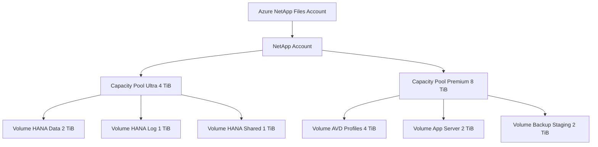
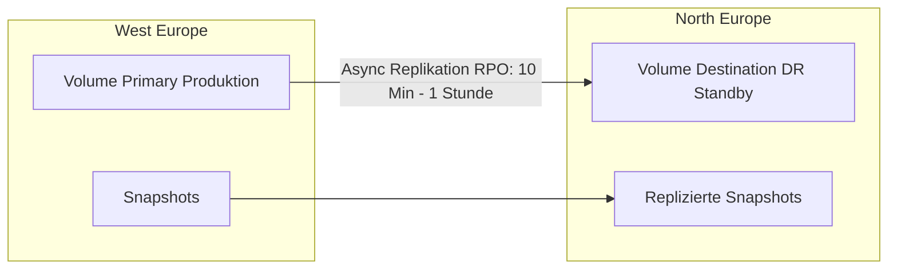

---
tags:
  - azure
  - storage
  - netapp-files
  - anf
  - nfs
  - hpc
  - sap-hana
  - enterprise-storage
aliases:
  - ANF
  - Azure NetApp Files ANF
  - NetApp Azure
---

# Azure NetApp Files

> [!ABSTRACT] TL;DR
> Azure NetApp Files (ANF) ist ein vollständig verwalteter Enterprise-Storage-Dienst auf Basis von NetApp ONTAP. Er bietet Ultra-Low-Latency NFS und SMB Shares für anspruchsvollste Workloads wie SAP HANA, HPC, Oracle Datenbanken und Azure Virtual Desktop mit NetApp-zertifizierter Performance.

---

## Was ist Azure NetApp Files?

Azure NetApp Files ist **NetApp ONTAP as a Service in Azure** — ohne Infrastrukturverwaltung, aber mit der gesamten Enterprise-Funktionalität von NetApp ONTAP:

- Sub-Millisekunden-Latenz (< 1 ms)
- Millionen IOPS pro Volume möglich
- Mehrere GiB/s Throughput pro Service Level
- NFSv3, NFSv4.1, SMB 3.x und Dual-Protocol Support
- Unternehmensqualität: Snapshots, Replikation, Backup, QoS

**Unterschied zu anderen Azure Storage-Diensten:**
ANF läuft auf dedizierten NetApp-Hardwaresystemen in Azure-Rechenzentren — es teilt keine Hardware mit anderen Azure-Diensten. Das garantiert konsistente, vorhersagbare Performance.

---

## Anwendungsfälle

| Workload | Protokoll | Warum ANF? |
|----------|-----------|-----------|
| **SAP HANA** | NFSv4.1 | Offizielle SAP HANA TDI-Zertifizierung, Throughput-Anforderungen |
| **HPC (High Performance Computing)** | NFSv3/4.1 | Millionen IOPS, paralleler Zugriff vieler Nodes |
| **Oracle Datenbanken** | NFSv3/4.1 | dNFS Support, niedrige Latenz |
| **Azure Virtual Desktop (FSLogix)** | SMB 3.x | Hochperformante Profile Container |
| **Media und Entertainment** | NFSv3 | Hoher Throughput für Video-Rendering |
| **Kubernetes Persistent Volumes** | NFSv3/4.1 | Trident CSI Driver von NetApp |

---

## Service Levels

| Service Level | Throughput pro TiB | Typische Latenz | Anwendungsfall |
|--------------|-------------------|-----------------|----------------|
| **Standard** | 16 MiB/s | < 5 ms | Allgemeine Workloads, Test, Dev |
| **Premium** | 64 MiB/s | < 2 ms | Datenbanken, AVD, Analytics |
| **Ultra** | 128 MiB/s | < 1 ms | SAP HANA, HPC, Oracle Production |

**Beispiel-Berechnung (SAP HANA):**
- Benötigter Throughput: 400 MiB/s
- Service Level: Ultra (128 MiB/s per TiB)
- Benötigte Pool-Kapazität: 400 / 128 = 3,125 → **4 TiB** (Minimum)

> [!TIP]
> Bei QoS Manual kann der Throughput unabhängig von der Kapazität zugewiesen werden. Ein 4 TiB Ultra Pool hat 512 MiB/s gesamt — mit Manual QoS kannst du diese flexibel auf Volumes verteilen.

---

## Architektur: Capacity Pools und Volumes



**Kapazitäts-Hierarchie:**

| Ebene | Mindestgröße | Beschreibung |
|-------|-------------|-------------|
| **NetApp Account** | — | Regionale Verwaltungseinheit |
| **Capacity Pool** | 4 TiB | Performance-Pool (Service Level bestimmt Throughput) |
| **Volume** | 100 GiB | Einzelnes Dateisystem (aus Pool-Quota zugewiesen) |

---

## Protokoll-Unterstützung

| Protokoll | Version | OS | Anmerkung |
|-----------|---------|----|----|
| **NFSv3** | 3 | Linux, Unix | Breite Kompatibilität, AD Kerberos optional |
| **NFSv4.1** | 4.1 | Linux | Empfohlen für SAP HANA, Kerberos-Auth |
| **SMB** | 3.x | Windows | Active Directory erforderlich |
| **Dual-Protocol** | NFS + SMB | Linux + Windows | Gleiche Daten über beide Protokolle |

---

## QoS: Auto vs. Manual

| Modus | Throughput-Zuweisung | Flexibilität | Anwendungsfall |
|-------|---------------------|-------------|----------------|
| **Auto QoS** | Proportional zur Volume-Quota | Gering (fix an Größe) | Standard, einfache Workloads |
| **Manual QoS** | Frei konfigurierbar (MiB/s) | Hoch (entkoppelt von Größe) | SAP HANA, ungleichmäßige Workloads |

**Beispiel Manual QoS (4 TiB Ultra Pool = 512 MiB/s gesamt):**

| Volume | Größe | Zugewiesener Throughput |
|--------|-------|------------------------|
| HANA Data | 2 TiB | 300 MiB/s |
| HANA Log | 1 TiB | 150 MiB/s |
| HANA Shared | 1 TiB | 62 MiB/s |

---

## Snapshots

NetApp ANF Snapshots sind instantan und space-efficient:

```bash
# Snapshot Policy über az netappfiles CLI
az netappfiles snapshot policy create \
    --resource-group myRG \
    --account-name myNetAppAccount \
    --snapshot-policy-name mySnapshotPolicy \
    --location westeurope \
    --hourly-snapshots-to-keep 4 \
    --daily-snapshots-to-keep 7 \
    --weekly-snapshots-to-keep 4 \
    --monthly-snapshots-to-keep 3 \
    --hourly-minute 0 \
    --daily-minute 0 --daily-hour 2 \
    --weekly-minute 0 --weekly-hour 2 --weekly-day Sunday \
    --monthly-minute 0 --monthly-hour 2 --monthly-days-of-month "1"

# Snapshot Policy an Volume binden
az netappfiles volume update \
    --resource-group myRG \
    --account-name myNetAppAccount \
    --pool-name myPool \
    --name myVolume \
    --snapshot-policy-id "/subscriptions/{sub}/resourceGroups/myRG/providers/Microsoft.NetApp/netAppAccounts/myNetAppAccount/snapshotPolicies/mySnapshotPolicy"
```

**SnapRestore — Sofort aus Snapshot zurücksetzen:**

```bash
az netappfiles volume revert \
    --resource-group myRG \
    --account-name myNetAppAccount \
    --pool-name myPool \
    --name myVolume \
    --snapshot-id "/subscriptions/{sub}/resourceGroups/myRG/providers/Microsoft.NetApp/netAppAccounts/myNetAppAccount/capacityPools/myPool/volumes/myVolume/snapshots/mySnapshot"
```

> [!NOTE]
> ANF Snapshots sind **Space-efficient** — sie speichern nur die geänderten Blöcke (Copy-on-Write). Ein Snapshot verbraucht initial keinen zusätzlichen Speicher.

---

## Cross-Region Replication (CRR)

Asynchrone Disaster Recovery in eine andere Azure Region:



```bash
# CRR Destination Volume erstellen
az netappfiles volume create \
    --resource-group myRG-DR \
    --account-name myNetAppAccount-DR \
    --pool-name myPool-DR \
    --name myVolume-DR \
    --location northeurope \
    --service-level Premium \
    --usage-threshold 2199023255552 \
    --file-path myVolume-DR \
    --vnet myVnet-DR \
    --subnet mySubnet-ANF-DR \
    --replication-schedule "_10minutely" \
    --endpoint-type "dst" \
    --remote-volume-resource-id "/subscriptions/{sub}/resourceGroups/myRG/providers/Microsoft.NetApp/netAppAccounts/myNetAppAccount/capacityPools/myPool/volumes/myVolume"
```

---

## Cross-Zone Replication (CZR)

Asynchrone Replikation zwischen Availability Zones innerhalb einer Region:

```bash
# CZR für zonale Redundanz (Zone 1 → Zone 3)
az netappfiles volume create \
    --resource-group myRG \
    --account-name myNetAppAccount \
    --pool-name myPool-Zone3 \
    --name myVolume-CZR \
    --location westeurope \
    --zone 3 \
    --endpoint-type "dst" \
    --replication-schedule "hourly" \
    --remote-volume-resource-id "/subscriptions/{sub}/.../volumes/myVolume"
```

---

## ANF Backup

Long-Term Retention zu Azure Blob Storage:

```bash
# Backup Policy erstellen
az netappfiles account backup-policy create \
    --resource-group myRG \
    --account-name myNetAppAccount \
    --backup-policy-name myBackupPolicy \
    --location westeurope \
    --daily-backups-to-keep 7 \
    --weekly-backups-to-keep 4 \
    --monthly-backups-to-keep 12 \
    --enabled true

# Backup für Volume aktivieren
az netappfiles volume update \
    --resource-group myRG \
    --account-name myNetAppAccount \
    --pool-name myPool \
    --name myVolume \
    --backup-policy-id "/subscriptions/{sub}/resourceGroups/myRG/providers/Microsoft.NetApp/netAppAccounts/myNetAppAccount/backupPolicies/myBackupPolicy" \
    --backup-enabled true \
    --backup-vault-id "/subscriptions/{sub}/resourceGroups/myRG/providers/Microsoft.NetApp/netAppAccounts/myNetAppAccount/backupVaults/myBackupVault"
```

---

## Active Directory Integration

```bash
# Active Directory Connection für ANF Account erstellen
az netappfiles account ad add \
    --resource-group myRG \
    --name myNetAppAccount \
    --username "anfadmin" \
    --password "<Password>" \
    --smb-server-name "ANFSMB" \
    --dns "10.0.1.4 10.0.1.5" \
    --domain "corp.contoso.com"
```

> [!IMPORTANT]
> ANF benötigt ein **dediziertes Subnet** (delegiert an `Microsoft.NetApp/volumes`) mit mindestens /28 (16 IPs). Dieses Subnet kann nicht für andere Ressourcen genutzt werden.

---

## VNet-Konfiguration und Delegated Subnet

```bash
# Subnet delegieren für ANF
az network vnet subnet create \
    --resource-group myRG \
    --vnet-name myVnet \
    --name anf-subnet \
    --address-prefixes "10.0.3.0/28" \
    --delegations "Microsoft.NetApp/volumes"

# ANF Account erstellen
az netappfiles account create \
    --resource-group myRG \
    --name myNetAppAccount \
    --location westeurope

# Capacity Pool erstellen
az netappfiles pool create \
    --resource-group myRG \
    --account-name myNetAppAccount \
    --name myUltraPool \
    --size 4398046511104 \
    --service-level Ultra \
    --location westeurope \
    --qos-type Manual

# Volume erstellen (NFSv4.1)
az netappfiles volume create \
    --resource-group myRG \
    --account-name myNetAppAccount \
    --pool-name myUltraPool \
    --name hana-data \
    --location westeurope \
    --service-level Ultra \
    --usage-threshold 2199023255552 \
    --file-path "hana-data" \
    --vnet myVnet \
    --subnet anf-subnet \
    --protocol-types "NFSv4.1" \
    --throughput-mibps 300
```

---

## SAP HANA auf ANF

SAP HANA erfordert sehr hohe Throughput-Anforderungen, die ANF mit Ultra-Service Level erfüllt:

| Volume | Min Throughput | Empfohlen | ANF Service Level |
|--------|---------------|-----------|------------------|
| **/hana/data** | 250 MiB/s | 400 MiB/s | Ultra |
| **/hana/log** | 250 MiB/s | 250 MiB/s | Ultra |
| **/hana/shared** | 64 MiB/s | 128 MiB/s | Ultra oder Premium |
| **/hana/backup** | 128 MiB/s | variabel | Premium |

**Warum ANF für SAP HANA?**
- Einziger Azure-Speicherdienst mit SAP HANA TDI-Zertifizierung
- Konsistente Sub-Millisekunden-Latenz auch unter Last
- NFSv4.1 mit Kerberos-Auth für SAP-Compliance
- SnapCenter Integration für applikations-konsistente Backups
- Größere HANA-Instanzen (> 2 TiB RAM) möglich durch ANF-Skalierung

```bash
# HANA-Volume über NFSv4.1 mounten (Linux)
sudo mkdir -p /hana/data /hana/log /hana/shared

# /etc/fstab Einträge für HANA
echo "10.0.3.10:/hana-data /hana/data nfs4 rw,hard,timeo=600,retrans=2,proto=tcp,nfsvers=4.1,noatime,lock,_netdev 0 0" | sudo tee -a /etc/fstab
echo "10.0.3.11:/hana-log /hana/log nfs4 rw,hard,timeo=600,retrans=2,proto=tcp,nfsvers=4.1,noatime,lock,_netdev 0 0" | sudo tee -a /etc/fstab

sudo mount -a
df -h /hana/data /hana/log
```

---

## Vergleich: ANF vs. Azure Files Premium vs. Premium SSD

| Merkmal | Azure NetApp Files | Azure Files Premium | Premium SSD v1 |
|---------|-------------------|--------------------|--------------------|
| **Max IOPS** | Millionen (Volume-abhängig) | ~100.000 | 20.000 |
| **Max Throughput** | 4.500 MiB/s (Ultra) | ~10.000 MiB/s | 900 MiB/s |
| **Latenz** | < 1 ms (Ultra) | < 2 ms | < 5 ms |
| **Protokolle** | NFSv3/4.1, SMB 3.x | SMB 3.x, NFS 4.1 | Block (kein NFS) |
| **Snapshots** | Instantan, space-efficient | Share-Snapshots | Inkrementelle Snapshots |
| **Replikation** | CRR + CZR | Nur GRS (Read) | Cross-Region Copy |
| **Min Kosten** | ~4 TiB × Service Level | 100 GiB provisioned | Per Disk-Größe |
| **Anwendungsfall** | SAP HANA, HPC, Oracle | AVD, Lift&Shift | VM Boot/Data Disks |

---

## Kosten

| Service Level | Preis ($/TiB/Monat) | Mindest-Pool | Mindest-Kosten/Monat |
|--------------|---------------------|-------------|----------------------|
| **Standard** | ~45 $ | 4 TiB | ~180 $ |
| **Premium** | ~115 $ | 4 TiB | ~460 $ |
| **Ultra** | ~230 $ | 4 TiB | ~920 $ |

> [!WARNING]
> ANF ist ein **Premium-Dienst** mit erheblichen Mindestkosten (4 TiB Pool). Es eignet sich nicht für kleine Workloads. Der Mehrwert liegt in der Enterprise-Performance für SAP, HPC und ähnliche Anforderungen.

**Zusätzliche Kosten:**
- Cross-Region Replication: Egress-Kosten für replizierte Daten
- ANF Backup: Kosten für Blob Storage-Nutzung

---

## Verwandte Notizen

- [[Azure Storage Grundlagen]]
- [[Azure Files]]
- [[Azure Managed Disks]]
- [[Azure Virtual Machines]]
- [[Azure RBAC]]
