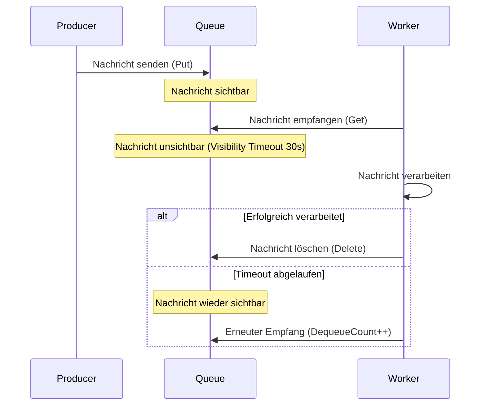

---
tags:
  - azure
  - storage
  - queue-storage
  - messaging
  - event-driven
aliases:
  - Azure Queue
  - Storage Queue Azure
  - Message Queue Azure
---

# Azure Queue Storage

> [!ABSTRACT] TL;DR
> Azure Queue Storage ist ein einfacher, hochskalierbarer Message-Queuing-Dienst für asynchrone Kommunikation zwischen Anwendungskomponenten. Er eignet sich für Workload-Entkopplung, Task-Verteilung und einfache Event-gesteuerte Architekturen bei sehr geringen Kosten.

---

## Was ist Azure Queue Storage?

Azure Queue Storage ermöglicht die **asynchrone Kommunikation** zwischen Anwendungskomponenten, die zu unterschiedlichen Zeiten laufen können. Eine Komponente stellt eine Nachricht in eine Queue; eine andere Komponente liest und verarbeitet sie unabhängig davon.

**Kernkonzepte:**
- **Queue:** Warteschlange für Nachrichten (max. 500 TiB Speicherplatz pro Queue)
- **Message:** Einzelne Nachricht (max. 64 KiB, Base64-kodiert)
- **Visibility Timeout:** Zeitraum, in dem eine empfangene Nachricht für andere unsichtbar ist
- **TTL (Time to Live):** Maximale Lebensdauer einer Nachricht (Standard: 7 Tage, max: 7 Tage)

**Typische Anwendungsfälle:**
- Entkopplung von Web-Frontend und Backend-Processing
- Task-Verteilung auf mehrere Worker
- Puffer bei Lastspitzen (Load Leveling)
- Retry-Logik für fehlgeschlagene Operationen
- Trigger für Azure Functions

---

## Queue-Konzept: FIFO und Visibility Timeout



> [!NOTE]
> Azure Queue Storage garantiert **keine strenge FIFO-Reihenfolge** bei mehreren Consumern. Nachrichten können in unterschiedlicher Reihenfolge empfangen werden. Für garantiertes FIFO → Azure Service Bus (Sessions).

---

## Visibility Timeout

| Parameter | Standard | Maximum | Beschreibung |
|-----------|----------|---------|-------------|
| Visibility Timeout | 30 Sekunden | 7 Tage | Zeitraum, in dem Nachricht nach Empfang unsichtbar ist |
| Message TTL | 7 Tage | 7 Tage | Automatisches Ablaufen der Nachricht |
| Max DequeueCount | Manuell prüfen | — | Zähler wie oft Nachricht empfangen wurde |

---

## Poison Message Handling

Wenn eine Nachricht wiederholt nicht verarbeitet werden kann:

```python
from azure.storage.queue import QueueClient
from azure.identity import DefaultAzureCredential

credential = DefaultAzureCredential()
queue = QueueClient(
    account_url="https://myaccount.queue.core.windows.net",
    queue_name="auftraege",
    credential=credential
)

# Dead Letter Queue (manuell verwalten)
dlq = QueueClient(
    account_url="https://myaccount.queue.core.windows.net",
    queue_name="auftraege-dlq",
    credential=credential
)

POISON_THRESHOLD = 5

messages = queue.receive_messages(max_messages=10, visibility_timeout=60)
for msg in messages:
    if msg.dequeue_count > POISON_THRESHOLD:
        # In Dead Letter Queue verschieben
        dlq.send_message(f"POISON|count={msg.dequeue_count}|{msg.content}")
        queue.delete_message(msg)
        print(f"Poison Message verschoben: {msg.id}")
    else:
        try:
            # Nachricht verarbeiten
            process_message(msg.content)
            queue.delete_message(msg)
        except Exception as e:
            print(f"Fehler bei Verarbeitung: {e}")
            # Nicht löschen → Visibility Timeout läuft ab → erneuter Versuch
```

> [!WARNING]
> Azure Queue Storage hat **keine eingebaute Dead Letter Queue** (DLQ). Diese muss manuell implementiert werden. Für native DLQ-Unterstützung → Azure Service Bus.

---

## Vergleich: Queue Storage vs. Service Bus vs. Event Grid vs. Event Hubs

| Merkmal | Queue Storage | Service Bus | Event Grid | Event Hubs |
|---------|--------------|-------------|-----------|-----------|
| **Protokoll** | REST/HTTP | AMQP, REST | REST/Webhook | AMQP, Kafka, REST |
| **Max Message-Größe** | 64 KiB | 256 KiB (Standard) / 100 MB (Premium) | 1 MB | 1 MB |
| **Max TTL** | 7 Tage | Unbegrenzt (Premium) | 24 Stunden | Bis 90 Tage |
| **Ordering** | Keine Garantie | Ja (Sessions) | Nein | Partitions-Reihenfolge |
| **Dead Letter Queue** | Manuell | Native | Native | Nein |
| **Throughput** | Sehr hoch | Hoch | Sehr hoch | Extrem hoch |
| **Preis** | Sehr günstig | Mittel-Hoch | Günstig | Mittel |
| **Anwendungsfall** | Einfache Task-Queues | Enterprise Messaging | Event-Routing, Serverless | Telemetrie, Streaming |

> [!TIP]
> **Faustregel:** Queue Storage für einfache Worker-Queues. Service Bus wenn Ordering, DLQ oder Transaktionen nötig. Event Grid für reaktive Architekturen. Event Hubs für Millionen Events/Sekunde.

---

## Authentifizierung

| Methode | Beschreibung | Empfehlung |
|---------|-------------|-----------|
| **Account Key** | Vollzugriff auf Account | Nur für Dev/Test |
| **SAS Token** | Zeitlich begrenzte Rechte | Externe Clients |
| **Managed Identity** | Identitätsbasiert, kein Secret | Empfohlen für Azure-Dienste |

**RBAC-Rollen für Queue Storage:**

| Rolle | Rechte |
|-------|--------|
| `Storage Queue Data Reader` | Lesen von Nachrichten |
| `Storage Queue Data Message Sender` | Nachrichten senden |
| `Storage Queue Data Message Processor` | Empfangen und Löschen von Nachrichten |
| `Storage Queue Data Contributor` | Vollzugriff auf Queue-Daten |

---

## Via Azure Portal (UI)

> [!TIP] Schnelleinstieg
> Queue Storage-Warteschlangen lassen sich direkt im Speicherkonto über das Portal erstellen und testen.

### Storage Account erstellen

1. **portal.azure.com** → **Speicherkonten** → **+ Erstellen**
2. Name, Region, Redundanz (LRS ausreichend für Queues) → **Überprüfen + erstellen** → **Erstellen**

### Warteschlange erstellen

1. Speicherkonto → **Warteschlangen** → **+ Warteschlange**
2. **Warteschlangenname** (Kleinbuchstaben, Bindestriche erlaubt) → **OK**

### Nachrichten senden und empfangen (Portal)

1. Warteschlange öffnen → **Nachricht hinzufügen**
2. **Nachrichtentext** eingeben, **Ablauf** (Sekunden, maximal 7 Tage) → **OK**
3. **Nachrichten abrufen**: Schaltfläche → Nachrichten werden sichtbar (Visibility Timeout läuft)
4. Nachricht auswählen → **Nachricht löschen** nach Verarbeitung

### Zugriffssteuerung

1. Speicherkonto → **Zugriffssteuerung (IAM)** → **+ Rollenzuweisung hinzufügen**
2. Rolle: `Storage Queue Data Contributor` oder `Storage Queue Data Reader`
3. Mitglied (Benutzer, Gruppe, Managed Identity) → **Überprüfen + zuweisen**

### Monitoring

1. Speicherkonto → **Metriken** → Namespace: **Queue**
2. Metriken: `QueueMessageCount`, `QueueCapacity` → Dashboard hinzufügen

---

## Python SDK — Vollständiges Beispiel

```python
from azure.storage.queue import QueueServiceClient, QueueClient
from azure.identity import DefaultAzureCredential
import json

# Verbindung über Managed Identity (empfohlen)
credential = DefaultAzureCredential()
service = QueueServiceClient(
    account_url="https://myaccount.queue.core.windows.net",
    credential=credential
)

# Queue erstellen
queue_name = "auftraege"
queue = service.create_queue(queue_name)
print(f"Queue '{queue_name}' erstellt")

# Nachricht senden (als JSON)
auftrag = {
    "id": "job-001",
    "typ": "bildverarbeitung",
    "datei": "upload/foto.jpg"
}
queue.send_message(json.dumps(auftrag))
print("Nachricht gesendet")

# Nachrichten empfangen (Visibility Timeout: 60 Sekunden)
messages = queue.receive_messages(
    max_messages=5,
    visibility_timeout=60
)

for msg in messages:
    print(f"Nachricht empfangen: {msg.content}")
    print(f"DequeueCount: {msg.dequeue_count}")
    
    data = json.loads(msg.content)
    
    # Verarbeitung
    try:
        # ... Verarbeitungslogik ...
        print(f"Verarbeite Job: {data['id']}")
        
        # Erfolgreich → Nachricht löschen
        queue.delete_message(msg)
        print("Nachricht gelöscht")
        
    except Exception as e:
        print(f"Fehler: {e}")
        # Nicht löschen → Timeout läuft ab, Nachricht erscheint wieder

# Queue-Eigenschaften abrufen
props = queue.get_queue_properties()
print(f"Nachrichten in Queue: ~{props.approximate_message_count}")

# Queue löschen (nach Test)
# queue.delete_queue()
```

---

## Azure Functions Queue Trigger

```python
# function_app.py
import azure.functions as func
import logging
import json

app = func.FunctionApp()

@app.queue_trigger(
    arg_name="msg",
    queue_name="auftraege",
    connection="AzureWebJobsStorage"
)
def queue_trigger(msg: func.QueueMessage) -> None:
    logging.info(f"Queue Trigger ausgeführt: {msg.get_body().decode('utf-8')}")
    
    data = json.loads(msg.get_body().decode('utf-8'))
    logging.info(f"Verarbeite Auftrag: {data.get('id')}")
    
    # DequeueCount für Poison Message Handling
    if msg.dequeue_count > 5:
        logging.error(f"Poison Message nach {msg.dequeue_count} Versuchen: {data}")
        return
    
    # Verarbeitung
    process_job(data)
```

```json
{
  "bindings": [
    {
      "name": "msg",
      "type": "queueTrigger",
      "direction": "in",
      "queueName": "auftraege",
      "connection": "AzureWebJobsStorage"
    }
  ]
}
```

---

## PowerShell-Beispiele

```powershell
# Context erstellen
$ctx = New-AzStorageContext -StorageAccountName "myaccount" -UseConnectedAccount

# Queue erstellen
New-AzStorageQueue -Name "auftraege" -Context $ctx

# Nachricht senden
$queue = Get-AzStorageQueue -Name "auftraege" -Context $ctx
$queueMessage = [Microsoft.Azure.Storage.Queue.CloudQueueMessage]::new("Meine Nachricht")
$queue.CloudQueue.AddMessage($queueMessage)

# Nachrichten anzeigen (ohne Empfang)
$queue.CloudQueue.PeekMessages(10) | ForEach-Object {
    Write-Host "Inhalt: $($_.AsString) | ID: $($_.Id)"
}

# Nachricht empfangen (mit Visibility Timeout 60s)
$message = $queue.CloudQueue.GetMessage(
    [System.TimeSpan]::FromSeconds(60)
)
Write-Host "Empfangen: $($message.AsString)"

# Nachricht löschen
$queue.CloudQueue.DeleteMessage($message)

# Queue-Tiefe überwachen
$queue.CloudQueue.FetchAttributes()
Write-Host "Nachrichten in Queue: $($queue.CloudQueue.ApproximateMessageCount)"
```

---

## Monitoring und Alerts

```powershell
# Alert bei hoher Queue-Tiefe (> 1000 Nachrichten)
New-AzMetricAlertRuleV2 `
    -ResourceGroupName "myRG" `
    -Name "QueueDepthAlert" `
    -TargetResourceId "/subscriptions/{sub}/resourceGroups/myRG/providers/Microsoft.Storage/storageAccounts/myaccount" `
    -Condition (
        New-AzMetricAlertRuleV2Criteria `
            -MetricName "QueueMessageCount" `
            -MetricNameSpace "Microsoft.Storage/storageAccounts/queueServices" `
            -Operator GreaterThan `
            -Threshold 1000 `
            -TimeAggregation Maximum
    ) `
    -WindowSize (New-TimeSpan -Minutes 5) `
    -Frequency (New-TimeSpan -Minutes 1) `
    -ActionGroupId "/subscriptions/{sub}/resourceGroups/myRG/providers/microsoft.insights/actionGroups/myAlerts" `
    -Severity 2
```

**Wichtige Metriken:**
- `QueueMessageCount` — Aktuelle Anzahl Nachrichten
- `Transactions` — Anzahl API-Anfragen
- `SuccessE2ELatency` — End-to-End Latenz
- `Availability` — Dienstverfügbarkeit

---

## Kosten-Übersicht

| Kategorie | Kosten |
|-----------|--------|
| Speicher (für Queue-Metadaten) | ~0,045 $/GB/Monat |
| Queue Class 1 (Put, Get, Peek, Delete) | ~0,004 $ pro 10.000 Operationen |
| Queue Class 2 (andere Operationen) | ~0,004 $ pro 10.000 Operationen |
| Geo-Replikation (GRS) | Zusätzliche Speicherkosten |

> [!TIP]
> Bei 1 Million Queue-Operationen pro Tag entstehen Kosten von ca. **12 Cent pro Monat**. Queue Storage ist einer der günstigsten Azure-Dienste überhaupt.

---

## Verwandte Notizen

- [[Azure Storage Grundlagen]]
- [[Azure Blob Storage]]
- [[Azure Data Lake Storage Gen2]]
