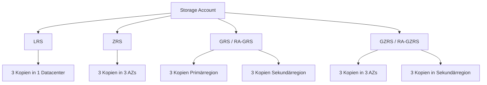

---
tags:
  - azure
  - storage
  - storage-account
  - redundanz
  - sicherheit
  - grundlagen
aliases:
  - Azure Storage Account
  - Storage Grundlagen Azure
---

# Azure Storage Grundlagen

> [!ABSTRACT]
> Azure Storage ist die skalierbare, hochverfügbare und sichere Cloud-Speicherplattform von Microsoft. Sie bietet Blob-Speicher, Datei-Shares, Queues, Tabellen und Disk-Speicher in einem einheitlichen Dienst mit globaler Redundanz und Enterprise-Sicherheitsfunktionen.

---

## Storage Account Typen

| Typ | Dienste | Performance | Redundanz | Anwendungsfall |
|-----|---------|-------------|-----------|----------------|
| **General Purpose v2 (GPv2)** | Blob, Files, Queue, Table | Standard + Premium (via Tiers) | LRS, ZRS, GRS, GZRS, RA-GRS, RA-GZRS | Standard-Wahl für die meisten Szenarien |
| **Premium Block Blob** | Nur Block Blobs + Append Blobs | Premium SSD | LRS, ZRS | Niedrige Latenz, hohe Transaktionsrate (Logs, IoT) |
| **Premium File Share** | Nur Azure Files | Premium SSD | LRS, ZRS | Hochperformante SMB/NFS File Shares |
| **Premium Page Blob** | Nur Page Blobs | Premium SSD | LRS | Nicht-verwaltete VM-Disks, VHDs |

> [!NOTE]
> GPv2 ist der empfohlene Typ für neue Deployments. GPv1 und Blob Storage Accounts gelten als Legacy.

---

## Redundanz-Optionen

| Option | Kopien | Standorte | Failover | RPO | SLA Lesen | SLA Schreiben | Anwendungsfall |
|--------|--------|-----------|----------|-----|-----------|---------------|----------------|
| **LRS** (Locally Redundant) | 3 | 1 Datacenter | Nein | — | 99,9 % | 99,9 % | Dev/Test, unkritische Daten |
| **ZRS** (Zone Redundant) | 3 | 3 AZs in 1 Region | Nein | — | 99,9 % | 99,9 % | Produktion, HA in Region |
| **GRS** (Geo Redundant) | 6 | 2 Regionen | Manuell | < 15 Min | 99,9 % | 99,9 % | Disaster Recovery |
| **GZRS** (Geo + Zone) | 6 | 3 AZs + 2. Region | Manuell | < 15 Min | 99,9 % | 99,9 % | Maximale Ausfallsicherheit |
| **RA-GRS** (Read-Access Geo) | 6 | 2 Regionen | Manuell | < 15 Min | 99,99 % | 99,9 % | Lesezugriff auf Sekundär-Region |
| **RA-GZRS** (Read-Access Geo + Zone) | 6 | 3 AZs + 2. Region | Manuell | < 15 Min | 99,99 % | 99,9 % | Höchste Verfügbarkeit |

> [!IMPORTANT]
> Bei GRS/GZRS ist die Sekundärregion von Microsoft festgelegt (z. B. West Europe → North Europe). Bei RA-GRS/RA-GZRS kann die Sekundärregion lesend über den `-secondary` Endpoint abgerufen werden.

### Redundanz-Architektur



---

## Access Tiers

| Tier | Speicherkosten | Zugriffskosten | Min Speicherdauer | Zugriffszeit | Anwendungsfall |
|------|---------------|----------------|-------------------|--------------|----------------|
| **Hot** | Hoch | Niedrig | Keine | ms | Aktiv genutzte Daten |
| **Cool** | Mittel | Mittel | 30 Tage | ms | Infrequent Access (Backups, Logs) |
| **Cold** | Niedrig | Höher | 90 Tage | ms | Selten abgerufene Daten |
| **Archive** | Sehr niedrig | Sehr hoch | 180 Tage | Stunden (Rehydration) | Langzeitarchivierung, Compliance |

> [!WARNING]
> Blobs im Archive-Tier müssen erst **rehydriert** werden (Standard: bis zu 15 Stunden, High Priority: bis zu 1 Stunde) bevor sie gelesen werden können. Frühzeitiges Löschen innerhalb der Mindest-Speicherdauer wird anteilig berechnet.

---

## Storage Limits

| Parameter | Grenzwert |
|-----------|-----------|
| Maximale Kapazität pro Account | 5 PiB |
| Maximale Anfrage-Rate | 20.000 Requests/Sekunde |
| Maximale Ingress (in Region) | 10 Gbps |
| Maximale Egress (aus Region) | 50 Gbps |
| Maximale Anzahl Container/Shares | Unbegrenzt |
| Maximale Blob-Größe (Block Blob) | 190,7 TiB |

---

## Sicherheit

### Netzwerk-Zugriffskontrolle

| Methode | Beschreibung | Anwendungsfall |
|---------|-------------|----------------|
| **Storage Firewall** | IP-Regeln und VNET-Regeln im Azure Portal | Zugriff auf bekannte IPs/Netze beschränken |
| **VNet Service Endpoints** | Direktroute vom VNet zum Storage | Kein öffentlicher Internet-Traffic |
| **Private Endpoints** | Privater IP im VNet, kein öffentlicher Endpunkt | Maximale Netzwerksicherheit |

> [!TIP]
> Private Endpoints sind die empfohlene Methode für Produktionsworkloads. Sie benötigen DNS-Konfiguration (Private DNS Zone `privatelink.blob.core.windows.net`).

### SAS Token Typen

| Typ | Scope | Signiert mit | Empfehlung |
|-----|-------|-------------|------------|
| **Account SAS** | Gesamter Account | Account Key | Vermeiden — zu breite Rechte |
| **Service SAS** | Bestimmter Dienst/Container/Blob | Account Key | Nur wenn User Delegation nicht möglich |
| **User Delegation SAS** | Blob Service | Entra ID (Managed Identity) | Empfohlen — kein Account Key nötig |

```powershell
# User Delegation SAS erstellen (empfohlen)
$ctx = New-AzStorageContext -StorageAccountName "myaccount" -UseConnectedAccount
$startTime = (Get-Date).AddMinutes(-5)
$endTime = (Get-Date).AddHours(2)

$sas = New-AzStorageBlobSASToken `
    -Container "mycontainer" `
    -Blob "myfile.txt" `
    -Permission "r" `
    -StartTime $startTime `
    -ExpiryTime $endTime `
    -Context $ctx `
    -UseConnectedAccount
```

### Managed Identity Zugriff

```powershell
# Storage Blob Data Contributor an Managed Identity vergeben
$principalId = (Get-AzUserAssignedIdentity -ResourceGroupName "rg" -Name "my-identity").PrincipalId
$storageId = (Get-AzStorageAccount -ResourceGroupName "rg" -Name "myaccount").Id

New-AzRoleAssignment `
    -ObjectId $principalId `
    -RoleDefinitionName "Storage Blob Data Contributor" `
    -Scope $storageId
```

---

## Datenverschlüsselung

| Methode | Schlüssel-Verwaltung | Beschreibung | Compliance |
|---------|---------------------|-------------|------------|
| **SSE-PMK** (Platform Managed Key) | Microsoft | Standard, automatisch | Basis |
| **SSE-CMK** (Customer Managed Key) | Azure Key Vault (Kunde) | Eigene Schlüssel, Key Rotation | HIPAA, ISO, PCI |
| **Infrastructure Encryption** | Doppelte Verschlüsselung | AES-256 auf Hardware + Software | Sehr hohe Compliance-Anforderungen |

> [!NOTE]
> CMK erfordert einen Azure Key Vault mit aktiviertem Soft Delete und Purge Protection. Der Key Vault muss in der gleichen Region liegen oder Region-übergreifend erreichbar sein.

---

## Dienste-Vergleich

| Dienst | Namespace | Protokoll | Zugriff | Max Größe | Anwendungsfall |
|--------|-----------|-----------|---------|-----------|----------------|
| **Blob Storage** | Flach (Container/Blob) | REST/HTTP | Anonym möglich | 190 TiB/Blob | Objekte, Backups, Medien |
| **Azure Files** | Hierarchisch | SMB 3.x / NFS 4.1 | AD-Auth / Entra | 100 TiB/Share | File Shares, Lift&Shift |
| **Queue Storage** | Flach | REST/HTTP | Managed Identity | 64 KiB/Message | Async Messaging |
| **Table Storage** | Flach (Partition/Row) | REST/HTTP | Managed Identity | 252 Eigenschaften/Entity | NoSQL, Metadaten |
| **Data Lake Gen2** | Hierarchisch (HNS) | REST/DFS/ABFS | POSIX-ACLs + RBAC | 5 PiB | Big Data, Analytics |

---

## AzCopy — Beispiele

```bash
# Login mit Entra ID
azcopy login

# Einzelne Datei hochladen
azcopy copy "/lokaler/pfad/datei.txt" \
    "https://myaccount.blob.core.windows.net/mycontainer/datei.txt"

# Verzeichnis rekursiv hochladen
azcopy copy "/lokaler/ordner/" \
    "https://myaccount.blob.core.windows.net/mycontainer/" \
    --recursive

# Datei herunterladen
azcopy copy \
    "https://myaccount.blob.core.windows.net/mycontainer/datei.txt" \
    "/lokaler/pfad/datei.txt"

# Zwischen zwei Storage Accounts kopieren (server-side copy)
azcopy copy \
    "https://source.blob.core.windows.net/container/" \
    "https://dest.blob.core.windows.net/container/" \
    --recursive

# Synchronisieren (nur neue/geänderte Dateien)
azcopy sync "/lokaler/ordner/" \
    "https://myaccount.blob.core.windows.net/mycontainer/" \
    --recursive
```

---

## Lifecycle Management

Automatisiertes Verschieben und Löschen von Blobs anhand von Regeln:

```json
{
  "rules": [
    {
      "name": "moveToCool",
      "enabled": true,
      "type": "Lifecycle",
      "definition": {
        "filters": {
          "blobTypes": ["blockBlob"],
          "prefixMatch": ["logs/"]
        },
        "actions": {
          "baseBlob": {
            "tierToCool": { "daysAfterModificationGreaterThan": 30 },
            "tierToArchive": { "daysAfterModificationGreaterThan": 90 },
            "delete": { "daysAfterModificationGreaterThan": 365 }
          },
          "snapshot": {
            "delete": { "daysAfterCreationGreaterThan": 90 }
          }
        }
      }
    }
  ]
}
```

> [!TIP]
> Lifecycle-Richtlinien werden einmal täglich ausgewertet. Die Änderung des Tiers ist kostenpflichtig — Archive-Rehydration kann teuer werden. Plane die Regeln sorgfältig.

---

## Soft Delete

Schutz gegen versehentliches Löschen von Blobs und File Shares:

| Feature | Scope | Aufbewahrungsdauer | Wiederherstellung |
|---------|-------|-------------------|-------------------|
| **Blob Soft Delete** | Blobs und Snapshots | 1–365 Tage | Portal, SDK, REST API |
| **Container Soft Delete** | Container und Inhalt | 1–365 Tage | Portal, SDK, REST API |
| **File Share Soft Delete** | Azure Files Shares | 1–365 Tage | Portal, PowerShell |

```powershell
# Blob Soft Delete aktivieren (7 Tage)
$ctx = New-AzStorageContext -StorageAccountName "myaccount" -UseConnectedAccount
Enable-AzStorageDeleteRetentionPolicy -RetentionDays 7 -Context $ctx

# Gelöschte Blobs anzeigen
Get-AzStorageBlob -Container "mycontainer" -Context $ctx -IncludeDeleted

# Blob wiederherstellen
Restore-AzStorageBlob -Container "mycontainer" -Blob "datei.txt" -Context $ctx
```

---

## Point-in-Time Restore

Container auf einen früheren Zeitpunkt zurücksetzen (nur Block Blobs, GPv2):

**Voraussetzungen:**
- Blob Soft Delete aktiviert
- Blob Versioning aktiviert
- Change Feed aktiviert

```powershell
# Point-in-Time Restore aktivieren (max 30 Tage)
Enable-AzStorageBlobRestorePolicy `
    -ResourceGroupName "myRG" `
    -StorageAccountName "myaccount" `
    -RestoreDays 30

# Restore auf Zeitpunkt ausführen
$restoreTime = (Get-Date).AddHours(-6)
Invoke-AzStorageBlobRestore `
    -ResourceGroupName "myRG" `
    -StorageAccountName "myaccount" `
    -TimeToRestore $restoreTime `
    -BlobRestoreRange @{StartRange="container1/"; EndRange="container2/"}
```

> [!WARNING]
> Point-in-Time Restore stellt **alle** Blobs im angegebenen Range zurück. Neuere Änderungen nach dem Restore-Zeitpunkt gehen verloren. Nicht verfügbar für Premium Block Blob Accounts.

---

## Storage Explorer

Azure Storage Explorer ist ein kostenloses GUI-Tool für den Zugriff auf alle Storage-Dienste:

- **Download:** `storageexplorer.com`
- Unterstützt: Blob, Files, Queues, Tables, Cosmos DB, Data Lake
- Authentifizierung: Entra ID, Account Key, SAS Token, Connection String
- Features: Drag & Drop Upload, Snapshot-Verwaltung, Access Policy Editor
- Verfügbar für: Windows, macOS, Linux

> [!TIP]
> Storage Explorer kann auch direkt im Azure Portal geöffnet werden (integrier­te Web-Version).

---

## Verwandte Notizen

- [[Azure Blob Storage]]
- [[Azure Files]]
- [[Azure Queue Storage]]
- [[Azure Data Lake Storage Gen2]]
- [[Azure Managed Disks]]
- [[Azure NetApp Files]]
- [[Azure RBAC]]
