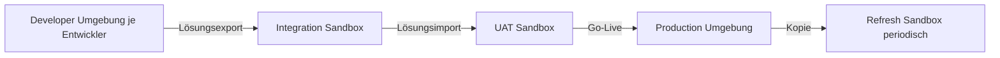
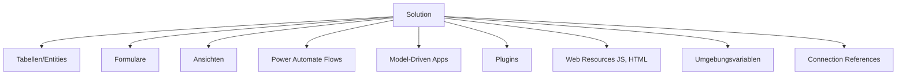
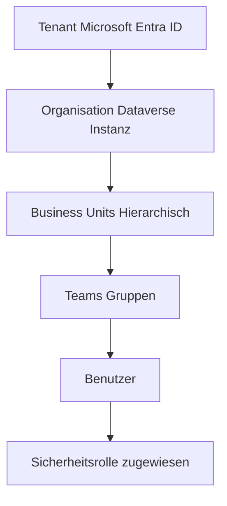
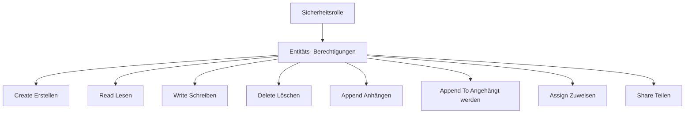
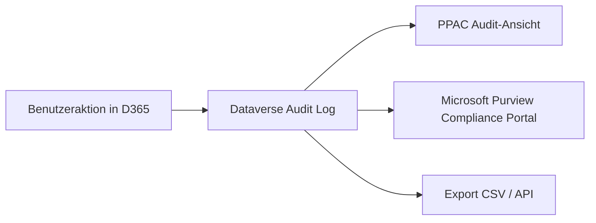
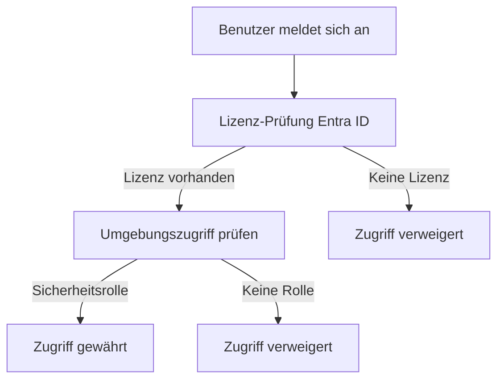

---
tags:
  - dynamics365
  - administration
  - power-platform
  - dataverse
  - alm
  - sicherheit
  - governance
  - dlp
aliases:
  - D365 Admin
  - Dynamics 365 Administration
  - Power Platform Admin
  - D365 Governance
---

# Dynamics 365 Administration

> [!ABSTRACT] TL;DR
> Die Administration von Dynamics 365 erfolgt hauptsächlich über das **Power Platform Admin Center**. Kernthemen sind Umgebungsverwaltung, DLP-Policies, Dataverse-Sicherheitskonzept, ALM-Pipelines mit Azure DevOps sowie Monitoring über Audit Logs und Application Insights.

---

## Power Platform Admin Center

Das Power Platform Admin Center (PPAC) unter [admin.powerplatform.microsoft.com](https://admin.powerplatform.microsoft.com) ist die zentrale Verwaltungsoberfläche.

### Hauptbereiche

| Bereich | Beschreibung |
|---------|-------------|
| **Environments** | Umgebungen verwalten, erstellen, löschen |
| **Analytics** | Nutzungsstatistiken, Kapazität |
| **Resources** | Kapazitätsverwaltung (Storage, APIs) |
| **Policies** | DLP-Richtlinien, Governance |
| **Settings** | Tenant-weite Einstellungen |
| **Help + Support** | Supportanfragen, Service Health |
| **Billing** | Lizenz- und Verbrauchsübersicht |

---

## Umgebungsverwaltung (Environments)

### Umgebungstypen

| Typ | Zweck | Lizenz | Eigenschaften |
|-----|-------|--------|---------------|
| **Production** | Livebetrieb | D365/PP Lizenz | SLA, volle Kapazität |
| **Sandbox** | Test/UAT | D365/PP Lizenz | Reset möglich, keine SLA |
| **Developer** | Einzelentwickler | Kostenlos | 1 User, keine SLA |
| **Trial** | 30-Tage-Test | Kostenlos | Automatisch gelöscht |
| **Default** | Tenant-Standard | Inkludiert | Alle User haben Zugriff |

### Umgebungs-Strategie

**Empfohlene Struktur:**



**Empfohlene Mindeststruktur:**
- 1 Production Environment
- 1 UAT/Staging Sandbox
- 1 Developer Environment pro Entwickler
- Optional: Integration Sandbox für CI/CD-Tests

### Umgebung erstellen (PowerShell)

```powershell
# Power Platform Admin PowerShell
Install-Module -Name Microsoft.PowerApps.Administration.PowerShell

# Anmelden
Add-PowerAppsAccount

# Neue Umgebung erstellen
New-AdminPowerAppEnvironment `
  -DisplayName "D365 UAT - Vertrieb" `
  -Location "europe" `
  -EnvironmentSku Sandbox `
  -ProvisionDatabase `
  -CurrencyName "EUR" `
  -LanguageName "1031"  # 1031 = Deutsch

# Umgebungen auflisten
Get-AdminPowerAppEnvironment | 
  Select-Object DisplayName, EnvironmentType, CreatedTime |
  Format-Table
```

---

## Kapazitätsverwaltung

### Kapazitätstypen

| Typ | Beschreibung | Basis-Inkludiert |
|-----|-------------|-----------------|
| **Dataverse Database** | Datenbank-Speicher | 10 GB + 4 GB/User |
| **Dataverse File** | Dateianhänge | 20 GB + 2 GB/User |
| **Dataverse Log** | Audit-Protokolle | 2 GB |
| **Power Platform Requests** | API-Calls/Tag | Nach Lizenz |

> [!WARNING] Kapazitäts-Überschreitung
> Bei Überschreitung der Kapazitätsgrenzen können Umgebungen in den Reduced-Functionality-Mode wechseln. Regelmäßige Überwachung im PPAC ist wichtig.

```powershell
# Kapazitätsverbrauch prüfen
Get-AdminPowerAppEnvironmentCapacity |
  Select-Object DisplayName, DatabaseUsedInMB, FileUsedInMB
```

---

## DLP-Policies (Data Loss Prevention)

DLP-Policies steuern, welche Connectors miteinander kommunizieren dürfen.

### Connector-Klassifizierung

| Klassifizierung | Beschreibung |
|----------------|-------------|
| **Business** | Connectors für Geschäftsdaten (D365, SharePoint, Teams) |
| **Non-Business** | Nicht-Geschäfts-Connectors (Twitter, Dropbox) |
| **Blocked** | Verboten — kann nicht genutzt werden |

**DLP-Grundregel:**
- Business-Connectors können miteinander kommunizieren
- Non-Business-Connectors können miteinander kommunizieren
- Business und Non-Business können NICHT kombiniert werden

### DLP-Policy Beispiel

```json
{
  "PolicyName": "Standard Business Policy",
  "Scope": "Alle Umgebungen außer Developer",
  "Business Connectors": [
    "Dataverse",
    "SharePoint",
    "Teams",
    "Outlook",
    "Dynamics 365",
    "Azure SQL"
  ],
  "Non-Business Connectors": [
    "Twitter",
    "Dropbox",
    "Google Drive"
  ],
  "Blocked Connectors": [
    "Slack",
    "WhatsApp"
  ]
}
```

```powershell
# DLP-Policies per PowerShell verwalten
Get-AdminDlpPolicy | Select-Object DisplayName, CreatedTime

# Policy-Details anzeigen
Get-AdminDlpPolicy -PolicyName "Standard Business Policy" |
  ConvertTo-Json -Depth 5
```

---

## Lösungen (Solutions) und ALM

### Managed vs. Unmanaged Solutions

| Aspekt | Managed | Unmanaged |
|--------|---------|-----------|
| **Zweck** | Deployment in Test/Prod | Entwicklung |
| **Editierbar** | Nein (außer Overrides) | Ja |
| **Deinstallierbar** | Ja (komplett) | Nein (nur einzelne Komponenten) |
| **Abhängigkeiten** | Klar definiert | Implizit |
| **Empfehlung** | Production, UAT | Development |

### Solution-Komponenten

Lösungen können folgende Komponenten enthalten:



### ALM-Pipeline mit Azure DevOps

```yaml
# azure-pipelines.yml - Dynamics 365 Solution CI/CD
trigger:
  branches:
    include:
      - main
      - develop

stages:
  - stage: Export
    displayName: 'Lösung aus Dev exportieren'
    jobs:
      - job: ExportSolution
        steps:
          - task: PowerPlatformToolInstaller@2
            inputs:
              DefaultVersion: true
          
          - task: PowerPlatformExportSolution@2
            inputs:
              authenticationType: PowerPlatformSPN
              PowerPlatformSPN: 'D365-Dev-ServicePrincipal'
              SolutionName: 'MeineCRMLösung'
              SolutionOutputFile: '$(Build.ArtifactStagingDirectory)/MeineCRMLösung.zip'
              Managed: false

  - stage: DeployUAT
    displayName: 'In UAT deployen'
    dependsOn: Export
    jobs:
      - job: ImportSolution
        steps:
          - task: PowerPlatformImportSolution@2
            inputs:
              authenticationType: PowerPlatformSPN
              PowerPlatformSPN: 'D365-UAT-ServicePrincipal'
              SolutionInputFile: '$(Pipeline.Workspace)/MeineCRMLösung.zip'
              AsyncOperation: true
```

**Umgebungsvariablen** für umgebungsspezifische Konfiguration:

```json
{
  "Name": "API_Endpoint",
  "Typ": "String",
  "Dev-Wert": "https://api-dev.company.com",
  "UAT-Wert": "https://api-uat.company.com",
  "Prod-Wert": "https://api.company.com"
}
```

---

## Dataverse-Sicherheitsmodell

### Hierarchie



### Business Units

Business Units strukturieren die Organisation hierarchisch und steuern den Datenzugriff:

| Ebene | Beispiel | Sichtbarkeit |
|-------|---------|-------------|
| **Root BU** | Contoso AG | Alles im Tenant |
| **BU Level 1** | DACH Region | Alle Untereinheiten |
| **BU Level 2** | Deutschland | Eigene + Untereinheiten |
| **BU Level 3** | München | Nur eigene BU |

### Teams

| Team-Typ | Beschreibung | Mitglieder |
|----------|-------------|-----------|
| **Owner Team** | Besitzt Datensätze | Benutzer |
| **Access Team** | Temporärer Zugriff | Benutzer |
| **Entra ID Group Team** | Synced mit Entra ID Gruppe | Entra ID Gruppe |

### Sicherheitsrollen

Sicherheitsrollen definieren, was ein Benutzer in Dataverse tun darf:



**Zugriffsebenen:**

| Ebene | Symbol | Beschreibung |
|-------|--------|-------------|
| **None** | — | Kein Zugriff |
| **User** | 🔵 | Nur eigene Datensätze |
| **Business Unit** | 🟢 | Eigene Business Unit |
| **Parent-Child BU** | 🟡 | BU und alle untergeordneten |
| **Organization** | 🔴 | Alle Datensätze im Tenant |

### Sicherheitsrolle per PowerShell

```powershell
# Sicherheitsrolle einem Benutzer zuweisen
$userId = "12345678-1234-1234-1234-123456789012"
$roleId = "87654321-4321-4321-4321-210987654321"

# Via Dataverse Web API
$headers = @{
    "Authorization" = "Bearer $token"
    "Content-Type" = "application/json"
    "OData-MaxVersion" = "4.0"
    "OData-Version" = "4.0"
}

$body = @{
    "@odata.id" = "$orgUrl/api/data/v9.2/roles($roleId)"
} | ConvertTo-Json

Invoke-RestMethod `
  -Uri "$orgUrl/api/data/v9.2/systemusers($userId)/systemuserroles_association/`$ref" `
  -Method POST `
  -Headers $headers `
  -Body $body
```

---

## Monitoring und Diagnose

### Audit Log (Überwachungsprotokoll)



**Auditierbare Aktionen:**
- Datensatz erstellen, aktualisieren, löschen
- Anmeldungen und Abmeldungen
- Rollenänderungen
- Lösungsimporte

**Audit aktivieren:**
```powershell
# Organisation-weites Audit aktivieren
Set-CrmOrganizationSetting -OrganizationService $orgService -Setting @{
    IsAuditEnabled = $true
    IsUserAccessAuditEnabled = $true
    IsReadAuditEnabled = $true
}
```

### Application Insights Integration

D365 Customer Service und Power Apps senden Telemetrie an Azure Application Insights:

```json
{
  "Integration": "Application Insights",
  "Konfiguration": {
    "Instrumentation Key": "xxx-xxx-xxx",
    "Telemetrie": [
      "Seitenaufrufe",
      "API-Calls",
      "Fehler und Ausnahmen",
      "Plugin-Performance",
      "Canvas App Fehler"
    ]
  }
}
```

**KQL-Abfragen für D365-Diagnose:**

```kql
// Häufigste Fehler der letzten 7 Tage
exceptions
| where timestamp > ago(7d)
| summarize count() by type, outerMessage
| order by count_ desc
| take 20

// Performance-Analyse von Plugins
customEvents
| where name == "PluginExecution"
| summarize avg(duration), max(duration), count() 
    by tostring(customDimensions["PluginType"])
| order by avg_duration desc
```

---

## Lizenz-Zuweisung und Verwaltung

### Lizenz-Zuweisung per PowerShell

```powershell
# Microsoft Graph PowerShell
Connect-MgGraph -Scopes "User.ReadWrite.All", "Directory.ReadWrite.All"

# Verfügbare Lizenzen anzeigen
Get-MgSubscribedSku | 
  Select-Object SkuPartNumber, ConsumedUnits, 
    @{N='Available';E={$_.PrepaidUnits.Enabled - $_.ConsumedUnits}}

# D365 Sales Enterprise zuweisen
$userId = "max.mustermann@contoso.com"
$skuId = (Get-MgSubscribedSku | 
  Where-Object SkuPartNumber -eq "DYN365_ENTERPRISE_SALES").SkuId

Set-MgUserLicense `
  -UserId $userId `
  -AddLicenses @{SkuId = $skuId} `
  -RemoveLicenses @()
```

### License Check im PPAC



---

## Umgebungsstrategien

### Mehrstufige Deployment-Strategie

| Umgebung | Zweck | Update-Frequenz | Zugriff |
|----------|-------|-----------------|---------|
| **Dev-01 bis Dev-N** | Feature-Entwicklung | Täglich | Entwickler |
| **Integration** | CI/CD-Tests | Bei jedem PR | CI/CD System |
| **UAT/QA** | User Acceptance Testing | Wöchentlich | Tester, Key User |
| **Staging** | Production-Mirror | Vor jedem Release | Senior Team |
| **Production** | Livebetrieb | 2x/Jahr (Wave) | Alle User |

> [!TIP] Production kopieren
> Regelmäßige Kopien der Production-Umgebung in eine Sandbox ermöglichen realistische Tests. Im PPAC: Environments → Production → Copy → Sandbox.

---

## Verwandte Notizen

- [[Dynamics 365 Überblick]]
- [[Dynamics 365 Sales]]
- [[Dynamics 365 Customer Service]]
- [[Dynamics 365 Business Central]]
- [[Dynamics 365 Finance]]
