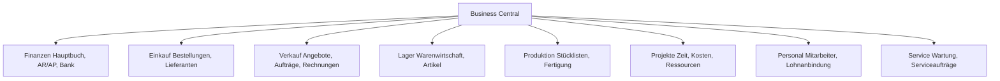

---
tags:
  - dynamics365
  - business-central
  - erp
  - kmu
  - smb
  - navision
  - al-entwicklung
  - copilot
aliases:
  - D365 BC
  - Business Central
  - Dynamics NAV Nachfolger
  - Navision
---

# Dynamics 365 Business Central

> [!ABSTRACT] TL;DR
> Dynamics 365 Business Central ist Microsofts Cloud-ERP für kleine und mittelständische Unternehmen (KMU). Als Nachfolger von Dynamics NAV/Navision bietet es Finanzen, Einkauf, Verkauf, Lager, Produktion und Projekte in einer Lösung. AL-Extensions, AppSource und tiefe Microsoft 365-Integration machen es zur flexiblen SMB-Plattform.

---

## Business Central als SMB-ERP

Business Central (BC) richtet sich an Unternehmen mit 5 bis ca. 500 Mitarbeitern und deckt alle wesentlichen Geschäftsprozesse ab.

### Abgedeckte Module



### Wichtigste Features nach Modul

**Finanzen:**
- Mehrstufige Genehmigungsworkflows
- Kostenrechnung und Profit Center
- Bankabstimmung mit KI (Copilot)
- Mehrwährung und Mehrsprachigkeit
- DATEV-Export, SKR03/SKR04

**Verkauf:**
- Angebots-/Auftragsbearbeitung
- Preislisten und Rabattgruppen
- Lieferpläne und Rahmenaufträge
- Versand und Fakturierung

**Einkauf:**
- Bestellanforderungen und Bestellungen
- Lieferantenpreislisten
- Drop Shipment (Direktlieferung)
- Eingangsrechnungsverarbeitung

**Lager:**
- Mehrstufige Lagerhaltung
- Chargen- und Seriennummernverfolgung
- Inventur und Zählung
- Lagerbewertungsmethoden (FIFO, LIFO, Durchschnitt)

**Produktion:**
- Stücklisten (BOM)
- Arbeitspläne und Maschinenkapazität
- Fertigungsaufträge
- Subunternehmer-Fertigung

**Projekte:**
- Projektaufgaben und Planungszeilen
- Zeit- und Kostenschreibung
- WIP (Work in Progress) Bewertung
- Projektabrechnung

---

## Cloud vs. On-Premises vs. Hybrid

| Aspekt | Cloud (SaaS) | On-Premises | Hybrid |
|--------|-------------|-------------|--------|
| **Hosting** | Microsoft Azure | Eigene Server | Gemischt |
| **Updates** | Automatisch (2x/Jahr) | Manuell | Abhängig |
| **Kosten** | Monatliche Abo-Gebühr | Einmallizenz + Wartung | Beides |
| **Anpassungen** | Extensions (AppSource/Custom) | Direkte Code-Änderungen | Beides |
| **Datenhaltung** | Microsoft-Rechenzentren | Eigene Server | Variabel |
| **Copilot** | ✅ Vollständig | ❌ Nicht verfügbar | Eingeschränkt |
| **Empfehlung** | Neuprojekte | Ältere Installationen | Migrationspfad |

> [!IMPORTANT] Microsoft-Strategie: Cloud-First
> Microsoft empfiehlt für alle Neuprojekte die Cloud-Variante. On-Premises-Installationen erhalten weiterhin Mainstreamsupport bis 2028 (BC 23), aber Innovationen kommen primär in die Cloud.

---

## Versionsentwicklung: Navision → Business Central

| Version | Name | Jahr | Besonderheiten |
|---------|------|------|----------------|
| **Navision Financials** | — | 1995-2001 | Ursprung |
| **Microsoft Business Solutions-Navision** | NAV 3.x | 2002-2005 | Microsoft-Übernahme |
| **Dynamics NAV** | NAV 4.0-2018 | 2006-2018 | C/AL Entwicklung |
| **Dynamics 365 Business Central** | BC 13 | 2018 | Cloud-Launch, AL/Extensions |
| **BC 14-22** | — | 2019-2023 | Schrittweise Cloud-Migration |
| **BC 23 (2023 W2)** | — | 2023 | Power Platform Integration |
| **BC 24 (2024 W1)** | — | 2024 | Copilot-Erweiterungen |
| **BC 25 (2024 W2)** | — | 2024 | AI-Features, Teams-Integration |

> [!NOTE] Release Waves
> Business Central erscheint zweimal jährlich: Wave 1 (April) und Wave 2 (Oktober). Kunden erhalten 30 Tage Vorabzugang zum Testen.

---

## AL-Entwicklung und Extensions

### Von C/AL zu AL

Der Wechsel von C/AL (Classic/C) zu AL (Application Language) ermöglichte das Extension-Modell:

| Aspekt | C/AL (alt) | AL (neu) |
|--------|-----------|---------|
| **Modell** | Direkter Code-Eingriff | Event-basierte Extensions |
| **Upgrade** | Customizations blockieren | Extensions upgraden automatisch |
| **Entwicklung** | Navision IDE | Visual Studio Code |
| **Deployment** | Server-seitig | Extension Package (.app) |
| **AppSource** | Nicht möglich | ISV-Publishing möglich |

### AL Extension Grundstruktur

```json
// app.json - Extension Manifest
{
  "id": "12345678-1234-1234-1234-123456789012",
  "name": "Meine BC Extension",
  "publisher": "Mein Unternehmen GmbH",
  "version": "1.0.0.0",
  "platform": "23.0.0.0",
  "application": "23.0.0.0",
  "target": "Cloud",
  "dependencies": []
}
```

```al
// Erweiterung einer bestehenden Seite
pageextension 50100 "Meine Kunden Erweiterung" extends "Customer Card"
{
    layout
    {
        addafter("Name")
        {
            field("Kundennummer Extern"; Rec."Externe Kundennummer")
            {
                ApplicationArea = All;
                Caption = 'Externe Kundennummer';
                ToolTip = 'Kundennummer im Fremdsystem';
            }
        }
    }
    
    actions
    {
        addafter("&Customer")
        {
            action("Sync mit Fremdsystem")
            {
                ApplicationArea = All;
                trigger OnAction()
                begin
                    // Synchronisierungslogik
                end;
            }
        }
    }
}
```

```al
// Neue Tabelle erstellen
table 50100 "Meine Custom Tabelle"
{
    DataClassification = CustomerContent;
    
    fields
    {
        field(1; "Code"; Code[20])
        {
            Caption = 'Code';
        }
        field(2; "Beschreibung"; Text[100])
        {
            Caption = 'Beschreibung';
        }
    }
    
    keys
    {
        key(PK; "Code") { Clustered = true; }
    }
}
```

### Events und Subscriber

```al
// Event Publisher (in Standard-Codeunit)
[IntegrationEvent(false, false)]
procedure OnBeforePostSalesInvoice(var SalesHeader: Record "Sales Header")
begin
end;

// Event Subscriber (in eigener Extension)
[EventSubscriber(ObjectType::Codeunit, Codeunit::"Sales-Post", 
    'OnBeforePostSalesInvoice', '', false, false)]
local procedure MyOnBeforePostSalesInvoice(var SalesHeader: Record "Sales Header")
begin
    // Eigene Logik vor dem Buchen der Rechnung
    ValidateCustomField(SalesHeader);
end;
```

---

## AppSource-Marketplace

AppSource ist der Microsoft-Marktplatz für Business Central Extensions.

### ISV-Kategorien

| Kategorie | Beispiele |
|-----------|---------|
| **Finanz-Erweiterungen** | DATEV-Schnittstellen, E-Invoicing |
| **Branchenlösungen** | Handwerk, Pharma, Automotive |
| **E-Commerce** | Shopify, WooCommerce, Amazon |
| **Dokumentenmanagement** | Easy DMS, d.3ecm |
| **Reportingtools** | Jet Reports, Zetadocs |
| **ERP-Erweiterungen** | Erweiterte Lagerverwaltung, Service-Management |

> [!TIP] Shopify-Integration (nativ)
> Business Central enthält seit BC 21 eine **native Shopify-Integration** ohne AppSource-Add-on. Bidirektionale Synchronisation von Artikeln, Beständen, Kunden und Bestellungen.

---

## Copilot in Business Central

### Marketing Text (Copilot)

Copilot erstellt automatisch Artikelbeschreibungen für Online-Shops:

```
Artikelnummer: FAHRR-MTB-001
Artikelname: Mountainbike Pro 29"

Copilot generiert:
"Das Mountainbike Pro 29" ist Ihr idealer Begleiter für 
anspruchsvolle Trails und Geländefahrten. Mit seinem 
robusten Aluminiumrahmen, der 29-Zoll-Bereifung und 
dem 21-Gang-Shimano-Schaltwerk meistern Sie jedes 
Gelände mit Leichtigkeit..."
```

### Bank Reconciliation AI

Copilot unterstützt bei der Bankabstimmung:
- Automatischer Vorschlag von Buchungszeilen zu Kontoauszügen
- Erkennt Zahlungsmuster und lernt dazu
- Erklärt Abstimmungsvorschläge verständlich

### E-Mail-Entwürfe

- Mahnungsschreiben automatisch verfassen
- Angebots-Begleitschreiben generieren
- Bestellbestätigungen mit Copilot formulieren

### Copilot Chat (2024 W2)

```
Buchhalter fragt Copilot in BC:
"Welche offenen Rechnungen von Contoso AG sind überfällig?"

Copilot: "Es gibt 3 überfällige Rechnungen von Contoso AG:
- RE-2024-0234: €4.500 (15 Tage überfällig)
- RE-2024-0267: €2.100 (8 Tage überfällig)  
- RE-2024-0289: €8.900 (3 Tage überfällig)
Gesamt: €15.500 | Soll ich eine Mahnung erstellen?"
```

---

## Preise und Lizenzierung

| Lizenz | Preis/User/Monat | Enthält |
|--------|-----------------|---------|
| **BC Essentials** | $70 | Finanzen, Vertrieb, Einkauf, Lager, Projekte |
| **BC Premium** | $100 | + Produktion, Service Management |
| **BC Team Members** | $8 | Lesezugriff, Zeiterfassung, einfache Eingaben |
| **BC Device** | $40 | Pro Gerät (Kiosk, geteilte Terminals) |

**Was ist in Essentials enthalten:**
- Finanzmanagement (GL, AR, AP)
- Verkaufs- und Einkaufsmanagement
- Grundlegende Lagerverwaltung
- Projekt-Management
- CRM (basic)
- Human Resources (basic)

**Was zusätzlich in Premium:**
- Produktionsplanung und -steuerung
- Service Management (Serviceaufträge, Garantien)

---

## Business Central und Microsoft 365

| Integration | Beschreibung |
|------------|-------------|
| **Outlook Add-in** | BC-Daten direkt in Outlook einsehen |
| **Teams** | BC-Karten in Teams-Chats teilen |
| **Excel** | Bi-direktionale Datenbearbeitung |
| **Word** | Bericht-Layouts mit Word-Vorlagen |
| **SharePoint** | Dokumentenanhänge in SharePoint |
| **Power BI** | Standard-Dashboards aus BC-Daten |
| **Power Automate** | Genehmigungsflows und Benachrichtigungen |

---

## Via Dynamics 365 Business Central (UI)

Business Central ist unter [businesscentral.dynamics.com](https://businesscentral.dynamics.com) erreichbar. Nach der Anmeldung gelangt man direkt auf das **Rollencenter**, das je nach Lizenz und Konfiguration unterschiedlich aussieht (z. B. Buchhalter, Verkaufsbearbeiter, Geschäftsführer).

### Debitor anlegen

**Navigation:** `Debitoren` → `+ Neu` **oder** Suche: `Debitoren`

1. Oben rechts das Suchfeld (Lupe-Symbol oder `Alt + Q`) öffnen → `Debitoren` eingeben
2. In der Debitorenliste **+ Neu** klicken → eine **Debitorenvorlage** auswählen (z. B. `Inland`)
3. Im Debitorenstamm die Felder befüllen:

| Feld | Wert (Beispiel) |
|------|----------------|
| **Nr.** | automatisch aus Nummernserie |
| **Name** | `Mustermann GmbH` |
| **Adresse** | `Musterstraße 1` |
| **PLZ / Ort** | `80331 München` |
| **Land** | `DE` |
| **Währungscode** | leer = Hauswährung EUR |
| **Zahlungsbedingungen** | `30T` (30 Tage netto) |
| **MwSt.-Geschäftsbuchungsgruppe** | `INLAND` |
| **Debitorenbuchungsgruppe** | `INLAND` |

4. Unter dem Tab **Zahlung** Bankverbindung und SEPA-Lastschriftmandat hinterlegen (optional)
5. **Speichern und schließen** (oben links zurück → BC speichert automatisch)

> [!TIP] Debitorenvorlagen für verschiedene Kundengruppen
> Lege separate Debitorenvorlagen für Inland, EU und Drittland an. Die Vorlage befüllt automatisch die korrekten Buchungsgruppen und MwSt.-Einstellungen, was Buchungsfehler bei der Rechnungsstellung verhindert.

---

### Verkaufsauftrag erstellen

**Navigation:** `Verkauf` → `Aufträge` → `+ Neu`

1. Im Rollencenter-Menü **Verkauf** → **Aufträge** öffnen (oder Suche: `Verkaufsaufträge`)
2. **+ Neu** klicken
3. Im Auftragskopf befüllen:

| Feld | Wert (Beispiel) |
|------|----------------|
| **Debitorennr.** | `KUND-0042` (Debitor suchen und auswählen) |
| **Auftragsdatum** | `automatisch (heute)` |
| **Gewünschtes Lieferdatum** | `14.02.2025` |
| **Ihre Referenz** | `AB 2025-047` (Kundennummer/Referenz) |

4. Im Tab **Zeilen** Artikel hinzufügen:
   - Spalte **Art**: `Artikel`
   - Spalte **Nr.**: Artikelnummer eingeben oder suchen
   - Spalte **Menge**: gewünschte Menge
   - **VK-Preis** wird automatisch aus Preisliste vorgeschlagen
   - Zeilenrabatt ggf. eintragen
5. Unter **Statistik** (Menü oben) Gesamtbetrag prüfen
6. **Freigeben** klicken → Auftrag ist für Lieferung und Fakturierung bereit
7. **Buchen** → wählen ob **Lieferung**, **Rechnung** oder **Lieferung und Rechnung**

---

### Einkaufsrechnung buchen

**Navigation:** `Einkauf` → `Rechnungen` → `+ Neu`

1. Im Menü **Einkauf** → **Rechnungen** öffnen (oder Suche: `Einkaufsrechnungen`)
2. **+ Neu** klicken
3. Rechnungskopf befüllen:

| Feld | Wert (Beispiel) |
|------|----------------|
| **Kreditorennr.** | `LIEF-007` |
| **Kreditorenrechnungsnr.** | `RE-2025-4711` (Rechnungsnummer des Lieferanten) |
| **Rechnungsdatum** | `31.01.2025` |
| **Fälligkeitsdatum** | automatisch aus Zahlungsbedingungen |

4. Im Tab **Zeilen** Rechnungspositionen erfassen:
   - **Art**: `Artikel`, `Sachkonto` oder `Ressource`
   - Für Artikel: Artikelnummer und Menge eingeben → Preis aus Bestellung vorschlagen lassen
   - Für Direktkosten: Sachkonto (z. B. `6300 Miete`) mit Betrag erfassen
5. Über **Bestellung** im Menü kann die Rechnung mit einer offenen Bestellung verknüpft werden (3-Wege-Match)
6. **Buchen** klicken → Rechnung wird gebucht, Verbindlichkeit entsteht, Lagerbestand aktualisiert sich (bei Artikeln)

> [!NOTE] Belegnummern-Vorschriften DACH
> In Deutschland, Österreich und der Schweiz muss die **Kreditorenrechnungsnummer** des Lieferanten eingetragen werden. BC verwendet diese für die GoBD-konforme Belegverknüpfung und als Duplikatsprüfung.

---

## Verwandte Notizen

- [[Dynamics 365 Überblick]]
- [[Dynamics 365 Finance]]
- [[Dynamics 365 Administration]]
